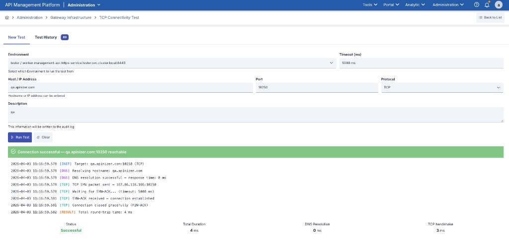
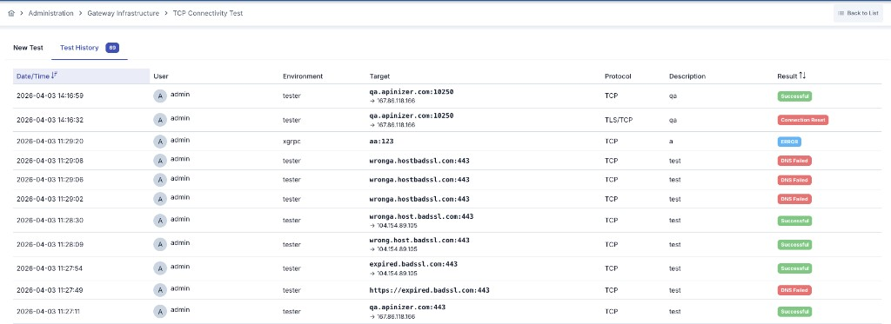

## Overview

The TCP Connectivity Test performs a connection attempt from the selected Gateway Runtime environment to a specified `host:port`, verifying network reachability. The test is executed directly on the Gateway Runtime pod, allowing you to observe real network constraints (firewall rules, DNS access, port availability) as they exist in that environment.

:::info

The environment from which the test is performed is selected in the **Environment** field. The connection is made from a pod belonging to the selected environment.

:::

## New Test

### Form Fields

| Field | Description |
|-------|-------------|
| **Environment** | The Gateway Runtime environment from which the test will be performed. |
| **Timeout** | Maximum wait time for the connection attempt (milliseconds). Default: 5000 ms. |
| **Host / IP Address** | The hostname or IP address of the target server. |
| **Port** | The target server's port number (1–65535). |
| **Protocol** | Connection protocol: **TCP** (plain connection) or **TLS/TCP** (encrypted connection). |
| **HTTP path** | Optional. When set, one GET request is sent on the same connection after the TCP/TLS stage. |
| **Run on all nodes** | Runs the same test from every gateway node of the selected environment. |
| **Description** | A short note describing the purpose of the test. Saved to the audit log. |

:::warning

The **TLS/TCP** protocol performs a real TLS handshake. A target whose certificate is not trusted used to appear as successful. It now ends with "cut at the TLS stage".

:::

### HTTP Path

The HTTP stage runs only when you enter an **HTTP path**.

- The test sends one GET request on the same connection.
- The request has no custom header and no body.
- The test does not follow redirects.
- The test adds `/` at the start if the path has none.
- The test rejects a path that contains a space or a control character.

The result shows the status line, the response headers and a body excerpt of at most 2 KB. The values of `Set-Cookie` headers are masked as `***`. The test skips 1xx interim responses.

### Run on All Nodes

Turn on **Run on all nodes** to run the test from every gateway node of the selected environment. Each node shows its own result card. Use this to find a firewall rule that is missing for only one node.

### Test Duration

The whole test takes at most 50 seconds, all stages together.

### Running the Test

Fill in the form fields and click the **Run Test** button. The test cannot be started without selecting an environment, entering a host/port, or providing a description.

## Test Result

When the test completes, a result panel appears showing the connection status, a step-by-step log stream, and summary metrics.

### Stages

The test runs these stages in order.

| Stage | When it runs |
|-------|--------------|
| **DNS** | Always. |
| **TCP** | Always. |
| **TLS** | Only when the protocol is **TLS/TCP**. |
| **HTTP** | Only when you enter an **HTTP path**. |

Each stage shows its state and its duration. The state is **Passed**, **Failed** or **Not run**. A stage is **Not run** when an earlier stage failed, or when the stage does not apply to the test.

When a stage fails, the result shows the title "cut at the *stage* stage". The **Diagnosis** text under it explains the probable cause and the next step.

### Connection Statuses

| Status | Description |
|--------|-------------|
| **Successful** | All stages passed. |
| **Timeout** | The connection received no response. Typically indicates the firewall is silently dropping packets. |
| **Refused** | The target answered with a reset. The port is not open, or a firewall rejects the connection. |
| **Unreachable** | An ICMP unreachable came back. A firewall REJECT rule or a missing route blocks the target. |
| **Connection reset** | The connection was reset or closed by the remote side. |
| **TLS failed** | The TLS handshake failed. |
| **DNS failed** | The hostname could not be resolved to an IP address. |
| **Error** | The test could not be completed, for example because the HTTP path is not valid. |

### TLS Details

For a **TLS/TCP** test, the result shows these fields.

| Field | Description |
|-------|-------------|
| **Protocol** and **Cipher** | The negotiated TLS protocol and cipher. |
| **Trusted** | Whether the certificate chain is trusted. |
| **Host name matches** | Whether the certificate matches the host name. |
| **Subject**, **Issuer**, **Valid until** | Details of the certificate chain. The subject alternative names (SAN) are also shown. |

The test uses the same trust store as the gateway traffic. A certificate that the gateway trusts is trusted here.

A host name mismatch cuts the test only when **Enable Hostname Verification For Secure Connections** is on in [General Settings](/en/admin/system-settings/global-configuration). When the setting is off, the result shows a yellow warning and the test continues. Calls to this address fail if you turn the setting on later.

### HTTP Response Details

When the HTTP stage runs, the result shows the status line, the response headers and the **Body excerpt** (first 2 KB).

### Recognised Devices

The result lists the devices that the test recognises from the response or from the certificate. Each device has one of three labels.

| Label | Description |
|-------|-------------|
| **Produced the response** | A device on the path blocked the request and produced this response, for example a WAF block page. Some pages carry a reference ID, for example the F5 ASM Support ID. Give this reference to the network team. They find the blocked request in the device log. |
| **Generated the error page** | A reverse proxy or load balancer produced the error page (nginx, HAProxy, Envoy, Squid). This is often the application's own proxy, not a security device. |
| **On the path** | A cookie or a `Server` header shows the device. The response can still come from the backend. |

The test recognises these products from the response: F5 BIG-IP (ASM, LTM, APM), Imperva (Incapsula, SecureSphere), Fortinet (FortiWeb, FortiGate), Citrix NetScaler AppFirewall, Akamai, Cloudflare, AWS ELB / AWS WAF, ModSecurity, Barracuda WAF, Palo Alto Networks, Radware AppWall, Sophos UTM Web Protection, Istio / Envoy, HAProxy, nginx and Squid.

The test also recognises two cases from the certificate:

- **Ingress default certificate**: the target presents the default certificate of ingress-nginx or Traefik. The request reached an ingress that has no certificate for this host.
- **SSL inspection**: the certificate is not trusted, and a security vendor's CA signed it. A device on the path replaces the backend certificate with its own.

### Step-by-Step Log

The **Step log** lists each step of the test with its stage name: `INIT`, `DNS`, `TCP`, `TLS`, `HTTP` and `RESULT`.

### Summary Metrics

| Metric | Description |
|--------|-------------|
| **Status** | Successful / Failed |
| **Total Duration** | Total elapsed time from start to finish (ms) |
| **DNS Resolution** | Time taken to resolve the hostname to an IP (ms). Displays "Failed" if DNS resolution fails. |

:::info

If DNS resolution succeeds but the TCP connection cannot be established, the issue is at the network layer (firewall rule, closed port, etc.).

:::

## Response Analysis

Use the **Response Analysis** tab to analyse a response that a client already received.

1. Open the **Response Analysis** tab.
2. Paste the raw response that the client received: the status line, the headers and the body.
3. Click **Analyze**.

The same device matching runs on the pasted text. The analysis runs in your browser. The text is not sent to the server.

## Test History

The **Test History** tab provides access to all previously performed tests. Each record contains:

| Field | Description |
|-------|-------------|
| **Date/Time** | When the test was performed |
| **User** | The user who initiated the test |
| **Environment** | The Gateway Runtime environment used |
| **Target** | `host:port` and resolved IP address |
| **Protocol** | TCP or TLS/TCP |
| **Description** | The note entered during the test |
| **Result** | Successful / Timeout / Refused / Unreachable / Connection reset / TLS failed / DNS failed / Error |

Click the eye icon (**Show details**) on a row to open the result card of that old record.

:::info

For information on cleaning up history records, see the [TCP Connectivity Test History Collection Cleanup](/en/operations/database-growth-management/tcp-connectivity-test-history-collection-cleanup) page.

:::
