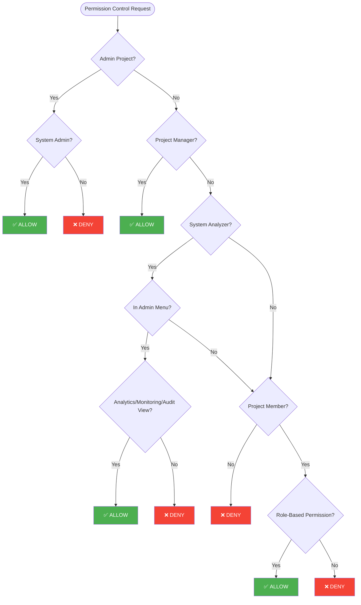

:::info

Please note the difference between roles and permissions. A role is a grouping of permissions and is managed from the [roles page](/en/admin/user-access-management/roles). For detailed role permission matrices, see the [Role Permission Details](/en/admin/user-access-management/role-permission-details) page.

:::

## Current Authorization Model

Apinizer's authorization system is based on the **asset category + action** model. Each asset category groups components with similar functions, and specific actions are defined for each category.

### Asset Categories

Apinizer has 17 different asset categories. Each category covers specific components and functions:

| Category | Covered Components | Supported Actions | Auto-Deploy |
|---|---|---|---|
| **API Management** | API Spec, API Proxy, API Proxy Group | View, Manage, Deploy/Undeploy, Export/Import | - |
| **API Creator** | DB2API, Script2API, Mock API | View, Manage, Export/Import | - |
| **API Integrator** | Task Flow, Scheduled Jobs | View, Manage | - |
| **Global Settings** | Variables, Policy Groups, Global Policies, Environment Variables | View, Manage, Export/Import | ✓ |
| **Connections** | All connection configurations, connectors | View, Manage, Export/Import | ✓ |
| **Identity & Access Control** | Consumers, Consumer Roles, ACL, Rate Limits, Identity Providers, IP Groups | View, Manage, Export/Import | ✓ |
| **Secrets & Certificates** | KeyStore, JWK, Certificates, Keys | View, Manage, Export/Import | ✓ |
| **Monitoring** | Uptime Monitor, Anomaly Detector, Custom Queries, Filters | View, Manage | - |
| **Analytics & Reports** | API Traffic Analytics, Custom Queries, Filters, Reports | View, Manage | - |
| **Audit & Application Logs** | Audit Logs, Application Logs | View | - |
| **Testing** | Test Console | View, Manage, Execute | - |
| **Promotion** | API Mapping, Execution Management | View, Manage | - |
| **Project Management** | Project Settings, Project Members | View, Manage, Export/Import | - |
| **AI Development** | LLM Providers, Model Catalog, RAG (Knowledge Bases), Vector DBs, LLM Gateway, AI Policies, Presets, AI Settings | View, Manage, Deploy/Undeploy, Export/Import | - |
| **AI Budgets** | AI Limit Plans, Quota Usage & Alerts | View, Manage, Export/Import | - |
| **AI Analytics** | AI Dashboard, Usage Reports, Trace, Provider Health, Analytics | View, Export/Import | - |
| **Data Lifecycle** | [Legal Holds and Data Lifecycle Purge](/en/admin/identity-management/legal-holds-and-purge) | View, Manage, Execute | - |

### Actions

Five different actions are defined for each asset category:

- **View**: Permission to view components
- **Manage**: Permission to create, edit, and delete components. In auto-deploy categories, Manage permission also includes automatic deployment of changes to workers
- **Deploy/Undeploy**: Permission to deploy and remove API Proxies, Proxy Groups and LLM Gateways to/from workers
- **Execute**: Permission to run test operations and approved Data Lifecycle purge runs
- **Export/Import**: Permission to export and import components

### Auto-Deploy Categories

Some asset categories have the **auto-deploy** feature. Users with MANAGE permission in these categories can automatically deploy their changes to workers. Categories with auto-deploy feature:

- **Global Settings**: Global policy settings and predefined values
- **Connections**: Connection configurations
- **Identity & Access Control**: Identity management components (Consumer, Certificate, Key, JWK)
- **Secrets & Certificates**: Secret information and encrypted values

### Asset Categories and Actions Relationship Table

The following table shows which actions each asset category supports. ✓ indicates supported actions, - indicates unsupported actions.

**Note**: 🔵 indicates auto-deploy categories. In these categories, Manage permission also includes automatic deployment of changes to workers.

| Asset Category | View | Manage | Deploy/Undeploy | Execute | Export/Import |
|---|---|---|---|---|---|
| **API Management** | ✓ | ✓ | ✓ | - | ✓ |
| **API Creator** | ✓ | ✓ | - | - | ✓ |
| **API Integrator** | ✓ | ✓ | - | - | - |
| **Global Settings** 🔵 | ✓ | ✓ | - | - | ✓ |
| **Connections** 🔵 | ✓ | ✓ | - | - | ✓ |
| **Identity & Access Control** 🔵 | ✓ | ✓ | - | - | ✓ |
| **Secrets & Certificates** 🔵 | ✓ | ✓ | - | - | ✓ |
| **Monitoring** | ✓ | ✓ | - | - | - |
| **Analytics & Reports** | ✓ | ✓ | - | - | - |
| **Audit & Application Logs** | ✓ | - | - | - | - |
| **Testing** | ✓ | ✓ | - | ✓ | - |
| **Promotion** | ✓ | ✓ | - | - | - |
| **Project Management** | ✓ | ✓ | - | - | ✓ |
| **AI Development** | ✓ | ✓ | ✓ | - | ✓ |
| **AI Budgets** | ✓ | ✓ | - | - | ✓ |
| **AI Analytics** | ✓ | - | - | - | ✓ |
| **Data Lifecycle** | ✓ | ✓ | - | ✓ | - |

## Permission Control Hierarchy

Permission control in Apinizer follows a specific hierarchy. System-level roles are higher than project-level roles.

### System-Level Roles

System-level roles are valid system-wide and are assigned by System Admin:

#### System Admin (sysAdmin)

- **Admin Project**: Can perform all operations (all categories, all actions)
- **Normal Projects**: 
  - Must be a project member and pass role-based permission control
  - Cannot perform operations if no permission (checked like a normal user)
  - Can perform operations if permission exists

#### Project Manager (sysProjectManager)

- **All Projects**: Project Owner level permissions
- Has all actions in all categories
- Project membership check is not performed (automatically passes)

#### System Analyzer (sysAnalyzer)

- **In Admin Menu**: View permission for Analytics & Reports, Monitoring, Audit & Application Logs categories (special case - no role required)
- **In Normal Projects**: Role-based permission control required (subject to same rules as normal users)

### Project-Level Roles

Project-level roles are assigned on a project basis and managed by the project owner. These roles provide authorization based on asset categories and actions.

#### Permission Control Process

1. **Project Membership Check**: User must be a member of the project
2. **Role-Based Permission Check**: User's roles in the project are checked
3. **Category + Action Check**: Permission is checked through each role's assetPermissions list by category and action

:::info

On analytics and report screens, the API Proxy and Proxy Group pickers reflect this same project scoping: a user without a system-level role sees only the API Proxies and Proxy Groups from projects they are a member of with **at least one permission** (any category — the pickers are shared by screens guarded by different categories, so no single category is required) — including when no project is explicitly selected. The "all projects" view available from the Admin menu returns an empty list for these users. Users with a system-level role (System Admin, Project Manager, System Analyzer, or a portal role) are unaffected.

:::

### Permission Control Flow

The following diagram shows how a permission control request is processed:

## Predefined Roles

Apinizer has eleven predefined roles for project-level access: seven API roles and four AI roles. The permissions below are the defaults created on a new installation:

| Role | Description | Main Permissions (Manage) |
|------|-------------|------------------|
| **Project Owner** | Role with all permissions in the project. Cannot be deleted. It is the only predefined role that carries **Data Lifecycle** (legal holds and data lifecycle purge) and **Promotion** permissions; these must be granted to other roles explicitly. | All actions in all categories |
| **API Developer** | Role that can manage API Proxies, deploy, and perform integration operations. | API Management (including Deploy/Undeploy), API Creator, API Integrator, Global Settings, Connections, Identity & Access Control, Secrets & Certificates, Monitoring, Analytics & Reports, Project Management |
| **API Manager** | Role that can manage APIs, perform analysis and monitoring. | API Management (including Deploy/Undeploy), Monitoring, Analytics & Reports, Project Management |
| **API Creator** | Role that can perform API creation operations such as DB to API, Script to API, Mock API. | API Creator, Project Management |
| **API Security** | Role that manages identity management, consumers, certificates, and connection security. | Identity & Access Control, Secrets & Certificates, Connections, Project Management |
| **API Analytics** | Role that can perform analysis and reporting operations. | Analytics & Reports, Project Management |
| **API Tester** | Role that can perform test operations. | Testing, Project Management |
| **AI Admin** | Role with full control over AI development, AI budgets and AI analytics. | AI Development (including Deploy/Undeploy), AI Budgets |
| **AI Developer** | Role that manages, moves and deploys AI assets. | AI Development (including Deploy/Undeploy) |
| **AI Analytics** | Role with read-only observation of AI development, AI budgets and AI analytics. | — (View only) |
| **AI Finance** | Role that only views AI budgets/cost and AI analytics. | — (View only) |

For detailed permission matrices, see the [Role Permission Details](/en/admin/user-access-management/role-permission-details) page.

## System-Level Roles

System-level roles are valid system-wide and are assigned by System Admin:

| Role | Description | Main Permissions |
|------|-------------|------------------|
| **System Admin** | System administrator - has full authority system-wide. | All operations in admin project, role-based control in normal projects |
| **Project Manager** | Has access to all projects and menus related to project management. | Project Owner level permissions in all projects |
| **System Analyzer** | Has access to analysis menus system-wide. | Analytics & Reports, Monitoring, Audit & Application Logs (View) in admin menu |
| **API Portal Manager** | Has full management authority in API Portal. | Portal settings, API products, account management |
| **API Portal Business User** | Has business process and viewing permissions in API Portal. | API product reviews, approval processes |
| **API Portal Developer User** | Has permission to view and use APIs as a portal developer user. | API product development, application management |
| **Promotion Manager** | Has permission to manage cross-environment promotion operations for APIs. | Promotion (Instances, Mappings, Executions) in the Administration and project menus |

:::note

The built-in **admin** account shipped with the installation now also comes with the Promotion Manager, API Portal Business User, and API Portal Developer User permissions; installations upgraded from a previous version have these three permissions added automatically. See the [Users](/en/admin/user-access-management/users) page for details.

:::
