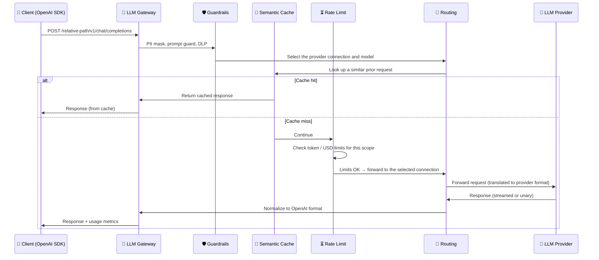

import {Card, CardGroup} from '@site/src/components/Card';
import {Steps, Step} from '@site/src/components/Steps';

## What Apinizer AI Gateway Gives You

<CardGroup cols={2}>
  <Card title="Single, OpenAI-Compatible Endpoint" icon="plug">
    Point any OpenAI SDK (or compatible client) at one `base_url` and reach every LLM provider you've connected — no per-provider integration code.
  </Card>
  <Card title="Multi-Provider Routing" icon="route">
    Route requests to OpenAI, Anthropic, Google Vertex/Gemini, AWS Bedrock, and OpenAI-compatible self-hosted engines from the same interface. Non-OpenAI responses are normalized back to the OpenAI format automatically.
  </Card>
  <Card title="Built-in Guardrails and Cost Controls" icon="shield">
    PII masking, prompt-injection guards, semantic caching, Limit Plans and token rate limits, and per-model cost tracking are available out of the box — no separate tooling to wire up.
  </Card>
  <Card title="Enterprise Visibility" icon="chart-bar">
    Usage and cost reports broken down by person, team, project, model, and deployment type (cloud vs. on-premise) give you a single source of truth for AI spend.
  </Card>
</CardGroup>

True streaming is supported end-to-end: responses are relayed to the client chunk-by-chunk as they arrive from the provider, with no artificial buffering.

:::note The Streaming setting and the client's stream field
Each LLM Gateway has its own **Streaming (SSE)** switch and a **Client "stream" field** setting on the **Routing** tab. See [Client "stream" Field](/en/ai-gateway/routing-and-failover#client-stream-field).

- **Use the client's value:** the `stream` value in the request body decides. `stream: true` is relayed via server-sent events as described above, and `stream: false` returns a single response. A request without a `stream` field follows the **Streaming (SSE)** switch. New LLM Gateways start with this option.
- **Overwrite with the proxy setting:** the switch decides for every request. When it is off, the gateway processes the request as a single, non-streaming response, even if the client sets `stream: true`. The gateway sets the field to `false` (and drops `stream_options`) before it forwards the request to the provider. This keeps token counts and cost accurate in the Traffic report regardless of what an individual client sends. LLM Gateways created earlier, with no stored value, work this way.

When the LLM Gateway has a policy that works only on a single response, the client cannot switch streaming on.

With streaming on, the response stream sent to the client appears in the **Traffic** record as the actual event stream instead of a placeholder, provided response body logging is enabled in the proxy's log settings (within the body size limit; once the limit is exceeded the record ends with a `<<Streaming Body Truncated>>` marker). The record is written once, as a single traffic entry, when the stream completes. Memory planning rule: every open stream holds at most the body limit in worker memory (concurrent streams × body limit); where long answers are common, keep the recorded body small with the connector's **Partial size** setting. See [Traffic Log Settings](/en/develop/api-proxy-configuration/api-traffic-log-settings) for details.
:::

:::info
New to LLM terms like tokens, embeddings, or RAG? See [AI Fundamentals](/en/concepts/core-concepts/ai-fundamentals) for a primer — this page focuses on what Apinizer AI Gateway does with them.
:::

## Supported LLM Providers

- **Cloud**: OpenAI, Anthropic (Claude), Azure OpenAI, Google Vertex AI (Gemini), AWS Bedrock, and many OpenAI-compatible cloud providers such as Mistral, DeepSeek, Groq and xAI
- **Self-hosted**: vLLM, Ollama
- **Custom**: any OpenAI-compatible API endpoint

Each provider is configured once as a **connection**, with encrypted credentials and a deployment type. See [LLM Providers and Models](/en/ai-gateway/llm-providers) for the full list and setup steps.

## Request Flow

Every request to the gateway flows through the same pipeline, whether it targets OpenAI or a self-hosted model:



1. **Intake** — the request is validated and parsed as OpenAI-format JSON
2. **Guardrails** *(optional)* — PII masking, prompt-injection checks, data-loss protection
3. **Routing** — a provider connection and model are selected based on the requested model and your routing/failover configuration
4. **Semantic cache** *(optional)* — a similar recent request short-circuits the call and returns a cached response
5. **Rate limiting** — the token and USD limits of the caller's [Limit Plans](/en/ai-gateway/limit-plans) and of the LLM Gateway's [Token Rate Limit policy](/en/ai-gateway/token-quotas) are checked
6. **Inference** — the request is translated to the provider's native format and forwarded
7. **Response** — the provider's response is normalized back to OpenAI format and streamed to the client along with usage metrics

The semantic cache lookup and the Token Rate Limit policy run after routing has decided the model. They use the model that the gateway will really call.

## Deployment Type

Every provider connection is tagged **Cloud**, **On-Premise** or **Other** (custom providers), so usage and cost reports can distinguish provider-hosted traffic from traffic served by infrastructure you run yourself. See [LLM Providers and Models](/en/ai-gateway/llm-providers#deployment-type) for details.

## LLM Gateway vs. Classic API Proxy

An LLM Gateway is **the same `ApiProxy` entity** in Apinizer — it goes through the same create/deploy/undeploy flow, the same environment management, the same proxy list, and the same endpoints as a classic API proxy. The difference is how the request is routed to the backend:

- **Classic API proxy** → the `routing` object (address list, circuit breaker, mTLS, proxy server, NTLM, etc.)
- **LLM Gateway** → the `aiRouting` object (LLM provider connection, model, primary pool, conditional routing, failover chain) — see [Routing and Failover](/en/ai-gateway/routing-and-failover)

The LLM Gateway runtime **never reads** the classic `routing` object, so settings tied to it don't apply to an LLM Gateway.

:::warning Behavior Change
The following 12 settings endpoints (`PATCH .../apiProxies/{apiProxyName}/settings/<X>/`) now return **HTTP 400** when called on an LLM Gateway (or an MCP or A2A Gateway). Previously they returned HTTP 200 but **had no effect at all** (a silent no-op) — that's now an explicit rejection:

`circuit-breaker` · `proxy-server` · `mtls` · `ntlm` · `connection` · `error-handling` · `custom-message` · `grpc` · `websocket` · `addresses` · `routing-status` · `metadata`

On an LLM Gateway, settings like mTLS, proxy server, and circuit breaker live under `aiRouting` instead — the correct endpoint is `PUT .../apiProxies/{apiProxyName}/ai-routing/`. The `metadata` endpoint's 400 check is conditional: it only triggers when the request body sets `fixSoapApiPortType` (a field meaningful only for classic routing) — a plain metadata update keeps working on an LLM Gateway.
:::

11 type-agnostic settings endpoints — CORS, cache, idempotency, XML/JSON error templates, forwarded-ip-header, spec-access-type, client-route, keys, maintenance mode, trace, and traffic log — continue to work on LLM Gateways unchanged.

See [API Reference: API Proxy Settings](/api-reference/api-proxies/settings) for full details.

## Try It: OpenAI SDK Quickstart

Use Apinizer AI Gateway with the Python OpenAI SDK or any compatible client — no client-side code changes beyond `base_url` and the API key. Get `base_url` from the **Endpoints** panel on the LLM Gateway's **Routing** tab (the address plus `/v1`):

```python
from openai import OpenAI

client = OpenAI(
    api_key="your-consumer-key",
    base_url="https://<gateway-access-url>/<relative-path>/v1"
)

response = client.chat.completions.create(
    model="gpt-4o",
    messages=[{"role": "user", "content": "Hello"}],
    stream=True
)

for chunk in response:
    print(chunk.choices[0].delta.content, end="")
```

:::note Request and response format
The client interface is always OpenAI-format — there is no separate Anthropic Messages or Gemini inbound format to learn. Apinizer translates each request into the target provider's native format and normalizes the response back to the OpenAI canonical format, so the same client code works against OpenAI, Anthropic, Google Vertex/Gemini, AWS Bedrock, or any OpenAI-compatible endpoint.
:::

For a full step-by-step walkthrough — connecting a provider and sending your first request — see the [AI Gateway Quickstart](/en/ai-gateway/quickstart).

## Model Discovery: GET /v1/models

The gateway serves an OpenAI-compatible model-listing endpoint at `GET /v1/models`, so `client.models.list()` in the OpenAI Python SDK — and OpenAI-compatible tooling built on it, such as LangChain and LiteLLM — can discover which models are available instead of having the model name hardcoded:

```python
models = client.models.list()
for model in models:
    print(model.id)
```

The response body:

```json
{
  "object": "list",
  "data": [
    { "id": "gpt-4o", "object": "model", "created": 0, "owned_by": "openai" },
    { "id": "claude-3-5-sonnet", "object": "model", "created": 0, "owned_by": "anthropic" }
  ]
}
```

:::info `created` is always `0`
Apinizer keeps no creation timestamp for a model — OpenAI SDKs parse the field but don't attach meaning to it. Extra model detail such as context window, pricing, and capabilities is **deliberately** left out of this response as well; the discovery endpoint isn't a surface for exposing that.
:::

### The List Is This Proxy's Serving Surface, Not the Provider's Model List

The response is not the LLM provider's full model list — it's the union of models this specific LLM Gateway's `aiRouting` configuration can actually serve (the primary model, plus any [primary pool](/en/ai-gateway/routing-and-failover#load-balancing-across-equal-priority-primaries), [conditional routing](/en/ai-gateway/routing-and-failover#conditional-routing), and [failover chain](/en/ai-gateway/routing-and-failover#failover-chains) entries). When the **Client "model" field** is set to use the client's model, the list also holds every model of the providers that can serve as primary, because the client may call any of them. Three elimination checks then run:

1. A candidate whose provider connection is **not deployed or disabled** is dropped.
2. A candidate whose model is switched off (the **Enabled** switch of the model in its provider) is dropped — a model that the gateway refuses with 403 isn't advertised here.
3. A model whose access list does not include the caller is dropped. Two callers can therefore get different lists from the same LLM Gateway.

An empty result is not an error: `{"object":"list","data":[]}` with HTTP 200 is a valid response when nothing survives the checks above.

This endpoint only **lists**; OpenAI's single-model retrieval endpoint (`GET /v1/models/{model_id}`, `client.models.retrieve(...)` in the SDK) is out of scope and does not match here.

### Authentication and the Normal Policy Chain Still Apply

Discovery is not a `.well-known`-style authentication-exempt path — the proxy's normal policy chain, including any auth policy and its **block anonymous requests** setting, runs on this request exactly as it does on any other, so an unauthenticated discovery call against a proxy with that setting on still gets a 401.

:::note No Upstream Call, No Metering
A discovery request never reaches an LLM provider, so no token or cost usage is recorded for it. The call still shows up in the Traffic report, but its usage and cost columns stay empty. The endpoint accepts `GET` only — any other method returns 405.
:::

## Search Fields of the LLM Gateway List

The filter bar of the **AI Gateway → LLM Gateway** list has three fields that appear only for LLM Gateways. Choose them under **Add filter**. They work alongside the proxy filters (name, description, path, category, environment, status). Filters apply when you click **Search** or press Enter in a text field:

- **AI model or LLM provider** — Free text. Matches the model identifier of the proxy's target, or the name or type of its LLM provider. Typing `openai` returns every proxy routed to an OpenAI-type provider; typing `gpt-4o` returns the proxies using that model.
- **Model type** — The modality recorded on the model in its LLM provider (Text (Chat), Vision, Audio, Embedding, Rerank, Multimodal, Image Generation). Lists the proxies that use a model of the selected type. The **Unspecified** option at the end of the list returns the proxies whose model has no type recorded at all — models added through the **Discover from provider** tab or the **Add manually** tab that have not been classified yet, and model identifiers that are not on the model list of any provider. It is evaluated per provider — a model id classified on one connection but blank on another counts as unspecified only for the second — and it also lists proxies whose LLM provider has been deleted or is outside your scope, since their model can no longer be classified. Those proxies appear under no other type value, so this option is how you find unclassified entries.
- **LLM Provider** — Chosen from the providers defined in your project or shared by an administrator.

The search scans **all of a proxy's routing targets**: the single primary target, the primary pool, conditional routing variants, and the provider failover chain. A proxy therefore appears in the results even when it uses the provider you searched for only in its failover chain.

:::note Combining the fields
Different fields combine with AND, and the matches must land on the **same routing target**. Selecting "Provider = OpenAI" together with "Model type = Image Generation" lists the proxies that run an image-generation model on an OpenAI provider; a proxy that uses OpenAI as its primary target but the image-generation model only in its failover chain (on another provider) is not listed. Pool and conditional-routing entries that leave the model field empty inherit the primary model, and that inherited pair is what the match is evaluated against.
:::

:::tip Classifying a model that shows as Unspecified
When a model is listed as **Unspecified**, open its provider under **AI Gateway → Models**, open the model in the **Models** section, and pick a value in the **Model Type** field (see [Models](/en/ai-gateway/llm-providers#models)). Apinizer never assigns a type automatically, because a wrong classification breaks model-type validation and cost calculation.
:::

Because the filter is applied in the database query, the page count and total record count reflect the narrowed result correctly. If the provider you selected has been deleted, or belongs to a project you cannot access, the search returns no results.

## Next Steps

<CardGroup cols={2}>
  <Card title="AI Gateway Quickstart" icon="rocket" href="/en/ai-gateway/quickstart">
    Connect a provider and send your first request
  </Card>
  <Card title="LLM Providers and Models" icon="plug" href="/en/ai-gateway/llm-providers">
    Configure provider connections, models, prices and deployment types
  </Card>
  <Card title="Routing and Failover" icon="route" href="/en/ai-gateway/routing-and-failover">
    Failover chains, cost- and latency-aware routing, and LLM classifier routing
  </Card>
  <Card title="Prompt Decorator" icon="list-plus" href="/en/ai-gateway/prompt-decorator">
    Inject fixed system instructions into every request
  </Card>
  <Card title="Prompt Templates" icon="braces" href="/en/ai-gateway/prompt-templates">
    Let clients reference a reusable, parameterized prompt by name
  </Card>
  <Card title="Token Rate Limit Policy" icon="gauge" href="/en/ai-gateway/token-quotas">
    Set up token limits and monitoring
  </Card>
  <Card title="AI Cost Settings" icon="dollar-sign" href="/en/ai-gateway/cost-settings">
    Configure pricing and multi-currency display
  </Card>
  <Card title="Reports and Analytics" icon="chart-bar" href="/en/ai-gateway/reports">
    View usage and cost breakdowns
  </Card>
  <Card title="A2A Gateway" icon="share-2" href="/en/ai-gateway/a2a-gateway">
    Configure inbound/outbound Agent2Agent communication
  </Card>
  <Card title="Advanced Guardrails" icon="shield" href="/en/ai-gateway/advanced-guardrails">
    Add DLP, loop, off-topic, and oversized guards
  </Card>
  <Card title="Multi-Modal Endpoints" icon="mic" href="/en/ai-gateway/multi-modal-endpoints">
    Use audio (STT/TTS) and image generation endpoints
  </Card>
  <Card title="Tracing and Replay" icon="history" href="/en/ai-gateway/tracing-and-replay">
    Inspect each step of a traced request and replay it
  </Card>
  <Card title="MCP Gateway" icon="plug" href="/en/ai-gateway/mcp-gateway">
    Govern MCP tool calls with risk tiers
  </Card>
  <Card title="Semantic Cache" icon="database" href="/en/ai-gateway/semantic-cache">
    Reuse answers to similar requests
  </Card>
  <Card title="RAG" icon="book-open" href="/en/ai-gateway/rag-injection">
    Add knowledge-base context to requests
  </Card>
  <Card title="Limit Plans" icon="gauge" href="/en/ai-gateway/limit-plans">
    Limit usage per caller
  </Card>
  <Card title="Access Control and Roles" icon="lock" href="/en/ai-gateway/access-control-rbac">
    Control who can use which model
  </Card>
  <Card title="AI Asset Inventory" icon="list" href="/en/ai-gateway/ai-asset-inventory">
    See which AI services are in use
  </Card>
  <Card title="OpenTelemetry" icon="activity" href="/en/ai-gateway/opentelemetry">
    Send AI traces to your observability stack
  </Card>
</CardGroup>
