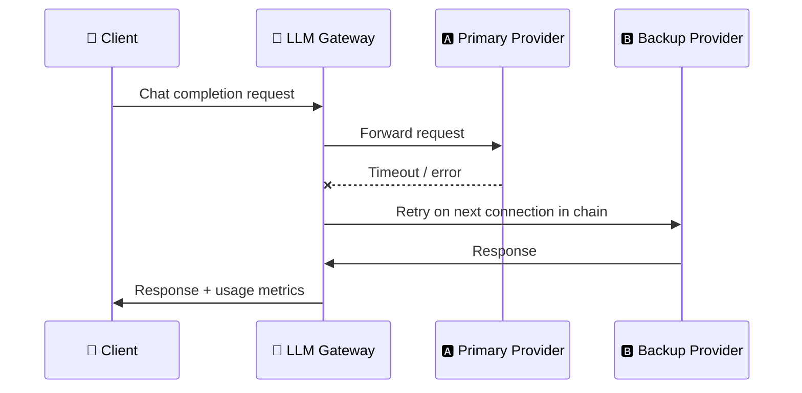

import {Card, CardGroup} from '@site/src/components/Card';

## How the AI Routing Screen Is Organized

The Routing tab lays out an LLM Gateway's configuration as a decision chain that mirrors the order a request is actually evaluated in. A summary band at the top of the screen — **Request → Conditional Gate → Target Selection → Failover → Provider** — is clickable: selecting a step scrolls the screen to the matching section and highlights which stage the current configuration is in.

Below the decision chain the tab carries two more groups of settings that apply to *every* request rather than to one branch of it: a **Client "model" field** card, and the **Connection & Delivery Settings** group. The group has a **Connection** card (timeouts and the connection pool), a **Streaming** card (the Streaming switch, the client "stream" field and the stream limits), and the SSL/mTLS, outbound proxy and anonymous access cards. See [Connection and Delivery Settings](#connection-and-delivery-settings). The Client "model" field card holds its two settings directly on the card — there is no **Configure** drawer to open, and each selection is saved the moment you make it. A user with read-only access on the proxy sees the two selected values as a summary instead of the option cards.

Wherever a step resolves to a specific provider and model — a conditional route, a load-balancing pool entry, the primary itself, or a failover chain entry — an expandable row shows the same **model metadata panel**: the provider's endpoint, deployment type, and live health status; the model's context window, max output tokens, and per-million-token pricing (input, output, cached); and a note when the model is switched off. This standard panel appears at every selection point, so you can check a model's limits and pricing without leaving the screen.

## How a Target Is Chosen

The gateway resolves the target for each request in **tiers**, stopping at the first one that yields a usable provider and model:

1. **Conditional routes** — evaluated in order; the first match wins.
2. **Default target group** — reached when no route matched: if a load-balancing pool is configured, its algorithm picks the active member; otherwise the single default provider and model is used. The AI Gateway list card follows the same rule: it shows the pool's first member when a pool is configured, otherwise the single default target.
3. **Failover chain (error path)** — reached when the default target group is empty or unusable: the first usable chain entry is *promoted to primary* for this request, and the rest of the chain stays behind it as failover.
4. **No suitable provider** — if no tier yields a target, the request is rejected with HTTP 503 and the message *"No suitable LLM provider found for this request"*.

This means **any one tier on its own is a complete configuration**. A gateway with nothing but conditional routes works; so does one with nothing but a pool, or nothing but a failover chain. You only need to define the default provider and model if you want a fallback for requests that match no route — or if your routes and pool entries deliberately leave fields blank to inherit from it.

:::note What counts as "unusable"
A candidate is skipped — and the next tier is tried — when its provider has been deleted or disabled, or when neither the entry nor the proxy-level default supplies a model. A matched conditional route whose target is unusable is skipped too, and evaluation continues with the next route.

What is **not** skipped: a model that is switched off on the provider, a model the calling consumer is not allowed to call, or a modality mismatch. Those return an error on the selected target rather than silently rerouting you somewhere else — they are configuration or authorization problems you need to see, not conditions to route around.
:::

:::warning Routing with no target
You can save the Routing tab with no target at all: no conditional route, no pool row, no failover row, and an empty default provider and model. The tab shows a warning. The proxy can be saved and deployed, but every request fails with HTTP 503 (`POLICY_ROUTING_AI_NO_SUITABLE_PROVIDER`) until you add a target. Deploy is not blocked.

A definition that fills a target field but produces no target is still rejected on save. For example, a provider is selected but the model is empty and there is no list entry.
:::

## Conditional Routing

A **Conditional Route** overrides the primary provider and model for requests that match a rule, a semantic pattern, or both — evaluated before the primary or the load-balancing pool. Routes are evaluated in order and the first match wins; if a matching route leaves its provider or model blank, it inherits the primary's. If no route matches, routing falls through to the load-balancing pool or the single primary as usual.

| Field | Description |
|---|---|
| **Route Name** | A label for the route, shown in the routing screen's summary table (for example, "Code questions → DeepSeek"). |
| **Condition** | A rule built from Apinizer's condition editor. Left empty, the route always matches on the rule side. |
| **Target type** | **Single target** (default) or **Target pool (load balancing)**. See [Target Pool Routes](#target-pool-routes). |
| **Target Provider · Model** | Shown for **Single target**. The provider connection and model this route sends matching requests to. Leave either blank to inherit the primary's value. |

### Target Pool Routes {#target-pool-routes}

Select **Target pool (load balancing)** as the **Target type** when the same model runs on several servers. The route then distributes the matching requests across its targets with its own algorithm. A single route needs no second proxy in front of the servers.

Example: the model `qwen3-8b` runs on the servers a1, a2 and a3.

1. Create a route with the rule `model = qwen3-8b`. Select **Target pool (load balancing)** and add one target for each server.
2. Create a second route with the rule `model = deepseek-r1`. Select **Target pool (load balancing)** and add its targets.

Each route has its own pool and its own balance state. Round Robin on one route does not affect another route.

| Field | Description |
|---|---|
| **Algorithm** | The same seven algorithms as the Default Target Group: Round Robin, Weighted, Least Latency, Random, LRU, Least Cost, and Prefix Affinity. See [Load Balancing Across Equal-Priority Primaries](#load-balancing-across-equal-priority-primaries). |
| **Affinity Key Header** and **Bounded Load Factor** | Shown for Prefix Affinity. Each route has its own values. Defaults: `session_id` and `1.25`. |
| **Display Name** | The name of the target in the route list and in the pool summary. |
| **LLM Provider** | Required for every target. |
| **Model ID** | Required for every target. A target does not inherit the model of the default target. |
| **Weight** | Shown for Weighted only. A higher weight receives more traffic. |

Click **Add Target** to add a row. Saving is rejected when a target has no provider or no model.

The route list and the route summary show **Target pool · algorithm · N targets** for a pool route. A route that was saved before this option existed opens as **Single target**. No migration is needed.

:::note When a pool target fails
Whether the other targets of the pool are tried is set by **Try the other pool targets** in the Error path settings. See [Try the Other Pool Targets](#try-the-other-pool-targets).
:::

### Semantic Matching

In addition to (or instead of) a rule, a route can match by **meaning**: define a list of example utterances that represent the route's intent, and Apinizer embeds the incoming prompt and compares it against them by cosine similarity.

- **Similarity Threshold** — the minimum cosine similarity an utterance must reach for the route to match. Default `0.75`.
- **Embedding Provider and Model** — configured once per proxy and shared by every route's utterance list; the inbound prompt is embedded **once per request**, not once per route.
- **Rule + Semantic Combined** — when a route defines both a condition and utterances, **both must match (AND)**: the rule is checked first, and semantic evaluation only runs once the rule has already passed.
- **No Route Matches** — if none of the conditional routes match, the request falls through to the load-balancing pool or the single primary; this is expected behavior, not an error.
- **No Embedding Provider Configured** — a route cannot carry utterances unless the proxy also has a semantic embedding provider selected. Saving is rejected with *"A conditional route uses semantic utterances, so the Routing tab must also have an embedding provider."* Earlier versions saved such a proxy successfully and then evaluated every semantic route on its rule alone, with no signal on screen. Once a provider *is* selected, request-time behavior is unchanged and deliberately fail-open: if the provider is unreachable, the route is treated as "not matched" and routing continues.

### Environment Variables in Routing Text

The utterances that drive semantic matching, and the header name the affinity strategies read their key from, both accept an [environment variable](/en/develop/environment-variables) reference in `${VARIABLE_NAME}` form, so one routing configuration can carry per-environment wording or header naming.

:::note
Utterance resolution happens once, when the route's embeddings are first built and cached — not per request. That is why only `${...}` environment variables are accepted here and `#{...}` context variables are not: a per-request value would be embedded on the first request and those same vectors would then be served to every later one.
:::

## Route Match Methods and the LLM Classifier

In the route dialog, **Match Method** has three options: **Rule-based**, **Semantic**, and **Classifier**. For **Semantic** and **Classifier**, the checkbox **Also require rule conditions (AND)** is shown. Select it to require the rule conditions in addition to the semantic or classifier match.

The route list shows one match type badge per route: `RULE`, `SEMANTIC`, `SEMANTIC + RULE`, `CLASSIFIER`, or `CLASSIFIER + RULE`.

:::note Routes created with the former Hybrid button
The **Hybrid** button no longer exists. A route that was saved as Hybrid opens as **Semantic** with **Also require rule conditions (AND)** selected. The saved configuration does not change.
:::

### Classifier Routing

Classifier routing selects the target by how well it suits the request, not only by cost. For example, you can send coding prompts to model A, finance prompts to model B, and legal prompts to model C.

A small LLM, the classifier, reads the prompt and answers with one label. The route with that label is selected. Each classifier route has two fields:

| Field | Description |
|---|---|
| **Label** | A short name for the type of request. Use lowercase letters, digits, `_`, and `-`. The maximum length is 64 characters. The label must start and end with a letter or digit. The label `none` is reserved. |
| **Description** | Required. The maximum length is 500 characters. The classifier model decides by this text, so describe the kind of request that belongs to the route. `${env}` environment variables are resolved; `#{...}` context variables are not. |

Several routes can use the same label. In this case, the first route in the list whose rule conditions also match wins. Use this to split one label by request size. For example:

1. Route 1: label `code`, with the condition **Estimated Request Token Count** greater than 2000. Target: a large model.
2. Route 2: label `code`, without a condition. Target: a small model.

### The LLM Classifier Settings

Open the **Conditional Routes** drawer to configure the **LLM classifier** box. This box is shared by all classifier routes of the proxy.

| Field | Description |
|---|---|
| **Classifier Provider** | The provider that runs the classifier. The list is grouped. See [Which Providers Can Classify](#which-providers-can-classify). |
| **Classifier Model** | The model of that provider. |
| **Model behaviour** | **Standard** (default) or **Reasoning**. See [Model Behaviour](#model-behaviour-standard-or-reasoning). Not shown for decision models. |
| **Reasoning budget (tokens)** | Shown only for **Reasoning**. Range `256` to `8192`. Default `1024`. |
| **Timeout (ms)** | The maximum time to wait for the classifier. **Standard:** default `1000`, range `100` to `10000`. **Reasoning:** default `15000`, up to `60000`. |
| **Max input characters** | The maximum length of the user message sent to the classifier. Longer messages are truncated. Default `2000`. Range `200` to `20000`. |
| **Additional instructions** | Optional. Extra text for the classifier, for example "Questions about invoices are finance." `${env}` environment variables are resolved; `#{...}` context variables are not. The user prompt is never resolved. |

The box also shows a preview of the label list that is sent to the classifier.

### Which Providers Can Classify

The **Classifier Provider** list shows every provider of the project. The list has these groups:

| Group | Providers |
|---|---|
| **Chat models** | OpenAI-compatible chat providers and Anthropic. |
| **Decision models** | TypeSafe Jev. |
| **Cannot be a route classifier** | Providers that are listed but disabled. The reason is shown under the name. |

These providers can classify:

- OpenAI-compatible chat providers: OpenAI, Azure OpenAI, DeepSeek, Moonshot (Kimi), Zhipu, Mistral, Groq, Ollama, vLLM, xAI, the Google AI Studio OpenAI endpoint, Together, Fireworks, Cerebras, Hugging Face, OpenRouter, Perplexity, and NVIDIA NIM. A custom provider can classify when its **Adapter family** is `OPENAI_COMPATIBLE` or `VLLM`.
- Anthropic, through the native Messages API.
- TypeSafe Jev. See [TypeSafe Jev as Classifier](#typesafe-jev-as-classifier).

These providers cannot classify: AWS Bedrock, Google Vertex AI, Cohere, the native Gemini wire format, embedding-only providers, TEI guard classifiers, and custom providers without an adapter family. For a custom provider, set the adapter family.

:::warning The classifier provider must use credentials held by the AI gateway
The classifier call uses the credentials stored on the provider. Set the provider credentials to **Provided by AI gateway**. A provider set to **Provided by client** has no client key for the classifier call, and the provider answers with `401` or `403`.
:::

:::note Decision-only providers are not routing targets
TypeSafe Jev and TEI make decisions only. You cannot use them as a routing target, a pool member, a failover target, or an embedding provider. They are not listed in those lists. Apinizer rejects a save that refers to one of them.
:::

### Model Behaviour: Standard or Reasoning

**Model behaviour** tells Apinizer how the classifier model answers.

| Behaviour | Use it for | What Apinizer sends |
|---|---|---|
| **Standard** (default) | Small instruct models that answer at once. | Temperature `0` and a small output limit. For Ollama, `reasoning_effort: "none"`, so that thinking models such as qwen3 and deepseek-r1 answer directly. |
| **Reasoning** | Models that think before they answer: DeepSeek Reasoner, Kimi thinking, Claude extended thinking, OpenAI o-series, qwen3 with thinking on. | No temperature. The **Reasoning budget (tokens)** is the output limit for thinking and answer together. For Ollama, thinking stays on. |

A value that you set always wins over the default of the behaviour.

For **Anthropic**, **Standard** sends a normal Messages call. **Reasoning** turns on extended thinking. Newer models use adaptive thinking. Older models use fixed thinking with a token budget. Apinizer tries one shape, then remembers the shape that works for the provider and model.

Some models accept only their default temperature, for example Kimi and the OpenAI o-series and gpt-5 models. Apinizer retries once without the temperature and remembers this for the model.

If the model uses its whole reasoning budget before it answers, the outcome is `TRUNCATED` and no classifier route matches. Raise **Reasoning budget (tokens)** or select **Standard** with a non-thinking model.

:::warning A reasoning classifier adds time and cost to every classified request
The classifier runs before every request that reaches a classifier route. A reasoning model adds several seconds and its token cost to each of these requests. Use **Test routing** to see the latency and the thinking tokens before you deploy.
:::

If the provider refuses to answer for safety reasons, the classifier treats this as no match.

### TypeSafe Jev as Classifier

TypeSafe Jev is a structured decision model. It does not generate text. Apinizer sends the route labels and their descriptions as the choices, with a "none of these" option, and the user prompt as the state. Jev returns one choice with a confidence between `0` and `1`.

- **Model behaviour**, **Reasoning budget (tokens)**, and the output limit do not apply. The screen shows an information note instead.
- **Test routing** shows the **Confidence** value. The routing trace shows it too.
- Create the provider with the type **TypeSafe Jev**. See [LLM Providers](/en/ai-gateway/llm-providers).

### Choosing the Classifier Model

Use a small, fast model. The classifier must answer with one word.

- **Small instruct models.** Select **Standard**. Examples for Ollama: qwen2.5:1.5b-instruct, llama3.2:3b, and granite3.3:2b.
- **Reasoning ("thinking") models.** Select **Reasoning** and set a **Reasoning budget (tokens)** and a longer **Timeout (ms)**. With **Standard**, a thinking model writes its reasoning into the short answer limit. The answer is empty and the outcome is `TRUNCATED` (**Output limit reached**). With a short timeout, the same problem can show as `TIMEOUT`.
  - **Ollama:** In **Standard**, Apinizer turns thinking off. A model such as qwen3 then answers directly.
  - **vLLM and other OpenAI-compatible servers:** For **Standard**, serve a non-thinking variant of the model, or turn thinking off on the server.
  - **OpenAI and Azure OpenAI:** Apinizer sends `max_completion_tokens` to OpenAI. Azure OpenAI gets it from `api-version` 2024-09-01 on, and `max_tokens` on older versions.
- **Timeout.** Use **Test routing** to see the classifier latency, then set **Timeout (ms)** to about twice that value. In our tests, local 8B to 14B models on Ollama answered in 0.25 to 0.7 seconds after warm-up. The first call after a model loads is slower.
- **Ambiguous requests.** If a type of request goes to the wrong route, describe it in **Additional instructions**. Example: "Tax filings, VAT refunds and invoices are finance, even when they mention documents or regulations." An instruction can also change the answers for other requests, especially on a small model. After you change it, test again with sample prompts for every route.

#### Accepted Answer Format

The classifier answer must be one of the labels, or `none`. Apinizer accepts these variations:

- Any letter case, surrounding quotes, backticks, bold markers, and a final period.
- A `category:` or `label:` prefix.
- A leading `<think>…</think>` block.
- A JSON object with one member, `label` or `category`. Example: `{"label": "code"}`.
- Only the first non-empty line is read.

Apinizer does not guess a label from a sentence. An answer such as "code - the user asks about Python" gives `UNKNOWN_LABEL`, and no classifier route matches.

### How Routes Are Evaluated

1. Apinizer evaluates the routes from top to bottom.
2. For each route, it checks the rule conditions first. Then it checks the semantic or classifier match. Both must match (AND) when the rule conditions are defined.
3. The classifier is called at most once per request. It is called only when a classifier route is reached.
4. Only the labels of classifier routes whose rule conditions are met are offered to the classifier.
5. The classifier receives the last user message, truncated to **Max input characters**. It answers with one label or `none`. In **Standard** behaviour, the temperature is 0 and the answer is limited to 32 output tokens. In **Reasoning** behaviour, the limit is the reasoning budget.
6. The classifier runs only in the routing phase, after authentication and PII masking. It receives the masked prompt. An unauthenticated request does not cause a classifier call.

If the classifier fails, the request is not rejected. This is fail-open. The classifier routes do not match in these cases:

- The classifier returns an error.
- The classifier times out.
- The model reaches its output limit before it answers (`TRUNCATED`).
- The provider refuses to answer for safety reasons.
- The classifier answers with a label that no route uses.
- No classifier provider is configured.
- The classifier model is switched off on its provider, or its ID is ambiguous. Apinizer makes no call and records the outcome `NO_PROVIDER`.
- The classifier failed recently. After a timeout, an error, or `TRUNCATED`, Apinizer skips classifier calls for that proxy for 15 seconds. The outcome is `BACKOFF`. Redeploying the proxy clears the back-off.

The request then continues down the list. If no route matches, the request goes to the Default Target Group.

:::note Rules that depend on the model
The proxy protection limit of the token rate limit, the semantic cache lookup, and the loop guard run in routing. They run once the provider and model are final and the model access list has let the caller through. When a classifier route wins, these rules use the model of the selected route. No rule runs with a guessed model.
:::

:::note Status code order
The request body size limit (`413`) and the stream compatibility checks (`400`) run before the token limit (`429`) and before a cache answer. A very long prompt gets `413`, not `429`.
:::

:::note Prompt steering
A user can try to steer the classifier choice with the text of the prompt. The choice is always limited to the routes that you defined. Quotas and the Limit Plan are not affected by the chosen route.
:::

In the first stage of the routing screen, the panel shows two information messages: **Classifier: provider · model · timeout ms** and **Embedding: provider · model**.

### Routing by Request Size

You can route by the size of the request. In the rule conditions of a route, select the context value **Estimated Request Token Count**. Set the data type to **Numeric** and select an operator, for example **greater than**.

The value is an estimate of the tokens in the request body. Apinizer uses the body that goes to the backend. If there is none, it uses the body from the client.

### Test Routing

Use **Test routing** to check which route a sample prompt selects. The button is shown only on the **Conditional Routes** panel.

1. Click **Test routing**.
2. Select a deployed environment.
3. Enter a sample prompt.
4. Click **Run test**.

The worker evaluates the saved routing. The target model is not called. Nothing is saved.

:::warning The classifier and embedding providers are called
The test calls the classifier and embedding providers. These calls can have a cost.
:::

The result shows:

- The estimated request tokens.
- The classifier label, outcome, latency, tokens, and cost. For a reasoning model, the tokens include the thinking tokens. If the provider does not report thinking tokens (for example Ollama or vLLM), Apinizer estimates them from the thinking text the model returns. For TypeSafe Jev, the result also shows the **Confidence**.
- A table with one row for each route: the rule, the semantic score, the classifier answer, and the result. The result is **Selected**, **No match**, **Target unusable**, or **Not evaluated**. Hold the pointer over **Selected** to see the target provider and model.
- For a pool route, the result is **Selected → Target pool · algorithm · N targets**. The gateway picks the target when the request arrives, so the test does not name a pool target.
- The message "No route matched — the request goes to the Default Target Group" when no route matches.

Rules other than **Estimated Request Token Count** need a real request. The test assumes that these rules match and shows them as `RUNTIME_ONLY`. A NOT over a rule that cannot be evaluated without a real request is shown as `INDETERMINATE`.

The test ignores the 15-second back-off. It always calls the classifier. If embedding fails, the dialog shows a warning with the error type only.

### Observability

The traffic log has these sparse fields for the classifier:

| Field | Description |
|---|---|
| `aircl` | The label that the classifier returned. |
| `aircs` | The outcome: `MATCHED`, `NONE`, `UNKNOWN_LABEL`, `TIMEOUT`, `ERROR`, `TRUNCATED` (shown as **Output limit reached**), `BACKOFF` (shown as **Skipped (back-off)**), `NO_PROVIDER`, or `NO_INPUT`. |
| `aircms` | The classifier latency in milliseconds. |
| `aircti` | The classifier input tokens. |
| `aircto` | The classifier output tokens. |
| `airccm` | The classifier cost in micro-USD. |

The AI traffic drawer and the traffic detail dialog show a **Routing Classifier** block with the classifier decision (outcome and label), **Decision time** in milliseconds, and **Classifier cost**.

The trace drawer shows a **Route classifier** section. When AI trace is on, it also shows a **Routing decision** panel with the result for each route.

:::warning Upgrade note: JDBC traffic log databases
If you write traffic logs to a JDBC database (Oracle, MySQL, PostgreSQL, or MSSQL), run the ALTER script for your database **before** you upgrade. Otherwise, traffic log inserts to this database fail.

The ALTER scripts for Oracle, MySQL, PostgreSQL, and SQL Server are on the [2026.10.0 — Log Table ALTER Scripts](/en/release-notes/2026-10-0-log-table-alter) page. They add these columns: `ai_route_cls_label`, `ai_route_cls_outcome`, `ai_route_cls_latency_ms`, `ai_route_cls_token_in`, `ai_route_cls_token_out`, and `ai_route_cls_cost_micro`.

For Elasticsearch, no action is needed. A startup migration updates the traffic index template automatically, and the index is rolled over.
:::

## Client "model" Field

Two independent settings decide what the gateway does with the `model` field the client sends in the request body. Whichever value they resolve to becomes the **effective model** for that request — the same model that rate limiting, semantic cache lookups, cost calculation, and traffic logs use, regardless of what the client originally sent.

You will find them on the **Routing** tab, in the **Client "model" field** card between the failover section and the connection settings. Selecting an option saves it immediately; if the save fails, the selection returns to its previous value. The card is not shown on an A2A agent's routing tab, where the client never sends a `model` field of its own.

### If the Request Already Has a Model Field

| Option | Behavior |
|---|---|
| **Use the client's model** | The gateway sends the client's model to the provider. A model on the provider's list must be enabled. A model that is not on the list is also sent when the provider does not have **Only listed models** on and the model ID is a plain name (see below). Otherwise the request is rejected with HTTP 400. |
| **Overwrite with the routing model** (default) | The model selected by routing replaces the client's value. |
| **Reject the request** | Requests that carry a `model` field are rejected with HTTP 400. |

#### Models That Are Not on the Provider's List {#unlisted-client-models}

With **Use the client's model**, the gateway sends a model that is not on the provider's list only when both conditions are true:

- The provider does not have the [Only listed models](/en/ai-gateway/llm-providers#only-listed-models) switch on.
- The model ID is a plain name: it starts with a letter or digit, contains only letters, digits and the characters `.` `_` `:` `@` `+` `-`, is at most 128 characters long, and does not contain `..`.

If one condition is not met, the gateway rejects the request with HTTP 400. A model ID that matches more than one listed model is also rejected. Unlisted models have no price and no access control, so the [USD limits](/en/ai-gateway/token-quotas) do not meter them.

This rule applies to the primary target only. A failover leg keeps its own model when the client's model is not on the leg's list. It does not send the unlisted client model to its provider.

### If the Request Has No Model Field

| Option | Behavior |
|---|---|
| **Leave it absent** (default) | The body is forwarded without a `model` field. Providers that resolve the model from the URL or a deployment work this way. |
| **Add the routing model** | The model selected by routing is added to the body. |
| **Reject the request** | Requests without a `model` field are rejected with HTTP 400. |

:::note Legacy Behavior
Unset values keep the previous behavior: overwrite the model when the client sends one, leave it absent when the client doesn't. An existing gateway keeps working exactly as it did before, with no change required.
:::

:::note Provider Notes
- **Gemini, Vertex, and Bedrock** carry the model in the URL path — the effective model still selects that path. On Gemini, Vertex, and Anthropic models on Bedrock the native request body never gets a `model` field. Other Bedrock models (Titan, Llama, Mistral, Nova) are still forwarded in OpenAI shape, so on those this setting applies to the body exactly as it does on any OpenAI-compatible provider.
- **Azure OpenAI** pins the model in the endpoint: a deployment endpoint such as `https://<resource>.openai.azure.com/openai/deployments/<deployment>` already names the deployment that will answer, so the body's `model` field cannot change which model is actually called. **Use the client's model** is therefore not applied there — see below.
- **Anthropic** always writes the effective model into the native request body itself, independent of what the client sent.
:::

:::note Azure OpenAI: "Use the client's model" Is Not Honored
Gemini, Vertex, and Bedrock take the *effective* model from the gateway and write it into the URL themselves, so attribution and the model that actually answers always agree. An Azure OpenAI deployment endpoint is the exception: the deployment is fixed in the endpoint the operator configured, so the body's `model` field cannot change which model answers — it could only change **attribution**, meaning which model's entry rate limits, quota, semantic cache, cost calculation, and traffic logs are booked against.

Letting the client move that attribution would let it be billed and counted at a cheaper model's rate than the deployment that actually served the call. Apinizer therefore does **not** apply **Use the client's model** on such a provider: the effective model stays the configured routing model and no model check is run against the client's value (the client's model is never called, so an unlisted value is not an error either). The request Apinizer sends to Azure carries the configured routing model in its body, exactly as it does under **Overwrite with the routing model** — what the client sent simply stops being a reason to reject the request. **Overwrite with the routing model**, **Reject the request**, and every option on the "no model field" axis behave exactly as described above.
:::

### Failover Legs

A failover leg re-evaluates both settings against its own provider's models. With **Use the client's model**, if the client's model isn't one of that leg's enabled models, the leg falls back to its own configured model instead of failing the request — only the primary target rejects outright when the model does not match.

A leg that does not define a model of its own inherits the **configured routing model**, not the effective model the primary resolved for this request. That distinction matters under **Use the client's model**: the client's model is used on a leg only when that leg's provider has it as an enabled model, and otherwise the leg falls back to a model the provider is known to serve, rather than carrying the client's choice into a provider that never offered it.

## Context Window {#context-window}

The **Context window** card sits on the **Routing** tab, below the **Client "model" field** card. It sets what the gateway does when a request does not fit the context window of the model that routing chose. The card is not shown on an A2A agent's routing tab.

The check runs once the model is decided. It applies only to chat/completions and responses requests.

The limit is the model's context window, minus the `max_completion_tokens`, `max_tokens` or `max_output_tokens` value of the request, minus a safety margin of 512 tokens. Apinizer counts text only. Images, audio and files are not counted.

Set the context window of a model in **Models**, in the model settings. A model with no context window value is not checked. The **Models in this proxy** table on the card shows **No value, not checked** for such a model.

| Option | Behavior |
|---|---|
| **Reject the request** (default) | The gateway rejects the request with HTTP 400 and error code **ERR-311**. It does not call the provider. Proxies that were never configured use this option. |
| **Truncate the conversation** | The gateway removes the oldest conversation turns until the request fits. If the request still does not fit, the gateway rejects it. |
| **Leave it to the provider** | The gateway does no check. The provider applies its own limit. |

The default body of the rejection is:

```json
{
  "error": {
    "code": 400,
    "message": "Request exceeds the model's context window",
    "type": "context_length_exceeded"
  }
}
```

You can change this message on the **Error Messages** screen. The traffic log records the request as **BLOCKED**.

### Truncation Rules

- The gateway always keeps the system messages that the client sent, the last user message, and everything after it. The only change allowed to the last user message is the shortening that **Last user message** sets (see below).
- A tool call and its result are removed together.
- Removal starts with the oldest turn. A turn is a user message and the assistant and tool messages after it.
- **Recent turns to keep** sets how many of the latest turns the gateway never removes. The value is from 0 to 50. The default is 0.
- **Context added by RAG** has two options. **Keep** (default) never removes the context that the gateway added. **Shorten from the end** removes the least relevant last chunks when removing turns is not enough.
- **Last user message** has two options. **Keep** (default) never changes the last user message. **Shorten from the middle** removes the middle of its text when the steps above are not enough.

The gateway applies the steps in this order:

1. It removes the oldest conversation turns.
2. When **Context added by RAG** is **Shorten from the end**, it cuts the end of the RAG context.
3. When **Last user message** is **Shorten from the middle** and the request still does not fit, it removes the middle of the last user message.

When the gateway shortens the last user message, it keeps the start and the end of the text. In place of the removed part it puts a note: `[... N characters removed by the gateway to fit the model context window ...]`. The model can see that content is missing. The gateway measures the request again with the note. If the request still does not fit, the gateway rejects it with HTTP 400.

Rules for **Shorten from the middle**:

- The last user message can have several text parts (for example the text parts of the Chat `content` array or the `input_text` parts of the Responses input). The gateway cuts the largest text part first. If this is not enough, it also cuts the next parts.
- Each text part loses at most half of its own text. Characters are counted as Unicode code points. So every part keeps its start and end, and the whole message also loses at most half of its text. Each cut part gets its own note.
- If more is needed, the gateway rejects the request.
- The cut moves to a line break when one is close.
- The gateway cuts text only. It never changes images, audio, files, tool calls or tool results.
- It works with Chat Completions `messages[].content` (a string or text parts) and with Responses `input` (a string or user input items).
- A RAG context set to **Keep** is never cut. If several RAG Injection policies run on the proxy, the gateway cannot find the kept context in the message. In this case it cuts nothing and rejects the request.

:::warning Content is lost
Typical use is a whole file pasted into one message. Pasted JSON, XML or code can break in the removed part. The answer cannot take the removed content into account. To analyze a whole document, the client should split the content into several requests.
:::

The response to a truncated request carries the `X-Apinizer-AI-Truncated` header. The header holds the number of removed messages. When only the last user message was shortened, the value is `0`. The traffic log also marks the request.

Click **See an example** to open a side drawer. The drawer runs the saved rules on a sample conversation. Each message shows its turn and a badge: **Always kept** (system messages and the last turn), **Kept**, **Kept (setting)** (kept by **Recent turns to keep**), **Removed**, **Shortened at the end** (the RAG context) or **Shortened in the middle** (the last user message). A marker in the text shows where tokens were cut, and the token count shows before → after.

### Failover and Known Limits

- The model that routing chose decides. During failover, the gateway skips a backup model whose context window cannot take the request.
- Requests to A2A proxies are not checked.
- When the Token Rate Limit policy switches to a cheaper model, the gateway does not check the request again.

For the per-request token limit of the Token Rate Limit policy, see [Token Rate Limit](/en/ai-gateway/token-quotas).

## Connection and Delivery Settings {#connection-and-delivery-settings}

These cards apply to every request that the LLM Gateway forwards, not to one branch of the routing decision. Each value is labeled with the request type it applies to: **All requests**, **Single-response requests**, or **Streaming requests**. Each card has its own **Configure** drawer: the **Connection** drawer holds the timeouts, the retry count and the connection pool; the **Streaming** drawer holds the stream limits. A value is edited in one place only.

### Connection Card

| Field | Applies to | Description |
|---|---|---|
| **Connect Timeout (seconds)** | All requests | The maximum time to open the connection (TCP and TLS) to the LLM provider. Range `1` to `300`. Default `10`. |
| **Response Timeout (seconds)** | Single-response requests | The maximum time to wait for the provider's answer to a request that is not streamed. Range `1` to `3600`. Default `60`. If you leave the field empty, the gateway uses the default of 60 seconds. Right after you save an empty field, the card shows **60 (default)**. |
| **Retry Count** | Single-response requests | How many times a request is retried after a transient connection error. Range `0` to `10`. Default `0`. Streaming requests are not retried. |

:::note Connect timeout and response timeout are separate
The connect timeout used to bound only the streaming connection, and the single-response connection used the response timeout. Now the connect timeout bounds the connection of both request types, and the response timeout bounds only the wait for the answer.
:::

### Connection Pool {#connection-pool}

The **Connection pool** group on the same card decides how the gateway reuses connections to the LLM provider. The gateway creates the pool when you deploy the LLM Gateway. It applies to streaming requests.

| Option | Behavior |
|---|---|
| **General** (default) | The LLM Gateway has its own pool. Its size and idle timeout come from the AI Settings defaults. |
| **Custom** | The LLM Gateway has its own pool with the values you enter in **Connections kept open per provider** (range `1` to `1000`, default `8`) and **Close unused connections after (seconds)** (range `1` to `3600`, default `4`). |
| **None** | No pooling. Every request opens a new connection, and the connection closes when the request ends. This does not hold for a provider that has a [provider-specific pool setting](#provider-pool-override) in a routing entry. |

- **Connections kept open per provider** is applied to each LLM provider of the gateway separately. A busy provider does not evict the warm connections of another provider, for example the failover provider.
- The size limits only the idle connections that are kept for reuse. It does not limit concurrent requests, and a request never waits for a connection.
- Keep **Close unused connections after (seconds)** shorter than the idle timeout of the provider. For example, vLLM and other uvicorn servers close an idle connection after 5 seconds. If the gateway keeps the connection longer, it can send a request on a connection that the provider already closed. The streaming request then fails with 502. The gateway resends a streaming request only when sending it on a reused pooled connection failed (a write or flush error). A write timeout or an interrupt does not count as a send failure, so the request is not resent. If the request was sent and the failure happens while the gateway reads the response (even before any response header), the gateway does not send it again. The provider may be running the request, so the client gets 502.
- Known limits: on HTTP/2, if the connection is torn down at the same instant, a flush error can be reported after the last frame already left. On HTTPS, a rare TLS-level case (a TLS KeyUpdate after the data was handed to the socket) can also report a send error after the data left. In these rare cases the request can reach the provider twice.
- On the Routing tab, the **Connection** card shows **AI Settings default** for the size and the timeout when the option is **General**.

The **General** defaults are in **System Settings & Limits**, on the **AI Gateway** tab, in the **Connection Pool Defaults** section. This tab is shown when your license includes the AI Gateway. Only a system administrator can save it.

| Field | Range | Default |
|---|---|---|
| **Idle Connections per Provider** | `1` to `1000` | `64` |
| **Idle Connection Timeout (s)** | `1` to `3600` | `4` |

A change in AI Settings reaches an LLM Gateway on its next deploy. The pool of a gateway that uses **General** is rebuilt then. A gateway that uses **Custom** keeps its own values.

#### Provider-Specific Pool Setting {#provider-pool-override}

The **Primary** (pool member), **Failover chain** and **Conditional route** dialogs have an **Connection pool for this provider (optional)** panel. It sets the pool values for the provider you select.

| Field | Range |
|---|---|
| **Connections kept open per provider** | `1` to `1000` |
| **Close unused connections after (seconds)** | `1` to `3600` |

- When a field is empty, the routing-level setting applies.
- The gateway keeps one pool for each provider. If the same provider has different values in several entries, the largest value of each field is used, and a warning icon shows in the dialog.
- When the routing-level option is **None**, a provider still gets a pool if an entry fills one of these fields. The other value, if left empty, takes the value stored at routing level first (the custom pool size or the idle connection timeout). If the routing has no such value, it takes the AI Settings default. The screen clears the routing-level values when **None** is chosen, so for a routing saved from the screen the result is the AI Settings default. A routing written with APIops can keep routing-level values under **None**. Then these values are used.
- The panel applies to streaming requests only.

### Streaming Card

| Field | Applies to | Description |
|---|---|---|
| **Streaming (SSE)** switch | Streaming requests | Turns streaming on for the gateway. How it combines with the client's `stream` field depends on the **Client "stream" field** setting below. |
| **Stream Idle Timeout (seconds)** | Streaming requests | The gateway closes the stream when the provider sends no new chunk for this long. Range `1` to `3600`. Default `120`. |
| **Max Response Bytes** | Streaming requests | The gateway cuts the stream when the response reaches this size. `0` means unlimited. |
| **Max Chunks** | Streaming requests | The gateway closes the stream after this many chunks. `0` means unlimited. |

### Client "stream" Field {#client-stream-field}

This setting decides what the gateway does with the `stream` value that the client sends in the request body. It is on the **Streaming** card. Selecting an option saves it immediately; if the save fails, the selection returns to its previous value. A user with read-only access sees the selected value as a summary. The card is not shown on an A2A agent's routing tab.

| Option | Behavior |
|---|---|
| **Use the client's value** | `stream: true` opens a streaming response, and `stream: false` returns a single response. A request without a `stream` field follows the **Streaming (SSE)** switch. |
| **Overwrite with the proxy setting** | The **Streaming (SSE)** switch decides for every request. The client's value is replaced. With the switch off, a request with `stream: true` still gets a single response. |

- A new LLM Gateway starts with **Use the client's value**. An existing LLM Gateway that has no stored value works as **Overwrite with the proxy setting**, exactly as before.
- The setting applies to chat completion and Responses requests. Embedding, audio and image requests keep the proxy setting.
- A client can switch streaming **on** only when the LLM Gateway has no policy that works only on a single response. If the LLM Gateway has such a policy and the client sends `stream: true`, the proxy setting applies and the client gets a single response. These policies are: Groundedness Guard; MCP Call (LLM) and A2A Call (LLM) on the response side; PII Mask that restores masked values inline, or that decodes encoded content on the response side; Topic Guard and DLP Guard both in buffer mode; and a DLP Guard, Topic Guard or PII Mask policy on the response side that uses an external guardrail engine. A client can always switch streaming **off**.
- The semantic cache keeps separate entries for streaming and single-response requests when the setting is **Use the client's value**.

:::note Single-response responses carry a Content-Type
A single-response answer from an LLM Gateway reaches the client with a `Content-Type` header. Earlier versions could send the answer without it. This also holds for an answer that comes from the semantic cache. Headers that only the provider uses are not forwarded.
:::

### Certificate Trust for the LLM Provider {#certificate-trust}

The gateway checks the certificate of the LLM provider with the certificates in the Apinizer certificate store. This applies to single-response and streaming requests. It applies when the routing does not use mTLS and **Skip SSL Verification** is off. The gateway uses the certificates that you assign to the environment of the LLM Gateway on the **Management → Secrets Management → Certificates** screen.

- A certificate that you add or remove applies to new connections right away. You do not need to redeploy the LLM Gateway. This is the same behavior as in API proxy routing.
- If the routing uses mTLS, the trust settings of the mTLS configuration apply.
- This does not change hostname verification.

:::tip PKIX path building failed
This error means that the certificate chain of the provider is not trusted. Add the issuing certificate authority (or the certificate) to the certificate store for the environment of the LLM Gateway. See [SSL/TLS Certificate Issues](/en/operations/common-problems-solutions/ssl-tls-certificate-issues).
:::

## Failover Chains

When you configure an LLM Gateway, you can list more than one provider connection for a model — a **primary** and one or more **backups**. If a request to the primary fails (timeout, error response, or the primary is unavailable), Apinizer automatically retries it against the next connection in the chain, without the client seeing the failure.



### When a Limit Is Reached

A [Limit Plan](/en/ai-gateway/limit-plans) or the [Token Rate Limit policy](/en/ai-gateway/token-quotas) can use the overflow action **Failover**. The request then goes to the backup provider. If the routing has no backup provider, Apinizer rejects the request with HTTP `429`. It does not send the request to the over-budget primary.

### Response Headers When Every Target Fails {#exhausted-headers}

When the primary and all backup targets fail, the client gets an error response. The response status and body follow your Error Message settings. Apinizer also adds these response headers:

| Header | Value | When it is sent |
|---|---|---|
| `X-Apinizer-AI-Exhausted` | `true` | The chain is exhausted for a non-streaming request. |
| `X-Apinizer-AI-Exhausted-Reason` | One reason code (see below) | Together with `X-Apinizer-AI-Exhausted`, when Apinizer could classify the last failed attempt. If it could not, only `X-Apinizer-AI-Exhausted` is sent. |

The reason code describes only the last failed attempt:

| Reason code | Meaning |
|---|---|
| `connect_timeout` | The connection to the provider did not open in time. |
| `read_timeout` | The provider did not answer in time. |
| `dns_error` | The provider host name could not be resolved. |
| `tls_error` | The TLS handshake with the provider failed. |
| `connection_refused` | The provider refused the connection. |
| `transport_error` | Another network failure. |
| `upstream_status` | The provider answered with an error status. |

The headers carry no provider message, address or body. The error body and status that the client receives do not change. Apinizer does not send these two headers for a streaming request.

If every attempt to the provider (primary, retries and failover) fails on TLS, the traffic log records the error type `POLICY_ROUTING_SSLHANDSHAKE`. It records `POLICY_ROUTING_SSLEXPIRED` when all attempts failed because the certificate is expired or not yet valid. Apinizer does not record a TLS connection that is cut during the handshake as an SSL error. If the failures are mixed (for example TLS and timeout), the error type stays `POLICY_ROUTING_AI_PROVIDER_EXHAUSTED`. The client response, including the `tls_error` reason header, does not change.

## Load Balancing Across Equal-Priority Primaries

Instead of a single primary connection, you can define a **pool** of equal-priority primaries and let Apinizer choose which one handles each request. This choice is made once, before the request is attempted — a different, earlier stage than the failover chain below, which only activates once the chosen primary has already failed. A pool member that isn't selected still becomes a failover sibling, tried ahead of the explicit Provider Failover Chain if the selected member fails.

Configure the pool from **Target Selection → Load Balancing** on the routing screen. Seven algorithms are available:

Every pool entry must name a provider. Its model is optional and inherits the default target's model when left blank — the same rule applies to failover chain entries, and an entry with no model of its own is rejected when there is no default model to inherit. An entry with no provider is skipped by the gateway at request time, so saving one is rejected rather than left on screen as configuration that never runs.

These checks run when you save the routing configuration itself — from the Routing tab, the APIops ai-routing endpoint, a promotion, or an import. Unrelated operations on the same proxy (deploying it, adding a policy, editing permissions) do not re-run them, so a proxy that predates a rule never becomes impossible to open and fix.

<CardGroup cols={2}>
  <Card title="Round Robin" icon="repeat">
    Distributes requests evenly across the pool, in turn.
  </Card>
  <Card title="Weighted" icon="scale">
    Distributes requests proportionally to a configured weight per pool member — a higher weight receives more traffic.
  </Card>
  <Card title="Random" icon="shuffle">
    Picks a pool member at random for each request.
  </Card>
  <Card title="Least Recently Used (LRU)" icon="history">
    Sends the request to whichever member has gone the longest without being selected.
  </Card>
  <Card title="Least Cost" icon="dollar-sign">
    Picks the member whose model has the lowest price, weighted as input price + output price × the configurable output ratio (default `0.25`, reflecting that a typical chat workload generates far more input tokens than output). A member whose model has no price is excluded from the comparison; if none of the pool has a known price, the pool falls back to Round Robin.
  </Card>
  <Card title="Least Latency" icon="gauge">
    Picks the fastest-responding member. The signal is prioritized: real traffic (an exponentially-weighted moving average of measured time-to-first-token for streaming requests, or total latency for unary requests) is used whenever at least one member has a recent sample; otherwise Apinizer falls back to the periodic health-check probe; with no signal at all, it falls back to Round Robin.
  </Card>
  <Card title="Prefix Affinity (Sticky)" icon="link">
    Routes the same conversation to the same pool member every time, to keep that member's prompt/KV cache warm on a self-hosted LLM farm (vLLM, SGLang, Ollama). The affinity key is the value of a configurable request header (default `session_id`) when present, otherwise a hash of the system message plus the first user message; if neither is available, falls back to Round Robin.
  </Card>
</CardGroup>

:::warning Do not combine Prefix Affinity with a cache-aware upstream router
If the pool members sit behind a layer that already makes its own KV-cache routing decision — such as llm-d or a GKE Inference Gateway — do not select Prefix Affinity. Pinning requests from Apinizer's side conflicts with that layer's own decision.
:::

**Least Cost** and **Least Latency** only take effect with **2 or more** pool members; with fewer, the pool silently uses Round Robin instead (the routing screen shows a warning when this applies to the current configuration).

A pool member is skipped when its provider is deleted or disabled, or when it has no resolvable model — the pool simply load-balances across what remains. If nothing remains, routing falls through to the single default target and then to the failover chain.

When you save the Default Target Group drawer from the screen, the screen clears the older proxy-level single default provider and model (the one shown with the **Single default** badge). The pool is then the only default target, so removing the last member leaves the group empty and routing goes to the failover chain. If a conditional route, pool member, or failover entry has an empty provider or model and used the cleared single default, the save is rejected: give that route or entry its own model. A routing written with APIops can still keep the single default. Then it is used as described above.

**Bounded-load protection**: for Prefix Affinity, if the target member's current load exceeds the pool average by more than the configurable **Bounded Load Factor** (default `1.25`), the request shifts to the next member instead — this keeps one popular conversation from overloading a single pool member.

### Try the Other Pool Targets {#try-the-other-pool-targets}

The **Try the other pool targets** switch is in the **Error path** (Failover) drawer. It decides what happens when the selected pool target fails. It applies to the Default Target Group and to every conditional route pool.

| Setting | Order of attempts |
|---|---|
| **On** (default) | The selected target, then retries on the same target (if any), then the other pool targets, then the failover chain. |
| **Off** | The selected target, then retries on the same target (if any), then the failover chain directly. If the chain is empty, the request returns an error. |

If the switch was never saved, it is on.

Apinizer moves to the next step in these cases: a connection error, a timeout, a failover status code, or by default a 5xx, 408 or 429 response. This list does not change. A model access denial or a 4xx client error does not move to the next step. This walk applies to non-streaming requests. A streaming request does not move to another target on an error; the client gets the error.

Retries on the same target are a separate setting.

## Routing Strategies

These strategies control how Apinizer iterates the **Provider Failover Chain** once the active primary — whether a single primary or one selected from the pool above — has failed:

<CardGroup cols={2}>
  <Card title="Sequential" icon="list">
    Always try connections in the order listed; move to the next one only on failure.
  </Card>
  <Card title="Round Robin" icon="repeat">
    Rotate the failover attempts across the connections in the chain, in turn (by the weight of each entry).
  </Card>
  <Card title="Priority Strict" icon="star">
    The primary handles all traffic. Backups are used only when the primary cannot be reached (connection failure or open circuit); an error response from the primary is returned as is.
  </Card>
  <Card title="Conditional" icon="git-branch">
    Also fails over when a successful response is slower than the latency threshold. If no other connection answers faster, the slow response is returned.
  </Card>
</CardGroup>

:::note Looking for cost- or latency-based selection?
That's **Least Cost** and **Least Latency** — two of the seven algorithms available for [load balancing across a pool of equal-priority primaries](#load-balancing-across-equal-priority-primaries) above, not a Provider Failover Chain strategy. The chain above only runs after a primary has already failed.
:::

### Failover Chain Fields

The failover chain is defined row by row on the **Routing** tab. These settings apply to the whole chain:

| Field | Description |
|---|---|
| **Failover Strategy** | How the chain is walked: **Sequential**, **Conditional (latency/error)**, **Priority Strict** or **Round Robin (load balance)** |
| **Trigger status codes** | The HTTP status codes that start a failover. When empty, 5xx / 408 / 429 are used |
| **Retries per step** | The number of attempts on each failover entry (default 1) |
| **Conditional Latency Threshold (ms)** | Read only by the **Conditional** strategy |

For each entry you pick the provider and model, and can set a timeout, a maximum cost (see [Per-Leg Cost Cap](#per-leg-cost-cap)) and, for Round Robin, a weight.

These four strategies are not the seven load-balancing algorithms above. The algorithms choose among equal-priority primaries before the request is sent; the strategies decide how the failover chain is walked after a failure.

The failover chain is part of the proxy's configuration, so it moves with the proxy on export and import and can also be managed with the APIops REST API.

## Per-Leg Cost Cap

You can set a maximum cost for an individual failover leg. Before forwarding a request to a connection, Apinizer estimates its cost from the input tokens and the requested maximum output tokens, using the model prices of the provider. If the projected cost exceeds that leg's cap, the leg is skipped and the next one in the chain is tried. A connection whose model has no price is **not** skipped by this check — the request goes through rather than being blocked by an unknown price.

## Reliable Retries and Billing

Failover retries are billed correctly: a failed attempt against one connection is never counted against your usage or budget — only the connection that actually served the response is billed and logged.

## Tool-Call Loop (Agentic Requests)

When a model's response includes a tool call, Apinizer can dispatch it to the tools configured for the proxy and feed the result back to the model automatically, continuing the exchange until the model returns a final answer or a configurable turn limit is reached (5 turns by default). Usage and cost are tracked per turn, so multi-step tool use shows up in reports the same way a single request would.

An MCP or A2A Call policy placed inside a Policy Group on the response side takes part in the loop, the same as one placed directly on the proxy. Apinizer enters the group when the group is active and its condition is met. Tool results are masked with the proxy's Personal Data Masking rules; see [Tool Results in the Tool-Call Loop](/en/ai-gateway/advanced-guardrails#pii-tool-results).

## Endpoints Panel

Below the decision-chain sections, the Routing tab lists an **Endpoints** panel: one row for every environment configured in the installation, showing the data-plane address to call in that environment, with a copy icon next to it.

:::warning Rows are not filtered by deployment status
The panel lists every environment defined in the installation, not just the ones the proxy has actually been deployed to. Running **Test** against a row for an environment the proxy hasn't been deployed to returns an error from the gateway — the proxy isn't running there to answer the request.
:::

Each row also has a **Test** button that opens the [Test Console](/en/develop/test-debug-tools/test-console) pre-filled with a ready-to-send request against that row's address: `POST` to the address with `/v1/chat/completions` appended, and a JSON body containing the proxy's primary route model, a single `ping` user message, and `max_tokens: 16`.

:::warning This test call reaches your real LLM provider
Sending the pre-filled request from a row's **Test** button goes to the actual configured LLM provider, the same way a real client request would — and consumes cost/quota accordingly. `max_tokens` is kept at 16 to keep a test call cheap, but it is not free, and a cost/quota warning is shown both on the panel and in the test dialog.
:::

The **Develop** tab of an LLM Gateway has the same shortcut. Its address list shows one row per environment, with a **Test Endpoint** button next to the address of every environment the proxy is deployed to. The button opens the same pre-filled request in a **Test Endpoint** dialog and is available to users who may run tests. The dialog carries the same warning: the call goes to the actual LLM provider and consumes cost and quota, and the minimal request (`max_tokens: 16`) is pre-filled to keep it low.

The panel is hidden when the proxy is embedded in an A2A agent (its traffic doesn't go through `/v1/chat/completions`), and the **Test** button is disabled unless you hold manage permission on the proxy.

Testing a streaming response, a token/cost summary for the test call, and ready-made request templates for embedding, audio, or image requests are not covered by this panel — use a full API client for those.

## Next Steps

<CardGroup cols={2}>
  <Card title="LLM Providers and Models" icon="plug" href="/en/ai-gateway/llm-providers">
    Add the connections you want to chain together, and set the model prices that cost-aware routing uses
  </Card>
  <Card title="Token Rate Limit Policy" icon="gauge" href="/en/ai-gateway/token-quotas">
    Cap spend alongside per-leg cost caps
  </Card>
  <Card title="Reports and Analytics" icon="chart-bar" href="/en/ai-gateway/reports">
    Monitor failover activity and cost
  </Card>
</CardGroup>
