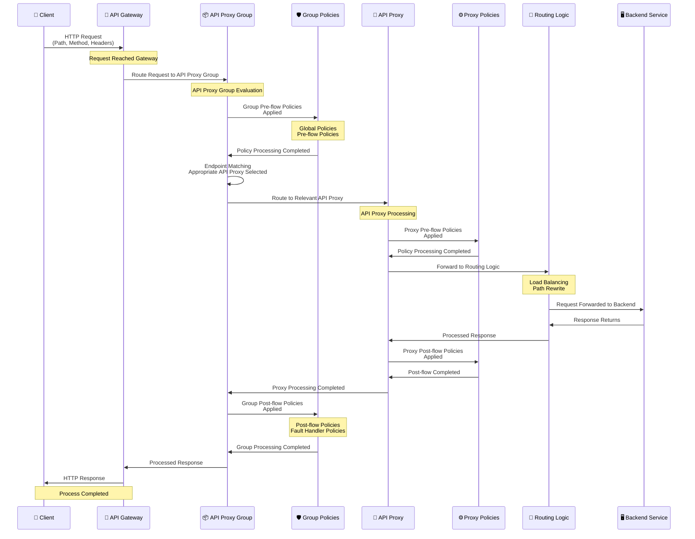

import {Card, CardGroup} from '@site/src/components/Card';
import {Accordion} from '@site/src/components/Accordion';

## API Proxy Group Concept

API Proxy Group enables logical grouping of related API Proxies. Policies and settings defined at the group level are applied only when the request arrives at the group's own address. When a member API Proxy is called at its own address, the group's settings and policies do not run; group settings are not copied to member API Proxies.

<CardGroup cols={2}>
  <Card title="Centralized Management" icon="gear">
    Policies and settings are defined at the group level
  </Card>
  <Card title="Common Policies" icon="shield">
    Group policies are applied to requests arriving at the group address
  </Card>
  <Card title="Easy Management" icon="users">
    Multiple API Proxies are managed under a single group
  </Card>
  <Card title="ACL Management" icon="lock">
    Group-based access control is provided
  </Card>
</CardGroup>

## API Proxy Group and API Proxy Relationship

API Proxy Group logically brings together multiple API Proxies. Policies and settings defined at the group level are applied only when the request arrives at the group's own address. When a member API Proxy is called at its own address, the group's settings and policies do not run; group settings are not copied to member API Proxies.

<CardGroup cols={2}>
  <Card title="Group-Level Policies" icon="shield">
    Policies defined at the group level are applied to requests arriving at the group address
    
    * Global Policies
    * Pre-flow Policies
    * Post-flow Policies
    * Fault Handler Policies
  </Card>
  
  <Card title="Group-Level Settings" icon="gear">
    Settings defined at the group level are applied to requests arriving at the group address
    
    * CORS
    * Cache
    * Idempotency
    * XML Error Response Template
    * JSON Error Response Template
    * Forwarded IP Header Parameter
    * Ignore Error Response Template In Case Of Error On Backend API
    * Maintenance Mode
  </Card>
</CardGroup>

:::info

Group-level policies and settings run **only when the request arrives at the group's own address**. When a member API Proxy is called at its own address, none of the group's settings or policies are applied; only the API Proxy's own settings and policies run. Group settings are not copied to member API Proxies.

:::

### How Settings Apply to a Request Arriving at the Group Address

When a request arrives at the group's address, the settings of the group and of the target API Proxy are evaluated together by the following rules:

| Setting | Rule |
|---------|------|
| CORS | If both the group and the API Proxy have CORS enabled, the two are merged; if only one is enabled, that one applies. |
| Cache | The group's setting applies if enabled; otherwise the API Proxy's setting applies. |
| Idempotency | The group's setting applies if enabled; otherwise the API Proxy's setting applies. |
| Forwarded IP Header Parameter | The group's setting applies if enabled; otherwise the API Proxy's setting applies. |
| XML / JSON Error Response Template | The XML and JSON templates are chosen separately: for each one, the group's template is used if it is enabled; otherwise the API Proxy's template is used. |
| Ignore Error Response Template In Case Of Error On Backend API | Applies if either the group or the API Proxy has it enabled. |
| Maintenance Mode | If the group is in maintenance, the group's maintenance response is returned. If the group is not in maintenance but the member API Proxy the request is routed to is, the API Proxy's maintenance response is returned. When a member API Proxy is called at its own address, the group's maintenance mode has no effect. |
| Policies | In the request flow they run group → API Proxy → method; in the response and error flows they run method → API Proxy → group. |

When a request arrives at the group's address, the JWKS endpoints list the JOSE keys of the group's policies and of the API Proxy's policies, each key once. When a member API Proxy is called at its own address, only the API Proxy's keys are listed.

:::warning

API Proxies of type AI, MCP, A2A, gRPC and WebSocket cannot be added to an API Proxy Group. A gRPC or WebSocket API Proxy that was already a member of a group before this rule keeps that membership and can still be removed from the group. During import, a gRPC or WebSocket API Proxy's group memberships that its target does not already hold are not imported, and the import report lists them. A copy made with Duplicate is created without the groups of its source.

:::

### Request Flow and Policy Application

The following diagram shows how request and response flow occurs through the Gateway with the API Proxy Group mechanism:

When a request arrives at the API Proxy Group, **policies on the API Proxy Group** are executed first. Then the relevant API Proxy's policies are applied.

<CardGroup cols={3}>
  <Card title="1. Request Arrival" icon="arrow-right">
    Request arrives at API Proxy Group
    
    Client request is routed to the API Proxy Group endpoint.
  </Card>
  
  <Card title="2. Group Policies" icon="shield">
    API Proxy Group policies are executed
    
    All policies defined at the group level are applied.
  </Card>
  
  <Card title="3. API Proxy Policies" icon="network-wired">
    API Proxy policies are executed
    
    The relevant API Proxy's own policies are applied.
  </Card>
</CardGroup>

### Multiple Group Membership

An API Proxy can be added to multiple API Proxy Groups. This allows the same API Proxy to be used in different configurations for different groups.

:::warning

When an API Proxy is a member of multiple groups, separate endpoints and policies are applied for each group. Group-based management and isolation are provided.

:::

### Direct Access Control

By prohibiting direct access through the API Proxy, it can be ensured that access is only possible through the API Proxy Group. This enables:

* **Centralized Management**: All access is controlled through the group
* **Security**: Direct API Proxy access is prevented
* **Consistency**: All requests pass through group policies

:::info

When a member API Proxy is called at its own address, the group's settings and policies are not applied. When direct access is prohibited, the API Proxy can only be reached through the group address; this way group-level policies and settings are applied to every request.

:::

### Endpoint Matching Logic

When an API Proxy Group has the same endpoint due to different API Proxies, the request **falls to the first matching endpoint**.

  <Accordion title="Endpoint Matching Priority">
    Endpoint matching order:
    
    1. **First Matching Endpoint**: Request is routed to the first matching endpoint
    2. **API Proxy Order**: The order of API Proxies within the group is important
    3. **Path and Method Match**: Path and HTTP method matching is checked
    
    :::tip

If there are multiple API Proxies with the same endpoint, the order within the group is important. The first matching endpoint is used.

:::
  </Accordion>
  
  <Accordion title="Definition File Creation">
    The API Proxy Group definition file is created by combining the definition files of all API Proxies it contains:
    
    * **Combination Process**: Definition files of all group members are combined
    * **Endpoint Combination**: All endpoints are collected in a single definition file
    * **Policy Combination**: Group and API Proxy policies are combined
    * **Swagger Combination**: Swagger definitions are combined to create group Swagger
    
    :::tip

The definition file combination process is performed automatically. Definitions of all API Proxies within the group are collected in a single file.

:::
  </Accordion>

## API Proxy Group Features

  <Accordion title="Group-Level Policies">
    Policies defined at the group level:
    
    * **Global Policies**: Policies applied to requests arriving at the group address
    * **Pre-flow Policies**: Pre-request group policies
    * **Post-flow Policies**: Post-response group policies
    * **Fault Handler Policies**: Error handling group policies
    
    :::tip

Group policies are applied to requests arriving at the group address; they do not run when a member API Proxy is called at its own address. This enables centralized management of common security and business logic policies for traffic coming through the group.

:::
  </Accordion>
  
  <Accordion title="Group-Level Settings">
    Settings defined at the group level:
    
    * **CORS**: Cross-Origin Resource Sharing settings
    * **Cache**: Cache settings
    * **Idempotency**: Idempotency settings for repeated requests
    * **XML / JSON Error Response Template**: Error response templates
    * **Forwarded IP Header Parameter**: Header the client IP address is read from
    * **Ignore Error Response Template In Case Of Error On Backend API**: Skips the error response template when the backend API returns an error
    * **Maintenance Mode**: Maintenance mode setting of the group
    
    :::tip

Group settings are common configurations valid for requests arriving at the group address. They are not applied when a member API Proxy is called at its own address.

:::
  </Accordion>
  
  <Accordion title="Deployment Management">
    API Proxy Groups are deployed environment-based:
    
    * **Group-Based Deployment**: All group members are deployed together
    * **Environment Management**: Different deployment strategies for different environments
    * **Versioning**: Version management at the group level
    * **Rollback**: Group-based rollback operations
    
    :::tip

Group-based deployment enables related API Proxies to be managed together and provides a consistent deployment process.

:::
  </Accordion>

## API Proxy Group Usage Scenarios

<CardGroup cols={2}>
  <Card title="Microservice Groups" icon="sitemap">
    Managing related microservices under a group. For example:
    * Product Service Group
    * Order Service Group
    * Payment Service Group
  </Card>
  <Card title="Version Groups" icon="code-branch">
    Managing different API versions as a group. For example:
    * API v1 Group
    * API v2 Group
  </Card>
  <Card title="Customer Groups" icon="building">
    Customer-based API groups. For example:
    * Customer A APIs
    * Customer B APIs
  </Card>
  <Card title="Functional Groups" icon="puzzle-piece">
    Grouping functionally related APIs. For example:
    * Authentication APIs
    * Reporting APIs
    * Integration APIs
  </Card>
</CardGroup>

## API Proxy Group Configuration

### Group Creation

When creating a new API Proxy Group:

<CardGroup cols={2}>
  <Card title="Basic Information" icon="info-circle">
    * **Group Name**: Unique name identifying the group
    * **Description**: Purpose and scope of the group
  </Card>
  
  <Card title="Group Content" icon="list">
    * **API Proxies**: API Proxies to be included in the group
    * **Policies**: Group-level policies
    * **Settings**: Group-level settings
  </Card>
</CardGroup>

### Group Management

  <Accordion title="Overview">
    General information about the group:
    
    * **Group Members**: List of API Proxies included in the group
    * **Group Statistics**: Traffic, error rates, performance metrics
    * **Group Status**: Deployment status and health information
    * **Recent Changes**: Recent updates made on the group
    
    :::tip

The Overview tab provides a quick summary about the group and allows you to track the group status.

:::
  </Accordion>
  
  <Accordion title="Settings">
    Group-level settings:
    
    * **CORS**: Cross-Origin Resource Sharing configuration
    * **Cache**: Cache configuration
    * **Idempotency**: Idempotency settings for repeated requests
    * **XML / JSON Error Response Template**: Customizable error response templates
    * **Forwarded IP Header Parameter**: Header the client IP address is read from
    * **Ignore Error Response Template In Case Of Error On Backend API**: Skips the error response template when the backend API returns an error
    * **Maintenance Mode**: Maintenance mode setting of the group
    
    :::tip

Group settings are common configurations valid for requests arriving at the group address. They are not applied when a member API Proxy is called at its own address.

:::
  </Accordion>
  
  <Accordion title="Design">
    Group-level policies:
    
    * **Pre-flow Policies**: Policies that run before requests
    * **Post-flow Policies**: Policies that run after responses
    * **Fault Handler Policies**: Policies that run in error conditions
    * **Global Policies**: Policies that run in all flows
    
    :::tip

Group policies are applied to requests arriving at the group address; they do not run when a member API Proxy is called at its own address. This enables centralized management of common security and business logic policies for traffic coming through the group.

:::
  </Accordion>
  
  <Accordion title="Deployment">
    Group deployment management:
    
    * **Environment Selection**: Environments where deployment will be performed
    * **Deployment Status**: Current deployment statuses
    * **Version Management**: Group versions and history
    * **Rollback**: Rollback operations
    
    :::tip

Group-based deployment enables related API Proxies to be managed together and provides a consistent deployment process.

:::
  </Accordion>

## API Proxy Group and ACL

Group-based access control enables ACLs defined at the group level to be automatically applied to group members.

<CardGroup cols={2}>
  <Card title="Group-Based ACL" icon="lock">
    Access control is defined at the group level
    
    Group ACLs are valid for all API Proxies within the group.
  </Card>
  <Card title="Inheritance" icon="arrow-down">
    Group ACLs are inherited by group members
    
    Group members automatically inherit group ACLs.
  </Card>
  <Card title="Bulk Management" icon="list">
    Bulk ACL management for multiple API Proxies
    
    Group-based ACL enables access control for multiple API Proxies at once.
  </Card>
  <Card title="Blocked Members" icon="ban">
    Member API Proxies can be blocked on a group ACL row

    The **Blocked API Proxies** field of a group ACL row closes the consumer's access to specific member API Proxies of the group.
  </Card>
</CardGroup>

  <Accordion title="Which ACL Is Checked?">
    Where the authentication policy is defined decides which ACL rows are checked:

    1. An authentication policy **added to the API Proxy Group** checks the consumer's **group** ACL rows.
    2. An authentication policy **added to the API Proxy** checks the consumer's **API Proxy** ACL rows.

    :::info

There is no priority between the two ACLs, and there is no project-level ACL. When a request comes through the group and both group and API Proxy policies run, each authentication policy checks its own ACL rows separately.

:::
  </Accordion>
  
  <Accordion title="Bulk ACL Management">
    Advantages of group-based ACL management:
    
    * Defining ACL for multiple API Proxies at once
    * Consistent access control policies
    * Centralized ACL management
    * Easy update and maintenance
    
    :::tip

Group-based ACL management enables applying consistent access control policies for related API Proxies.

:::
  </Accordion>

## API Proxy Group and API Documentation

API Proxy Groups produce and display documentation in Swagger and OpenAPI formats.

<CardGroup cols={3}>
  <Card title="Group Swagger/OpenAPI" icon="file-code">
    Swagger and OpenAPI documentation at the group level
    
    Combined Swagger and OpenAPI documentation of all group members.
  </Card>
  <Card title="Member Swagger/OpenAPI" icon="file-lines">
    Swagger and OpenAPI documentation of group members
    
    Each API Proxy's own Swagger and OpenAPI documentation.
  </Card>
  <Card title="Combined View" icon="layer-group">
    Combined view of all group members
    
    Combined Swagger and OpenAPI view of all API Proxies within the group.
  </Card>
</CardGroup>

  <Accordion title="Swagger Documentation">
    API Proxy Groups produce documentation in Swagger format:
    
    * **Group Swagger**: Combined Swagger documentation of all group members
    * **Member Swagger**: Each API Proxy's own Swagger documentation
    * **Swagger UI**: Display in Swagger UI interface
    
    :::tip

Swagger documentation allows you to view APIs of all API Proxies within the group from a single place.

:::
  </Accordion>
  
  <Accordion title="OpenAPI Documentation">
    API Proxy Groups produce documentation in OpenAPI format:
    
    * **Group OpenAPI**: Combined OpenAPI documentation of all group members
    * **Member OpenAPI**: Each API Proxy's own OpenAPI documentation
    * **OpenAPI Spec**: Download in OpenAPI specification format
    
    :::tip

OpenAPI documentation allows you to view APIs of all API Proxies within the group in standard OpenAPI format.

:::
  </Accordion>

:::info

Swagger and OpenAPI documentation for API Proxy Groups allows you to view APIs of all API Proxies within the group from a single place and use them in standard formats.

:::

## API Proxy Group Advantages

  <Accordion title="Centralized Management">
    * Common policies are managed from a single place
    * Changes are applied to requests arriving at the group address
    * Consistency is ensured
  </Accordion>
  
  <Accordion title="Easy Management">
    * Multiple API Proxies are managed under a single group
    * Bulk operations can be performed
    * Management complexity is reduced
  </Accordion>
  
  <Accordion title="ACL Management">
    * Group-based access control
    * Inherited permissions
    * Bulk ACL management
  </Accordion>

## Next Steps

<CardGroup cols={2}>
  <Card title="What is API Proxy?" icon="network-wired" href="/en/concepts/core-concepts/what-is-api-proxy">
    Learn about the API Proxy concept
  </Card>
  <Card title="What is Policy?" icon="shield" href="/en/concepts/core-concepts/what-is-policy">
    Learn about the Policy concept
  </Card>
  <Card title="API List Management" icon="gear" href="/en/develop/api-list-management">
    API Proxy management
  </Card>
  <Card title="ACL Management" icon="lock" href="/en/admin/identity-management/access-control">
    ACL management
  </Card>
</CardGroup>

