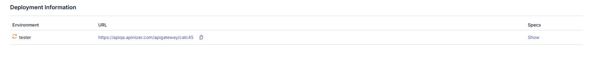
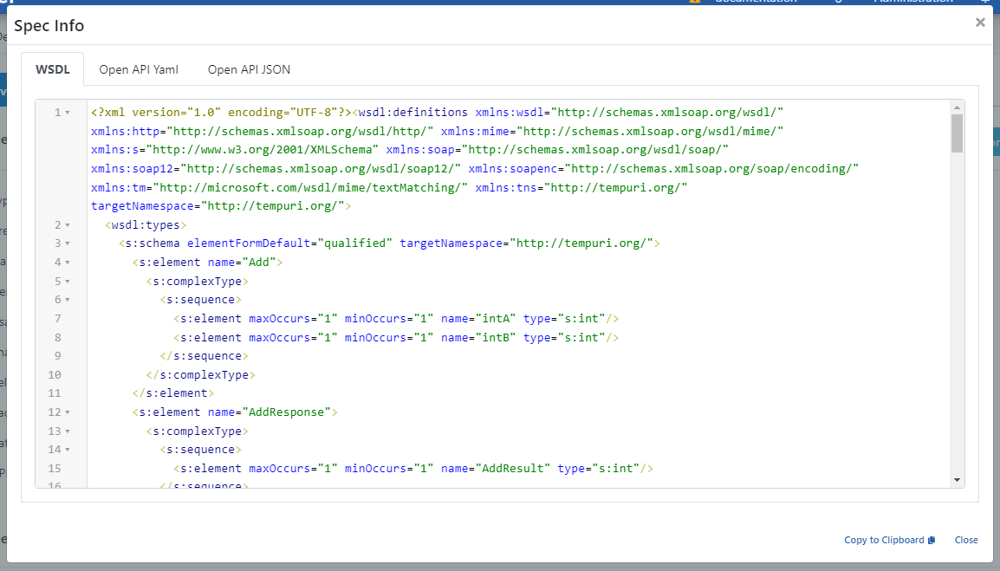

import {Card, CardGroup} from '@site/src/components/Card';

## Deployment Information

The deployment information section displays which [environments](/en/concepts/core-concepts/what-is-environment) the [API Proxy](/en/concepts/core-concepts/what-is-api-proxy) is deployed to and the access address in that environment. An API Proxy can be deployed to multiple environments at the same time.

If an API Proxy Group has been created from the API Proxy, information about that group is also displayed in this area.

### Deployment Information Fields

| Field | Description |
|---|---|
| **Environment** | The Environment information where the API Proxy is deployed. |
| **Access Type** | The access type information of the API Proxy. |
| **URL** | The access address of the API Proxy. It is automatically generated using the Gateway Address and the access address of the deployed Environment. |
| **Specification Files** | The Specification files of the API Proxy. Specification files in Swagger and OpenAPI formats are generated for each API Proxy. If the API Proxy type is SOAP, WSDL and XSD specification files will also be generated. When the **Show** link is clicked for any environment, the API Specification Files valid for that environment for the API Proxy are displayed. |

## Viewing Specification Files

When the **Show** button is clicked, a dialog showing API Proxy definitions in different types and formats opens:

:::warning

If the related API Proxy is part of a Group and the **Block Direct Access to API Proxies** option is selected from the API Proxy Group screen, a warning box is displayed in this section.

:::

## Accessing Specification Files Through API Proxy

The content of specification files opens as shown above when the **Show** link is clicked and can be copied from there. However, this method is for users with roles such as API Developer, API Tester working on the Apinizer platform. Clients cannot access these interfaces.

Clients can use the access address of the Environment where the API Proxy is deployed in the following way to access specification files:

For example, let the API Proxy's access address in Production Environment be `https://demo.apinizer.com/apigateway/petstoreProxy`.

Requests can be sent to the following addresses to access specification files:

### Swagger 2.x (JSON)

- `https://demo.apinizer.com/apigateway/petstoreProxy?swagger`
- `https://demo.apinizer.com/apigateway/petstoreProxy?swagger&format=json`
- `https://demo.apinizer.com/apigateway/petstoreProxy?swagger.json`

### Swagger 2.x (YAML)

- `https://demo.apinizer.com/apigateway/petstoreProxy?swagger&format=yaml`
- `https://demo.apinizer.com/apigateway/petstoreProxy?swagger.yaml`

### OpenAPI 3.x (JSON)

- `https://demo.apinizer.com/apigateway/petstoreProxy?openapi`
- `https://demo.apinizer.com/apigateway/petstoreProxy?openapi&format=json`
- `https://demo.apinizer.com/apigateway/petstoreProxy?openapi.json`

### OpenAPI 3.x (YAML)

- `https://demo.apinizer.com/apigateway/petstoreProxy?openapi&format=yaml`
- `https://demo.apinizer.com/apigateway/petstoreProxy?openapi.yaml`

### WSDL (If API Proxy is SOAP)

- `https://demo.apinizer.com/apigateway/calc?wsdl`

## JWK Set (signing and encryption keys) {#jwk-set-signing-and-encryption-keys}

From the same API Proxy access URL on the gateway, JSON Web Key Sets (JWKS) can be published **independently** of OpenAPI/Swagger query parameters. These URLs are not API specification documents; a `?swagger` or `?openapi` request does **not** return JWK content. They expose **public keys only** for clients using JOSE/JWT verification or encryption (related to [JOSE Verification](/en/develop/policies/jose-verification) and [JOSE Application](/en/develop/policies/jose-application-policy) policies).

Example base address: `https://demo.apinizer.com/apigateway/petstoreProxy`

### Signing keys

Public JWK Set for signature verification (JWS):

- `https://demo.apinizer.com/apigateway/petstoreProxy?jwk-sign.json`

### Encryption keys

Public JWK Set for encryption / decryption (JWE):

- `https://demo.apinizer.com/apigateway/petstoreProxy?jwk-enc.json`

:::info

Responses contain **public** JWK material only (RFC 7517 `keys` array). Private keys, shared secrets, or raw key material from Secret Manager are **not** exported through these endpoints.

:::

:::note

Each key in the set is described with fields such as `kid`, `alg`, and `use`; clients match verification (`sig`) or encryption (`enc`) usage to this metadata. If no public keys are bound to the proxy, `keys` may be an empty array. During key rotation, new `kid` values are added to the set; clients should refresh JWKS periodically. Access and payload depend on the published configuration in the environment—validate behavior in your target environment rather than assuming fixed HTTP status codes.

:::

:::warning

[API specification access control](/en/develop/api-proxy-configuration/settings#api-specification-file-access-control) for `?swagger`, `?openapi`, `?wsdl`, and similar queries may **not** match access rules for **JWK Set** URLs (`?jwk-sign.json`, `?jwk-enc.json`). Specification files may be public while JWK sets are restricted, or the opposite; verify both endpoint families separately in each target environment.

:::

## Next Steps

<CardGroup cols={2}>
  <Card title="General Information Tab" icon="info-circle" href="/en/develop/api-proxy-configuration/overview">
    API Proxy general information
  </Card>
  <Card title="Settings" icon="gear" href="/en/develop/api-proxy-configuration/settings">
    API Proxy settings
  </Card>
  <Card title="Design" icon="pencil" href="/en/develop/api-proxy-configuration/design">
    API Proxy design tab
  </Card>
</CardGroup>

