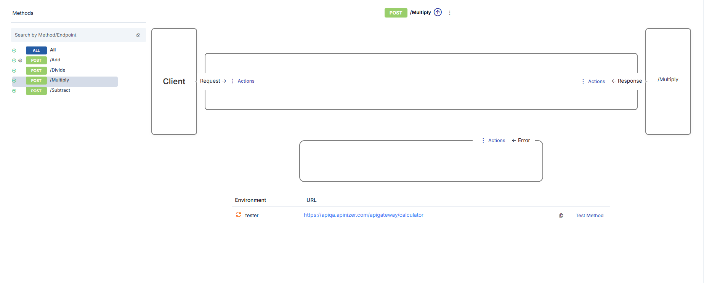
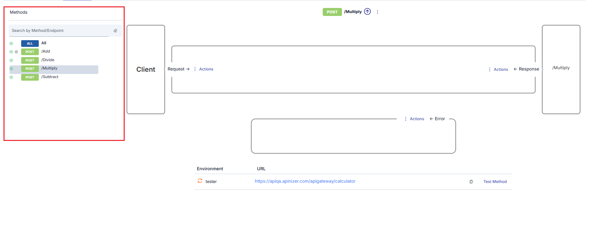
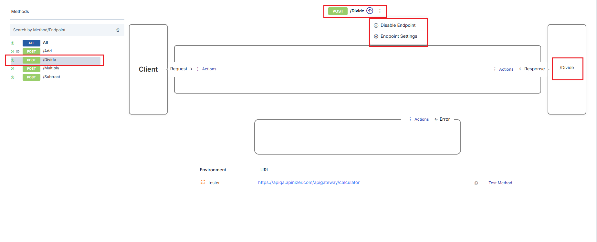
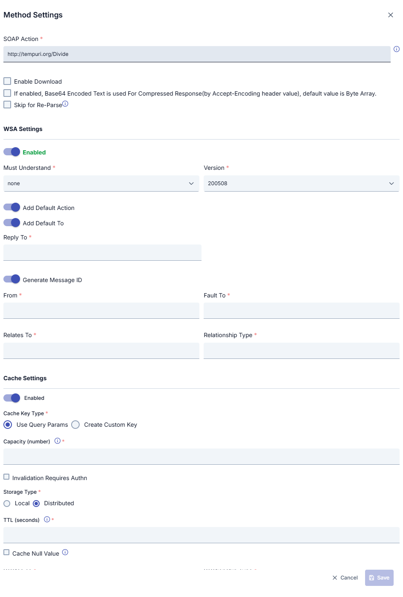
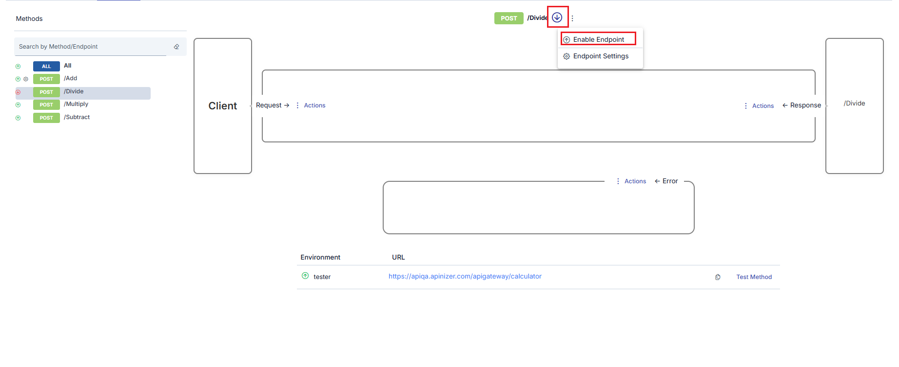
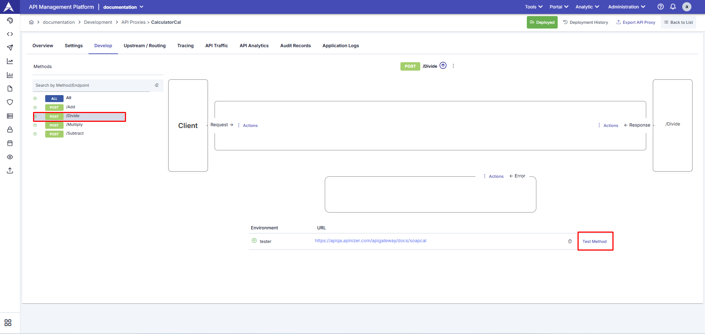
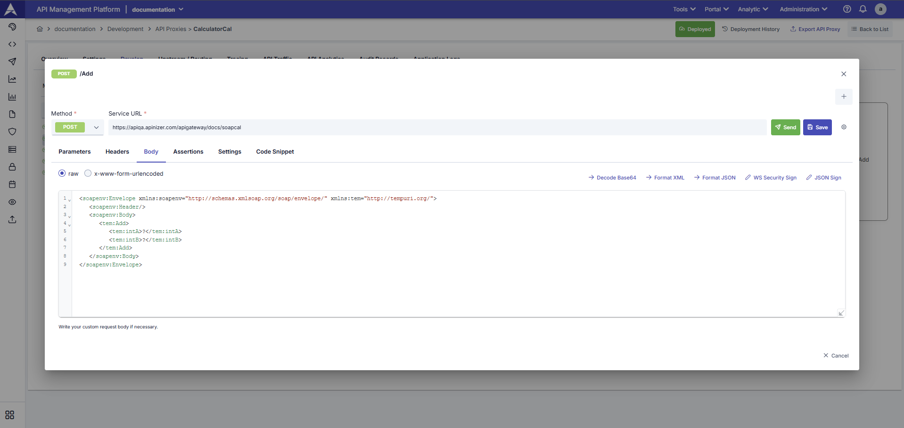

import {Card, CardGroup} from '@site/src/components/Card';

## SOAP Method Configuration

In this tab, [policies](/en/concepts/core-concepts/what-is-policy), protocol conversion settings, and SOAP method management operations can be performed for the selected [API Proxy](/en/concepts/core-concepts/what-is-api-proxy).

## SOAP Method Operations

Each [API Proxy](/en/concepts/core-concepts/what-is-api-proxy) has its own methods that act as proxies for the methods of the Backend API placed in front of it.

If the API Proxy has been created by providing the address of a WSDL file or by uploading such a file, a method with the same name is automatically created in the API Proxy for each method that exists in that file.

Users may want to add new ones, update existing ones, delete, or disable methods for a certain or indefinite period for the following possible reasons:

- One or more new methods have been added to the Backend API
- One or more methods have been deleted from the Backend API
- The name of one or more methods in the Backend API is desired to be hidden from clients
- One or more methods in the Backend API are desired to be completely or temporarily closed to client access

### Selecting SOAP Method

When the name of any method in the method list is clicked, that method is selected and the interface is updated accordingly.

1. In the list, the color changes to indicate which method is selected.
2. In the upper middle section, which method is selected is shown.
3. In the lower middle section, links to operations that can be performed for this method are displayed.
4. On the right side, which method of the Backend API the selected method is related to is visible.

## Updating SOAP Method Settings

Only method update operations can be performed in SOAP type API Proxies.

The settings that can be made for methods of SOAP type API Proxy are different from REST type settings, and an image containing these settings is shown below:

### SOAP Method Settings Fields

| Field | Description |
|---|---|
| **SOAP Action** | When the WSDL file is parsed, the SOAPAction value specified for the method is automatically obtained. However, to use a different value for any reason, the value in this field can be changed. |
| **Enable Download** | If the result returned from the API Method/Endpoint is of [Byte Array](/en/admin/system-settings/predefined-values/byte-array-content-types) type, this option is marked for the result to be handled as a file. Otherwise, the content is returned to the client as encoded text. To decide whether the result is Byte Array, it is checked whether the Content Type Header value is in the "Byte Array Types" list in system settings. If it is in this list, it is decided that the result is of Byte Array type. |
| **If enabled, Base64 Encoded Text is used For Compressed Response(by Accept-Encoding header value), default value is Byte Array** | It is decided whether the response message to be returned from this method is compressed by checking whether the values gzip, deflate, or br are in the Accept-Encoding value. If one of these values exists, the status of the response message is compressed.  If the returned message is in compressed state and the response is Byte Array type and: • If this option of the method is active, the returned message is compressed as Byte Array and returned to the client. • If this option of the method is passive, the returned message is encoded with Base64 and converted to text, then the text version is compressed and returned to the client. |
| **Skip for Re-Parse** | When this field is marked, it indicates that this method should not be updated when the API Proxy is subjected to a "re-parse" operation. For example, even if this method has been deleted from the specification file, it remains undeleted after the re-parse operation. |
| **WSA Settings** | Thanks to this section, WS-Security Addressing settings can be activated separately for each method. When activated, the related WSA values are added to the SOAP message. |
| **Must Understand** | The setting of the "Must Understand" value is made. |
| **Version** | Selection of the WSA version to be used is made. |
| **Add Default Action** | Ensures that the default action determined when the WSDL file is parsed is added to the SOAP message. When activated, the action expression below disappears. |
| **Action** | This field is used to add a customized action to the SOAP message. |
| **Add Default To** | Ensures that the default "To" information determined when the WSDL file is parsed is added to the SOAP message. When activated, the "To" expression below disappears. |
| **To** | This field is used to add customized "To" information to the SOAP message. |
| **Reply To** | This field is used to add customized reply "To" information to the SOAP message. |
| **Generate Message ID** | This field is activated to add a different generated Message ID for each message to the SOAP message. |
| **Message ID** | This field is activated to add a fixed Message ID for each message to the SOAP message. |
| **From** | This field is used to add customized "From" information to the SOAP message. |
| **Fault To** | This field is used to add customized fault "To" information to the SOAP message. |
| **Relates To** | This field is used to add customized fault relation information to the SOAP message. |
| **RelationShip Type** | This field is used to add customized fault relationship type information to the SOAP message. |
| **Cache Settings** | If this setting is activated, method/endpoint-based cache settings are activated. |
| **Cache Key Type** | There are two options for Cache Key Type:  • **Use Query Params**: Used to determine the key to be created for caching based on HTTP Query parameters in the request. For example, when the query parameter is `/methodName?param1=value1&param2=value2`, the key to be kept in cache consists of the value `param1=value1&param2=value2`, and when a request comes in this way again, the result in cache is returned.  • **Create Custom Key**: Used to create the key to be created for caching with the fields to be selected in the request. When this value is selected, the key is created with the fields specified in the "Variable List" table. |
| **Variable List** | This field becomes active if "Create Custom Key" is selected as the Cache Key Type. With this option, the cache key to be created is made with the combination of fields to be specified from the header, parameter, or body sections of the request message. Custom key can be created using [Variable](/en/concepts/core-concepts/variable). |
| **Capacity** | The maximum number of responses that can be stored in cache. |
| **Invalidation Requires Authn** | Selected if authorization is required to invalidate the cache. |
| **Handling Action** | If authorization is required to invalidate the cache, the action to be taken for unauthorized requests is selected:  • **Continue**: If this option is selected, when one of the values `no-cache`, `no-store`, or `max-age=0` is sent in the Cache-Control header information, if the sender is not authorized, it continues to work as if this value was not sent.  • **Stop**: If this option is selected, when one of the values `no-cache`, `no-store`, or `max-age=0` is sent in the Cache-Control header information, if the sender is not authorized, it stops the flow and returns an error message.  This field becomes active when the "Invalidation Requires Authn" option is marked. |
| **TTL (seconds)** | The duration for which the cached response will be valid is entered in seconds. |
| **Cache Null Value** | Marked if empty values are also desired to be cached. |

### MTOM / Attachments Settings {#mtom-attachments}

The method settings window has four sections: **General**, **WS-Addressing**, **MTOM / Attachments** and **Cache**. The **MTOM / Attachments** section controls requests and responses in MTOM format (`multipart/related`, a SOAP message with binary parts such as files). The section is shown only in SOAP type API Proxies. All settings keep today's behavior until you change them.

| Field | Description |
|---|---|
| **Remove text before the first boundary (MIME preamble)** | Off by default. Some clients write a MIME header block before the first boundary of the MTOM body, and some backends cannot read it. When this setting is on, the text before the first boundary is removed from the request and the remaining bytes do not change. The boundary is searched in the first 32 KB of the body. If no boundary is found, the body is sent as it is. Do not turn this on for clients that sign the body. |
| **MTOM Requirement** | Selects which requests the method accepts. **Any** (default): plain SOAP and MTOM requests. **Require MTOM**: a request that is not `multipart/related` gets error ERR-320 (HTTP 400). **Reject MTOM**: a `multipart/related` request gets error ERR-321 (HTTP 400). The check runs on the request of the client, before the request policies. |
| **MTOM Request Handling** | Selects what the gateway does with the request body: **Keep** (default), **Decode (MTOM → plain SOAP)** or **Encode (plain SOAP → MTOM)**. |
| **MTOM Response Handling** | Selects what the gateway does with the response body of the backend: **Keep** (default), **Decode (MTOM → plain SOAP)** or **Encode (plain SOAP → MTOM)**. |
| **Elements to Send as Attachments (XPath, one per line)** | Used by **Encode**. Each line is the XPath of an element whose Base64 text becomes an attachment. Enter at least one XPath. |
| **Minimum Attachment Size (bytes)** | Used by **Encode**. An element whose decoded size is smaller than this value stays in the message as Base64 text. Empty or 0: every selected element becomes an attachment. |

#### Keep

The message goes as it is. A body that no policy changed is sent with its original bytes, so binary parts are not damaged. This also applies to compressed (gzip, deflate, br, zstd) bodies. A policy that changes the body, such as XSLT, WS-Security or a script that changes the body, writes the body as text. Policies that read the body as XML cannot read an MTOM package. Select **Decode** for these policies.

#### Decode (MTOM → plain SOAP)

The gateway turns an MTOM message into one plain SOAP message. It replaces each `xop:Include` element with the Base64 text of the attachment. Then XML policies, such as XML Schema Validation, XSLT, WS-Security and scripts, read normal XML.

- For a request, Decode runs before the request policies. For a response, it runs before the response policies.
- The new Content-Type is `text/xml` or `application/soap+xml` with the UTF-8 charset.
- A message that is not MTOM goes on without a change.
- The gateway checks the package. Every Content-ID must be unique, every `cid:` reference must point to a part of the package, and the root part must be valid XML. The size of the result is limited by the maximum decompressed body size of the gateway.
- If the check fails, a request gets error ERR-322 (HTTP 400). A response of the backend gets error ERR-323 (HTTP 502).
- The limits of the [Max Message Size](/en/develop/policies/max-message-size) policy are read from the original request of the client, so Decode does not bypass them.

#### Encode (plain SOAP → MTOM)

The gateway turns the selected Base64 elements of a plain SOAP message into MTOM attachments.

- For a request, Encode runs after the request policies and before the gateway sends the request to the backend. For a response, it runs after the response policies.
- Only an element whose text is canonical Base64 (no spaces or line breaks) and whose decoded size reaches the minimum size is moved. Other elements stay in the message.
- A message that is already MTOM is not changed.
- If the message is not XML or an XPath fails, the gateway writes a warning to the log and sends the message unchanged. A plain SOAP message with Base64 text is a valid message.
- You cannot save **Encode** when the XPath list is empty or when WS-Addressing is on for the method.

:::note XPath expressions

Namespace prefixes are not defined in these XPath expressions. Use `local-name()` or the `Q{namespace}name` form. Example: `//*[local-name()='Content']`.

:::

#### Known limits

- With **Keep**, policies that read the body as XML (XML Schema Validation, XSLT, WS-Security and scripts that change the body) cannot read an MTOM package. Select **Decode** for such methods.
- **Decode** drops a part that no `xop:Include` references (a SOAP with Attachments part).
- With **Keep**, a response that comes from the response cache does not keep the binary bytes of the attachment. Support is planned for version 2027.01.0.
- WS-Addressing and MTOM do not work together. The WS-Addressing settings cannot add their headers to an MTOM package, and **Encode** cannot be saved when WS-Addressing is on.
- **Decode** and **Encode** do not apply to a response that is streamed or downloaded.
- If the MTOM response of the backend is not valid, the client gets the text of ERR-323. The HTTP status code of the backend stays as it is.

For the error codes, see [Error Messages](/en/admin/system-settings/error-messages). For the MTOM entries of the traffic log, see [API Traffic](/en/analytic/api-traffic).

## Deleting SOAP Method

Methods cannot be deleted in SOAP API Proxies. To close a method to access, use the disable operation below.

## Temporarily Disabling SOAP Method

It is possible to close a method to access without deleting it. For this, the **Disable Endpoint** option is clicked. When the option is clicked, the method is disabled, and along with this, the following changes occur in the interface.

1. The icon next to the method changes to show that the method is out of use.
2. The **Disable Endpoint** option disappears. Instead, the **Enable Endpoint** option appears.

## Testing SOAP Methods

1. **Endpoints Are Displayed**  
Using the _(Test Method)_, the relevant SOAP endpoints can be displayed and tested.

2. **Test Method**  
Using the Test Method, SOAP services can be manually tested in XML (SOAP Envelope) format.

If an API Proxy [has been deployed to at least one environment](/en/develop/deployment-and-version-management), methods can be easily tested from this tab. For this, when the **Test Method** link is clicked for the selected method, the [Test Console](/en/develop/test-debug-tools/test-console) opens for this method.

## Next Steps

<CardGroup cols={2}>
  <Card title="Endpoint Configuration" icon="link" href="/en/develop/api-proxy-configuration/endpoint-configuration">
    REST endpoint configuration
  </Card>
  <Card title="General Information Tab" icon="info-circle" href="/en/develop/api-proxy-configuration/overview">
    API Proxy general information
  </Card>
  <Card title="Settings" icon="gear" href="/en/develop/api-proxy-configuration/settings">
    API Proxy settings
  </Card>
  <Card title="Test Console" icon="flask" href="/en/develop/test-debug-tools/test-console">
    API Proxy test operations
  </Card>
</CardGroup>

