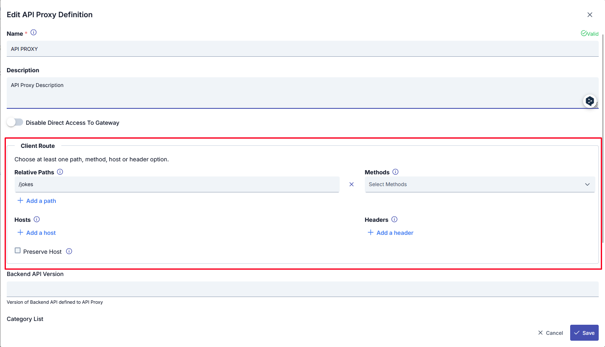

import {Card, CardGroup} from '@site/src/components/Card';
import {Accordion} from '@site/src/components/Accordion';

Client Route is the configuration settings that determine how incoming requests to your API Proxies will be routed. For detailed information about the Client Route concept, you can refer to the [Client Route](/en/concepts/core-concepts/client-route) page.

## Client Route Features

Overview:




With the Client Route feature, you can use the following routing options:

<CardGroup cols={2}>
  <Card title="Multiple Paths" icon="layer-group">
    You can define multiple relative paths for an API Proxy
  </Card>
  <Card title="Host-Based Routing" icon="globe">
    You can route to different API Proxies based on host information
  </Card>
  <Card title="Header-Based Routing" icon="file-lines">
    You can create routing rules based on HTTP header values
  </Card>
  <Card title="Method-Based Routing" icon="code">
    You can perform HTTP method-based routing
  </Card>
</CardGroup>

:::info

Before this feature was developed, only a single unique relative path could be defined for each API Proxy. With the new feature, multiple API Proxies with the same relative path can be created, and dynamic routing can be performed between them based on host, header, or method information.

:::

## Routing Priority Order

An API Proxy can be selected only if **all** criteria defined in its client route (host, header, path, method) match the request. When several API Proxies qualify, the Gateway decides in this order:

1. **The proxy that defines more criteria wins.** For example, a proxy with a path and a host beats a proxy with only a path.
2. **When the number of criteria is equal**, the order is **Host > Header > Relative Path > Method**.
3. **When the set of criteria is the same**, the proxy whose path matches exactly comes first, then the proxy with the longest path.
4. **If there is still a tie**, the order in which the proxies were loaded decides.

:::warning

The number of criteria comes before path length. For example, if Proxy A defines the path `/api` and the host `X`, and Proxy B defines only the path `/api/v1`, a request to `/api/v1` with `Host: X` is routed to Proxy A.

:::

If no API Proxy matches, the Gateway returns **404** (`ERR-002`).

## Matching Logic

### Hosts (OR Logic)

When multiple hosts are defined, it works with **OR** logic. That is, matching **any one** of the defined hosts is sufficient.

**Example:**
```
Hosts: hostname_x.com, hostname_y.com
```

If the Host header value in the request is `hostname_x.com` or `hostname_y.com`, the condition is met.

### Headers (AND Logic)

When multiple headers are defined, it works with **AND** logic. That is, **all** defined headers must match.

**Example:**
```
Headers: testmode:true, test:true
```

Both `testmode: true` and `test: true` headers must be present in the request. Header names and values are compared case-insensitively. A `Host` entry in the header list is ignored; use the **Hosts** field for the host.

### Path Matching

* Among proxies with the same set of criteria, an exact path match comes first, then the longest prefix
* If an exact match is not found, the closest parent path is used
* A prefix matches only at a segment boundary: `/jokes` matches `/jokes/a` but not `/jokes1`
* Path comparison is case-insensitive and a trailing `/` is ignored

### Method Matching

* When the number of criteria is equal, the method is evaluated last
* If not specified, all HTTP methods are accepted

## Wildcard Hostname Usage

Apinizer supports **wildcard (joker character)** usage to provide flexibility in host definitions. Wildcard hostnames allow all Host header values that match a certain pattern to satisfy the condition and thus match the related Route.

### Wildcard Rules

:::warning

**Wildcard Rules:**
* `*` matches one or more characters and can span several labels, dots included
* `*` is most often used at the start (`*.example.com`) or the end (`example.*`)
* If a wildcard host has no port, any port is accepted

:::

### Wildcard Examples

<CardGroup cols={2}>
  <Card title="Left-Side Wildcard" icon="arrow-left">
    ```
    *.example.com
    ```
    
    **Matching Hosts:**
    * a.example.com
    * x.y.example.com
    * api.example.com
    * test.subdomain.example.com
  </Card>
  <Card title="Right-Side Wildcard" icon="arrow-right">
    ```
    example.*
    ```
    
    **Matching Hosts:**
    * example.com
    * example.org
    * example.net
    * example.io
  </Card>
</CardGroup>

## Example Scenario

The table below shows 5 different API Proxies and the Client Route configurations defined for them:

| Proxy ID | Relative Path | Methods | Hosts (OR) | Headers (AND) |
|----------|---------------|---------|------------|---------------|
| 1 | `/jokes` | - | - | `testmode:true`, `test:true` |
| 2 | `/jokes` | - | `hostname_x.com`, `hostname_y.com` | - |
| 3 | `/jokes1/endpoint_x` | - | - | - |
| 4 | `/jokes1` | - | - | - |
| 5 | `/jokes` | - | - | - |

## Routing Examples

According to this configuration, incoming requests are routed as follows:


  <Accordion title="Example 1: Basic Routing">
    **Request:**
    ```
    GET https://<ACCESS_URL>/jokes
    ```
    
    **Result:** Routed to Proxy 5 (the only proxy whose conditions are all met)
    
    :::tip

The extra conditions of Proxy 1 and 2 (header and host) are not met, so Proxy 5, the only proxy whose conditions are all met, is selected.

:::
  </Accordion>
  
  <Accordion title="Example 2: Host-Based Routing">
    **Request:**
    ```
    GET https://<ACCESS_URL>/jokes
    Host: hostname_x.com
    ```
    
    **Result:** Routed to Proxy 2 (host condition met)
    
    :::tip

The path and host conditions of Proxy 2 are met, and it defines more criteria than Proxy 5. Proxy 1 drops out because its header conditions are not met. So Proxy 2 is selected.

:::
  </Accordion>
  
  <Accordion title="Example 3: Routing with Missing Header">
    **Request:**
    ```
    GET https://<ACCESS_URL>/jokes
    testmode: true
    ```
    
    **Result:** Routed to Proxy 5 (Proxy 1 requires both headers, only one is provided)
    
    :::tip

Since headers work with AND logic, all headers must match. In case of missing headers, the next suitable proxy is selected.

:::
  </Accordion>
  
  <Accordion title="Example 4: Full Header Match">
    **Request:**
    ```
    GET https://<ACCESS_URL>/jokes
    testmode: true
    test: true
    ```
    
    **Result:** Routed to Proxy 1 (all header conditions met)
    
    :::tip

Proxy 1 is selected because all header conditions are met.

:::
  </Accordion>
  
  <Accordion title="Example 5: Path Priority - Basic Path">
    **Request:**
    ```
    GET https://<ACCESS_URL>/jokes1
    ```
    
    **Result:** Routed to Proxy 4 (exact path match)
    
    :::tip

The path of Proxy 1, 2 and 5 (`/jokes`) does not match `/jokes1`, because a prefix matches only at a segment boundary. Proxy 4, whose path matches exactly, is selected.

:::
  </Accordion>
  
  <Accordion title="Example 6: Path Priority - Long Path">
    **Request:**
    ```
    GET https://<ACCESS_URL>/jokes1/endpoint_x
    ```
    
    **Result:** Routed to Proxy 3 (more specific path takes priority)
    
    :::tip

More specific (longer) paths are evaluated before more general (shorter) paths.

:::
  </Accordion>
  
  <Accordion title="Example 7: Path with Sub-Path">
    **Request:**
    ```
    GET https://<ACCESS_URL>/jokes1/endpoint_x/endpoint_y
    ```
    
    **Result:** Routed to Proxy 3 (closest parent path match)
    
    :::tip

If an exact match is not found, the closest parent path is used.

:::
  </Accordion>
  
  <Accordion title="Example 8: Path Match - Different Sub-Path">
    **Request:**
    ```
    GET https://<ACCESS_URL>/jokes1/endpoint_y
    ```
    
    **Result:** Routed to Proxy 4 (matched /jokes1 as parent path)
    
    :::tip

There is no exact match for `/jokes1/endpoint_y` path, so the parent path match `/jokes1` is used.

:::
  </Accordion>
  
  <Accordion title="Example 9: Host and Header Combination">
    **Request:**
    ```
    GET https://<ACCESS_URL>/jokes
    Host: hostname_x.com
    testmode: true
    test: true
    ```
    
    **Result:** Routed to Proxy 2 (on a tie, host comes before header)
    
    :::tip

All conditions of Proxy 1 and 2 are met, and both define two criteria. When the number of criteria is equal, Host comes before Header, so Proxy 2 is selected.

:::
  </Accordion>
  
  <Accordion title="Example 10: Different Path with Host and Header">
    **Request:**
    ```
    GET https://<ACCESS_URL>/jokes1
    Host: hostname_x.com
    testmode: true
    test: true
    ```
    
    **Result:** Routed to Proxy 4 (the path of Proxy 1 and 2 does not match)
    
    :::tip

The path of Proxy 1 and 2 (`/jokes`) does not match `/jokes1`, so these proxies drop out. Even though their host and header conditions are met, they cannot be selected because the path condition is not. Among the remaining proxies, Proxy 4, whose path matches, is selected.

:::
  </Accordion>


## Routing Combination Table

This table shows from the API Proxy perspective how the API Proxy is selected:

| Status | Description |
|-------|----------|
| **None** | Not present in the API proxy definition. What the client sends is not checked. |
| **Matched** | Present in the API proxy definition. What the client sends is checked, and it sent the expected value. |
| **Not Matched** | Present in the API proxy definition. What the client sends is checked, but it did not send the expected value. |

The table below shows how the API Proxy is selected in different combinations:

| #  | HOST      | PATH      | METHOD    | HEADER    | RESULT        | EXPLANATION                                                      |
| -- | --------- | --------- | --------- | --------- | ------------ | ------------------------------------------------------------- |
| 1  | None       | None       | None       | None       | ✗ INVALID     | At least one path, method, host or header is required |
| 2  | None       | None       | None       | Matched   | ✓ SELECTED    | All defined criteria OK (HEADER)                             |
| 3  | None       | None       | None       | Not Matched | ✗ REJECTED | Cannot route because HEADER did not match                     |
| 4  | None       | None       | Matched   | None       | ✓ SELECTED    | All defined criteria OK (METHOD)                             |
| 5  | None       | None       | Matched   | Matched   | ✓ SELECTED    | All defined criteria OK (METHOD, HEADER)                     |
| 6  | None       | None       | Matched   | Not Matched | ✗ REJECTED | Cannot route because HEADER did not match                     |
| 7  | None       | None       | Not Matched | None       | ✗ REJECTED | Cannot route because METHOD did not match                     |
| 8  | None       | None       | Not Matched | Matched   | ✗ REJECTED | Cannot route because METHOD did not match                     |
| 9  | None       | None       | Not Matched | Not Matched | ✗ REJECTED | Cannot route because METHOD, HEADER did not match             |
| 10 | None       | Matched   | None       | None       | ✓ SELECTED    | All defined criteria OK (PATH)                               |
| 11 | None       | Matched   | None       | Matched   | ✓ SELECTED    | All defined criteria OK (PATH, HEADER)                       |
| 12 | None       | Matched   | None       | Not Matched | ✗ REJECTED | Cannot route because HEADER did not match                     |
| 13 | None       | Matched   | Matched   | None       | ✓ SELECTED    | All defined criteria OK (PATH, METHOD)                       |
| 14 | None       | Matched   | Matched   | Matched   | ✓ SELECTED    | All defined criteria OK (PATH, METHOD, HEADER)               |
| 15 | None       | Matched   | Matched   | Not Matched | ✗ REJECTED | Cannot route because HEADER did not match                     |
| 16 | None       | Matched   | Not Matched | None       | ✗ REJECTED | Cannot route because METHOD did not match                     |
| 17 | None       | Matched   | Not Matched | Matched   | ✗ REJECTED | Cannot route because METHOD did not match                     |
| 18 | None       | Matched   | Not Matched | Not Matched | ✗ REJECTED | Cannot route because METHOD, HEADER did not match             |
| 19 | None       | Not Matched | None       | None       | ✗ REJECTED | Cannot route because PATH did not match                       |
| 20 | None       | Not Matched | None       | Matched   | ✗ REJECTED | Cannot route because PATH did not match                       |
| 21 | None       | Not Matched | None       | Not Matched | ✗ REJECTED | Cannot route because PATH, HEADER did not match               |
| 22 | None       | Not Matched | Matched   | None       | ✗ REJECTED | Cannot route because PATH did not match                       |
| 23 | None       | Not Matched | Matched   | Matched   | ✗ REJECTED | Cannot route because PATH did not match                       |
| 24 | None       | Not Matched | Matched   | Not Matched | ✗ REJECTED | Cannot route because PATH, HEADER did not match               |
| 25 | None       | Not Matched | Not Matched | None       | ✗ REJECTED | Cannot route because PATH, METHOD did not match               |
| 26 | None       | Not Matched | Not Matched | Matched   | ✗ REJECTED | Cannot route because PATH, METHOD did not match               |
| 27 | None       | Not Matched | Not Matched | Not Matched | ✗ REJECTED | Cannot route because PATH, METHOD, HEADER did not match       |
| 28 | Matched   | None       | None       | None       | ✓ SELECTED    | All defined criteria OK (HOST)                               |
| 29 | Matched   | None       | None       | Matched   | ✓ SELECTED    | All defined criteria OK (HOST, HEADER)                       |
| 30 | Matched   | None       | None       | Not Matched | ✗ REJECTED | Cannot route because HEADER did not match                     |
| 31 | Matched   | None       | Matched   | None       | ✓ SELECTED    | All defined criteria OK (HOST, METHOD)                       |
| 32 | Matched   | None       | Matched   | Matched   | ✓ SELECTED    | All defined criteria OK (HOST, METHOD, HEADER)               |
| 33 | Matched   | None       | Matched   | Not Matched | ✗ REJECTED | Cannot route because HEADER did not match                     |
| 34 | Matched   | None       | Not Matched | None       | ✗ REJECTED | Cannot route because METHOD did not match                     |
| 35 | Matched   | None       | Not Matched | Matched   | ✗ REJECTED | Cannot route because METHOD did not match                     |
| 36 | Matched   | None       | Not Matched | Not Matched | ✗ REJECTED | Cannot route because METHOD, HEADER did not match             |
| 37 | Matched   | Matched   | None       | None       | ✓ SELECTED    | All defined criteria OK (HOST, PATH)                         |
| 38 | Matched   | Matched   | None       | Matched   | ✓ SELECTED    | All defined criteria OK (HOST, PATH, HEADER)                 |
| 39 | Matched   | Matched   | None       | Not Matched | ✗ REJECTED | Cannot route because HEADER did not match                     |
| 40 | Matched   | Matched   | Matched   | None       | ✓ SELECTED    | All defined criteria OK (HOST, PATH, METHOD)                 |
| 41 | Matched   | Matched   | Matched   | Matched   | ✓ SELECTED    | All defined criteria OK (HOST, PATH, METHOD, HEADER)         |
| 42 | Matched   | Matched   | Matched   | Not Matched | ✗ REJECTED | Cannot route because HEADER did not match                     |
| 43 | Matched   | Matched   | Not Matched | None       | ✗ REJECTED | Cannot route because METHOD did not match                     |
| 44 | Matched   | Matched   | Not Matched | Matched   | ✗ REJECTED | Cannot route because METHOD did not match                     |
| 45 | Matched   | Matched   | Not Matched | Not Matched | ✗ REJECTED | Cannot route because METHOD, HEADER did not match             |
| 46 | Matched   | Not Matched | None       | None       | ✗ REJECTED | Cannot route because PATH did not match                       |
| 47 | Matched   | Not Matched | None       | Matched   | ✗ REJECTED | Cannot route because PATH did not match                       |
| 48 | Matched   | Not Matched | None       | Not Matched | ✗ REJECTED | Cannot route because PATH, HEADER did not match               |
| 49 | Matched   | Not Matched | Matched   | None       | ✗ REJECTED | Cannot route because PATH did not match                       |
| 50 | Matched   | Not Matched | Matched   | Matched   | ✗ REJECTED | Cannot route because PATH did not match                       |
| 51 | Matched   | Not Matched | Matched   | Not Matched | ✗ REJECTED | Cannot route because PATH, HEADER did not match               |
| 52 | Matched   | Not Matched | Not Matched | None       | ✗ REJECTED | Cannot route because PATH, METHOD did not match               |
| 53 | Matched   | Not Matched | Not Matched | Matched   | ✗ REJECTED | Cannot route because PATH, METHOD did not match               |
| 54 | Matched   | Not Matched | Not Matched | Not Matched | ✗ REJECTED | Cannot route because PATH, METHOD, HEADER did not match       |
| 55 | Not Matched | None       | None       | None       | ✗ REJECTED | Cannot route because HOST did not match                       |
| 56 | Not Matched | None       | None       | Matched   | ✗ REJECTED | Cannot route because HOST did not match                       |
| 57 | Not Matched | None       | None       | Not Matched | ✗ REJECTED | Cannot route because HOST, HEADER did not match               |
| 58 | Not Matched | None       | Matched   | None       | ✗ REJECTED | Cannot route because HOST did not match                       |
| 59 | Not Matched | None       | Matched   | Matched   | ✗ REJECTED | Cannot route because HOST did not match                       |
| 60 | Not Matched | None       | Matched   | Not Matched | ✗ REJECTED | Cannot route because HOST, HEADER did not match               |
| 61 | Not Matched | None       | Not Matched | None       | ✗ REJECTED | Cannot route because HOST, METHOD did not match               |
| 62 | Not Matched | None       | Not Matched | Matched   | ✗ REJECTED | Cannot route because HOST, METHOD did not match               |
| 63 | Not Matched | None       | Not Matched | Not Matched | ✗ REJECTED | Cannot route because HOST, METHOD, HEADER did not match       |
| 64 | Not Matched | Matched   | None       | None       | ✗ REJECTED | Cannot route because HOST did not match                       |
| 65 | Not Matched | Matched   | None       | Matched   | ✗ REJECTED | Cannot route because HOST did not match                       |
| 66 | Not Matched | Matched   | None       | Not Matched | ✗ REJECTED | Cannot route because HOST, HEADER did not match               |
| 67 | Not Matched | Matched   | Matched   | None       | ✗ REJECTED | Cannot route because HOST did not match                       |
| 68 | Not Matched | Matched   | Matched   | Matched   | ✗ REJECTED | Cannot route because HOST did not match                       |
| 69 | Not Matched | Matched   | Matched   | Not Matched | ✗ REJECTED | Cannot route because HOST, HEADER did not match               |
| 70 | Not Matched | Matched   | Not Matched | None       | ✗ REJECTED | Cannot route because HOST, METHOD did not match               |
| 71 | Not Matched | Matched   | Not Matched | Matched   | ✗ REJECTED | Cannot route because HOST, METHOD did not match               |
| 72 | Not Matched | Matched   | Not Matched | Not Matched | ✗ REJECTED | Cannot route because HOST, METHOD, HEADER did not match       |
| 73 | Not Matched | Not Matched | None       | None       | ✗ REJECTED | Cannot route because HOST, PATH did not match                 |
| 74 | Not Matched | Not Matched | None       | Matched   | ✗ REJECTED | Cannot route because HOST, PATH did not match                 |
| 75 | Not Matched | Not Matched | None       | Not Matched | ✗ REJECTED | Cannot route because HOST, PATH, HEADER did not match         |
| 76 | Not Matched | Not Matched | Matched   | None       | ✗ REJECTED | Cannot route because HOST, PATH did not match                 |
| 77 | Not Matched | Not Matched | Matched   | Matched   | ✗ REJECTED | Cannot route because HOST, PATH did not match                 |
| 78 | Not Matched | Not Matched | Matched   | Not Matched | ✗ REJECTED | Cannot route because HOST, PATH, HEADER did not match         |
| 79 | Not Matched | Not Matched | Not Matched | None       | ✗ REJECTED | Cannot route because HOST, PATH, METHOD did not match         |
| 80 | Not Matched | Not Matched | Not Matched | Matched   | ✗ REJECTED | Cannot route because HOST, PATH, METHOD did not match         |
| 81 | Not Matched | Not Matched | Not Matched | Not Matched | ✗ REJECTED | Cannot route because HOST, PATH, METHOD, HEADER did not match |

## Published Access URLs {#published-access-urls}

The **Published Access URLs** field in the Client Route of an API proxy or an API proxy group sets which environment addresses the proxy shows. The environment defines the addresses. See [Access URLs](/en/admin/server-management/gateway-runtimes#access-urls).

:::info

This selection does not change routing or access. It only sets the address that the specification documents and the Manager screens show. A request to an address that you did not select still reaches the proxy. To restrict access, use the **Hosts** list of the Client Route.

:::

Select one of these:

- **All access URLs (including ones added later).** This is the default. An address that you add to the environment later is included.
- A selection of address names. The names come from all environments. Select the names that the proxy publishes.

A warning icon next to a name shows that an environment has no address with this name. When an environment has none of the selected names, the proxy shows the default address of that environment, and the screen shows a warning.

### Address match source

**Address match source** sets how the gateway chooses the published address for a specification request.

| Option | Behavior |
|--------|----------|
| **Request hostname** | The gateway chooses the address by the host of the request. This is the default. |
| **Variable** | The gateway compares the value of the variable with the address names, then with the hosts. When the value is empty, the gateway uses the host of the request. |

You can select only a header variable or a query parameter variable. The gateway answers a specification request before the policies run, so only a value that the client sent is known at that time. The save fails with another variable type.

When no address matches, the gateway uses the first published address. For the rules that choose the address, see [Which address a document shows](/en/admin/server-management/gateway-runtimes#which-address-a-document-shows).

### Hosts warning

When a published address has a host that is not in the **Hosts** list of the Client Route, the screen shows a warning. A request to this host does not reach this proxy, because the **Hosts** list does not contain it. Add the host to the **Hosts** list, or remove the address from the selection. If the **Hosts** list is empty, this warning does not apply.

## Important Notes


  <Accordion title="Path Matching">
    * A proxy that defines more criteria comes before path length
    * Within the same set of criteria, an exact match comes first, then the longest prefix
    * A prefix matches only at a segment boundary (`/jokes` does not match `/jokes1`)
  </Accordion>
  
  <Accordion title="Host Matching">
    * Multiple hosts can be defined
    * Hosts work with **OR** logic
    * If the host value in the request matches any of the defined hosts, the condition is met
  </Accordion>
  
  <Accordion title="Header Matching">
    * Multiple headers can be defined
    * Headers work with **AND** logic
    * All defined headers must be present in the request
    * In case of missing or incorrect headers, it moves to the next suitable proxy
  </Accordion>
  
  <Accordion title="Method Matching">
    * When the number of criteria is equal, the method is evaluated last
    * If not specified, all HTTP methods are accepted
  </Accordion>


:::info

The Client Route feature allows you to easily manage complex routing scenarios in your API Gateway. By understanding the priority order and matching logic correctly, you can create flexible and powerful API routing configurations.

:::

## Related Pages

<CardGroup cols={3}>
  <Card title="Client Route" icon="route" href="/en/concepts/core-concepts/client-route">
    Learn about Client Route concept
  </Card>
  <Card title="API Proxy Creation" icon="plus" href="/en/develop/api-proxy-creation">
    API Proxy creation
  </Card>
  <Card title="Routing and Upstream" icon="network-wired" href="/en/concepts/core-concepts/routing-and-upstream">
    Learn about Routing and Upstream concepts
  </Card>
  <Card title="HTTP Routing" icon="globe" href="/en/develop/routing/http-routing">
    HTTP Routing configuration
  </Card>
  <Card title="API Proxy Configuration" icon="gear" href="/en/develop/api-proxy-configuration/overview">
    API Proxy settings
  </Card>
</CardGroup>

