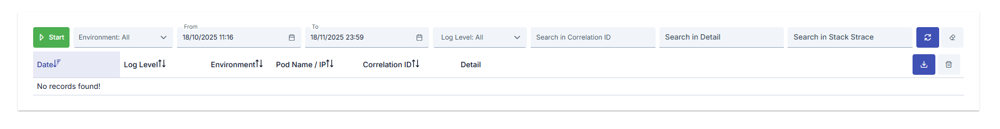

In this tab, records of software logs that occur during the execution of the flow for messages coming to and returning from the relevant API Proxy are displayed.

:::info

It is appropriate to use this page when a software error is suspected or when it is desired to investigate how the application behaves in the background.

:::

**The visual containing the Application Logs tab is shown below:**

The fields used for operations and filtering on Application Logs are shown below.

| Field | Description |
|------|-------------|
| **Start** *(Start)* | Enables keeping records of application logs on an API Proxy basis |
| **Environment Filter** *(Environment)* | Enables filtering application logs for the specified environment |
| **Time Filter** *(From, To)* | Enables filtering application logs for the specified date range |
| **Log Level** *(Search by Log Levels)* | Enables filtering logs at the level specified by "Log Level" in application logs |
| **Search in Correlation ID** *(Search in Correlation ID)* | When a request comes to the API Proxy, Apinizer assigns a correlation id to this request so that the request can be tracked. By performing a detailed search in application logs with the correlation id to be found from API Proxy Traffic logs, only the application logs of a single request can be accessed |
| **Search in Detail** *(Search in Detail)* | Enables searching in text fields of application logs |
| **Search in Stack Trace** *(Search in Stack Trace)* | Enables searching on exception text if an exception has occurred in application logs |
| **Download Button** *(Download)* | Enables downloading application logs as a zip file from the **Export** menu (**Download logs (zip)**). If "All logs in the time range" is selected, all logs related to this API Proxy in the searched time range are downloaded. If "All search results" is selected, all filtered logs are downloaded |
| **Delete Button** *(Delete)* | Enables deletion of application log records belonging to this API Proxy |

The tab opens with the last hour.

## Downloading Logs

The download needs a time range of at most 7 days. If the range is longer, the **Download logs (zip)** item is disabled.

The file holds at most 100,000 records, newest first. If more records match, the file is cut and its last line says it was truncated. The screen also tells you how many records the file holds and how many matched. Narrow the time range or the filters to get the rest.

## Policy Name and Type in a Log Line

When a log line is written while a policy runs, the record carries the name and the type of that policy. The log detail window shows them in the **Policy** row. The row does not appear for a line that is written outside a policy. The lines where a policy condition is evaluated, the REST to SOAP conversion in an error template and the lines of asynchronous tasks do not carry the policy name.

The name and the type are also in the MongoDB and Graylog log targets, in the downloaded file and in the SIEM application log data. The relational database log target keeps its columns and does not store them.

## Credentials in Trace Logs

When trace is on for the API proxy, the application log does not store the Authorization, Cookie and Set-Cookie values that the HTTP client header, wire and cookie logs write, the values of credential form fields sent to the backend, or the text of WebSocket messages written by the WebSocket client library. The request and response header, query and form dumps of Apinizer show the name of a credential and hide its value. This applies to Authorization, Cookie, the API key names and every name that contains token, secret or password. The debug line of the Kafka connection hides `sasl.jaas.config`.

A logger that an operator sets to DEBUG or TRACE still writes as before.

## Access Auditing

Searching application logs, opening a log record and downloading logs write an audit record with your user name and a summary of the filters. See [Log Access Events](/en/admin/audit-compliance/audit-records#log-access-events).
