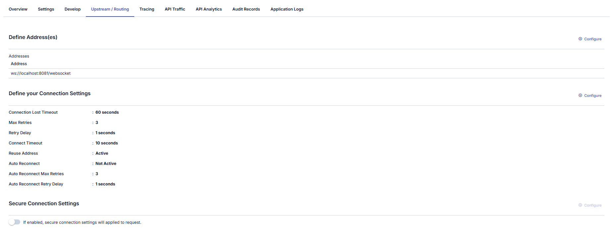
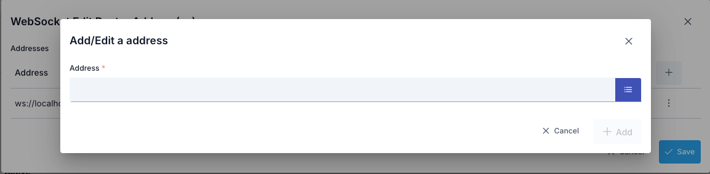
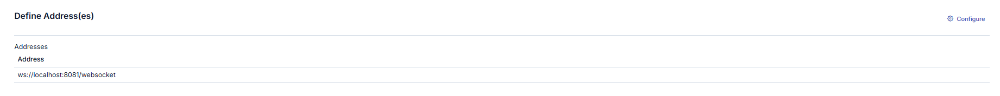
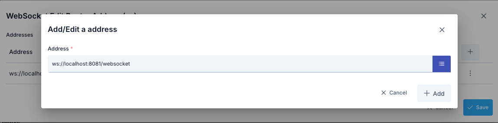
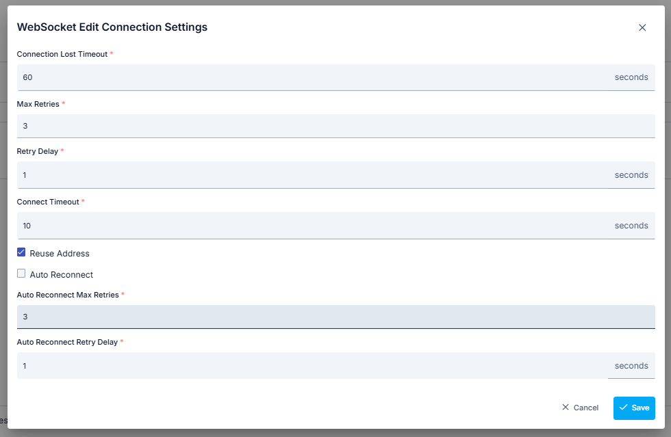
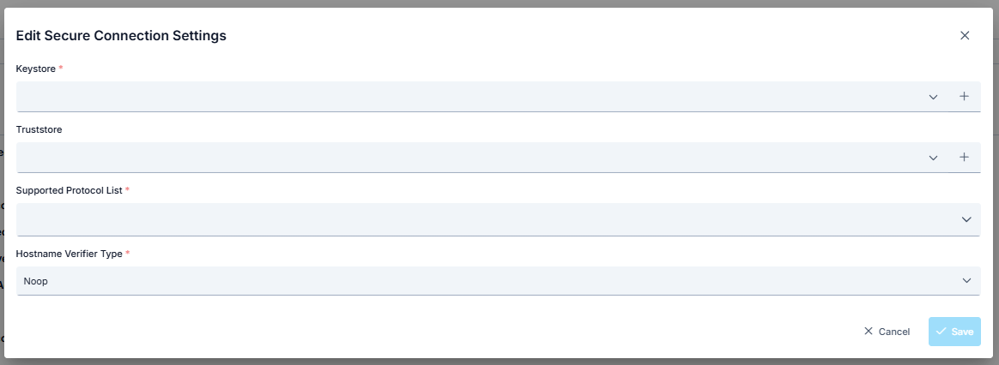

:::note

If API type is WebSocket, this tab is visible.

:::

:::warning

Protocols such as **SignalR** are not plain WebSockets; because they require an HTTP negotiate step and a custom handshake, they do not work with Apinizer's **WebSocket proxy** type — use **Reverse Proxy** instead and set upstream directly to the hub URL (e.g. `http://host/hub`). The layer in front of Apinizer (load balancer, ingress, Nginx, etc.) must also forward WebSocket upgrade headers (`Upgrade`, `Connection`) to the backend without modification.

:::

This section contains routing settings for WebSocket API Proxy Type.

After the API Proxy receives messages from clients and executes policies if any, it routes the message to the Backend API. The Routing tab is the tab where this routing operation is configured.

WebSocket Routing Tab settings are shown in the following image:


### Adding New Address

A new address can be added from the window that opens when the ➕ button in the column header area at the far right of the window opened with the Configure button is clicked.




**In the new address addition window:**

* Backend API address is entered in the Address field or environment variable is used
* Environment Variables Selection Dialog can be opened by clicking the list icon button on the right of the Address field
* Selected environment variable is copied to clipboard and pasted into the Address field
* Conditional routing can be defined with the Condition section

### Updating Address

The backend address information where the request will be sent can be updated in the window that opens when the **Configure** button in the **Address (Address)** column of the table showing addresses is clicked.



For how this value should be entered, you can visit the [WebSocket Proxy Routing Guide](/en/develop/api-proxy-creation/websocket-api-proxy-creation) page.

If this value is desired to change automatically according to the environment it is in, selection can be made from Environment Variables (Environment Variable).

The address can be updated in the window that opens when the **Configure** button in the **Address (Address)** column of the table showing addresses is clicked.

**Environment Variables (Environment Variable) Selection** dialog detail is specified in the following image.

When the list icon button on the right of the address input field is clicked, the Environment Variables Selection Dialog opens. Through this dialog, all environment variables (Environment Variables) defined in the project can be viewed and selected.


**In the Environment Variables Selection Dialog:**

* All environment variables are listed (Global and Environment-Specific)
* Filtering can be done by variable name or description with the search box
* Key Name, Description, Type information is displayed for each variable
* The format of the selected variable (`${variableName}`) is automatically copied to clipboard with the Copy button
* The copied value can be used by pasting it into the Address field

**Example Usage:**

* Environment variable: `BACKEND_URL = ws://dev-api.example.com` (for Development environment)
* Environment variable: `BACKEND_URL = wss://api.example.com` (for Production environment)
* Value entered in Address field: `${BACKEND_URL}`
* At runtime in Development environment: `ws://dev-api.example.com`
* At runtime in Production environment: `wss://api.example.com`

### Deleting Address

The address is deleted by selecting the **Remove** option from the dropdown menu at the end of the row of the address to be deleted.

:::warning

At least one address is required for the API Proxy to route. Therefore, after deleting the last address, the save button becomes inactive and does not allow saving.

:::

## Connection Settings Configuration

The WebSocket Connection Settings Definition Tab enables configuration of connections made over the WebSocket protocol. This tab contains various parameters necessary to optimize the performance and security of connections. Below are the details of the settings in this tab.

The parameters used for WebSocket Connection settings configuration are shown below.


| Field | Description |
|-------|-------------|
| **Connection Lost Timeout** *(Connection Lost Timeout)* | This setting determines how long to wait after the WebSocket connection is lost. If this time is exceeded, a new connection is attempted. |
| **Connect Timeout** *(Connect Timeout)* | Expresses the timeout duration valid during connection to the WebSocket server. |
| **Retry Delay** *(Retry Delay)* | Specifies the time that should be waited before reconnecting when the connection is lost. |
| **Max Retries** *(Max Retries)* | Specifies the maximum number of attempts to reconnect when the connection is lost. |
| **Reuse Address** *(Reuse Address)* | A setting that enables the IP address used for network connection to be reused even if the connection is closed. |
| **Auto Reconnect** *(Auto Reconnect)* | Enables the client to automatically attempt to reconnect to the server when the connection is unexpectedly closed. |
| **Auto Reconnect Max Retries** *(Auto Reconnect Max Retries)* | Determines how many times the client will attempt to reconnect after the connection is broken. |
| **Auto Reconnect Retry Delay** *(Auto Reconnect Retry Delay)* | Determines how long to wait between each reconnection attempt. |
| **Socket.IO Compatibility** | Lets the proxy carry the HTTP long-polling requests of Socket.IO clients. Off by default. When you select it, the **Read Timeout** field appears in the same window. See [Socket.IO Compatibility](#socket-io-compatibility). |

These settings provide important information about how your WebSocket connection will be managed and how it will respond to errors.

## Socket.IO Compatibility {#socket-io-compatibility}

A Socket.IO client can connect with HTTP long-polling requests and then upgrade to WebSocket. Select **Socket.IO Compatibility** in the connection settings window when the clients of the proxy are Socket.IO clients.

The setting is off by default. It is part of the proxy's export, import, deploy and audit data.

When the setting is on:

* The proxy carries Engine.IO long-polling requests to the backend through the same proxy address. A request counts as polling when it has no `Upgrade` header and its query has `transport=polling` and `EIO=<version>`. The methods `GET`, `POST` and `OPTIONS` are carried. Engine.IO versions 3 and 4 are supported.
* The backend address of a polling request is the routing address of the proxy, with `ws` changed to `http` and `wss` changed to `https`.
* The **Read Timeout** field appears in the window and is required. It is the time, in seconds, that the proxy waits for the backend's answer to a polling request. A polling request can wait for the backend for a long time, so set a value that is longer than the Socket.IO ping interval. The Socket.IO default ping interval is 25 seconds.

### Policies and Limits on Polling Requests

A polling request runs these:

* The request policies of the proxy.
* The Rate Limit Control List rules.
* The Limit Plan of the caller. A polling request counts once for the Target Audience.
* The response policies of the proxy.

The proxy group policies and the method policies do not run on a polling request. A WebSocket proxy has no methods.

A response policy sees the response body as the Engine.IO payload. In Engine.IO version 4, the packets are separated by the byte `0x1e`. In version 3, each packet starts with its length. A policy that changes the body must keep this frame, or the client cannot read the answer.

### Security Note

While the setting is on, the HTTP endpoints of the backend under the proxy path can be reached through the proxy with a query that has `EIO` and `transport=polling`. The request policies of the proxy run for these requests. Add authentication and IP policies to the request flow of the proxy to protect them.

### Capacity Note

A polling client that waits for a `GET` answer holds one gateway worker thread and one concurrent request slot, as a slow REST request does. A WebSocket connection does not hold a worker thread after the upgrade.

Size the gateway for the number of polling clients plus your other peak traffic:

* `tuneWorkerMaxThreads` and `tuneMaxConcurrentRequest` must be at least this number.
* `tuneRoutingConnectionPoolMaxConnectionPerHost` must be higher than this number.

The defaults are `tuneWorkerThreads` = CPU core count × 8 and `tuneWorkerMaxThreads` = CPU core count × 16, that is 64 on a 4 vCPU server. See [Gateway Performance Tuning](/en/operations/administrator-guides/gateway-performance-tuning) and [Gateway Settings](/en/setup/gateway-settings).

### Heartbeat Records

On a Socket.IO connection, the WebSocket frames `2` and `3` are the Engine.IO ping and pong heartbeats. The proxy does not write a traffic record for each of them when the setting is on and the backend has confirmed an Engine.IO session. The backend confirms the session when its first frame is the open packet (`0{...}`), or when it answers `2probe` with `3probe`. To a backend that is not an Engine.IO server, every frame keeps its own traffic record.

The policies run on every heartbeat. A heartbeat that a policy refuses is recorded.

The record that closes the connection carries a summary in its body:

```text
Socket.IO heartbeats: client to backend N, backend to client M, last <time|none>. Connection closed by the <client|backend|gateway (...)> with code C.
```

The summary is written only when payload logging is on. When payload logging is off, the summary does not appear. When the setting is off, every frame has its own record as before.

## Secure Connection Setting

When this setting is enabled, the selected connection settings are applied to the request.

Thus, the Apinizer client that will send from Apinizer to the target service verifies the target service's certificate and indicates that it also has a certificate and must be verified by the target service.

The target service also verifies the client's certificate, and thus secure communication is established with the client.

The parameters used for connection settings configuration are shown below.


| Field | Description |
|-------|-------------|
| **Keystore** | Keystore is used to authenticate the client side. Keystore content should contain: If there is no mTLS verification at the server address, it should be empty. (Since the field is required, an empty keystore must be added.) If there is mTLS verification at the server address: client privatekey, Client certificate (with public key), Certificate chain (if any intermediate and root CA certificates) should be present. If the Key Store record has an **Alias** value, only the key entry with that alias is used as the client certificate. Other entries in the file are not opened. If the alias does not exist in the Key Store or is not a private key entry, Apinizer uses the whole Key Store and the TLS layer selects the certificate. Apinizer then writes one WARN line to the worker log when it builds the setting. The line names the Key Store ID, the file name and the active environment, and never the password. If the Key Store has no private key entry at all, the request is rejected. If the alias is empty, the Key Store is used as before. |
| **Truststore** | Truststore is used to verify the server certificate. If the server certificate is Self Signed or is a certificate not trusted by Apinizer, Truststore content should contain: The root CA certificate of the target server, Intermediate CA certificates (if any) should be present. Otherwise, the CA certificates owned by Apinizer will be sufficient for secure connection. A truststore is not a separate record type: your JKS/PKCS12 file is uploaded as a Key Store record under **Administration** → **Secret** → **Key Stores**, and that record is what you select here. |
| **Supported Protocol List** *(Supported Protocol List)* | Select the protocols. Options: TLSv1.3, TLSv1.2, TLSv1.1, TLSv1, SSLv3. On the connection to the target, only TLSv1.2 and TLSv1.3 from the list are applied; the other options are ignored. If the list has neither of them, the default protocols are used. |
| **Hostname Verifier Type** *(Hostname Verifier Type)* | **Noop Hostname Verification** disables hostname verification that could pose a security risk in SSL/TLS connections. To prevent man-in-the-middle (MITM) attacks where an attacker could intercept SSL/TLS communication and impersonate the server, it is important to verify the server's hostname. Instead of using Noop Hostname Verification, you can use one of the following hostname verification implementations provided by the Apache HttpComponents client framework: **Default Hostname Verification**: This implementation performs standard hostname verification according to rules defined in RFC 2818 and RFC 6125. It checks the common name (CN) of the server certificate and subject alternative names (SANs) to ensure the hostname matches. **Strict Hostname Verification**: This implementation performs stricter hostname verification than Default Hostname Verification. It requires an exact match between the hostname and the CN or SANs of the server certificate. It also checks whether the hostname is a fully qualified domain name (FQDN) and is not an IP address or wildcard domain name. **Browser Compat Hostname Verification**: This implementation performs relaxed hostname verification based on rules used by popular web browsers. It allows a wildcard domain name to match any subdomain of the domain name and ignores case sensitivity of the hostname. |

:::warning The connection is rejected when the mTLS configuration fails

If the secure connection settings cannot be built, for example when the Keystore file cannot be opened, Apinizer does not fall back to a default connection. It rejects the WebSocket connection with close code 1008 and does not retry.

On the connection to the target, only TLSv1.2 and TLSv1.3 are offered. A target that supports only TLS 1.0 or 1.1 cannot connect.
:::

