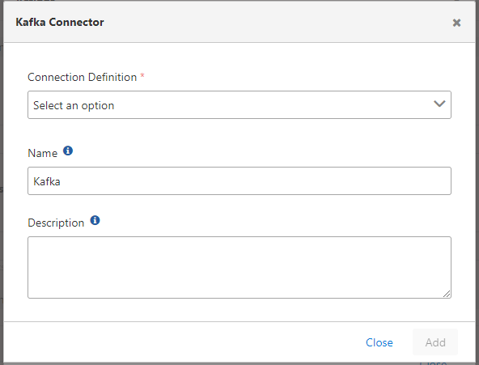

import {Card, CardGroup} from '@site/src/components/Card';

## Configuration

Configuration fields:

<CardGroup cols={1}>
  <Card title="Connection Definition" icon="plug">
    **Field:** Connection Definition
    
    The definition belonging to the Kafka connection is selected from the pool. For detailed information about creating connections, [click here](/en/integrations/connection-management/kafka).
  </Card>
</CardGroup>

:::note

When this connector is used as a log target, it opens its own connection for log delivery and works independently of the other log targets. See [Log Delivery](/en/integrations/connectors/overview#log-delivery).

:::
