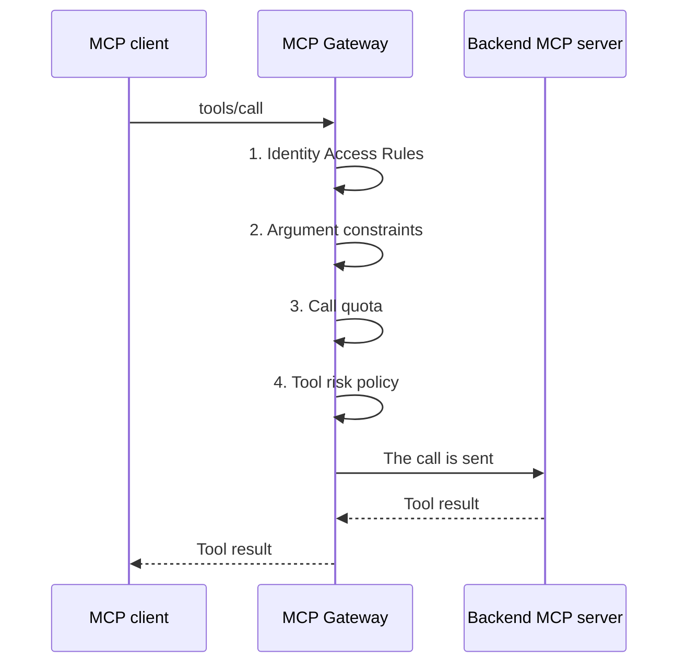

import {Steps, Step} from '@site/src/components/Steps';

## What You Build

In this scenario you add four checks to the **Order Desk MCP** proxy. The proxy is a Passthrough proxy. The checks run on every `tools/call`.

| Card | Question that it answers |
|---|---|
| **Identity Access Rules** | Which caller may see and call which tool? |
| **Argument constraints** | Are the arguments of the call valid? |
| **Call quota** | How many calls can one caller make in a time window? |
| **Tool risk policy** | Does a person need to approve the call first? |

A call passes the checks in this order. A refusal at one step stops the call. The next steps do not run.



On an Expose Tools proxy, the **Required Scopes** check of the tool runs between step 1 and step 2. See [Expose Tools Proxies](/en/tutorials/ai-proxy-scenarios/mcp-gateway-browser-sign-in#expose-tools-proxies).

The reference for each card is in [MCP Gateway](/en/ai-gateway/mcp-gateway#identity-based-access-control). This page shows how to use the cards in one scenario.

## Prerequisites

Complete the setup of [MCP Gateway Browser Sign-In Without Keycloak](/en/tutorials/ai-proxy-scenarios/mcp-gateway-browser-sign-in) first. The checks need a caller identity. The examples use this setup:

| Item | Example |
|---|---|
| Proxy | **Order Desk MCP**, Passthrough, path `/order-desk`, Standard MCP OAuth profile. |
| Token policy | A JWT policy in **Manage From ACL** mode. |
| Application | **Claude Code**, with the public API client `claude-code-desktop`. |
| Consumers | `jane.doe` (role **Order Viewer**) and `sam.lee` (roles **Order Viewer** and **Order Manager**). |
| Roles | **Order Viewer** (OAuth Scope Name `orders.read`) and **Order Manager** (OAuth Scope Name `orders.write`). |
| Backend MCP server | `order-desk`, with three tools. |

The tools of the backend server:

| Tool | Annotation | Arguments |
|---|---|---|
| `get_order_status` | `readOnlyHint` | `orderId` |
| `list_open_orders` | `readOnlyHint` | None |
| `cancel_order` | `destructiveHint` | `orderId`, `reason` |

## Where the Cards Are

Open the **MCP Routing** tab of the proxy. The cards are below the list of backend MCP servers. Each card has a **Configure** button. The button is disabled if you do not have manage permission on the API proxy.


The same cards exist on an Expose Tools proxy. On that proxy, the default risk tier of a tool comes from the HTTP method of the operation: GET is Low, POST is Medium and DELETE is High.

## Identity Access Rules

This card sets who may see and call which tool. A caller that a rule does not allow does not see the tool in `tools/list` and cannot call it.

<Steps>
  <Step title="Open the card">
    On the **MCP Routing** tab, select **Configure** on the **Identity Access Rules** card.
  </Step>

  <Step title="Add the rule for viewers">
    Select **Add Rule**. Set **Applies To** to **Role** and **Name** to `Order Viewer`. In **Allow**, add `get_order_status` and `list_open_orders`.
  </Step>

  <Step title="Add the rule for managers">
    Select **Add Rule** again. Set **Applies To** to **Role** and **Name** to `Order Manager`. In **Allow**, add `cancel_order`.
  </Step>

  <Step title="Save and deploy">
    Select **Save**. Deploy the proxy.
  </Step>
</Steps>


How the rules work:

- A rule applies to a **Credential**, a **Role** or an **Organization**.
- An empty **Allow** list means every name.
- A name in **Deny** always wins.
- When the list has no rules, every authenticated caller sees and calls every tool. When the list has rules, a caller that no rule matches gets nothing.
- The rules of all matching principals combine. `sam.lee` has both roles, so `sam.lee` gets the tools of both rules.

See [Identity-Based Access Control](/en/ai-gateway/mcp-gateway#identity-based-access-control).

### Try it

Send `tools/list` with the access token of each user. Get the token with the steps of the [sign-in tutorial](/en/tutorials/ai-proxy-scenarios/mcp-gateway-browser-sign-in#verifying-with-curl).

```bash
curl -s -X POST https://gateway.example.com/apigateway/order-desk \
  -H "Authorization: Bearer <access token of jane.doe>" \
  -H "Content-Type: application/json" \
  -H "Accept: application/json, text/event-stream" \
  -d '{"jsonrpc":"2.0","id":1,"method":"tools/list"}'
```

| Caller | Tools in the answer |
|---|---|
| `jane.doe` | `get_order_status`, `list_open_orders` |
| `sam.lee` | `get_order_status`, `list_open_orders`, `cancel_order` |

Now call `cancel_order` with the token of `jane.doe`:

```bash
curl -s -X POST https://gateway.example.com/apigateway/order-desk \
  -H "Authorization: Bearer <access token of jane.doe>" \
  -H "Content-Type: application/json" \
  -H "Accept: application/json, text/event-stream" \
  -d '{"jsonrpc":"2.0","id":2,"method":"tools/call","params":{"name":"cancel_order","arguments":{"orderId":"SO-10421","reason":"Customer withdrew the order"}}}'
```

The answer is an HTTP 200 response with a JSON-RPC error. Depending on the client, the body is JSON or an SSE `data:` frame:

```json
{"jsonrpc":"2.0","id":2,"error":{"code":-32603,"message":"Tool call rejected: the target API requires policies (e.g. authentication or rate-limit) that the MCP gateway cannot apply on this path."}}
```

:::note
The gateway uses one generic refusal message for this case. It does not tell the caller why the call is refused. You can change the text of the message on the [Error Messages](/en/admin/system-settings/error-messages) screen.
:::

## Argument Constraints

This card validates the arguments of a tool call before the gateway sends the call.

<Steps>
  <Step title="Open the card">
    Select **Configure** on the **Argument constraints** card.
  </Step>

  <Step title="Add the rules of get_order_status">
    Add the tool `get_order_status`. Add one rule: **Argument path** `orderId`, **Rule** **Regex (full match)**, **Value** `^SO-[0-9]{5}$`.
  </Step>

  <Step title="Add the rules of cancel_order">
    Add the tool `cancel_order`. Add three rules:

    | Argument path | Rule | Value |
    |---|---|---|
    | `orderId` | **Regex (full match)** | `^SO-[0-9]{5}$` |
    | `reason` | **Required** | Not used |
    | `reason` | **Maximum length** | `200` |
  </Step>

  <Step title="Save and deploy">
    Select **Save**. Deploy the proxy.
  </Step>
</Steps>


Rules that you must know:

| Rule | Value | The call is rejected when |
|---|---|---|
| **Regex (full match)** | A regular expression | The argument does not match the whole expression. |
| **Maximum length** | A whole number | The text of the argument is longer. |
| **Allowed values** | Values separated by commas | The argument is not one of the values. |
| **Required** | None | The argument is missing. |

- **Regex (full match)**, **Maximum length** and **Allowed values** check an argument only when it is present. Add a **Required** rule to make the argument mandatory.
- The argument path is a list of property names separated by dots, for example `user.email`. Array indexes and wildcards are not supported.
- Environment variables (`${var}`) are resolved at run time.
- The tool name must be the same as the name in `tools/list`. The match is case-sensitive. When two servers share a tool name, it shows as `server__tool`.

See [Argument Constraints](/en/ai-gateway/mcp-gateway#argument-constraints).

### Try it

Call `get_order_status` with an `orderId` that does not match the expression:

```bash
curl -s -X POST https://gateway.example.com/apigateway/order-desk \
  -H "Authorization: Bearer <access token of jane.doe>" \
  -H "Content-Type: application/json" \
  -H "Accept: application/json, text/event-stream" \
  -d '{"jsonrpc":"2.0","id":3,"method":"tools/call","params":{"name":"get_order_status","arguments":{"orderId":"10421"}}}'
```

```json
{"jsonrpc":"2.0","id":3,"error":{"code":-32602,"message":"Bad request. argument constraint violated: path='orderId' rule=REGEX constraint='^SO-[0-9]{5}$'"}}
```

Call `cancel_order` as `sam.lee` without `reason`:

```bash
curl -s -X POST https://gateway.example.com/apigateway/order-desk \
  -H "Authorization: Bearer <access token of sam.lee>" \
  -H "Content-Type: application/json" \
  -H "Accept: application/json, text/event-stream" \
  -d '{"jsonrpc":"2.0","id":4,"method":"tools/call","params":{"name":"cancel_order","arguments":{"orderId":"SO-10421"}}}'
```

```json
{"jsonrpc":"2.0","id":4,"error":{"code":-32602,"message":"Bad request. argument constraint violated: path='reason' rule=REQUIRED"}}
```

The message names the rule from your configuration. It never repeats the value that the client sent.

## Call Quota

This card limits how often a tool can be called.

<Steps>
  <Step title="Open the card">
    Select **Configure** on the **Call quota** card.
  </Step>

  <Step title="Set the limit">
    Turn on **Limit tool calls**. Set **Call limit** to `10`, **Time window** to `minute` and **Count by** to `Per tool and credential`.
  </Step>

  <Step title="Save and deploy">
    Select **Save**. Deploy the proxy.
  </Step>
</Steps>


| Option | Counter |
|---|---|
| **Per tool** | One counter for each tool. |
| **Per credential** | One counter for each caller. |
| **Per tool and credential** | One counter for each caller on each tool. |

The time windows are **minute**, **hour** and **day**. See [Call Quotas](/en/ai-gateway/mcp-gateway#call-quotas).

### Try it

Call `get_order_status` 11 times in one minute as `sam.lee`, with a valid `orderId`:

```bash
curl -s -X POST https://gateway.example.com/apigateway/order-desk \
  -H "Authorization: Bearer <access token of sam.lee>" \
  -H "Content-Type: application/json" \
  -H "Accept: application/json, text/event-stream" \
  -d '{"jsonrpc":"2.0","id":5,"method":"tools/call","params":{"name":"get_order_status","arguments":{"orderId":"SO-10421"}}}'
```

Calls 1 to 10 succeed. Call 11 returns:

```json
{"jsonrpc":"2.0","id":5,"error":{"code":-32000,"message":"Call quota exceeded. Try again later."}}
```

In the same minute, `get_order_status` as `jane.doe` and `list_open_orders` as `sam.lee` still succeed. They use separate counters.

:::warning
Every attempt that reaches the quota step counts. This includes an attempt that the risk policy then holds for approval, and the retry after the approval. A tool that needs approval can use the whole quota with held attempts. In a test, 10 attempts of `cancel_order` that were each held for approval used the whole quota, and attempt 11 returned `-32000`. When a tool needs approval, set the call limit high enough for the retries.
:::

A call that an access rule or an argument constraint refused earlier does not reach the quota step. It does not count.

## Tool Risk Policy and Pending Tool Approvals

This card holds risky tools until a person approves the call.

<Steps>
  <Step title="Open the card">
    Select **Configure** on the **Tool risk policy** card.
  </Step>

  <Step title="Turn on the policy">
    Turn on **Apply the tool risk policy**. When the policy is off, every call is allowed. The exemptions and the tool risk tiers stay saved.
  </Step>

  <Step title="Set the action of each tier">
    Under **Action per risk tier**, set **Low** to **Allow**, **Medium** to **Allow** and **High** to **Require approval**.
  </Step>

  <Step title="Save and deploy">
    Select **Save**. Deploy the proxy.
  </Step>
</Steps>


The actions of a tier are **Allow**, **Require approval** and **Deny**.

**Tier of a Passthrough tool.** The gateway uses the first rule that matches:

1. A row in **Tool risk tiers** for the tool name.
2. The annotations of the backend server: `readOnlyHint` gives Low and `destructiveHint` gives High.
3. Medium.

In the example, `get_order_status` and `list_open_orders` are Low. `cancel_order` is High, so it needs approval.

**Exemptions.** For a matching identity (credential, role or organization), **Require approval** becomes **Allow**. **Deny** does not change. The exemption checks only the identity, so it applies to every tool.

See [Tool Risk Policy and Approval](/en/ai-gateway/mcp-gateway#tool-risk-policy-and-approval) for the tiers and the annotation options.

### Try it

Call `cancel_order` as `sam.lee` with valid arguments:

```bash
curl -s -X POST https://gateway.example.com/apigateway/order-desk \
  -H "Authorization: Bearer <access token of sam.lee>" \
  -H "Content-Type: application/json" \
  -H "Accept: application/json, text/event-stream" \
  -d '{"jsonrpc":"2.0","id":6,"method":"tools/call","params":{"name":"cancel_order","arguments":{"orderId":"SO-10421","reason":"Customer withdrew the order"}}}'
```

The gateway holds the call and returns:

```json
{"jsonrpc":"2.0","id":6,"error":{"code":-32021,"message":"Tool call requires approval. Retry the same call after an administrator approves it.","data":{"approvalId":"…"}}}
```

If you send the same call again before the decision, the answer holds the same `approvalId`. The gateway does not create a second request.

### Approve the call

<Steps>
  <Step title="Open the list">
    On the **MCP Routing** tab, open **Pending tool approvals**. Select **Refresh** if the request does not show.

    

    The list shows the environment, the tool, the risk tier, the caller, the client ID, the operation, the request time and the expiry time.
  </Step>

  <Step title="Approve the request">
    Select **Approve**. Read the question and confirm.

    
  </Step>

  <Step title="Send the call again">
    The client sends the same call again. The gateway runs it one time and returns the tool result:

    ```text
    Order SO-10421 was cancelled: Customer withdrew the order
    ```
  </Step>
</Steps>

The approval is single use. The next identical call creates a new approval request. A client that supports MCP Tasks gets a task instead of the `-32021` error, and it can read the result with `tasks/get`.

See [Pending tool approvals](/en/ai-gateway/mcp-gateway#pending-tool-approvals) for the permission that you need and for the audit log.

## Tool Output Filter

The **Tool Output Filter** card is not part of this scenario. It checks the answer of the tool, not the call. It can mask personal data (PII) and block a response that matches a deny pattern (a regular expression). See [Tool Output Filter](/en/ai-gateway/mcp-gateway#tool-output-filter).

## Results

| Caller | Call | Card that decides | Answer |
|---|---|---|---|
| `jane.doe` | `tools/list` | Identity Access Rules | `get_order_status`, `list_open_orders` |
| `sam.lee` | `tools/list` | Identity Access Rules | `get_order_status`, `list_open_orders`, `cancel_order` |
| `jane.doe` | `cancel_order` | Identity Access Rules | `-32603`, generic refusal message |
| `jane.doe` | `get_order_status` with `orderId` `10421` | Argument constraints | `-32602`, `rule=REGEX` |
| `sam.lee` | `cancel_order` without `reason` | Argument constraints | `-32602`, `rule=REQUIRED` |
| `sam.lee` | `get_order_status`, call 11 in one minute | Call quota | `-32000`, "Call quota exceeded. Try again later." |
| `jane.doe` | `get_order_status` in the same minute | Call quota | Tool result (separate counter) |
| `sam.lee` | `cancel_order` with valid arguments | Tool risk policy | `-32021` with `approvalId` |
| `sam.lee` | The same call after **Approve** | Tool risk policy | Tool result |

## Limits and Behavior

**Check order.** The gateway checks Identity Access Rules first, then argument constraints, then the call quota, then the tool risk policy. On an Expose Tools proxy, the **Required Scopes** check runs after the identity rules. A refusal at one step stops the call. The next steps do not run.

**Error answers.** The gateway returns each refusal as an HTTP 200 response with a JSON-RPC error. The body is JSON or an SSE `data:` frame. Read the `error.code` field, not the HTTP status.

**Quota and approval.** The quota step runs before the risk policy. Every attempt that reaches it counts: a held attempt and the retry after the approval too. Size the limit for the retries.

**Generic refusal.** For a caller that the identity rules do not allow, the gateway uses one generic message on purpose. The message does not reveal why the call is refused. You can change the message text on the [Error Messages](/en/admin/system-settings/error-messages) screen.

**Approval.**
- An approval is single use. The next identical call needs a new approval.
- A request expires 15 minutes after it is created.
- One caller can have at most 20 open approval requests on one proxy.
- The approval is bound to the environment, the caller, the tool and the arguments.
- The decisions that you make in the Manager are written to the audit log.

## Troubleshooting

| Problem | Cause | Fix |
|---|---|---|
| A caller sees no tool in `tools/list` | The list of **Identity Access Rules** has rules, and no rule matches the caller. | Add a rule for the credential, the role or the organization of the caller. |
| A tool is missing for a caller that has the right role | A **Deny** entry of a matching rule lists the tool. A deny entry always wins. | Remove the name from **Deny**. |
| `-32603` with the message "Tool call rejected: the target API requires policies…" | The identity rules do not allow the caller to call the tool. | Check the rule of the role of the caller. |
| An argument rule has no effect | The tool name in the rule is not the same as the name in `tools/list`, or the argument path is wrong. | Copy the name from `tools/list`. Use dot-separated property names. |
| A missing argument passes the check | **Regex (full match)**, **Maximum length** and **Allowed values** check an argument only when it is present. | Add a **Required** rule. |
| `-32000` "Call quota exceeded" earlier than you expect | Held and retried attempts count. | Raise the call limit or use a longer time window. |
| `-32000` for one caller only | **Count by** is **Per credential** or **Per tool and credential**, so each caller has own counter. | Check the **Count by** option. |
| A destructive tool does not need approval | The tool risk policy is off, an exemption matches the caller, or a **Tool risk tiers** row sets a lower tier. | Check the switch, the **Exemptions** list and the **Tool risk tiers** list. |
| The request does not show in **Pending tool approvals** | The request expired after 15 minutes, or it is in another environment. | Select **Refresh**. Send the call again to create a new request. |
| The call after **Approve** returns `-32021` again | The approval is single use, or the arguments of the call are not the same. | Send the call with the same arguments, right after the approval. |
| The call returns an error about open approval requests | The caller has 20 open approval requests. | Approve or reject the open requests, or wait until they expire. |

## Checking the Setup

- When `jane.doe` sends `tools/list`, does the answer show only `get_order_status` and `list_open_orders`?
- When `sam.lee` sends `tools/list`, does the answer show all three tools?
- When `jane.doe` calls `cancel_order`, does the call return the generic refusal with code `-32603`?
- When `get_order_status` gets an `orderId` that does not start with `SO-`, does the call return `-32602` with `rule=REGEX`?
- When `cancel_order` has no `reason`, does the call return `-32602` with `rule=REQUIRED`?
- When `sam.lee` calls `get_order_status` 11 times in one minute, does call 11 return `-32000`?
- In the same minute, does `jane.doe` still call `get_order_status`?
- When `sam.lee` calls `cancel_order` with valid arguments, does the call return `-32021` with an `approvalId`?
- When you send the same call again before the decision, does the answer hold the same `approvalId`?
- Does the request show in **Pending tool approvals** with the risk tier High?
- After **Approve**, does the same call return the tool result?
- When you send the same call a second time after the approval, does the gateway create a new approval request?
- When you turn off **Apply the tool risk policy**, does `cancel_order` run without approval?
