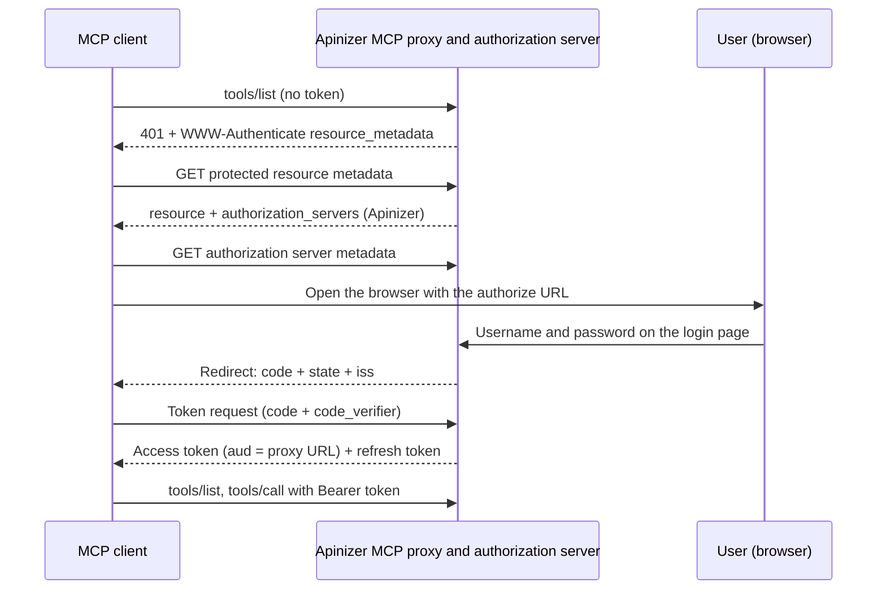

import {Steps, Step} from '@site/src/components/Steps';

## What You Build

In this scenario you use the Apinizer OAuth2 or JWT policy as the authorization server. You do not need an external identity provider.

- An MCP Gateway that uses the Standard MCP OAuth profile.
- A flow where the user signs in on the Apinizer login page in the browser (authorization code + PKCE).
- An application, with a public API client, that gets tokens on behalf of the user.

There are two management modes. The OAuth2 or JWT policy of the proxy selects the mode.

| | Manage From ACL | Manage From This Policy |
|---|---|---|
| Endpoint family | `/credential` | `/auth` |
| Issuer | `https://gateway.example.com/credential` | `https://gateway.example.com/auth` |
| Signed-in user | An Apinizer consumer. A local password, or a consumer synchronized with LDAP. | A user of the identity source of the policy: Secret Manager, LDAP, database or API. |
| Access | ACL row of the user ∩ ACL row of the application | Authorization of the policy ∩ ACL row of the application |
| Extra policy setting | None. You turn on browser login in the API client. | The **Browser login (authorization_code)** switch |



The profile itself is described in [Standard MCP Client Profile](/en/ai-gateway/mcp-gateway#standard-mcp-client-profile). To use an external identity provider instead, see [MCP Gateway Sign-In with Keycloak](/en/tutorials/ai-proxy-scenarios/mcp-gateway-keycloak-oauth-sign-in).

## Prerequisites

- The **access URL** of the environment is defined. The issuer comes only from this configuration. Without an access URL, browser login is closed: the authorization endpoint is not advertised, and an authorize request returns an error.
- **All workers** of the environment run a version that supports browser login. Upgrade every worker first, then turn on browser login.
- The access URL uses HTTPS. The login page keeps the sign-in in a secure browser cookie, and browsers accept this cookie only over HTTPS. For local development, `http://localhost` and `http://127.0.0.1` also work.
- If an ingress adds a path prefix, it must route the host-root `/.well-known/oauth-authorization-server/...` path to the gateway. See [Limits and Behavior](#limits-and-behavior).
- The identity source of the users is not **OIDC**. Browser login does not support an OIDC identity source.

The examples use the gateway `https://gateway.example.com` and the proxy path `/jira-pt`. The canonical resource of the proxy is:

```text
https://gateway.example.com/apigateway/jira-pt
```

## Common Steps for Both Modes

### The application and the public API client

An API client of any owner, an application or a consumer, can use browser login. This guide uses an API client of an application.

<Steps>
  <Step title="Create the application">
    Create an application that represents the client that gets tokens on behalf of the user. See [Portal Applications](/en/admin/identity-management/portal-applications).
  </Step>

  <Step title="Create an API client">
    On the **API Clients** tab of the application, create a new API client. The **client ID** of the client is the OAuth `client_id`.
  </Step>

  <Step title="Turn on browser login">
    In the client editor, turn on **Browser login (authorization code + PKCE)** and fill in these fields:

    | Field | Value |
    |---|---|
    | Client type | **Public (no secret)**. MCP clients cannot keep a secret. |
    | Redirect URIs | The redirect URI that the MCP client uses. One URI on each line. |
    | Access token lifetime | A finite lifetime. |
    | Allow refresh token | On. Enter a finite refresh lifetime. |

    There is no limit on the number of redirect URIs. Each URI must be different, absolute, without a fragment, and at most 2048 characters. `http` is allowed on any host. A redirect URI is matched exactly. For `http://127.0.0.1`, `http://[::1]` and `http://localhost`, only the port can differ.
  </Step>

  <Step title="Save and activate the client">
    Save the client and activate it. A public client needs no secret. If the client has secrets, they are kept but not used while the client is public.
  </Step>
</Steps>

:::warning
Browser login never issues a token without an expiry. You cannot save a client with an empty or `0` access or refresh lifetime.
:::

### The ACL row of the application

The application must have an access row for the MCP proxy. Add the row under the identity of the application in the [Access Control](/en/admin/identity-management/access-control) screen. Without access for the application, Apinizer does not open the login page for the user and returns `unauthorized_client`.

Access follows this rule: **access of the user ∩ access of the application**. If one is missing, the token does not work. If you remove one of the two rows after a token is issued, the gateway refuses the call with `403`.

## A. Manage From ACL Mode (`/credential`)

<Steps>
  <Step title="Prepare the user">
    Create a **Consumer** for the person who signs in. The consumer can have a local password, or can be synchronized with LDAP. A consumer synchronized with Keycloak or another OIDC provider is not supported. The identity of an application and its API clients cannot be users.
  </Step>

  <Step title="Give the user access">
    Add the access row of the consumer for the MCP proxy. See [API Proxy ACL](/en/admin/identity-management/api-proxy-acl).
  </Step>

  <Step title="Give the application access">
    Add the access row of the application for the same proxy. The row is described [above](#the-acl-row-of-the-application).
  </Step>

  <Step title="Add the token policy">
    Add a JWT or OAuth2 policy with **Manage From ACL** to the MCP proxy. See [JWT](/en/develop/policies/jwt) and [OAuth2](/en/develop/policies/oauth2). The token format (JWT or opaque) follows the policy. The token lifetimes come from the API client.
  </Step>

  <Step title="Select the profile">
    On the **MCP Routing** tab, select **Configure** in the **Routing Mode** panel. Under **Client Authentication Profile**, select **Standard MCP OAuth** and save. Deploy the proxy.
  </Step>
</Steps>

In this mode the client uses `https://gateway.example.com/credential/authorize` and `https://gateway.example.com/credential/token`. The same family also has the `/credential/revoke` and `/credential/introspect` endpoints.

## B. Manage From This Policy Mode (`/auth`)

<Steps>
  <Step title="Configure the token policy">
    Add a JWT or OAuth2 policy with **Manage From This Policy** to the MCP proxy. Select the identity source: Secret Manager, LDAP, database or API. When you select OIDC, the switch is off.
  </Step>

  <Step title="Set finite token lifetimes">
    Turn off **Token Never Expires** and enter an access token lifetime. If you allow a refresh token, enter a finite refresh lifetime. The policy cannot be saved with lifetimes that are not finite.
  </Step>

  <Step title="Turn on browser login">
    Turn on the **Browser login (authorization_code)** switch in the policy. The selected legacy grant (client credentials or password) keeps working.
  </Step>

  <Step title="Prepare the application and its ACL row">
    Prepare the application, the public API client and the ACL row of the application from the [common steps](#common-steps-for-both-modes). The application needs its ACL row in this mode too.
  </Step>

  <Step title="Select the profile and deploy">
    Select the **Standard MCP OAuth** profile in the proxy. Save the policy and redeploy the proxy. Turning the switch on or off needs a new save and deploy.
  </Step>
</Steps>

In this mode the client uses `https://gateway.example.com/auth/authorize` and `https://gateway.example.com/auth/token`. The `client_id` is the **client ID of the API client** of the application. It is not the proxy Client Id from the **Show API Key** window.

The users come from the identity source of the policy:

- **Secret Manager.** The user must be a consumer. The gateway checks the user again on every request.
- **LDAP, database, API.** The source is not queried on every request. The roles are queried again at refresh.

The roles travel in the scope of the token. A client can ask for a role by its name or by the **OAuth Scope Name** of the role. Both give the role.

## Connecting an MCP Client

A standard MCP client (Claude Code, MCP Inspector) follows this order by itself:

1. The client calls without a token and reads the `resource_metadata` address in the `401` answer.
2. The client reads `<proxy URL>/.well-known/oauth-protected-resource`. The document names the Apinizer issuer in `authorization_servers`: `/credential` or `/auth`.
3. The client reads the authorization server metadata.
4. The client opens the browser with the Apinizer login page.

The login page shows the name of the application, the redirect address and the target resource. The page has username and password fields and a **Sign in and allow** button. If the password is wrong, the same page opens again with an error message. If the sign-in succeeds, Apinizer redirects the browser to the redirect address with the `code`, `state` and `iss` parameters. The client exchanges the code for a token and calls the tools.

For Claude Code, give the client ID of the API client and a fixed callback port. The registered redirect URI and the address that the client uses must be the same.

```bash
claude mcp add --transport http --client-id <client ID of the API client> --callback-port 33418 jira-pt https://gateway.example.com/apigateway/jira-pt
```

Then select the server on the `/mcp` screen and use **Authenticate**.

MCP Inspector runs in the browser. Allow the origin of Inspector in CORS, so that the browser can send requests to the token endpoint. In Manage From ACL mode, the CORS setting of the worker in the environment applies. In Manage From This Policy mode, the CORS setting on the **Settings** tab of the proxy applies. See [Token Service](/en/develop/policies/token-service/overview).

## Verifying with curl

The examples use the Manage From ACL mode. For the other mode, write `/auth` instead of `/credential`.

**1. Read the metadata.** The protected resource metadata names the Apinizer issuer. The authorization server metadata is at the canonical address:

```bash
curl -s https://gateway.example.com/apigateway/jira-pt/.well-known/oauth-protected-resource

curl -s https://gateway.example.com/.well-known/oauth-authorization-server/credential
```

**2. Generate a PKCE pair:**

```bash
VERIFIER=$(openssl rand -base64 48 | tr -d '=+/\n' | cut -c1-64)
CHALLENGE=$(printf '%s' "$VERIFIER" | openssl dgst -sha256 -binary | openssl base64 -A | tr '+/' '-_' | tr -d '=')
echo "$CHALLENGE"
```

**3. Open the authorize URL in a browser.** The `redirect_uri` must be registered in the API client. `resource` is required:

```text
https://gateway.example.com/credential/authorize?response_type=code&client_id=<client ID>&redirect_uri=http%3A%2F%2F127.0.0.1%3A33418%2Fcb&code_challenge=<CHALLENGE value>&code_challenge_method=S256&resource=https%3A%2F%2Fgateway.example.com%2Fapigateway%2Fjira-pt&state=abc123
```

Enter the username and password on the login page. The browser goes to `http://127.0.0.1:33418/cb?code=...&state=abc123&iss=...`. If nothing listens on this port, the browser shows a connection error. Copy the `code` value from the address bar. The `iss` value equals the issuer.

**4. Exchange the code for a token.** Send `code` in the body. A `code` in the URL query is refused:

```bash
curl -s -X POST https://gateway.example.com/credential/token \
  -d grant_type=authorization_code \
  -d code=<code value> \
  -d code_verifier="$VERIFIER" \
  -d redirect_uri=http://127.0.0.1:33418/cb \
  -d client_id=<client ID> \
  -d resource=https://gateway.example.com/apigateway/jira-pt
```

The answer contains `access_token`, `refresh_token`, `expires_in` and `token_type`. The header of a JWT access token has `typ: at+jwt`.

**5. Call the proxy:**

```bash
curl -i -X POST https://gateway.example.com/apigateway/jira-pt \
  -H "Authorization: Bearer <access_token>" \
  -H "Content-Type: application/json" \
  -H "Accept: application/json, text/event-stream" \
  -d '{"jsonrpc":"2.0","id":1,"method":"tools/list"}'
```

**6. Refresh the token.** The refresh token rotates on every use. If you send an old refresh token again, Apinizer revokes the whole token family:

```bash
curl -s -X POST https://gateway.example.com/credential/token \
  -d grant_type=refresh_token \
  -d refresh_token=<refresh_token> \
  -d client_id=<client ID>
```

**7. Sign out.** A public client revokes its own token with the `client_id` only. Revoking the refresh token ends the whole family:

```bash
curl -s -X POST https://gateway.example.com/credential/revoke \
  -d token=<refresh_token> \
  -d client_id=<client ID>
```

## Limits and Behavior

**Access URL and issuer.** The issuer comes only from the access URL of the environment. Request headers do not set the issuer. Without an access URL, browser login is closed.

**Metadata addresses.** The canonical address follows RFC 8414: `https://gateway.example.com/.well-known/oauth-authorization-server/credential` or `.../auth`. The older addresses keep working: `/auth/.well-known/oauth-authorization-server`, `/credential/.well-known/oauth-authorization-server` and `/credential/.well-known/openid-configuration`. When the issuer equals the configured value, the older documents also contain the new fields.

**Ingress prefix.** If an ingress adds a prefix to the path, the issuer carries this prefix too. The canonical address becomes `https://host/.well-known/oauth-authorization-server/<prefix>/auth`. In the ingress, route the host-root `/.well-known/oauth-authorization-server` path to the gateway. This is an installation step.

**Not supported.**
- Proxy group policies. If you add a policy with browser login on to a proxy group, the save is refused.
- Method-level policies.
- An OIDC identity source. In this case, use the own login of the OIDC provider.
- Dynamic client registration (DCR) and client ID metadata documents (CIMD).

**Protocol rules.**
- Only PKCE `S256` is accepted.
- The redirect URI is matched exactly. On loopback addresses only the port is free.
- `resource` is required. Without it, or if this authorization server does not serve it, `invalid_target` is returned.
- The redirect carries the RFC 9207 `iss` parameter.
- A JWT access token has `typ: at+jwt` in its header.
- The refresh token rotates on every use. If a used refresh token comes again, the token family is revoked.
- After a family is revoked, a JWT access token stays valid until it expires. For an immediate effect, set [Revocation Strictness](/en/admin/identity-management/token-management-settings#revocation-strictness) to **STRICT**.

**Sign-in lifetime.** At sign-in, a ceiling is set: the longest of the access and refresh lifetimes. Refresh does not extend this ceiling. When the ceiling is reached, the user signs in again.

**Turning the switch off.** In Manage From This Policy mode, if you turn the switch off, save and deploy, the tokens issued by browser login become invalid immediately. The refresh of these tokens is refused too. Tokens from the legacy grants are not affected.

**Disabling an account.**
- Secret Manager users are checked again on every request.
- With LDAP, database and API sources, an account that is disabled in the source can work until the token family expires. A deleted user or a revoked role is dropped at refresh. In a token family that carries no role, a deleted user can also work until the family expires.
- If a consumer is suspended, or an API client is revoked, the tokens stop on the next request.

**Role authorization.** At sign-in, the role authorization on method level is not asked, because there is no method yet. A user whose role is not enough gets a token. The gateway refuses the call.

**Legacy flows.** Tokens from `client_credentials`, `password` and the older `refresh_token` keep working. An MCP proxy with the Standard profile still refuses a token of the legacy type.

## Troubleshooting

| Problem | Cause | Fix |
|---|---|---|
| The authorize request shows an error page and does not redirect | The `client_id` is unknown, or the `redirect_uri` does not match a registered address. | Compare the address with the registration in the API client, character by character. |
| `unauthorized_client` | The application has no ACL row for the proxy, or `authorization_code` is not on for this client. | Check the ACL row of the application and the browser login switch. |
| `access_denied` | The user has no ACL row. | Give the user access to the proxy. |
| `invalid_target` | `resource` is missing or does not match the canonical resource. The client targets a proxy in the other mode. | Check the canonical resource. Check the mode of the policy and the endpoint family. |
| A lifetime error when you save | The access or refresh lifetime is not finite. | Enter a finite lifetime. An authorize request also returns `invalid_request` for an infinite setting. |
| The protected resource metadata address answers `404` | The Standard profile is not selected, or the chain does not fit the profile. | Check the prerequisites in [Standard MCP Client Profile](/en/ai-gateway/mcp-gateway#standard-mcp-client-profile). |
| The canonical authorization server address answers `404` | The access URL of the environment is not defined, or the path is not `/auth` or `/credential`. | Define the access URL. Check the path. |
| After the password, the page says the sign-in expired or does not continue | The access URL is plain `http` on an address that is not loopback, so the browser drops the secure sign-in cookie; or the user opened the login page from another address than the access URL. | Use an HTTPS access URL and open the authorize address under it. |
| Sign-in works but the call gets `403` | After the token, the ACL row of the user or the application was removed, or the role is not enough. | Check the ACL rows and the OAuth scope name of the role. |

## Checking the Setup

- When you add the proxy to Claude Code, does the Apinizer login page open?
- Does the login page show the application name and the target resource?
- When you enter a wrong password, does the same page open again with an error message?
- After the sign-in, does the tool list arrive?
- When the access token expires, does the client keep working without a new sign-in?
- When you send the same refresh token a second time, is the request refused?
- When you remove the ACL row of the application, is the next call refused?
- When you remove the ACL row of the user, is the next call refused?
- When you disable the consumer, is the next call refused?
- In Manage From This Policy mode, when you turn the switch off and deploy, is a token from browser login refused?
- Does the sign-in work in both the Manage From This Policy and the Manage From ACL mode?
- Does an older `client_credentials` token still work?
