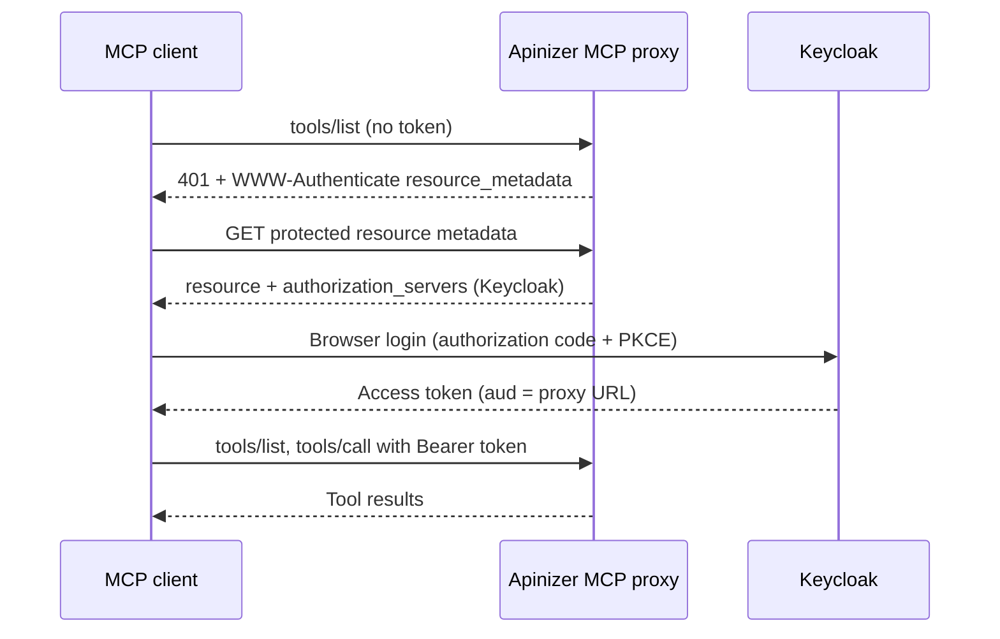

import {Steps, Step} from '@site/src/components/Steps';

## What You Build

In this scenario you set up one identity provider (Keycloak) and two MCP Gateways that trust it:

- A **Passthrough** proxy in front of an existing MCP server. The example uses a read-only Jira MCP server.
- An **Expose Tools** proxy that publishes a REST API (a small Jira REST subset in the example) as MCP tools.
- An MCP client (Claude Code) that signs in through the browser and calls the tools of both proxies.

Both proxies use the **Standard MCP OAuth** client authentication profile with an **OIDC Authentication** policy that trusts Keycloak. The profile itself is described in [Standard MCP Client Profile](/en/ai-gateway/mcp-gateway#standard-mcp-client-profile).



:::note
This scenario uses an external identity provider. You can also sign in through the browser with the own OAuth2 and JWT policy of Apinizer, without an external identity provider. See [MCP Gateway Browser Sign-In Without Keycloak](/en/tutorials/ai-proxy-scenarios/mcp-gateway-browser-sign-in). For machine clients, see the note at the end of the page.
:::

## Prerequisites

- **Keycloak** is reachable at the **same issuer URL** from the browser of the user and from the workers of the environment. The token carries this URL in `iss`, and the workers use it to load the signing keys.
- The **access URL** of the environment is defined. The canonical resource of a proxy is built from it.
- An **MCP server** that the workers can reach. The scenario assumes an MCP server over streamable HTTP, for example `https://mcp-backend.example.com/mcp`.
- For the Expose Tools proxy, a **REST API proxy** that you want to publish as tools.
- All workers of the environment run a release that supports the Standard profile (see the warning in the reference page).

In the examples below, the gateway is `https://gateway.example.com`, the Keycloak realm is `https://keycloak.example.com/realms/mcp`, and the proxy paths are `/jira-pt` (Passthrough) and `/jira-ex` (Expose Tools). The canonical resource of a proxy is the access URL, the root context and the proxy path:

```text
https://gateway.example.com/apigateway/jira-pt
https://gateway.example.com/apigateway/jira-ex
```

## Configure Keycloak

<Steps>
  <Step title="Create or choose a realm">
    Use an existing realm or create a new one (`mcp` in the example). The issuer of the realm is `https://keycloak.example.com/realms/mcp`.
  </Step>

  <Step title="Create a public client for the MCP client">
    Create a client with these settings:

    | Setting | Value |
    |---|---|
    | Client ID | A name of your choice, for example `mcp-cli` |
    | Client authentication | Off (public client) |
    | Standard flow | On |
    | Direct access grants | Off |
    | Proof Key for Code Exchange Code Challenge Method (Advanced settings) | `S256` |
    | Valid redirect URIs | `http://localhost:*` and `http://127.0.0.1:*` |

    The MCP client opens a local port to receive the sign-in result, so the redirect URIs point to the local machine.
  </Step>

  <Step title="Add an Audience mapper for each proxy">
    Keycloak ignores the `resource` parameter of the client, so you add the canonical resource to the `aud` claim yourself. Create a client scope (for example `mcp-audience`) and add one mapper of the type **Audience** for each proxy:

    | Field | Value |
    |---|---|
    | Name | A name of your choice, for example `aud-jira-pt` |
    | Included Custom Audience | `https://gateway.example.com/apigateway/jira-pt` |
    | Add to access token | On |

    Repeat for the second proxy with `https://gateway.example.com/apigateway/jira-ex`. Then open the public client, select **Client scopes** and add the scope as a **Default** scope. A scope that is not a default scope of the client does not reach the token.
  </Step>

  <Step title="Create a test user">
    Create a user in the realm and set a password. The user signs in with this account in the browser.
  </Step>

  <Step title="Optional: create a confidential client for machine tests">
    If you want to test the proxies with curl, create a second client with **Client authentication** On and **Service accounts roles** On, and add the same scope as a default scope. You use it in [Verify with curl](#verify-with-curl).
  </Step>
</Steps>

## Create the OIDC Policy

Each proxy needs its own **OIDC Authentication** policy, because the expected audience is different for each proxy. Add the policy in the **Develop** tab of the proxy: select **Actions** → **Add Policy** on the request line and pick **OIDC Authentication**. See [OIDC Authentication](/en/develop/policies/oidc-authentication) for the full policy reference.

Set the fields in this table. Leave the other fields at their default values.

| Tab and panel | Field | Value |
|---|---|---|
| Top of the form | Configuration Profile | **OIDC (Keycloak, Okta, Azure AD, ...)** |
| **Connection** | OIDC Issuer URL | `https://keycloak.example.com/realms/mcp` |
| **Connection** | JWKS Endpoint | `https://keycloak.example.com/realms/mcp/protocol/openid-connect/certs` |
| **Connection** | Authorization Endpoint, Token Endpoint, Client ID, Redirect URI | Required by the form. Select **Auto Discover** next to the issuer to fill the endpoints, enter the client ID of the public client and any valid redirect URI. Bearer token validation does not start a browser login. |
| **Connection** → Flow Configuration | Authentication Mode | **External OIDC Provider Only** |
| **Connection** → Flow Configuration | Scopes | Include `openid` |
| **Token & Validation** → Token Validation | Bearer JWT Authentication | On |
| **Token & Validation** → JWT Validation Details | Validate JWT Locally | On |
| **Token & Validation** → JWT Validation Details | Validate JWT Signature | On |
| **Token & Validation** → JWT Validation Details | Validate Audience | On |
| **Token & Validation** → JWT Validation Details | Expected Audience | The canonical resource of **this** proxy |

:::warning
Do not reuse one policy for both proxies. A token for the first proxy has `aud` of the first proxy only, and the second proxy must reject it.
:::

## Passthrough Proxy

<Steps>
  <Step title="Create the proxy">
    Select **MCP Gateway** under **AI Gateway** and create a new MCP Gateway with the client path `/jira-pt`.
  </Step>

  <Step title="Add the backend MCP server">
    Open the **MCP Routing** tab. Select **Configure** on the **Routing Mode** panel, pick **Passthrough**, and select **Add Backend MCP Server**. In the server drawer enter a **Name**, the **Endpoint** of the MCP server and the **Authentication Scheme**: **None**, or the scheme that the server asks for. Select **Fetch tools** to check the server before you save it, then select **Save**.

    Keep **Forward client token to backend server** off. The Standard profile does not forward the token of the client to the backend.
  </Step>

  <Step title="Optional: restrict the tools">
    In **Allowed Tool Names**, select **Add Tool** and enter the tool names that clients may use. An empty list lets every discovered tool through. The example allows only read tools.
  </Step>

  <Step title="Select the profile">
    Select **Configure** on the **Routing Mode** panel again. Under **Client Authentication Profile**, select **Standard MCP OAuth**, then **Save**. The screen lists the prerequisites and does not save an unsuitable authentication chain, so add the OIDC policy first if the screen reports **No active authentication policy**.
  </Step>

  <Step title="Add the OIDC policy and deploy">
    Add the OIDC policy from the previous section with the audience `https://gateway.example.com/apigateway/jira-pt`, then deploy the proxy to the environment.
  </Step>
</Steps>

## Expose Tools Proxy

<Steps>
  <Step title="Protect the target REST API">
    Open the REST API proxy that you want to publish and add an **OAuth2** policy with **Manage From ACL**. See [OAuth2](/en/develop/policies/oauth2). Deploy the proxy.
  </Step>

  <Step title="Create the service client">
    Create a **Consumer** (API client) and give it access to the target proxy in **API Proxy Access**. This client is the **service client**: the gateway uses it to call the target on behalf of the tools.
  </Step>

  <Step title="Create the MCP proxy">
    Create a new MCP Gateway with the client path `/jira-ex`. On the **MCP Routing** tab, select **Configure** on the **Routing Mode** panel and pick **Expose Tools**.
  </Step>

  <Step title="Add the tools">
    Select **Add Tool** and fill the drawer:

    | Field | Value |
    |---|---|
    | API Proxy | The target REST API proxy |
    | Method | The operation to publish |
    | Tool Name | A readable name, for example `jira_issue` |
    | Description | What the tool does |
    | Downstream identity | **Service** |

    Add one tool for each operation. The input parameters of a tool come from the specification of the target API.
  </Step>

  <Step title="Select the profile and the service client">
    Select **Configure** on the **Routing Mode** panel. Under **Client Authentication Profile**, select **Standard MCP OAuth** and enter the **Service client** (the API client ID of the consumer from step 2), then **Save**.
  </Step>

  <Step title="Add the OIDC policy and deploy">
    Add the OIDC policy with the audience `https://gateway.example.com/apigateway/jira-ex`, then deploy the proxy.
  </Step>
</Steps>

:::info
With **Service** as the downstream identity, the target API sees the service client, not the signed-in user. The user is recorded in the traffic log of the MCP proxy. The **Delegated user** option calls the target as the signed-in user. See [Calls to the tool target](/en/ai-gateway/mcp-gateway#calls-to-the-tool-target).
:::

## Verify with curl

Run the checks for each proxy. The examples use the Passthrough proxy.

**1. Call without a token.** The gateway answers `401` and names the metadata document:

```bash
curl -i -X POST https://gateway.example.com/apigateway/jira-pt \
  -H "Content-Type: application/json" \
  -H "Accept: application/json, text/event-stream" \
  -d '{"jsonrpc":"2.0","id":1,"method":"tools/list"}'
```

The response carries a header like this:

```text
WWW-Authenticate: Bearer resource_metadata="https://gateway.example.com/apigateway/jira-pt/.well-known/oauth-protected-resource"
```

**2. Read the protected resource metadata.** The `resource` value is the canonical resource, and `authorization_servers` holds the Keycloak issuer:

```bash
curl -s https://gateway.example.com/apigateway/jira-pt/.well-known/oauth-protected-resource
```

**3. Optional: call with a machine token.** Get a token from the confidential client and call the proxy:

```bash
TOKEN=$(curl -s -X POST \
  https://keycloak.example.com/realms/mcp/protocol/openid-connect/token \
  -d grant_type=client_credentials \
  -d client_id=<machine client id> \
  -d client_secret=<machine client secret> | jq -r .access_token)

curl -i -X POST https://gateway.example.com/apigateway/jira-pt \
  -H "Authorization: Bearer $TOKEN" \
  -H "Content-Type: application/json" \
  -H "Accept: application/json, text/event-stream" \
  -d '{"jsonrpc":"2.0","id":1,"method":"tools/list"}'
```

A `200` response with the tool list shows that the signature, issuer and audience checks pass. If you use the same token on the other proxy, the gateway must answer `401`, because the audience is different.

## Sign In with Claude Code

Add each proxy to Claude Code. Use the client ID of the public client and a fixed callback port that matches the redirect URIs:

```bash
claude mcp add --transport http --client-id <public client id> --callback-port 33418 jira-pt https://gateway.example.com/apigateway/jira-pt
```

```bash
claude mcp add --transport http --client-id <public client id> --callback-port 33418 jira-ex https://gateway.example.com/apigateway/jira-ex
```

Then sign in:

<Steps>
  <Step title="Open the server list">
    In Claude Code, type `/mcp` and select the server.
  </Step>

  <Step title="Authenticate">
    Select **Authenticate**. The browser opens the Keycloak login page. Sign in with the test user.
  </Step>

  <Step title="Use the tools">
    Back in Claude Code, the server shows as connected. Ask Claude Code to call one of the tools, for example to read an issue.
  </Step>
</Steps>

MCP Inspector works the same way. Because it runs in the browser, it needs the CORS settings of the proxy to be open, as the reference page states.

## Check the Traffic Log

Open the **Traffic** tab of the proxy and select **Detailed View** on a call. The record shows the user and the client of the token, and the **MCP Details** tab shows the tool name of each call. See [User context in logs and limits](/en/ai-gateway/mcp-gateway#user-context-in-logs-and-limits) for the log fields.

## Troubleshooting

| Problem | Cause | Fix |
|---|---|---|
| `401` with `invalid_token` right after the login | The `aud` claim is missing or different. The value of the Audience mapper is not equal to the canonical resource. | Correct **Included Custom Audience** (no trailing slash), check that the scope is a default scope of the client, and sign in again. |
| `404` on the metadata address | The proxy does not use the Standard profile, or the authentication chain does not fit it. | Select **Standard MCP OAuth** and check the prerequisites table in the [reference page](/en/ai-gateway/mcp-gateway#prerequisites). |
| The browser shows "Invalid redirect uri" | The redirect URIs of the public client do not match the callback port. | Add `http://localhost:*` and `http://127.0.0.1:*`, or the exact port you pass with `--callback-port`. |
| A valid token is rejected | The worker reaches Keycloak at a different URL than the issuer in the token. | Make the issuer reachable from the workers at the same URL, and set **OIDC Issuer URL** to that value. |
| `403` with `insufficient_scope` (Expose Tools) | The token does not contain the OAuth scope of the role that the tool needs. | Check the **OAuth Scope Name** of the role and the **Required Scopes** of the tool. |
| The backend (for example Jira) records every call under one account | The backend still uses its own shared credential. The gateway does not pass the user to it. | This is the expected behavior. The gateway records the user in its own traffic log. |

:::note
For browser sign-in with the own OAuth2 and JWT policy of Apinizer, see [MCP Gateway Browser Sign-In Without Keycloak](/en/tutorials/ai-proxy-scenarios/mcp-gateway-browser-sign-in). A machine client can also get a token with `client_credentials` and give it to the MCP client as a header. Renew the token when it expires.

```bash
claude mcp add --transport http jira-pt https://gateway.example.com/apigateway/jira-pt --header "Authorization: Bearer <token>"
```
:::
