## Calling Procedures in Oracle Database with Apinizer DB to API Designer

> **Note**
>
> For OUT parameters that return a cursor, select **REF_CURSOR** as the parameter type; on Oracle this parameter is registered as `OracleTypes.CURSOR` and the returned records are added to the response as rows.

## 1. Creating DB-2-API

Define a new API via **API Creator** → **DB-2-API**. On the **Definition** step, fill in the name and description, click **Continue →** to open **Review**, then confirm to create the DB-2-API.

**The image below shows the Definition step:**

  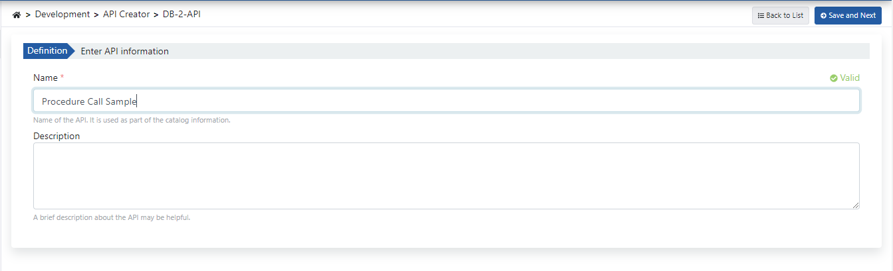

## 2. Creating Methods

Click the **+ Add endpoint** button to open the endpoint creation panel.

  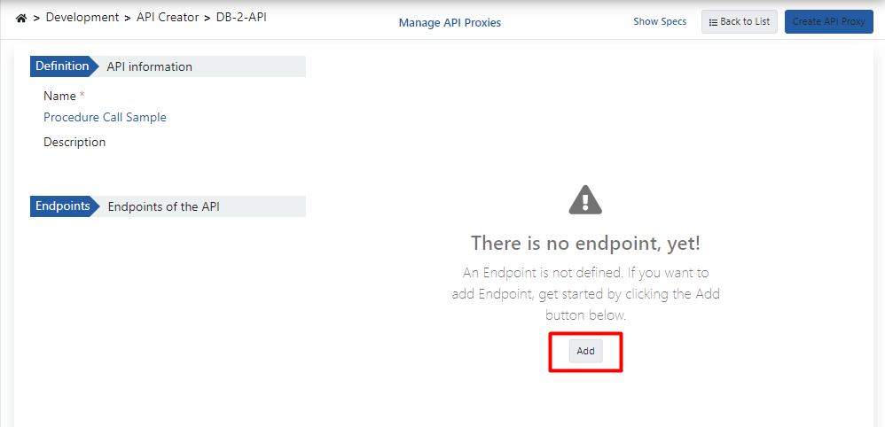

### 2.1 Calling Procedures with Only IN Parameters

The Oracle database procedure used as a demo is shown in the example below:

```sql
create or replace PROCEDURE sampleProcedureWithInParams (
  pId IN NUMBER, 
  pName IN VARCHAR2, 
  pDesc IN VARCHAR2, 
  pCost IN NUMBER, 
  pPrice IN NUMBER, 
  pCat IN NUMBER
) IS 
begin 
  INSERT INTO "TEST"."PRODUCTS" (
    PRODUCT_ID, 
    PRODUCT_NAME, 
    DESCRIPTION, 
    STANDARD_COST, 
    LIST_PRICE, 
    CATEGORY_ID
  ) VALUES (pId, pName, pDesc, pCost, pPrice, pCat); 
  commit; 
end;
```

**The image below shows method creation settings:**

  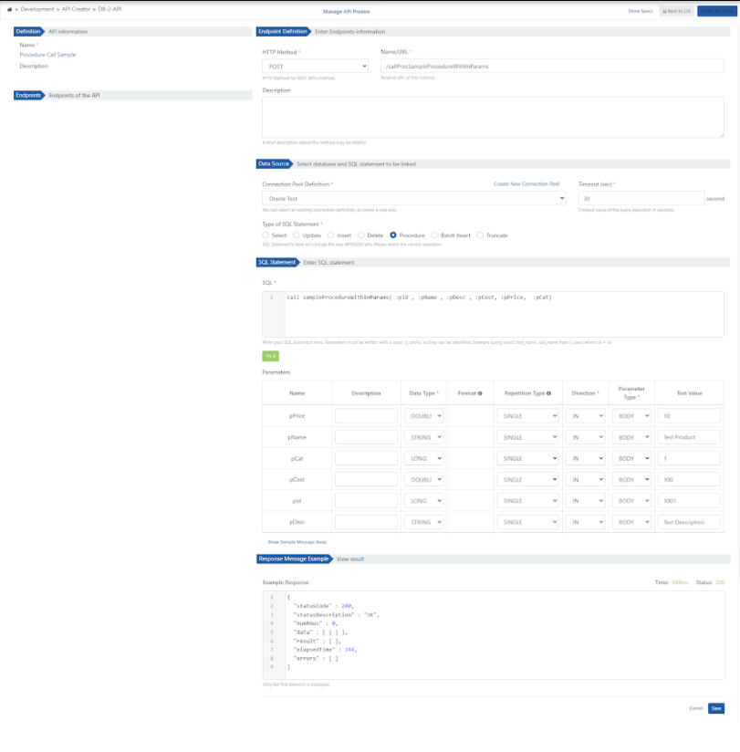

### 2.2 Calling Procedures with IN and OUT Parameters

#### A. The Oracle database procedure used as a demo is shown below:

```sql
create or replace PROCEDURE sampleProcedureWithInOutParams (
  pId IN NUMBER, 
  pName OUT VARCHAR2
) IS 
begin 
  select PRODUCT_NAME into pName 
  from PRODUCTS 
  where PRODUCT_ID = pId; 
  commit; 
end;
```

Use the **+** control in the **Endpoints** section to add another endpoint:

  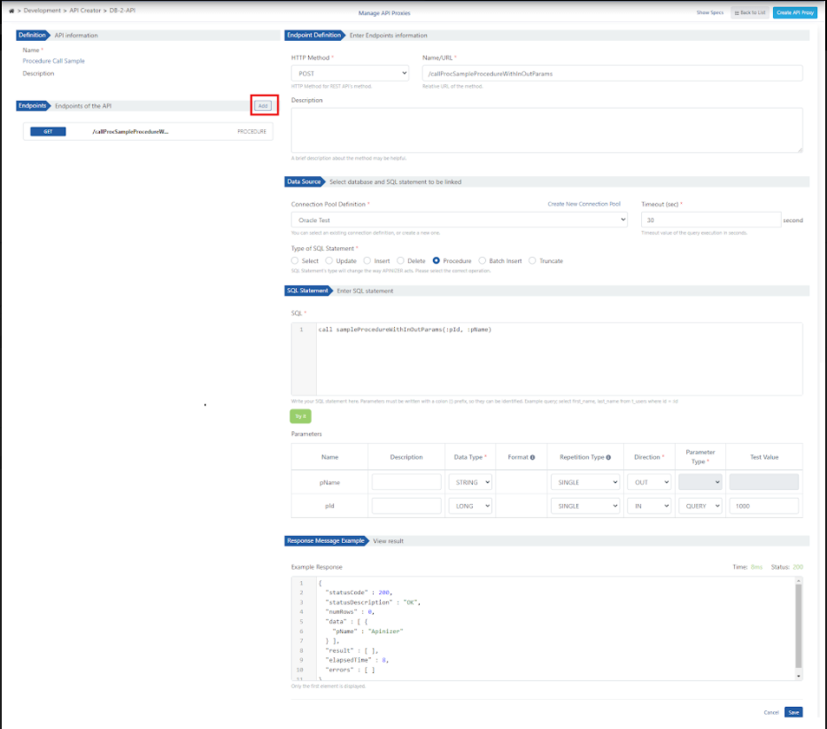

For the IN/OUT procedure, select **Operation Type: Procedure** and define parameter directions (IN/OUT) in the **Parameters** table (same flow as section 2.1).

#### B. The Oracle database procedure used as a demo is shown below:

```sql
create or replace PROCEDURE sampleProcedureWithInOutCursorParams (
  cat_id IN NUMBER, 
  total_cost OUT NUMBER, 
  cursoroutparam OUT SYS_REFCURSOR
) IS 
begin 
  SELECT sum (standard_cost) INTO total_cost 
  FROM PRODUCTS 
  where category_id = cat_id; 
  
  OPEN cursoroutparam FOR 
    SELECT * FROM PRODUCTS 
    where category_id = cat_id; 
end;
```

**The image below shows method creation settings** (`GET /callProcSampleProcedureWithInOutCursorParams`):

  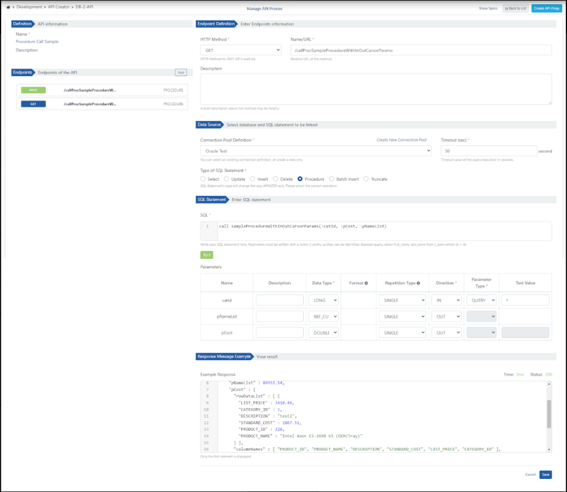

## 3. Viewing API Definition Documents

Click the **Show Sample Message Body** link to view the message content.

  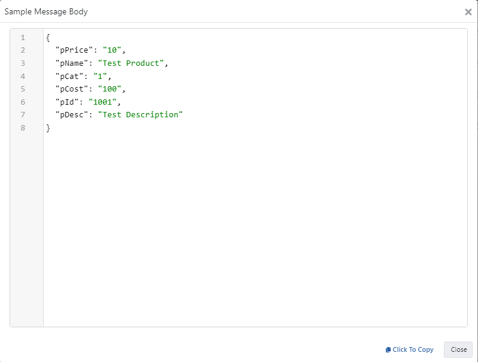

## 4. Creating API Proxy

From the DB-2-API screen, open the **⋯** menu in the top right and choose **API Proxy → Create API Proxy**.

  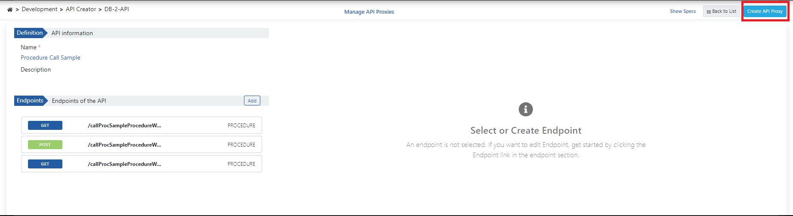

When creating the API Proxy, fill in the fields shown in the image below and click the **Create and deploy** button.

  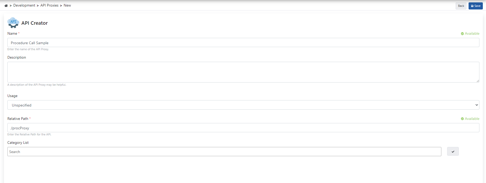


## 5. Testing

### 5.1 Testing the IN Procedure

When the parameters expected by the relevant method are added to the request and executed, the following successful response is returned.

  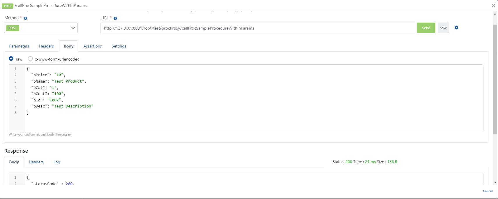

### 5.2 Testing the OUT Cursor Procedure

When the parameters expected by the relevant method are added to the request and executed, the following successful response is returned.

  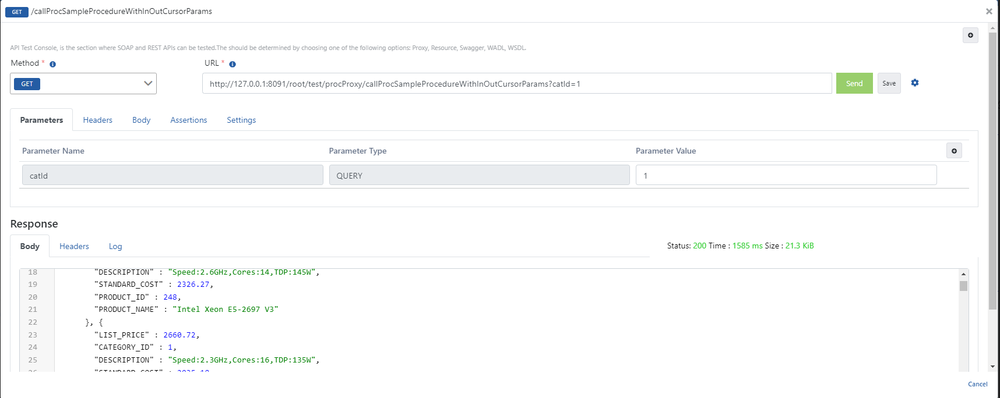

### 5.3 Testing the OUT Procedure

When the parameters expected by the relevant method are added to the request and executed, the following successful response is returned.

  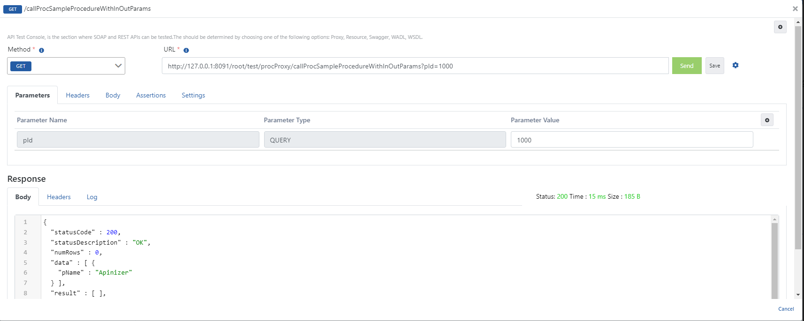

