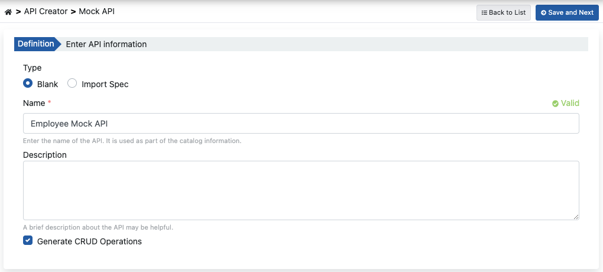
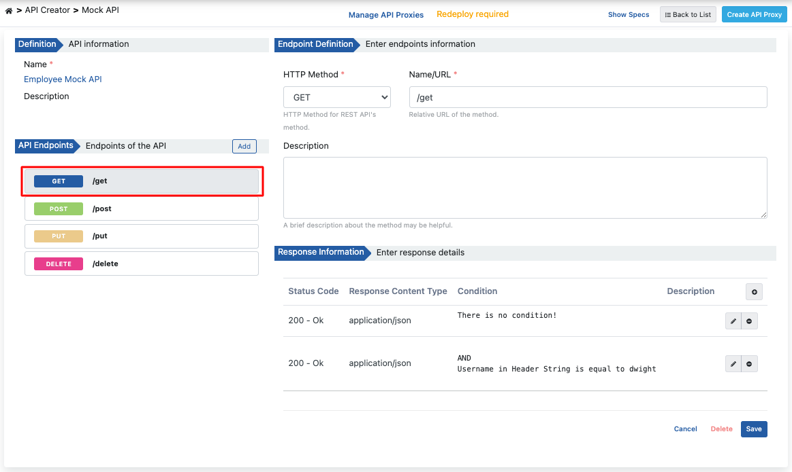
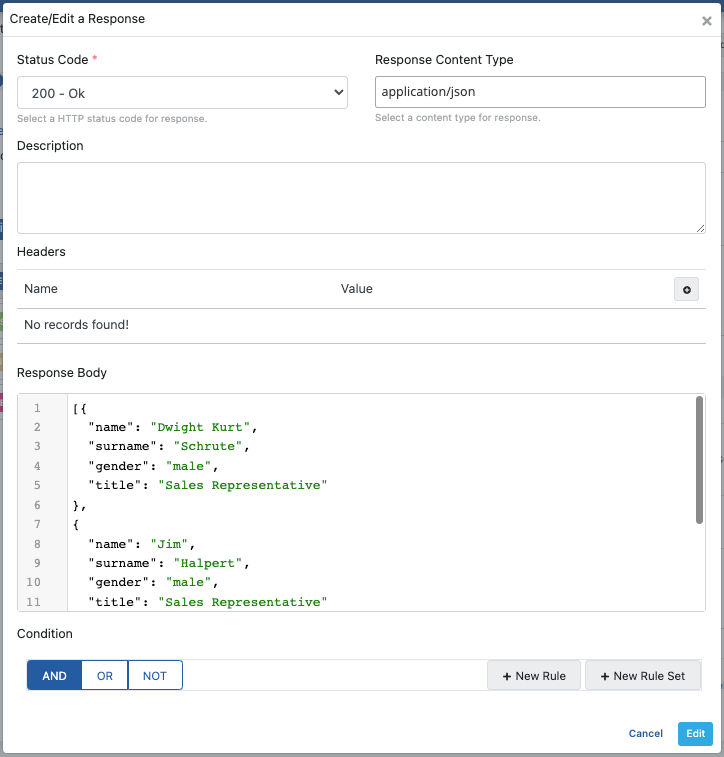
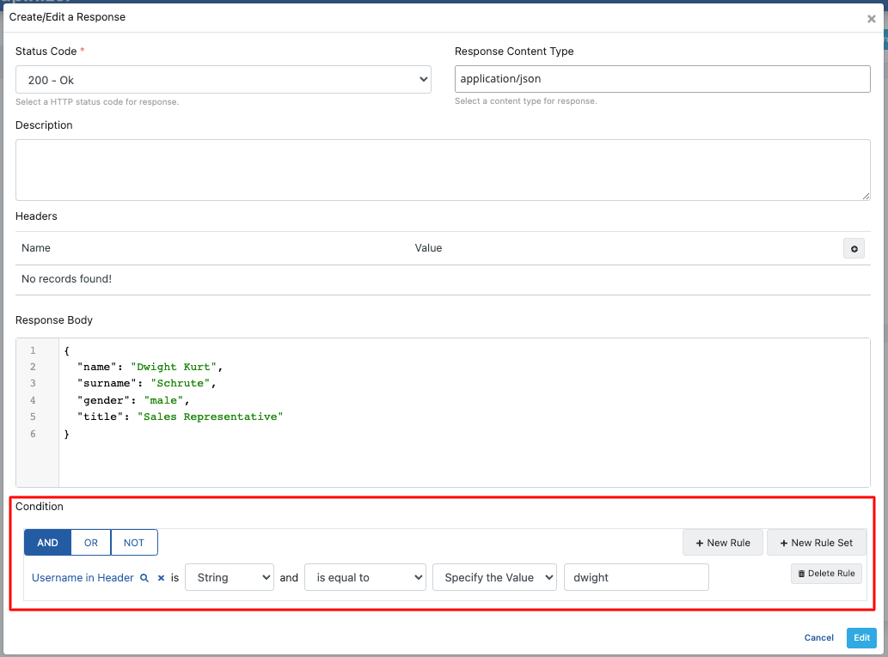
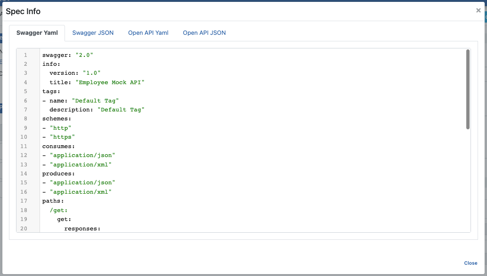
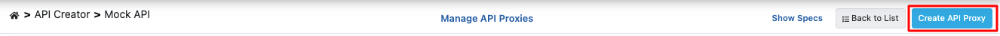
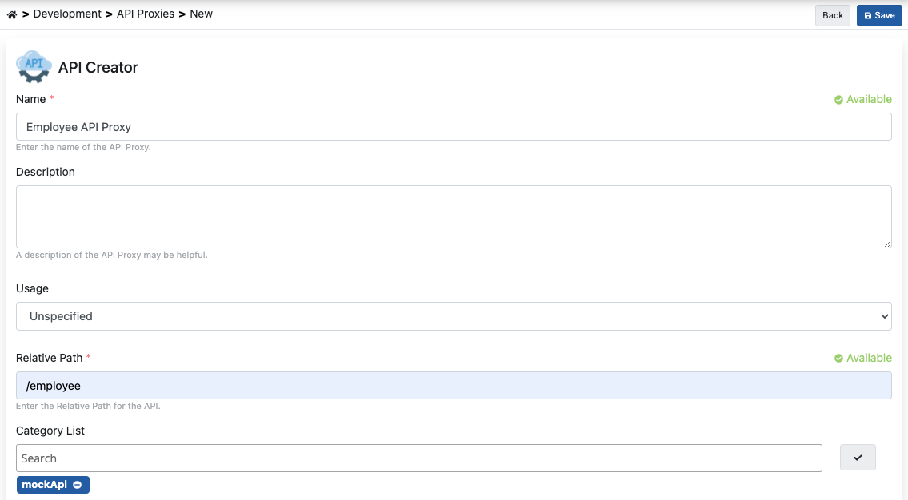
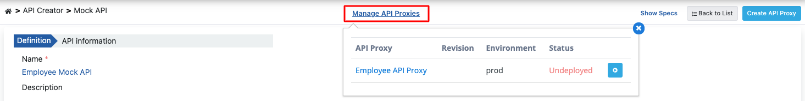
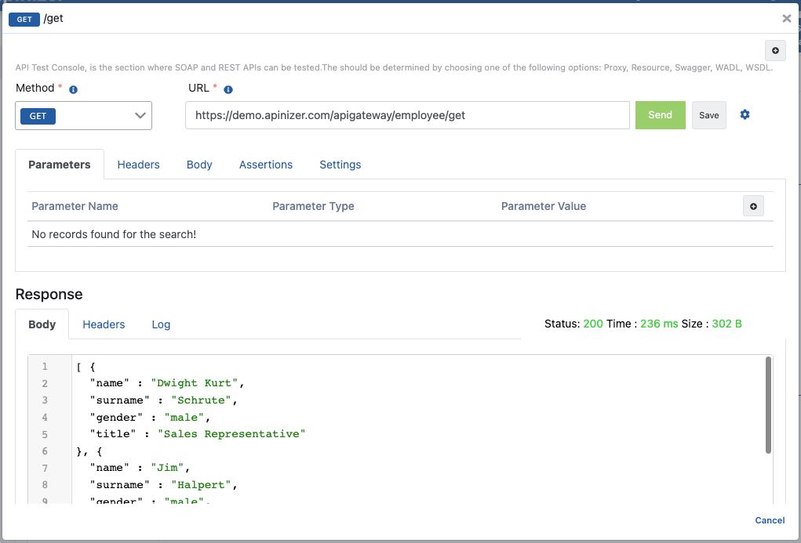
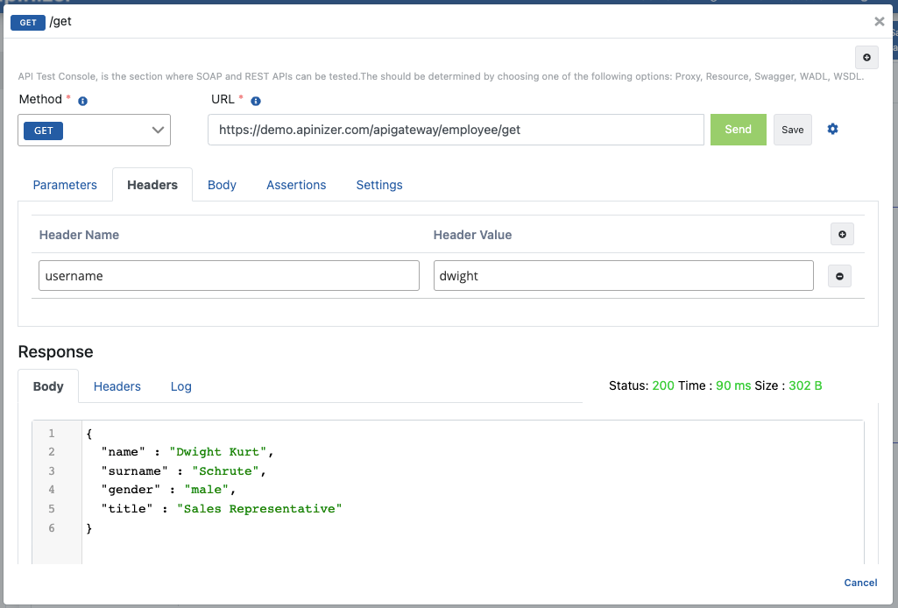

Mock API enables simulating the behavior of a real API. When you make an HTTP call to an endpoint you created without any software development, a previously specified response is returned.

This content explains, in order, creating a blank Mock API, returning responses based on conditions from endpoints, and creating, deploying, and testing the API as an API Proxy.

:::note

Thanks to conditions added to the response, Apinizer enables **receiving different responses based on conditions** depending on header, body, or parameter values of the request.

:::

## 1. Creating Mock API

An API is to be created to manage employee records. The endpoints and the responses are created in the interface, not from an API definition document.

1. Select **API Creator → Mock API** in the main menu. Click **+ New**. The new Mock API wizard opens.
2. In the **Source** step, select **Start blank**. Click **Continue →**.

  

3. In the **Details** step, enter **Employee Mock API** in the **Name** field. Optionally enter a description.
4. Turn on **CRUD scaffold**. Enter **items** as the **Resource name** (or a resource name that fits your scenario). Click **Continue →** to open **Review**, then confirm to create the Mock API.

The CRUD scaffold adds these endpoints: `GET /items`, `POST /items`, `GET /items/{id}`, `PUT /items/{id}`, and `DELETE /items/{id}`. For details, see [CRUD Scaffold](/en/develop/api-proxy-creation/api-creator-mock-api-creation#crud-scaffold).

**The image below shows the Details step:**

  

Apinizer creates the Mock API and opens the editor. The left column shows the Mock API and its endpoints. The center area shows the selected endpoint.

  

## 2. Returning Different Responses Based on Conditions

When a request is sent to the endpoint without a condition, the response must have a successful status code and the list of all employees.

The CRUD scaffold adds a default example to **GET /items**. Change its body as follows:

1. Select **GET /items** in the left column. Open the **200 Ok** response in the **Responses** card. The example table shows **Example 1** with the **Default** badge.
2. Click the **application/json** media type. The response panel opens.
3. Click the pencil icon on the **Example 1** row. The example dialog opens.
4. Leave **Conditions** empty. An example without conditions is the default example.
5. Enter the list of all employees in **Response Body**. Click **Save**. The dialog closes.
6. Click **Save** in the response panel.

  

The following condition is created to return only this employee's information when the value of the **username** header is **dwight**.

1. In the **Responses** card, click **+ Example** under **application/json**. The example dialog opens.
2. Under **Conditions**, click **New Rule**.
3. Set the rule: header **username**, type **String**, operator **equals**, value **dwight**.
4. Enter only the information of this employee in **Response Body**. Click **Save**.

The example appears in the table with the **1 rule** badge.

  

## 3. Viewing API Definition Documents

Click the **Spec preview** (eye) icon in the editor top bar to access the definition files for Employee Mock API.

  

The dialog shows the OpenAPI specification. Switch between the **Open API Yaml** and **Open API JSON** tabs. You can copy or download the definition.

**The image below shows the specification dialog:**

  

## 4. Creating API Proxy

From the Mock API screen, open the **⋯** menu in the top right and choose **API Proxy → Create API Proxy**.

  

The **Create API Proxy** dialog opens. Fill in the fields and click **Create and deploy** (for example: **Proxy name** `Employee Mock API`, **Relative path** `/employee-mock-api`, select an environment under **Deploy to**).

  

If you selected an environment under **Deploy to** and used **Create and deploy**, the API Proxy is deployed when it is created. To manage it later, use **⋯ → API Proxy → Manage API Proxies**.

  

## 5. Testing

Test the API with the **Try it** panel on the Mock API screen. For details, see [Try it](/en/develop/api-proxy-creation/api-creator-mock-api-creation#try-it).

1. Select **GET /items** in the left column. Click **Try it** on the endpoint card. The test panel opens.
2. The panel selects **Employee API Proxy** and its first environment. If necessary, select the **Environment** where you deployed the API Proxy.
3. Click **Send**.

The request does not include the header expected by the condition. The following response body listing all employees is returned.

  

Now add the header expected by the condition to the request. In the **Headers** tab, click **+ Header**. Enter **username** as the name and **dwight** as the value. Click **Send**. The following customized response is returned.

  
