This document explains step by step how to access the API Portal menu and how to define **API Proxy** and **API Proxy Group** items as an **API Product** for the **API Portal**.

:::tip
Field and tab reference: [API Product](/en/api-portal/api-product). Packaging inventory: [API Catalog](/en/api-portal/api-catalog). Support / Prod Promote settings: [API Portal Settings](/en/api-portal/api-portal-settings).
:::

## Accessing the Portal Menu and API Product Definition Screen

With **Apinizer API Portal** you can turn **APIs/Web Services** into a central storefront for API consumers and manage consumption with **quota** or **throttling** policies per plan.

To publish an **API Proxy** through the API Portal you must define an **API Product**.

The **Portal** menu under **Administration** is available only with suitable permissions.

  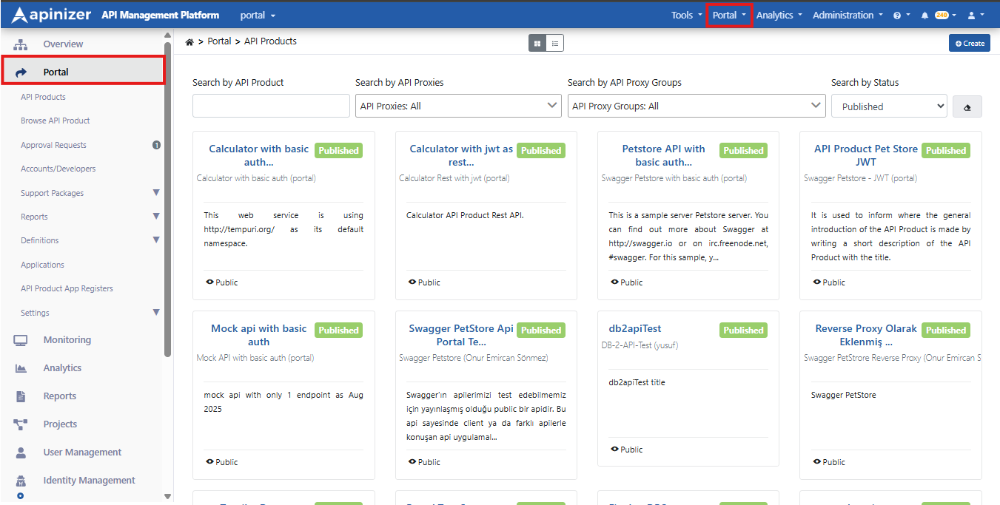

Go to **Administration → Portal → API Products**. Click **+ New API Product** in the top right to start the wizard.

:::warning

We recommend protecting the selected **API Proxy** / **API Proxy Group** with a security policy. Do not expose unprotected proxies to the Portal for security reasons.

:::

:::note

We recommend not publishing your live production **API Proxy** / **API Proxy Group** directly. Prefer publishing a replica in a separate project for the Portal so traffic to the product stays isolated and more controlled.

:::

Before defining an **API Product**, define **Category** and **Responsible Unit** entries that make product management easier:

## Defining Responsible Unit / Category

Under **Administration → Portal → Definitions**, use **Responsible Units** and **Categories** to create, view, and edit units and categories.

### Defining Responsible Unit

**Responsible Unit** represents the unit responsible for **API Products**. On **Administration → Portal → Definitions → Responsible Units** you can view, update, or add units.

  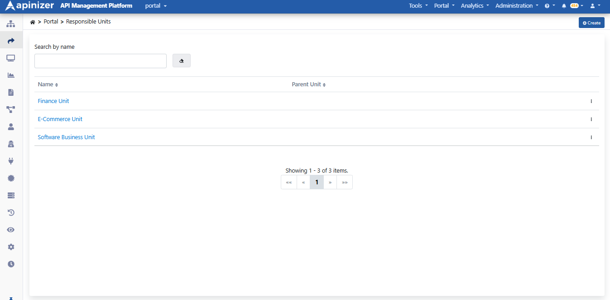

Click **+ Create** to open the form; fill the fields and save with **Save and Deploy**.

  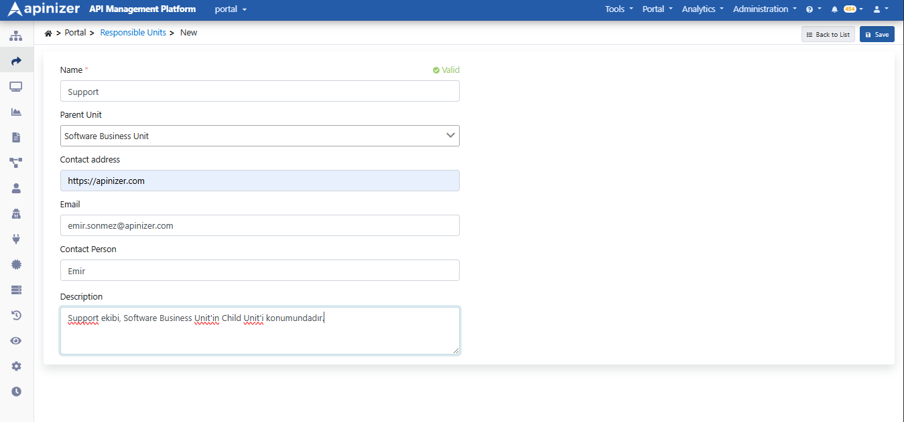

:::note

**Parent Unit** references the parent of the **Responsible Unit**. Modeling parent–child relationships makes hierarchy easier to manage in the list.

:::

### Defining Category

**Category** groups **API Products** so consumers can filter by category on the Developer Portal. Manage them on **Administration → Portal → Definitions → Categories**.

  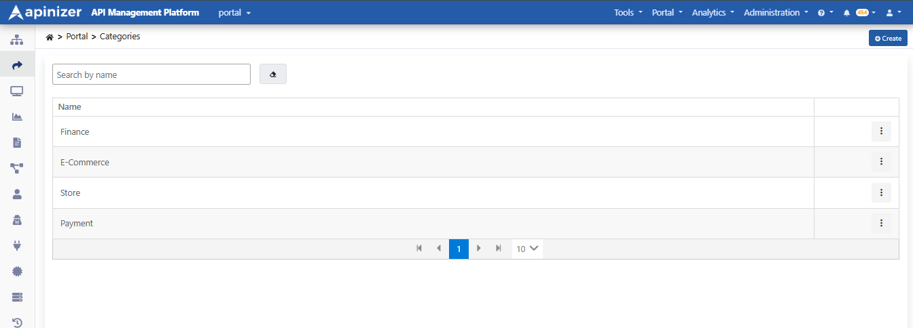

Click **+ Create** to open **Create or edit a Category**; fill **Name (tr)** and click **Save**.

  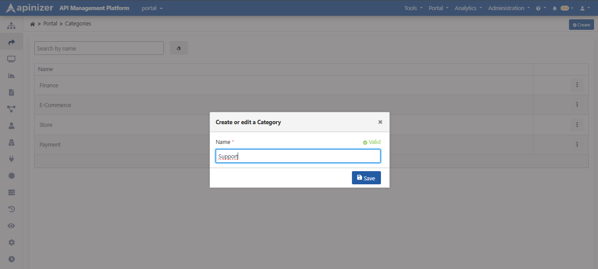

## Defining an API Product and Publishing It on the API Portal

On **Administration → Portal → API Products**, click **+ New API Product** to start the wizard. Steps:

1. **General** — name, description, category, Responsible Unit  
2. **APIs** — select proxies / proxy groups from the Catalog  
3. **API Spec** — upload the product OpenAPI (JSON/YAML)  
4. **Plans** — quota, rate limit, approval, pricing  
5. **Environment** — gateway environment  
6. **Summary** — review and **Complete**

:::note

Field and tab detail: **[API Product](/en/api-portal/api-product)**. Packaging inventory: **[API Catalog](/en/api-portal/api-catalog)**.

:::

### 1) General

Fill **Name (tr)**, description, **Categories**, and **Responsible Unit**. **Save and continue →** stays disabled until required fields are set.

  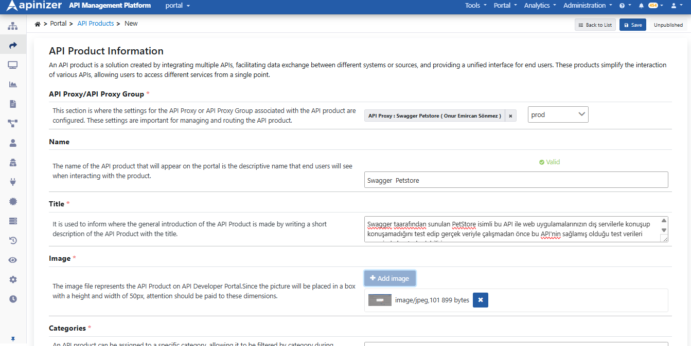

### 2) APIs

Select at least one proxy or proxy group from the catalog (use **Project** and **Packaging Status** filters if needed). The same proxy can belong to multiple products.

  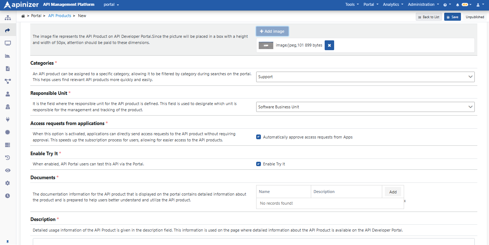

### 3) API Spec

A product can include multiple proxies, so reference docs are not derived from a single proxy swagger — use **Select file** to upload a product-owned OpenAPI file (.yaml / .json).

  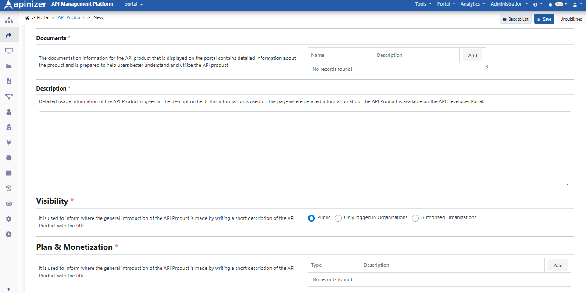

### 4) Plans

Consumers pick **exactly one plan** per subscription. At least one plan is required. Click **+ Add plan**; until you add one, you see *No plans yet — add at least one to create the product*.

  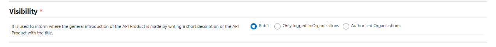

Pricing types:

* **Free** — free  
* **Flat rate** — fixed fee  
* **Metered** — usage-based  
* **Tiered** — tiered  

In **Edit Plan**, set **Approval Type**, **Throttling**, **Quota**, pricing type, and **Block (429)** / **Continue** on quota exceed, then **Save changes**.

  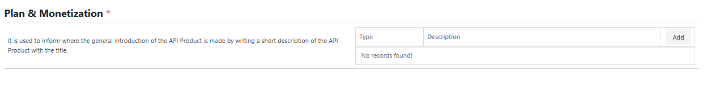

### 5) Environment

Select the gateway environment used for the portal access URL, Try It, and subscription limits.

  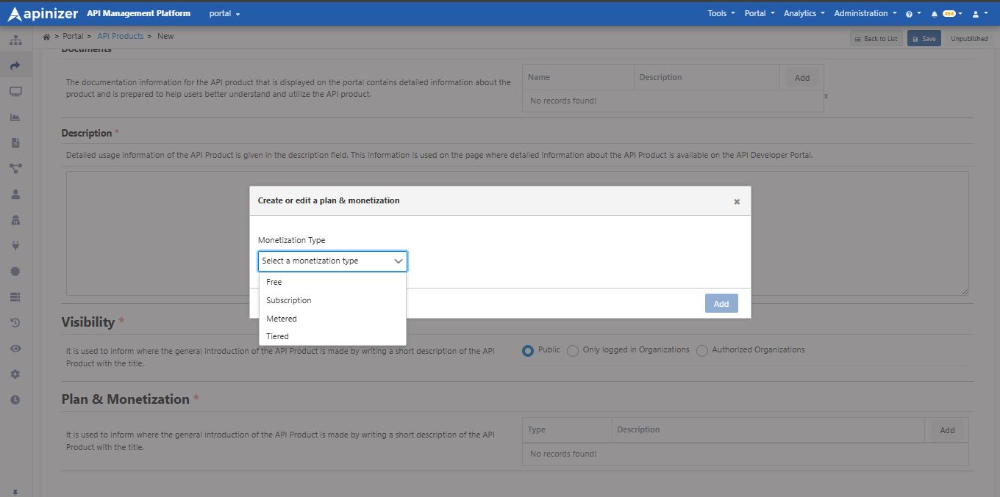

### 6) Summary and Complete

On **Summary**, review General, APIs, API Spec, Environment, and Plans; use the step list on the left to go back if needed. Click **Complete**. The product is created as **Unpublished**.

  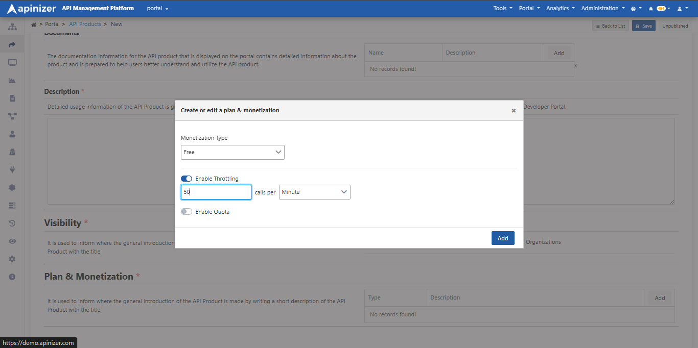

  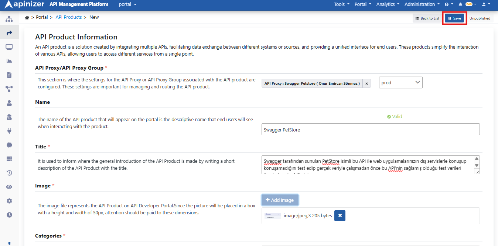

:::note

**Visibility** (Public / Only logged in Organizations / Authorized Organizations) is set on the product **Visibility** tab after create. It controls discoverability; subscription approval stays on plans. Details: **[API Product](/en/api-portal/api-product)**.

:::

On the product detail, check **Unpublished** status and plans on the **Plans** tab. If the connected proxy cannot identify the consumer, a warning banner may appear; see the **Security** tab for details.

Click **Unpublished** in the top right to publish. If security warnings apply, read them in **Publish with security warnings?** and click **Publish**.

  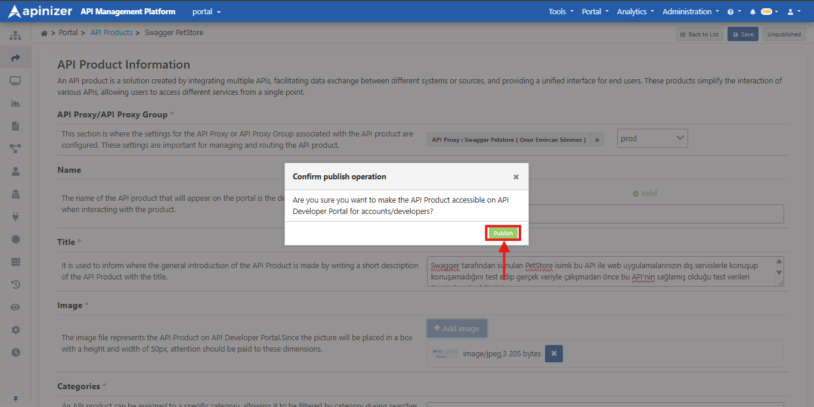

After publishing, the product shows a **Published** badge on **Administration → Portal → API Products**.

  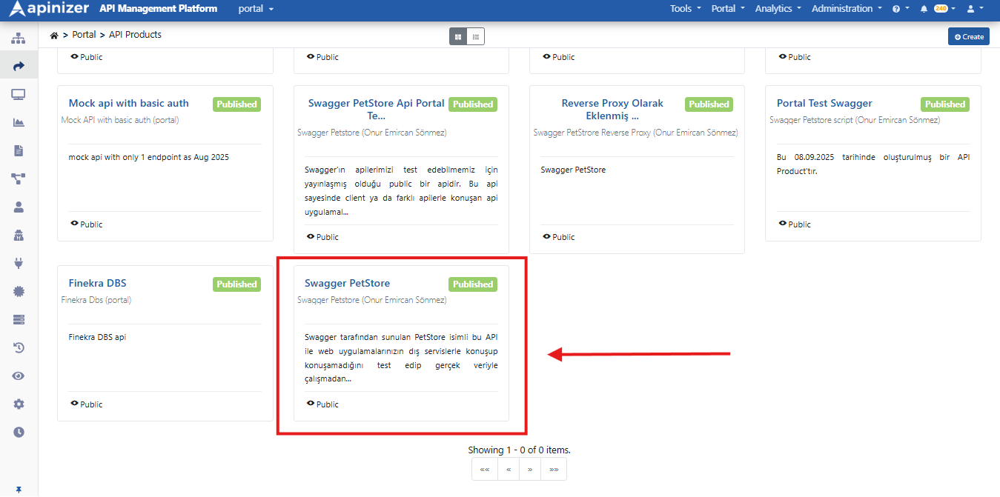

## Next steps

* Subscription approvals: [Approval Requests](/en/api-portal/approval-requests) / API Product App Registers
* Live usage: [Traffic & Usage](/en/api-portal/traffic-and-usage)
* Enable Support / Promote: [API Portal Settings](/en/api-portal/api-portal-settings) (**Support**, **Prod Promote**)
