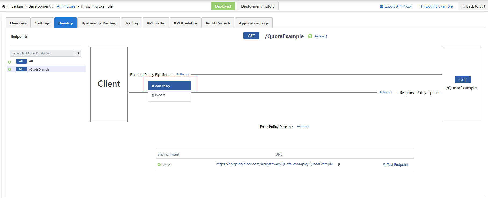
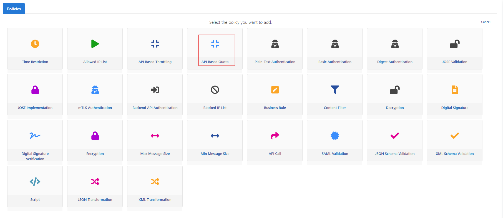
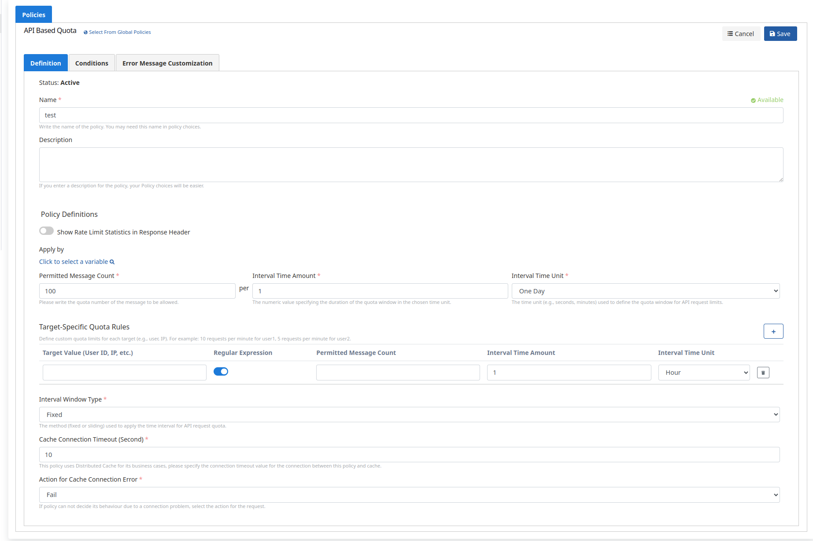
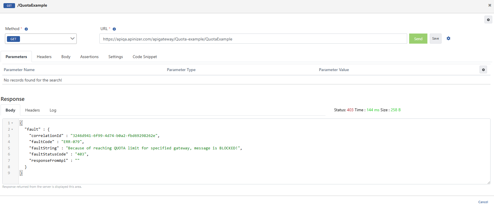
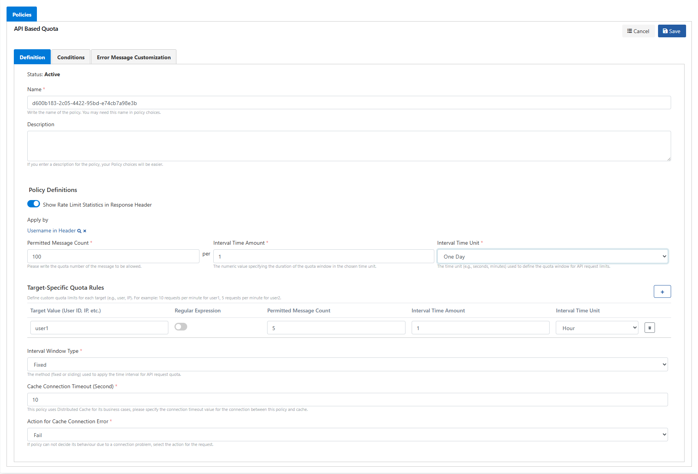
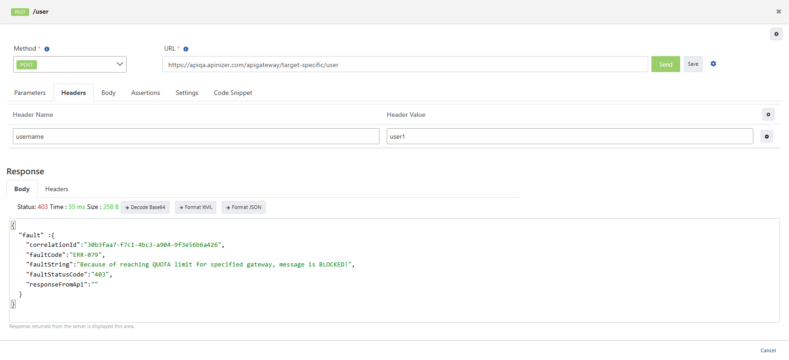

In this scenario, **API Based Quota** is applied to the **Swagger Petstore** API Proxy.

The Quota policy limits the total number of requests that can be made in a certain time period. This policy is generally used to provide longer-term usage control (**for example**, **giving a specific user permission for 1000 requests within one day or one month**).

In the scenario, we will limit incoming requests to 100 requests in a 1-day time period.

Go to **Development → API Proxies → Swagger Petstore**. On the **Develop** tab, select an endpoint (e.g. **ALL**). On the **Request** pipeline, use **Actions → Add Policy**.

Under **Access Control & Limiting**, select **API Based Quota**.

In the scenario, limit incoming requests to **100 requests for 1 day** using the **Fixed Window** method.

- If the period is set to 1 and day is selected:
- For example, if the policy was saved at 12:00:00, this policy will be valid between **00:00:00** and **23:59:59** on the current day.
- At **00:00:00** the next day, a new window starts and the counter resets.

On the **Definition** tab, set **Permitted Message Count**, **Interval Time Amount**, **Interval Time Unit**, and **Interval Window Type: Fixed**, then **Save**.

| Field | Description |
| --- | --- |
| Show Limits in Response Header | When enabled, remaining quota is returned in response headers. |
| Permitted Message Count | Number of requests allowed. We set this to 100 in this scenario. |
| Interval Time Amount | Period length in the selected time unit. We set this to 1. |
| Interval Time Unit | Time unit. We set this to day. |
| Target-Specific Quota Rules | Per-target limits (covered in the second section). |
| Interval Window Type | How the time window is applied. Fixed = calendar day windows in this scenario. |
| Counting Mode | Which requests count (e.g. **All requests**). |
| Cache Connection Timeout (Second) | Connection timeout between the policy and cache. |
| Action for Cache Connection Error | On cache failure: **Fail** (reject) or **Continue** (do not enforce quota). |

**Deploy** the proxy. Use **Test Endpoint** at the bottom of **Develop** to send requests. When the quota is exceeded, the response shows a quota block (e.g. `ERR-079`, QUOTA limit).

## Target-Specific Quota Rules

You can define special quota limits for specific users or targets.

Add **API Based Quota** again on the **Request** pipeline (**Add Policy → API Based Quota**), or edit the existing policy.

- **Target-Specific Quota Rules** define limits by header, body, or other fields. General rule: **Fixed Window**, **1 day / 100 requests**; set **Apply by** to e.g. **Username in Header**.
- Target rule for **user1** in the screenshot: **1 request per hour**.
- The general counter runs for the calendar day (**00:00:00–23:59:59**); the target rule uses hourly windows (**00:00:00–00:59:59**, etc.).

In **Test Endpoint**, add header `username: user1` on the **Headers** tab. Requests are blocked when the limit is exceeded; within the limit you get a successful response.

