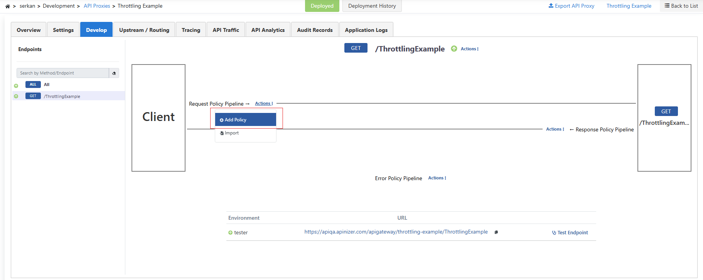
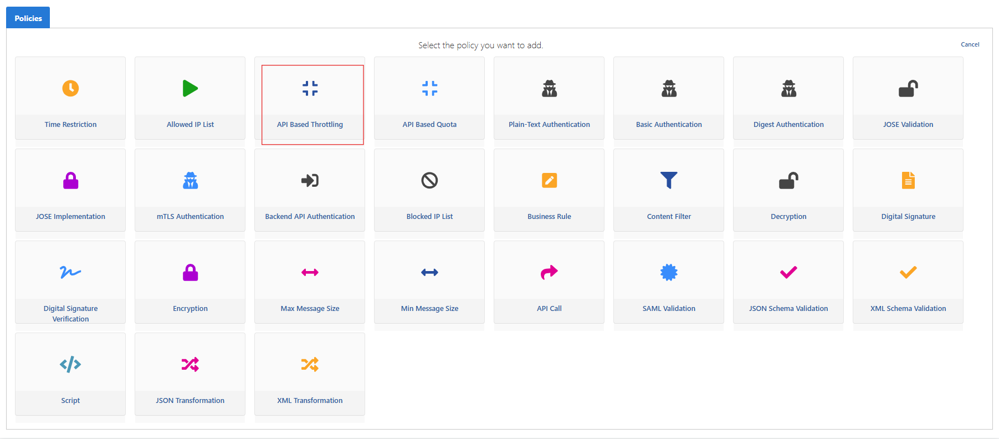
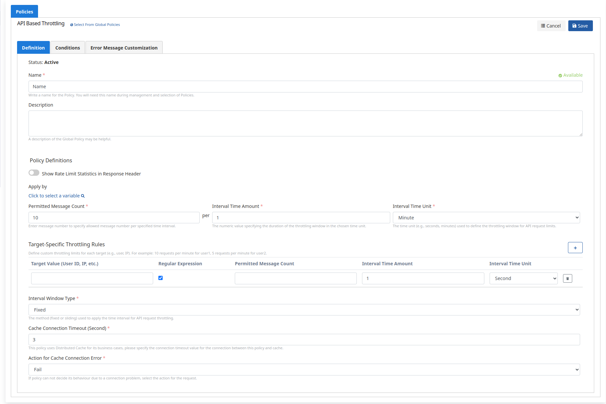
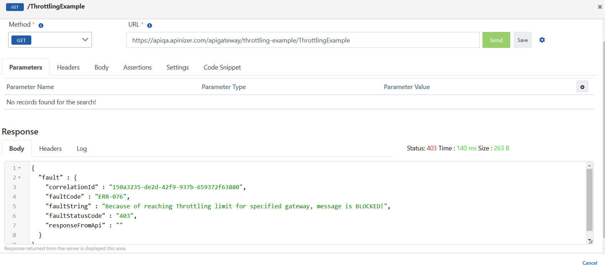
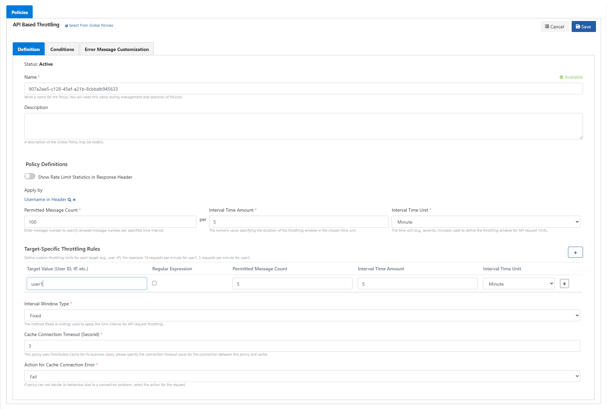
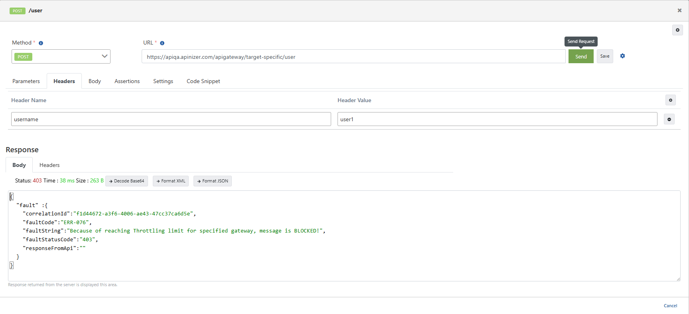

In this scenario, **API Based Throttling** is applied to the **Swagger Petstore** API Proxy.

Using **throttling** for services limits request volume and helps prevent overload.

In the first example, incoming requests are limited with **Fixed Window** to **10 requests per minute**.

Go to **Development → API Proxies → Swagger Petstore**. On the **Develop** tab, select an endpoint (e.g. **ALL**). On the **Request** pipeline, use **Actions → Add Policy**.

Under **Access Control & Limiting**, select **API Based Throttling**.

On the **Definition** tab, set **Permitted Message Count: 10**, **Interval Time Amount: 1**, **Interval Time Unit: Minute**, and **Interval Window Type: Fixed**, then **Save**.

- With a 1-minute period and **Fixed** window, counting advances in **1-minute** slices from the policy start (e.g. **12:00:00–12:00:59**).
- The counter resets in each new window.

| Field | Description |
| --- | --- |
| Show Limits in Response Header | When enabled, limit info is returned in response headers. |
| Permitted Message Count | Allowed requests. In this example: 10. |
| Interval Time Amount | Period length. In this example: 1. |
| Interval Time Unit | Time unit. In this example: **Minute**. |
| Target-Specific Throttling Rules | Per-target rules (second section). |
| Interval Window Type | **Fixed** — fixed window. |
| Counting Mode | Which requests count (e.g. **All requests**). |
| Cache Connection Timeout (Second) | Timeout between policy and cache. |
| Action for Cache Connection Error | On cache failure: **Fail** or **Continue**. |

**Redeploy** / **Deploy** the proxy. Use **Test Endpoint** to send sample requests. When the limit is exceeded, throttling blocks the call; within the limit you get a successful response.

## Target-Specific Throttling Rules

You can define special throttling for specific users or targets.

On the **Request** pipeline, choose **Add Policy → API Based Throttling** again (or edit the policy).

- General rule: **Fixed Window**, **100 requests per 5 minutes** (**Permitted Message Count: 100**, **Interval Time Amount: 5**, **Minute**).
- Set **Apply by** to the username in a header (or another variable).
- **Target-Specific Throttling Rules**: for **user1**, **5 requests per 5 minutes** (as in the screenshot).
- For **user1**, windows are 5-minute slices (e.g. **12:00:00–12:04:59**); the counter resets at **12:05:00**.

In **Test Endpoint**, add header `username: user1` on the **Headers** tab; fill path parameters (e.g. `petId`) and send. Requests are blocked when the limit is exceeded.

