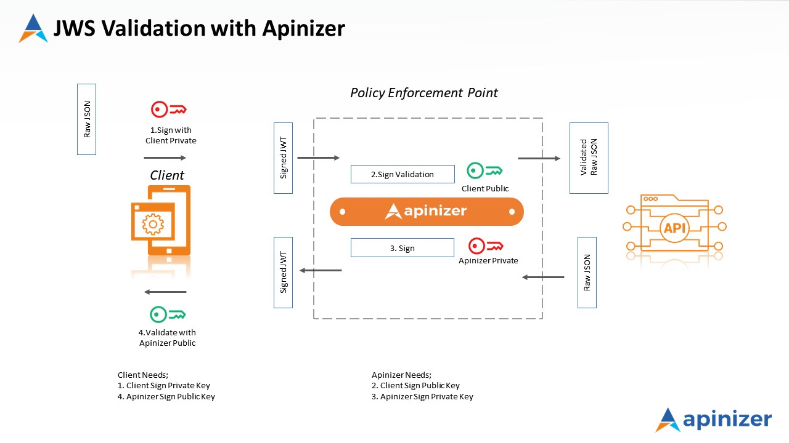
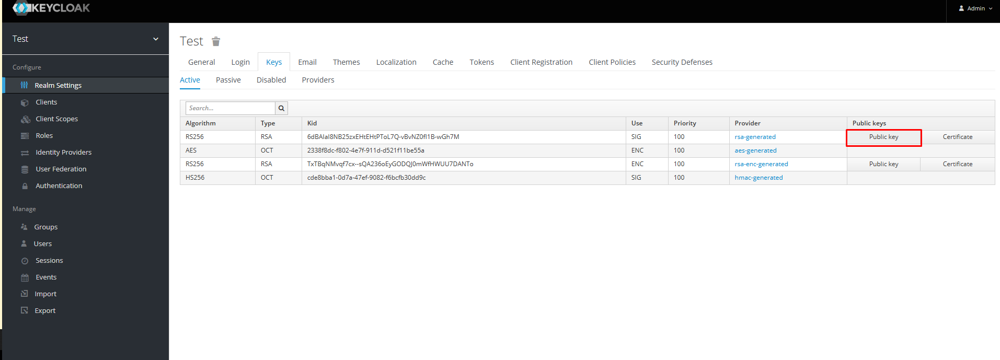
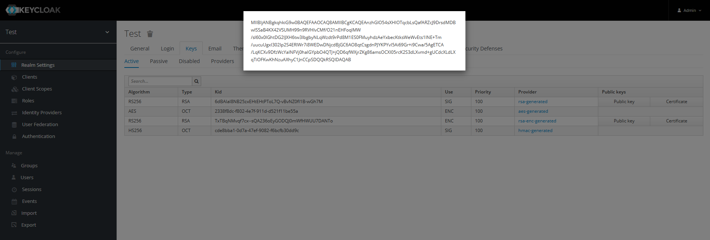
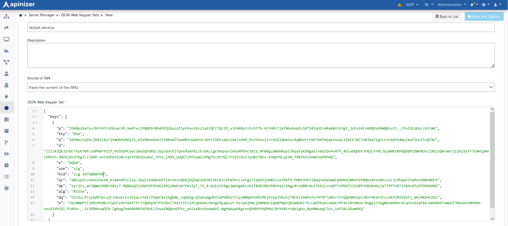
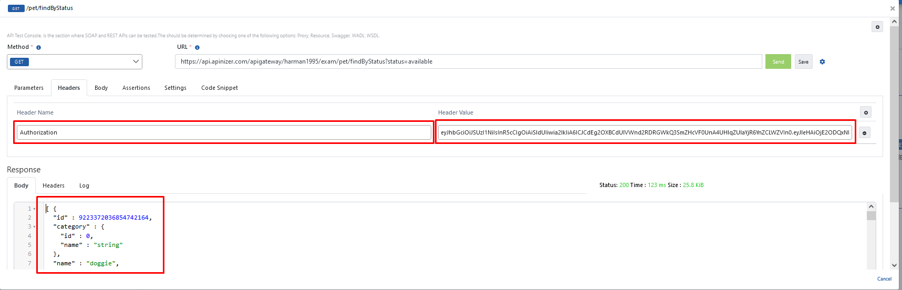

In this scenario, validating a JWT sent to a **REST** **API** named **Swagger PetStore** with the **JOSE Validation** policy is explained.

The image below shows the JOSE Validation workflow applied to a request.

## 1) Creating the API Proxy

This scenario uses the [Swagger Petstore](https://petstore.swagger.io) OpenAPI specification.

Open **Development → API Proxies** and click **+ Add API Proxy** in the top right.

Select **Swagger 2.x/OpenAPI**, then **Enter URL** to go to the spec entry screen.

Enter `https://petstore.swagger.io/v2/swagger.json` in **URL**, click **Parse**, confirm **Name**, routing addresses, and other fields, then **Save**. See [API Proxy Creation](/en/develop/api-proxy-creation) for details.

After saving, open the **Develop** tab. Use the **ALL** row to apply **JOSE Validation** to every method, or select a single method row if the policy should apply to one endpoint only.

**JSON Web Keypair Sets** must be defined before JOSE Validation can verify signatures.

## 2) JSON Web Keypair Sets

Open **Secret** from the left menu.

Open the **JSON Web Keypair Sets** tab and click **+ Create** in the top right.

This document covers generating JSON Web Keypair Sets in Apinizer or via Keycloak (third party).

### 2.1) Generating JWK in Apinizer

On the **General** tab, enter a **Name** for the keypair set. Choose **Generate JWK** as **Source of JWK**, set **Key Type**, **Key Use**, **Algorithm**, and **Key Size** as required, then click **Generate**.

After **Generate**, use the **Public Key** / **Public Key Set** for verification.

Click **Save and Deploy**.

### 2.2) Generating JWK from Keycloak

In Keycloak, open **Realm Settings → Keys** and use the **Public key** field to obtain the public key.

Convert the public key to JWK with a third-party tool, for example [https://russelldavies.github.io/jwk-creator/](https://russelldavies.github.io/jwk-creator/)

To save the JWK in Apinizer:

- Go to **Secret → JSON Web Keypair Sets**.
- Use **Paste the content of the JWT** (or the equivalent paste option) and enter the JWK.
- Set **Key id** to the Keycloak **Kid** value and **Save and Deploy**.

## 3) Adding the JOSE Validation policy

On the **Swagger Petstore** proxy, open **Develop**. For **ALL** (or the target endpoint), choose **Request → Actions → Add Policy**. Under **Security and Authentication**, select **JOSE Validation**.

On the **Definition** tab, configure the validation target and client identification (example: **Authorization Header**, **JWT Payload**, claim **`iss`**).

In **JWS Validation Settings**, enable **Validate Sign** and select the JWK set you saved in step 2 from **JWK for Validation**. Enable **Validate Expiration Time** if required.

Additional options (DPoP, replay protection, ACL, cache error behavior) are configured on the screen below. For Bearer JWT validation only, you can leave **DPoP Validation** off.

See [JWKS Configuration](/en/admin/secrets-management/jwks-configuration) for field details.

**Save** the policy and **Deploy** / **Redeploy** the proxy.

## 4) Testing the API Proxy

Open the **Swagger Petstore** proxy, go to **Develop**, and for example select **`GET /pet/findByStatus`**, then open **Test Endpoint**. For this example, set the **status** query parameter to **pending**. The first **Send** without an **Authorization** header should fail.

Add an **Authorization** header with a valid JWT from Keycloak or Apinizer. **Send** should succeed.

Invalid or expired tokens should return an error.
