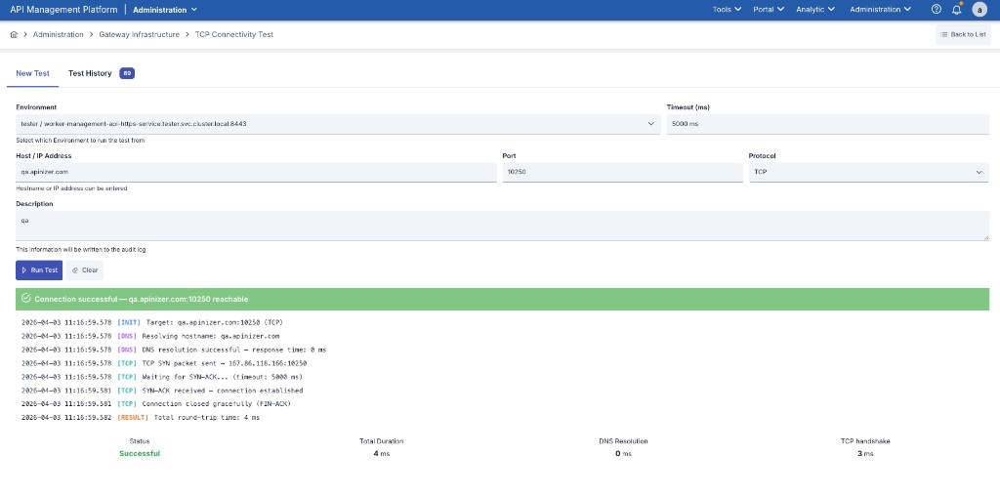
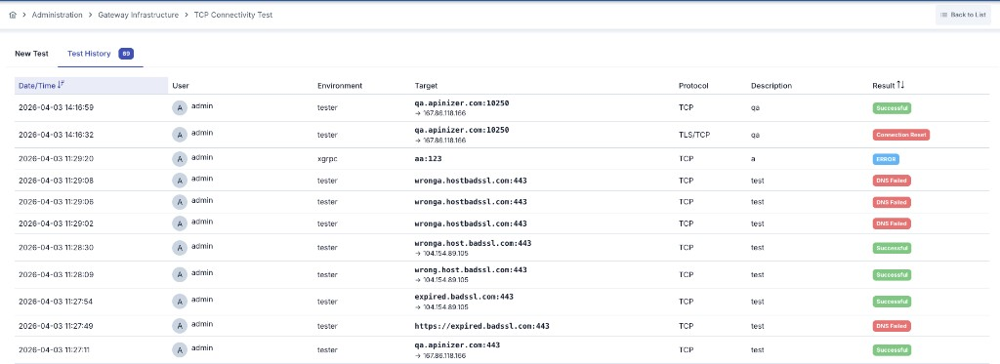

:::note

Bu ekran yalnızca **Admin** yetkisine sahip kullanıcılar tarafından erişilebilir.

:::

## Kullanım Amacı

Gateway üzerinden bir arka uç servise veya dış kaynağa bağlantı sorun yaşandığında, sorunun hangi katmanda olduğunu hızlıca teşhis etmek için kullanılır. Test, Gateway Worker üzerinden gerçekleştirildiğinden, bağlantı durumu uygulamanın çalıştığı gerçek ağ katmanından ölçülür.

Yaygın kullanım senaryoları:

- Yeni bir backend servis eklemeden önce Gateway'in o adrese erişebildiğini doğrulamak
- Güvenlik duvarı veya ağ politikası değişikliği sonrasında bağlantının açık olup olmadığını kontrol etmek
- Servis kesintilerinde sorunun Gateway tarafında mı yoksa hedef sunucuda mı olduğunu belirlemek

---

## Yeni Test

### Test Parametreleri

| Alan | Zorunlu | Açıklama |
|---|---|---|
| **Ortam** | Evet | Testin hangi Gateway ortamı üzerinden çalıştırılacağını belirler. Listede ortam adı ve Gateway adresi birlikte gösterilir. |
| **Timeout** | Evet | Bağlantı denemesinin kaç milisaniye içinde tamamlanması gerektiğini belirler. Varsayılan değer **5000 ms**'dir. En az 1000, en fazla 60000 ms girilebilir. |
| **Host / IP Adresi** | Evet | Bağlantı kurulmak istenen sunucunun alan adı veya IP adresi girilir. Örnek: `10.50.2.20` veya `api.example.com` |
| **Port** | Evet | Hedef sunucunun dinlediği port numarası girilir. 1 ile 65535 arasında bir değer olmalıdır. |
| **Protokol** | Evet | Bağlantının hangi protokolle gerçekleştirileceği seçilir. |
| **HTTP yolu** | Hayır | İsteğe bağlıdır. Girilirse TCP/TLS aşamasından sonra aynı bağlantıda tek bir GET isteği gönderilir. |
| **Tüm node'larda koş** | Hayır | Aynı testi seçili ortamın tüm gateway node'larından koşar. |
| **Açıklama** | Evet | Testin amacını özetleyen kısa bir metin girilir. Bu bilgi denetim kaydına (audit log) işlenir. |

### Protokol Seçenekleri

| Protokol | Açıklama |
|---|---|
| **TCP** | Standart TCP el sıkışması gerçekleştirilir. Uygulama katmanı şifrelemesi olmadan düz bağlantı test edilir. |
| **TLS/TCP** | TCP üzerine TLS el sıkışması da eklenir. HTTPS, SMTPS gibi şifreli protokollerde çalışan servislerin test edilmesi için kullanılır. |

:::warning

**TLS/TCP** protokolü gerçek bir TLS el sıkışması yapar. Sertifikası güvenilir olmayan bir hedef eskiden başarılı görünürdü. Artık "TLS aşamasında kesildi" sonucunu verir.

:::

### HTTP Yolu

HTTP aşaması yalnızca **HTTP yolu** girildiğinde çalışır.

- Test aynı bağlantıda tek bir GET isteği gönderir.
- İstekte özel header ve gövde yoktur.
- Test yönlendirmeleri izlemez.
- Yolun başında `/` yoksa test ekler.
- Boşluk ya da kontrol karakteri içeren yol reddedilir.

Sonuçta durum satırı, yanıt header'ları ve en çok 2 KB'lık gövde özeti gösterilir. `Set-Cookie` değerleri `***` ile maskelenir. Test 1xx ara yanıtlarını atlar.

### Tüm Node'larda Koşma

**Tüm node'larda koş** seçeneğini açın. Test, seçili ortamın tüm gateway node'larından çalışır. Her node için ayrı bir sonuç kartı görünür. Yalnızca bir node için eksik olan firewall kuralını bu şekilde görebilirsiniz.

### Test Süresi

Tüm test, bütün aşamalar dahil en çok 50 saniye sürer.

### Testi Başlatma ve Temizleme

- **Testi Çalıştır** — Zorunlu alanların tümü doldurulduğunda aktif hale gelir. Teste başlandığında yükleme göstergesi görünür ve sonuç gelene kadar buton devre dışı kalır.
- **Temizle** — Formdaki tüm alanları ve önceki test sonucunu sıfırlar.

---

## Test Sonucu

Test tamamlandığında, formun hemen altında ayrıntılı bir sonuç paneli görüntülenir.

### Test Aşamaları

Test aşamaları sırayla çalışır.

| Aşama | Ne zaman çalışır |
|---|---|
| **DNS** | Her zaman. |
| **TCP** | Her zaman. |
| **TLS** | Yalnızca protokol **TLS/TCP** ise. |
| **HTTP** | Yalnızca **HTTP yolu** girildiyse. |

Her aşama için durum ve süre gösterilir. Durum **Geçti**, **Başarısız** ya da **Çalışmadı** olur. Önceki aşama başarısız olduysa ya da aşama teste uygun değilse durum **Çalışmadı** olur.

Bir aşama başarısız olursa sonuçta "*aşama* aşamasında kesildi" başlığı görünür. Altındaki **Teşhis** metni olası nedeni ve sonraki adımı açıklar.

### Özet Metrikler

| Metrik | Açıklama |
|---|---|
| **Durum** | Testin genel sonucu: Başarılı veya Başarısız |
| **Toplam Süre** | Testin başlangıcından sonlanmasına kadar geçen toplam süre (ms) |
| **DNS Çözümleme** | Alan adının IP adresine dönüştürülmesi için geçen süre (ms). Doğrudan IP girilmişse bu değer sıfıra yakın çıkar. |

### TLS Ayrıntıları

**TLS/TCP** testinde sonuç şu alanları gösterir.

| Alan | Açıklama |
|---|---|
| **Protokol** ve **Cipher** | Anlaşılan TLS protokolü ve cipher. |
| **Güvenilir** | Sertifika zincirinin güvenilir olup olmadığı. |
| **Host adı eşleşiyor** | Sertifikanın host adıyla eşleşip eşleşmediği. |
| **Subject**, **Issuer**, **Geçerlilik sonu** | Sertifika zincirinin ayrıntıları. Alternatif adlar (SAN) de gösterilir. |

Test, gateway trafiğiyle aynı güven deposunu kullanır. Gateway'in güvendiği sertifika bu testte de güvenilirdir.

Host adı uyumsuzluğu, yalnızca [Genel Ayarlar](/tr/admin/system-settings/global-yapilandirma) sayfasında **Güvenli Bağlantılarda Hostname Doğrulamasını Etkinleştir** açıksa testi keser. Ayar kapalıysa sonuçta sarı bir uyarı görünür ve test sürer. Ayarı sonradan açarsanız bu adrese yapılan çağrılar hata verir.

### HTTP Yanıtı Ayrıntıları

HTTP aşaması çalıştıysa sonuç durum satırını, yanıt header'larını ve **Gövde özeti** alanını (ilk 2 KB) gösterir.

### Tanınan Cihazlar

Sonuç, yanıttan ya da sertifikadan tanınan cihazları listeler. Her cihazın üç etiketten biri vardır.

| Etiket | Açıklama |
|---|---|
| **Yanıtı üretti** | Yoldaki bir cihaz isteği engelledi ve bu yanıtı üretti. Örnek: WAF engelleme sayfası. Bazı sayfalarda referans numarası bulunur. Örnek: F5 ASM Support ID. Bu referansı ağ ekibine verin. Ekip engellenen isteği cihaz logunda bulur. |
| **Hata sayfasını üretti** | Bir ters proxy ya da yük dengeleyici hata sayfasını üretti (nginx, HAProxy, Envoy, Squid). Bu çoğu zaman uygulamanın kendi proxy'sidir, güvenlik cihazı değildir. |
| **Yolda** | Bir cookie ya da `Server` header'ı cihazı gösterir. Yanıt yine de backend'den gelmiş olabilir. |

Test, yanıttan şu ürünleri tanır: F5 BIG-IP (ASM, LTM, APM), Imperva (Incapsula, SecureSphere), Fortinet (FortiWeb, FortiGate), Citrix NetScaler AppFirewall, Akamai, Cloudflare, AWS ELB / AWS WAF, ModSecurity, Barracuda WAF, Palo Alto Networks, Radware AppWall, Sophos UTM Web Protection, Istio / Envoy, HAProxy, nginx ve Squid.

Test iki durumu sertifikadan da tanır:

- **Ingress varsayılan sertifikası**: Hedef, ingress-nginx ya da Traefik varsayılan sertifikasını sunar. İstek, bu host için sertifikası olmayan bir ingress'e ulaşmıştır.
- **SSL inspection**: Sertifika güvenilir değildir ve bir güvenlik üreticisinin CA'sı imzalamıştır. Yoldaki bir cihaz backend sertifikasını kendi sertifikasıyla değiştirir.

### Adım Kaydı

**Adım kaydı**, testin her adımını aşama adıyla listeler: `INIT`, `DNS`, `TCP`, `TLS`, `HTTP` ve `RESULT`.

---

## Olası Sonuç Durumları

| Durum | Anlamı | Önerilen Aksiyon |
|---|---|---|
| **Başarılı** | Tüm aşamalar geçti. | İşlem gerekmez. |
| **Zaman aşımı** | Belirlenen süre içinde yanıt alınamadı. Genellikle güvenlik duvarının paketi sessizce düşürdüğünü (DROP) gösterir. | Hedef sunucunun güvenlik duvarı kurallarını kontrol edin. |
| **Reddedildi** | Hedef sunucu bağlantıyı aktif olarak reddetti (RST paketi). Genellikle port kapalı veya o portu dinleyen bir servis yok. | Hedef servisi veya port numarasını kontrol edin. |
| **Erişilemiyor** | ICMP unreachable yanıtı geldi. Bir firewall REJECT kuralı ya da eksik bir route hedefe erişimi engelliyor. | Firewall kurallarını ve route tanımlarını kontrol edin. |
| **Bağlantı sıfırlandı** | Bağlantı uzak taraf tarafından sıfırlandı ya da kapatıldı. | Hedef sunucu loglarını ve ağ altyapısını kontrol edin. |
| **TLS başarısız** | TLS el sıkışması başarısız oldu. | Teşhis metnine ve TLS ayrıntılarına bakın. |
| **DNS başarısız** | Alan adı IP adresine çözümlenemedi. Gateway'in DNS sunucusuna erişimi olmayabilir veya alan adı yanlış girilmiş olabilir. | Alan adını ve Gateway'in DNS yapılandırmasını kontrol edin. |
| **Hata** | Test tamamlanamadı. Örnek: HTTP yolu geçersiz. | Adım kaydına bakın. |

:::tip

**Zaman aşımı** durumunda DNS çözümlemesi başarılıysa sorun ağ katmanındadır (güvenlik duvarı, yönlendirme vb.). DNS çözümlemesi de başarısızsa öncelikle Gateway ortamının DNS yapılandırmasını inceleyin.

:::

---

## Yanıt Analizi

**Yanıt Analizi** sekmesi, bir istemcinin zaten aldığı yanıtı analiz eder.

1. **Yanıt Analizi** sekmesini açın.
2. İstemcinin aldığı ham yanıtı yapıştırın: durum satırı, header'lar ve gövde.
3. **Analiz et** düğmesine tıklayın.

Yapıştırılan metinde aynı cihaz eşleştirmesi çalışır. Analiz tarayıcınızda çalışır. Metin sunucuya gönderilmez.

---

## Test Geçmişi

**Test Geçmişi** sekmesi, daha önce gerçekleştirilen tüm testlerin kaydını gösterir. Sekme başlığında toplam kayıt sayısı rozet olarak görünür.

### Tablo Sütunları

| Sütun | Açıklama |
|---|---|
| **Tarih/Saat** | Testin çalıştırıldığı tarih ve saat. Sütun başlığına tıklanarak sıralanabilir. |
| **Kullanıcı** | Testi başlatan kullanıcının adı. |
| **Ortam** | Testin hangi Gateway ortamı üzerinden çalıştırıldığı. |
| **Hedef** | Test edilen host ve port bilgisi. Alan adı girilmişse çözümlenen IP adresi de alt satırda gösterilir. |
| **Protokol** | Kullanılan protokol (TCP veya TLS/TCP). |
| **Açıklama** | Test sırasında girilen açıklama metni. |
| **Sonuç** | Testin sonucu renkli rozet ile gösterilir (Başarılı / Zaman aşımı / Reddedildi / Erişilemiyor / Bağlantı sıfırlandı / TLS başarısız / DNS başarısız / Hata). |

Bir satırdaki göz ikonuna (**Detayı göster**) tıklayın. Eski kaydın sonuç kartı açılır.
