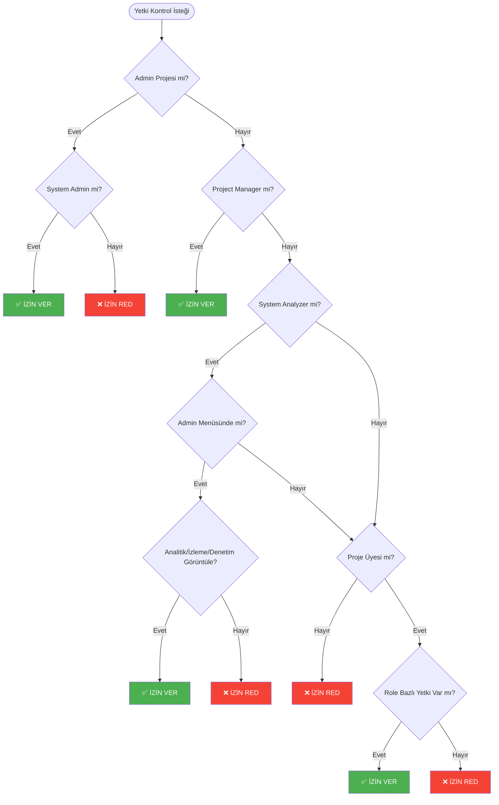

:::info

Lütfen rol ve yetki arasındaki farka dikkat ediniz. Rol yetkilerin gruplandırılmış halidir ve [roller sayfasından](/tr/admin/user-access-management/rol) yönetilir. Detaylı rol yetki matrisleri için [Rol Yetki Detayları](/tr/admin/user-access-management/rol-yetki-detaylari) sayfasına bakabilirsiniz.

:::

## Mevcut Yetkilendirme Modeli

Apinizer'da yetkilendirme sistemi **asset kategorisi + aksiyon** modeline dayalıdır. Her asset kategorisi, benzer işlevlere sahip bileşenleri gruplar ve her kategori için belirli aksiyonlar tanımlanmıştır.

### Asset Kategorileri

Apinizer'da 17 farklı asset kategorisi bulunmaktadır. Her kategori, belirli bileşenleri ve işlevleri kapsar:

| Kategori | Kapsadığı Bileşenler | Desteklenen Aksiyonlar | Auto-Deploy |
|---|---|---|---|
| **API Yönetimi** | API Spec, API Proxy, API Proxy Grupları | Görüntüle, Yönet, Dağıt/Kaldır, Dışa/İçe Aktar | - |
| **API Oluşturucu** | DB2API, Script2API, Mock API | Görüntüle, Yönet, Dışa/İçe Aktar | - |
| **API Entegratör** | Task Flow, Zamanlanmış İşler | Görüntüle, Yönet | - |
| **Global Ayarlar** | Değişkenler, Politika Grupları, Global Politikalar, Ortam Değişkenleri | Görüntüle, Yönet, Dışa/İçe Aktar | ✓ |
| **Bağlantılar** | Tüm bağlantı yapılandırmaları, konnektörler | Görüntüle, Yönet, Dışa/İçe Aktar | ✓ |
| **Kimlik ve Erişim Kontrolü** | Consumer'lar, Consumer Rolleri, ACL, Rate Limit, Identity Provider'lar, IP Grupları | Görüntüle, Yönet, Dışa/İçe Aktar | ✓ |
| **Gizli Anahtarlar ve Sertifikalar** | KeyStore, JWK, Sertifikalar, Anahtarlar | Görüntüle, Yönet, Dışa/İçe Aktar | ✓ |
| **İzleme** | Uptime Monitor, Anomali Dedektörü, Özel Sorgular, Filtreler | Görüntüle, Yönet | - |
| **Analitik ve Raporlar** | API Trafik Analitiği, Özel Sorgular, Filtreler, Raporlar | Görüntüle, Yönet | - |
| **Denetim ve Uygulama Kayıtları** | Denetim Kayıtları, Uygulama Kayıtları | Görüntüle | - |
| **Test** | Test Konsolu | Görüntüle, Yönet, Çalıştır | - |
| **Promotion** | API Mapping, Execution Yönetimi | Görüntüle, Yönet | - |
| **Proje Yönetimi** | Proje Ayarları, Proje Üyeleri | Görüntüle, Yönet, Dışa/İçe Aktar | - |
| **AI Geliştirme** | LLM Sağlayıcılar, Model Kataloğu, RAG (Bilgi Tabanları), Vector Veritabanları, LLM Gateway, AI Politikaları, Presetler, AI Ayarları | Görüntüle, Yönet, Dağıt/Kaldır, Dışa/İçe Aktar | - |
| **AI Bütçe/Kota** | AI Limit Planları, Kota Kullanımı ve Uyarılar | Görüntüle, Yönet, Dışa/İçe Aktar | - |
| **AI Analitik** | AI Dashboard, Kullanım Raporları, Trace, Sağlayıcı Sağlığı, Analitik | Görüntüle, Dışa/İçe Aktar | - |
| **Veri Yaşam Döngüsü** | [Yasal Saklama ve Veri Yaşam Döngüsü Temizleme](/tr/admin/identity-management/yasal-saklama-ve-temizleme) | Görüntüle, Yönet, Çalıştır | - |

### Aksiyonlar

Her asset kategorisi için beş farklı aksiyon tanımlanmıştır:

- **Görüntüle**: Bileşenleri görüntüleme yetkisi
- **Yönet**: Bileşenleri oluşturma, düzenleme ve silme yetkisi. Auto-deploy kategorilerinde Yönet yetkisi aynı zamanda değişikliklerin otomatik olarak worker'lara deploy edilmesini de içerir
- **Dağıt/Kaldır**: API Proxy, Proxy Group ve LLM Gateway'leri worker'lara deploy etme ve kaldırma yetkisi
- **Çalıştır**: Test işlemlerini ve onaylanmış Veri Yaşam Döngüsü temizleme koşularını çalıştırma yetkisi
- **Dışa/İçe Aktar**: Bileşenleri export ve import etme yetkisi

### Auto-Deploy Kategorileri

Bazı asset kategorileri **auto-deploy** özelliğine sahiptir. Bu kategorilerde MANAGE yetkisine sahip kullanıcılar, yaptıkları değişikliklerin otomatik olarak worker'lara deploy edilmesini sağlayabilirler. Auto-deploy özelliğine sahip kategoriler:

- **Global Ayarlar**: Global policy ayarları ve ön tanımlı değerler
- **Bağlantılar**: Bağlantı konfigürasyonları
- **Kimlik ve Erişim Kontrolü**: Kimlik yönetimi bileşenleri (Consumer, Certificate, Key, JWK)
- **Gizli Anahtarlar ve Sertifikalar**: Gizli bilgiler ve şifreli değerler

### Asset Kategorileri ve Aksiyonlar İlişki Tablosu

Aşağıdaki tablo, her asset kategorisinin hangi aksiyonları desteklediğini gösterir. ✓ işareti desteklenen aksiyonları, - işareti desteklenmeyen aksiyonları belirtir.

**Not**: 🔵 işareti auto-deploy kategorilerini gösterir. Bu kategorilerde Yönet yetkisi aynı zamanda değişikliklerin otomatik olarak worker'lara deploy edilmesini de içerir.

| Asset Kategorisi | Görüntüle | Yönet | Dağıt/Kaldır | Çalıştır | Dışa/İçe Aktar |
|---|---|---|---|---|---|
| **API Yönetimi** | ✓ | ✓ | ✓ | - | ✓ |
| **API Oluşturucu** | ✓ | ✓ | - | - | ✓ |
| **API Entegratör** | ✓ | ✓ | - | - | - |
| **Global Ayarlar** 🔵 | ✓ | ✓ | - | - | ✓ |
| **Bağlantılar** 🔵 | ✓ | ✓ | - | - | ✓ |
| **Kimlik ve Erişim Kontrolü** 🔵 | ✓ | ✓ | - | - | ✓ |
| **Gizli Anahtarlar ve Sertifikalar** 🔵 | ✓ | ✓ | - | - | ✓ |
| **İzleme** | ✓ | ✓ | - | - | - |
| **Analitik ve Raporlar** | ✓ | ✓ | - | - | - |
| **Denetim ve Uygulama Kayıtları** | ✓ | - | - | - | - |
| **Test** | ✓ | ✓ | - | ✓ | - |
| **Promotion** | ✓ | ✓ | - | - | - |
| **Proje Yönetimi** | ✓ | ✓ | - | - | ✓ |
| **AI Geliştirme** | ✓ | ✓ | ✓ | - | ✓ |
| **AI Bütçe/Kota** | ✓ | ✓ | - | - | ✓ |
| **AI Analitik** | ✓ | - | - | - | ✓ |
| **Veri Yaşam Döngüsü** | ✓ | ✓ | - | ✓ | - |

## Yetki Kontrol Hiyerarşisi

Apinizer'da yetki kontrolü belirli bir hiyerarşiye göre yapılır. Sistem seviyesi roller, proje seviyesi rollerden daha üst seviyededir.

### Sistem Seviyesi Roller

Sistem seviyesi roller, tüm sistem genelinde geçerlidir ve System Admin tarafından atanır:

#### System Admin (sysAdmin)

- **Admin Projesi**: Tüm işlemleri yapabilir (tüm kategoriler, tüm aksiyonlar)
- **Normal Projeler**: 
  - Proje üyesi olmalı ve role bazlı yetki kontrolünden geçmelidir
  - Yetkisi yoksa işlem yapamaz (normal kullanıcı gibi kontrol edilir)
  - Yetkisi varsa işlem yapabilir

#### Project Manager (sysProjectManager)

- **Tüm Projeler**: Project Owner seviyesinde yetki
- Tüm kategorilerde tüm aksiyonlara sahip
- Proje üyeliği kontrolü yapılmaz (otomatik geçer)

#### System Analyzer (sysAnalyzer)

- **Admin Menüsünde**: Analitik ve Raporlar, İzleme, Denetim ve Uygulama Kayıtları kategorilerinde Görüntüle yetkisi (özel durum - role gerekmez)
- **Normal Projelerde**: Role bazlı permission kontrolü gerekir (normal kullanıcı ile aynı kurallara tabi)

### Proje Seviyesi Roller

Proje seviyesi roller, proje bazında atanır ve proje sahibi tarafından yönetilir. Bu roller, asset kategorileri ve aksiyonlar bazında yetkilendirme sağlar.

#### Yetki Kontrol Süreci

1. **Proje Üyeliği Kontrolü**: Kullanıcının projede üye olması gerekir
2. **Role Bazlı Yetki Kontrolü**: Kullanıcının projedeki rolleri kontrol edilir
3. **Category + Action Kontrolü**: Her rolün assetPermissions listesi üzerinden kategori ve aksiyon kontrolü yapılır

### Yetki Kontrol Akışı

Aşağıdaki diyagram, bir yetki kontrol isteğinin nasıl işlendiğini gösterir:

## Önceden Tanımlı Roller

Apinizer'da proje seviyesi için on bir önceden tanımlı rol bulunmaktadır: yedi API rolü ve dört AI rolü. Aşağıdaki yetkiler yeni kurulumda oluşturulan varsayılan değerlerdir:

| Rol | Açıklama | Ana Yetkiler (Yönet) |
|-----|----------|--------------|
| **Project Owner** | Projede tüm yetkilere sahip rol. Silinemez. Önceden tanımlı roller arasında **Veri Yaşam Döngüsü** (yasal saklama ve veri yaşam döngüsü temizleme) ve **Promotion** yetkisini taşıyan tek roldür; bu yetkilerin başka rollere açıkça verilmesi gerekir. | Tüm kategorilerde tüm aksiyonlar |
| **API Developer** | API Proxy'leri yönetme, deploy etme ve entegrasyon işlemleri yapabilen rol. | API Yönetimi (Dağıt/Kaldır dahil), API Oluşturucu, API Entegratör, Global Ayarlar, Bağlantılar, Kimlik ve Erişim Kontrolü, Gizli Anahtarlar ve Sertifikalar, İzleme, Analitik ve Raporlar, Proje Yönetimi |
| **API Manager** | API'leri yönetme, analiz ve izleme yapabilen rol. | API Yönetimi (Dağıt/Kaldır dahil), İzleme, Analitik ve Raporlar, Proje Yönetimi |
| **API Creator** | DB to API, Script to API, Mock API gibi API oluşturma işlemleri yapabilen rol. | API Oluşturucu, Proje Yönetimi |
| **API Security** | Kimlik yönetimi, tüketici, certificate ve bağlantı güvenliği yöneten rol. | Kimlik ve Erişim Kontrolü, Gizli Anahtarlar ve Sertifikalar, Bağlantılar, Proje Yönetimi |
| **API Analytics** | Analiz ve raporlama işlemleri yapabilen rol. | Analitik ve Raporlar, Proje Yönetimi |
| **API Tester** | Test işlemleri yapabilen rol. | Test, Proje Yönetimi |
| **AI Admin** | AI geliştirme, AI bütçe/kota ve AI analitik üzerinde tam yetkiye sahip rol. | AI Geliştirme (Dağıt/Kaldır dahil), AI Bütçe/Kota |
| **AI Developer** | AI varlıklarını yöneten, taşıyan ve yükleyen rol. | AI Geliştirme (Dağıt/Kaldır dahil) |
| **AI Analytics** | AI geliştirme, AI bütçe/kota ve AI analitiği salt okunur izleyen rol. | — (yalnızca Görüntüle) |
| **AI Finance** | Yalnızca AI bütçe/maliyet ve AI analitiği görüntüleyen rol. | — (yalnızca Görüntüle) |

Detaylı yetki matrisleri için [Rol Yetki Detayları](/tr/admin/user-access-management/rol-yetki-detaylari) sayfasına bakabilirsiniz.

## Sistem Seviyesi Roller

Sistem seviyesi roller, tüm sistem genelinde geçerlidir ve System Admin tarafından atanır:

| Rol | Açıklama | Ana Yetkiler |
|-----|----------|--------------|
| **System Admin** | Sistem yöneticisi - sistem kapsamında tam yetkiye sahiptir. | Admin projesinde tüm işlemler, normal projelerde role bazlı kontrol |
| **Project Manager** | Tüm projelere ve proje yönetimiyle ilgili menülere erişim sahibidir. | Tüm projelerde Project Owner seviyesinde yetki |
| **System Analyzer** | Sistem genelince analiz menülerine erişim sahibidir. | Admin menüsünde Analitik ve Raporlar, İzleme, Denetim ve Uygulama Kayıtları (Görüntüle) |
| **API Portal Manager** | API Portal'da tam yönetim sahibidir. | Portal ayarları, API ürünleri, hesap yönetimi |
| **API Portal Business User** | API Portal'da iş süreçleri ve görüntüleme yetkisine sahiptir. | API ürün incelemeleri, onay süreçleri |
| **API Portal Developer User** | Portal geliştirici kullanıcısı olarak API'leri görüntüleme ve kullanma yetkisine sahiptir. | API ürün geliştirme, uygulama yönetimi |
| **Promotion Manager** | API'lerin ortamlar arası taşıma (promotion) işlemlerini yönetme yetkisine sahiptir. | Administration ve proje menülerinde Promotion (Instances, Mappings, Executions) |

:::note

Kurulumla birlikte gelen yerleşik **admin** hesabı artık Promotion Manager, API Portal Business User ve
API Portal Developer User yetkileriyle de gelir; önceki bir sürümden yükseltilen kurulumlarda bu üç yetki
otomatik olarak eklenir. Detay için [Kullanıcılar](/tr/admin/user-access-management/kullanicilar) sayfasına
bakın.

:::

## Analitik ve Rapor Ekranlarında Proje Kapsamı

Analitik ve rapor ekranlarındaki API Proxy ve Proxy Group seçim listeleri, sistem seviyesi rolü olmayan kullanıcılar için yalnızca üyesi oldukları ve **en az bir yetkiye** sahip oldukları projelerin kayıtlarını listeler (kategori fark etmez: bu seçim listeleri farklı kategorilerle korunan ekranlar tarafından ortak kullanılır, bu yüzden tek bir kategori şartı aranmaz). Hiçbir proje seçilmediğinde de bu kişisel kapsam geçerlidir; Admin menüsündeki "tüm projeler" görünümü bu kullanıcılar için boş liste döner.

System Admin, Project Manager, System Analyzer ve portal/promosyon rollerine sahip kullanıcılar bu kısıtlamadan etkilenmez.
