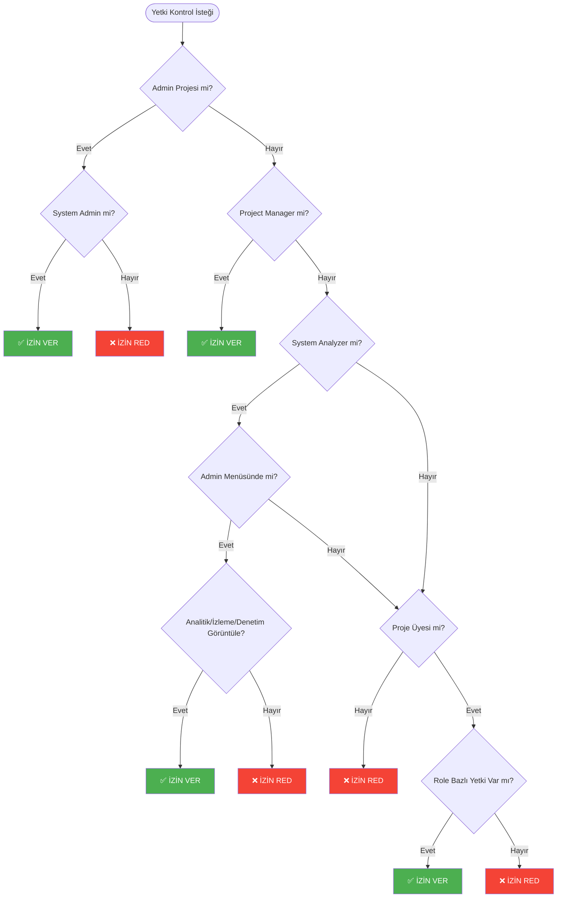

:::info

Lütfen rol ve yetki arasındaki farka dikkat ediniz. Rol yetkilerin gruplandırılmış halidir ve [roller sayfasından](/tr/admin/user-access-management/rol) yönetilir. Detaylı rol yetki matrisleri için [Rol Yetki Detayları](/tr/admin/user-access-management/rol-yetki-detaylari) sayfasına bakabilirsiniz.

:::

## Mevcut Yetkilendirme Modeli

Apinizer'da yetkilendirme sistemi **asset kategorisi + aksiyon** modeline dayalıdır. Her asset kategorisi, benzer işlevlere sahip bileşenleri gruplar ve her kategori için belirli aksiyonlar tanımlanmıştır.

### Asset Kategorileri

Apinizer'da 17 farklı asset kategorisi bulunmaktadır. Her kategori, belirli bileşenleri ve işlevleri kapsar:

| Kategori | Kapsadığı Bileşenler | Desteklenen Aksiyonlar | Auto-Deploy |
|---|---|---|---|
| **API Yönetimi** | API Spec, API Proxy, API Proxy Grupları | Görüntüle, Yönet, Dağıt/Kaldır, Dışa/İçe Aktar | - |
| **API Oluşturucu** | DB2API, Script2API, Mock API | Görüntüle, Yönet, Dışa/İçe Aktar | - |
| **API Entegratör** | Task Flow, Zamanlanmış İşler | Görüntüle, Yönet | - |
| **Global Ayarlar** | Değişkenler, Politika Grupları, Global Politikalar, Ortam Değişkenleri | Görüntüle, Yönet, Dışa/İçe Aktar | ✓ |
| **Bağlantılar** | Tüm bağlantı yapılandırmaları, konnektörler | Görüntüle, Yönet, Dışa/İçe Aktar | ✓ |
| **Kimlik ve Erişim Kontrolü** | Consumer'lar, Consumer Rolleri, ACL, Rate Limit, Identity Provider'lar, IP Grupları | Görüntüle, Yönet, Dışa/İçe Aktar | ✓ |
| **Gizli Anahtarlar ve Sertifikalar** | KeyStore, JWK, Sertifikalar, Anahtarlar | Görüntüle, Yönet, Dışa/İçe Aktar | ✓ |
| **İzleme** | Uptime Monitor, Anomali Dedektörü, Özel Sorgular, Filtreler | Görüntüle, Yönet | - |
| **Analitik ve Raporlar** | API Trafik Analitiği, Özel Sorgular, Filtreler, Raporlar | Görüntüle, Yönet | - |
| **Denetim ve Uygulama Kayıtları** | Denetim Kayıtları, Uygulama Kayıtları | Görüntüle | - |
| **Test** | Test Konsolu | Görüntüle, Yönet, Çalıştır | - |
| **Promotion** | API Mapping, Execution Yönetimi | Görüntüle, Yönet | - |
| **Proje Yönetimi** | Proje Ayarları, Proje Üyeleri | Görüntüle, Yönet, Dışa/İçe Aktar | - |
| **AI Geliştirme** | LLM Sağlayıcılar, Model Kataloğu, RAG (Bilgi Tabanları), Vector Veritabanları, LLM Gateway, AI Politikaları, Presetler, AI Ayarları | Görüntüle, Yönet, Dağıt/Kaldır, Dışa/İçe Aktar | - |
| **AI Bütçe/Kota** | AI Limit Planları, Kota Kullanımı ve Uyarılar | Görüntüle, Yönet, Dışa/İçe Aktar | - |
| **AI Analitik** | AI Dashboard, Kullanım Raporları, Trace, Sağlayıcı Sağlığı, Analitik | Görüntüle, Dışa/İçe Aktar | - |
| **Veri Yaşam Döngüsü** | [Yasal Saklama ve Veri Yaşam Döngüsü Temizleme](/tr/admin/identity-management/yasal-saklama-ve-temizleme) | Görüntüle, Yönet, Çalıştır | - |

### Aksiyonlar

Her asset kategorisi için beş farklı aksiyon tanımlanmıştır:

- **Görüntüle**: Bileşenleri görüntüleme yetkisi
- **Yönet**: Bileşenleri oluşturma, düzenleme ve silme yetkisi. Auto-deploy kategorilerinde Yönet yetkisi aynı zamanda değişikliklerin otomatik olarak worker'lara deploy edilmesini de içerir
- **Dağıt/Kaldır**: API Proxy, Proxy Group ve LLM Gateway'leri worker'lara deploy etme ve kaldırma yetkisi
- **Çalıştır**: Test işlemlerini ve onaylanmış Veri Yaşam Döngüsü temizleme koşularını çalıştırma yetkisi
- **Dışa/İçe Aktar**: Bileşenleri export ve import etme yetkisi

### Auto-Deploy Kategorileri

Bazı asset kategorileri **auto-deploy** özelliğine sahiptir. Bu kategorilerde MANAGE yetkisine sahip kullanıcılar, yaptıkları değişikliklerin otomatik olarak worker'lara deploy edilmesini sağlayabilirler. Auto-deploy özelliğine sahip kategoriler:

- **Global Ayarlar**: Global policy ayarları ve ön tanımlı değerler
- **Bağlantılar**: Bağlantı konfigürasyonları
- **Kimlik ve Erişim Kontrolü**: Kimlik yönetimi bileşenleri (Consumer, Certificate, Key, JWK)
- **Gizli Anahtarlar ve Sertifikalar**: Gizli bilgiler ve şifreli değerler

### Asset Kategorileri ve Aksiyonlar İlişki Tablosu

Aşağıdaki tablo, her asset kategorisinin hangi aksiyonları desteklediğini gösterir. ✓ işareti desteklenen aksiyonları, - işareti desteklenmeyen aksiyonları belirtir.

**Not**: 🔵 işareti auto-deploy kategorilerini gösterir. Bu kategorilerde Yönet yetkisi aynı zamanda değişikliklerin otomatik olarak worker'lara deploy edilmesini de içerir.

| Asset Kategorisi | Görüntüle | Yönet | Dağıt/Kaldır | Çalıştır | Dışa/İçe Aktar |
|---|---|---|---|---|---|
| **API Yönetimi** | ✓ | ✓ | ✓ | - | ✓ |
| **API Oluşturucu** | ✓ | ✓ | - | - | ✓ |
| **API Entegratör** | ✓ | ✓ | - | - | - |
| **Global Ayarlar** 🔵 | ✓ | ✓ | - | - | ✓ |
| **Bağlantılar** 🔵 | ✓ | ✓ | - | - | ✓ |
| **Kimlik ve Erişim Kontrolü** 🔵 | ✓ | ✓ | - | - | ✓ |
| **Gizli Anahtarlar ve Sertifikalar** 🔵 | ✓ | ✓ | - | - | ✓ |
| **İzleme** | ✓ | ✓ | - | - | - |
| **Analitik ve Raporlar** | ✓ | ✓ | - | - | - |
| **Denetim ve Uygulama Kayıtları** | ✓ | - | - | - | - |
| **Test** | ✓ | ✓ | - | ✓ | - |
| **Promotion** | ✓ | ✓ | - | - | - |
| **Proje Yönetimi** | ✓ | ✓ | - | - | ✓ |
| **AI Geliştirme** | ✓ | ✓ | ✓ | - | ✓ |
| **AI Bütçe/Kota** | ✓ | ✓ | - | - | ✓ |
| **AI Analitik** | ✓ | - | - | - | ✓ |
| **Veri Yaşam Döngüsü** | ✓ | ✓ | - | ✓ | - |

## Yetki Kontrol Hiyerarşisi

Apinizer'da yetki kontrolü belirli bir hiyerarşiye göre yapılır. Sistem seviyesi roller, proje seviyesi rollerden daha üst seviyededir.

### Sistem Seviyesi Roller

Sistem seviyesi roller, tüm sistem genelinde geçerlidir ve System Admin tarafından atanır:

#### System Admin (sysAdmin)

- **Admin Projesi**: Tüm işlemleri yapabilir (tüm kategoriler, tüm aksiyonlar)
- **Normal Projeler**: 
  - Proje üyesi olmalı ve role bazlı yetki kontrolünden geçmelidir
  - Yetkisi yoksa işlem yapamaz (normal kullanıcı gibi kontrol edilir)
  - Yetkisi varsa işlem yapabilir

#### Project Manager (sysProjectManager)

- **Tüm Projeler**: Project Owner seviyesinde yetki
- Tüm kategorilerde tüm aksiyonlara sahip
- Proje üyeliği kontrolü yapılmaz (otomatik geçer)

#### System Analyzer (sysAnalyzer)

- **Admin Menüsünde**: Analitik ve Raporlar, İzleme, Denetim ve Uygulama Kayıtları kategorilerinde Görüntüle yetkisi (özel durum - role gerekmez)
- **Normal Projelerde**: Role bazlı permission kontrolü gerekir (normal kullanıcı ile aynı kurallara tabi)

### Proje Seviyesi Roller

Proje seviyesi roller, proje bazında atanır ve proje sahibi tarafından yönetilir. Bu roller, asset kategorileri ve aksiyonlar bazında yetkilendirme sağlar.

#### Yetki Kontrol Süreci

1. **Proje Üyeliği Kontrolü**: Kullanıcının projede üye olması gerekir
2. **Role Bazlı Yetki Kontrolü**: Kullanıcının projedeki rolleri kontrol edilir
3. **Category + Action Kontrolü**: Her rolün assetPermissions listesi üzerinden kategori ve aksiyon kontrolü yapılır

### Yetki Kontrol Akışı

Aşağıdaki diyagram, bir yetki kontrol isteğinin nasıl işlendiğini gösterir:

### Başka Projelerdeki Kayıtlar İçin Kurallar

Yetki, istekte belirtilen projede değil, kaydın saklandığı projede kontrol edilir.

- **Kayıt güncelleme.** Global politika, politika grubu, Secrets kaydı, bağlantı ayarı veya task flow güncellemek için kaydın saklandığı projede ilgili yetkiye sahip olmanız gerekir. Yetki yoksa istek HTTP 403 döner. İstek, saklı kayıttan farklı bir proje belirtiyorsa HTTP 400 döner. Bir kaydın projesi güncelleme isteğiyle değiştirilemez: istek HTTP 400 ve `projectidimmutable` hatasını döner. Bu kural bağlantı ayarları, IP grupları, ortam değişkenleri, veritabanı ve API kimlik doğrulama kayıtları, sertifikalar, şifreleme anahtarları, key store, JWK, sözleşmeler, task flow'lar ve OIDC kimlik sağlayıcıları için geçerlidir. Bir kaydın projesini değiştirmek için **Global'e Taşı _(Move to Global)_** işlemini kullanın.
- **İstek gövdesindeki proje id'si ile yazma.** Aşağıdaki yazma uçları, gövdedeki proje id'sine değil kayıtlı kaydın projesine bakar. Başka projenin kaydının id'si gönderilirse istek HTTP 400 ve `projectidimmutable` hatasını döner, kayıt değişmez. Bilinmeyen id `notfound` döner. Bu kural global politika güncellemeleri (Jose ve MTLS dahil yaklaşık 59 politika tipi), API proxy grupları, kimlik rolleri, Spec Common Data Model kayıtları, test koleksiyonları, politika ayarları ve şablonlar için geçerlidir. Bir kimlik bilgisinin erişim satırlarında (İzinli API Proxy ve İzinli API Proxy Grubu) oluşturma, güncelleme ve `/all` isteklerinde hedef proxy veya grup, gövdedeki projeyle aynı projede olmalıdır (`projectidimmutable`). Hedef yoksa `notfound` döner. `/all` isteğinde başka hedefe ait bir satır `aclRowNotOfTarget` döner. Sistem yöneticisi proje id'si göndermezse yalnız hedefin varlığı kontrol edilir; bu davranış değişmedi. Kimlik bilgisini kaydederken veya kimlik bilgisinin ya da portal uygulamasının erişim listesini değiştirirken, id'li bir erişim satırı bu kimlik bilgisinin kayıtlı satırı olmalıdır; aksi halde istek `aclRowsChanged` döner. Sayfayı açtıktan sonra silinen satır artık yeniden oluşturulmaz; sayfayı yenileyin. Kimlik bilgisinin henüz tutmadığı yeni bir hedef (API proxy veya grup) eklemek için hedefin projesinde **Kimlik ve Erişim Kontrolü** kategorisinde **Yönet** gerekir (sistem yöneticileri geçer). Hedef yoksa `notfound` döner.
- **Portal abonelikleri, sözleşme erişim satırları ve sözleşme dosyaları (APNZ-7212).** API Portal'da tüketicinin erişim satırları yalnız uygulamasının onaylı aboneliklerinden gelir; portal kullanıcısı aboneliği yalnız iptal edebilir. API Manager'da yazılan erişim satırları (sözleşme, tüketici yenileme), her hedefin projesinde **Kimlik ve Erişim Kontrolü** kategorisinde **Yönet** yetkisi ister. Tüketicinin olmayan bir satırını gönderen tüketici yenileme isteği `aclRowsChanged`, olmayan hedef veya kayıt `notfound` döner. Sözleşme dosyasını silmek için sözleşmenin projesinde aynı yetki gerekir; sözleşmesi olmayan dosyayı yalnız sistem yöneticisi siler.
- **Task flow çalıştırma ve silme.** Task flow çalıştırmak için istekte belirtilen projede değil, saklı flow'un projesinde **Çalıştır** veya **Yönet** yetkisi gerekir. Task flow silmek için orada **Yönet** yetkisi gerekir. Sistem yöneticisi, üyesi olmadığı bir projedeki task flow'u da silebilir.
- **Global'e taşıma.** Bir kaydı Administration kapsamına taşımak için kaydın şu anda bulunduğu projede, kayıt tipinin kategorisinde **Yönet** yetkisi gerekir. Örneğin sertifika taşımak için **Gizli Anahtarlar ve Sertifikalar** kategorisinde **Yönet** gerekir. Sistem yöneticileri her zaman geçer. Hedef kapsam için yetki gerekmez. Birden çok kaydı birlikte taşırken biri reddedilirse hiçbiri taşınmaz. Administration kapsamındaki bir kaydı yalnız sistem yöneticisi taşıyabilir. Taşıma, kaydı oluşturmak için gereken yetkiyi izler: örneğin key store, JWK veya şifreleme anahtarı için **Gizli Anahtarlar ve Sertifikalar**, IP grubu veya tüketici için **Kimlik ve Erişim Kontrolü**, uptime monitörü veya anomali dedektörü için **İzleme**, rapor için **Analitik ve Raporlar**, LDAP veya vault bağlantısı için **Bağlantılar**. Sistem analizcisi yalnız oluşturabildiği dört tipi taşıyabilir: özel sorgu, rapor yapılandırması, uptime monitörü ve anomali dedektörü. Global'e taşıma, kayıt tipinin güncelleme yetkisini ister. Senkronizasyonla yönetilen (LDAP veya kimlik sağlayıcı) ya da iptal edilmiş bir kimlik bilgisi taşınamaz. OPSGENIE bağlantısını ve özel sorgu filtresini yalnız sistem yöneticisi taşıyabilir.
- **Dosyadan veya URL'den proxy oluşturma.** Gönderdiğiniz projede **API Yönetimi** kategorisinde **Yönet** yetkisi gerekir. Proje yoksa (Administration kapsamı) yalnız sistem yöneticisi yapabilir. API proxy deploy geçmişini silmek için, geri alma işleminde olduğu gibi, **API Yönetimi** veya **AI Geliştirme** kategorisinde **Yönet** gerekir. API proxy grubunun deploy geçmişini silmek için grubun projesinde **API Yönetimi** kategorisinde **Yönet** gerekir.
- **API proxy ve proxy grubu listeleri.** Proxy grubunun endpoint, deploy, geçmiş veya mesaj değişkenlerini okumak için grubun projesinde **API Yönetimi** kategorisinde **Görüntüle** veya **Yönet** gerekir (sistem yöneticileri ve sistem analistleri her zaman geçer). Seçim listeleri (ortam listesi, metod listesi, Test Konsolu proxy listeleri) için proxy'nin veya grubun projesinde herhangi bir yetki yeterlidir.
- **Kimlik kaynağı testleri.** Authentication Database ve LDAP kaynakları için test, kullanıcı çekme, grup çekme, bağlantı testi, dizin önizleme ve açıklama uçları yalnız çağıranın projesindeki veya global kaynağı kabul eder. Dizin önizleme, başka projenin kayıtlı kaynağını reddeder.
- **Okuma.** API proxy, API proxy grubu veya hata mesajı okumak için kaydın projesinde **Görüntüle** yetkisi gerekir. Sözleşme dosyalarını, IP gruplarını, consumer rollerini ve ACL listelerini okumak için projede **Kimlik ve Erişim Kontrolü** kategorisinde **Görüntüle** veya **Yönet** gerekir. Seçim listeleri kayıt düşürmez: Secrets yetkisi olmayan kullanıcılar kaydı gizli alanları olmadan görür.
- **İsim kontrolleri.** Proje kayıtlarının çoğunda isim var mı kontrolü için o projede herhangi bir yetki gerekir. Kullanıcı, rol, takım, LDAP ayarı, önceden tanımlı değerler ve log ayarları için isim kontrolleri yalnız sistem yöneticileri içindir.
- **API proxy grubu üyeliği.** API proxy kendi projesindeki bir gruba katılır. Administration grubuna proxy'yi yalnız sistem yöneticisi ekler. Başka projenin grubuna proxy eklemek HTTP 403 döner. Grubun üyesi olan başka proje proxy'si gruptan çıkarılabilir. Grubun üyesi olmayan proxy gruptan çıkarılamaz, istek reddedilir.
- **Tüketici, uygulama ve kurum için admin menüsü ekranları.** Sistem yöneticisi admin menüsünde tüm projelerin tüketici, uygulama ve kurumlarını açar, kaydeder ve durumunu değiştirir. Sistem yöneticisi bir tüketiciyi başka bir kuruma da taşıyabilir. Silme işlemleri değişmedi. Proje menüsündeki ekranlarda projenin üyesi olmayan sistem yöneticisinin ek bir yetkisi yoktur.
- **Tek kayıt okuma.** Tek bir tüketici, uygulama veya kurum okumak, okuma kontrolünden geçen her çağırana secret metadata'yı çözülmüş olarak döndürür. Listeler bunu hiçbir zaman içermez.
- **Erişim satırı hedefleri.** Yeni bir tüketici erişim satırı yalnız kendi projelerinizdeki bir API proxy'ye veya API proxy grubuna işaret edebilir. Satırın tüketicisi projenize ait olmalı veya paylaşımlı bir tüketici olmalıdır. Aksi halde istek HTTP 400 döner. Bir sözleşmenin önceki sürümü aynı projedeki bir sözleşme olmalıdır.
- **Secret seçim listeleri.** Sertifika, key store, JWK ve anahtar seçim listeleri için projede herhangi bir rol veya sistem yöneticisi ya da sistem analisti rolü gerekir. Administration kapsamı yalnız sistem yöneticileri içindir. Bkz. [Gizlilik Yönetimi](/tr/admin/secrets-management/genel-bakis#kayitlari-projeler-arasinda-kullanma).
- **Promotion çalıştırmaları.** Tek bir çalıştırmayı okumak için mapping'in kaynak projesinde **Promotion** kategorisinde **Görüntüle** yetkisi gerekir. Sistem yöneticileri ve promotion yöneticileri her zaman geçer. Adım listesi ve aktif çalıştırma listesi yalnız sistem yöneticileri ve promotion yöneticileri içindir. Çalıştırma sayıları, çalıştırma listesiyle aynı yetkiyi ister.
- **Tüketici erişim (ACL) satırları.** Satır oluşturmak veya genişletmek için hedef API proxy'nin veya API proxy grubunun projesinde **Kimlik ve Erişim Kontrolü** kategorisinde **Yönet** yetkisi gerekir. Genişletme; ortam eklemek, kısıtı kaldırmak, daha geç bir bitiş tarihi vermek veya bitiş tarihini kaldırmak demektir. Eksik ortam kaydı "ortam izinli" demektir. Bu yüzden kapalı bir ortamı kaldırmak da satırı genişletir. Satırı daraltmak veya silmek için tüketicinin projesinde ya da hedefin projesinde aynı yetki gerekir. Paylaşımlı (Administration) tüketici tek başına yazma hakkı vermez. Sistem yöneticisi ve sistem proje yöneticisi her zaman geçer. Bkz. [Tüketici Erişim Satırları](/tr/admin/identity-management/erisim-kontrolu#erisim-satirlarini-kim-degistirebilir).

## Önceden Tanımlı Roller

Apinizer'da proje seviyesi için on bir önceden tanımlı rol bulunmaktadır: yedi API rolü ve dört AI rolü. Aşağıdaki yetkiler yeni kurulumda oluşturulan varsayılan değerlerdir:

| Rol | Açıklama | Ana Yetkiler (Yönet) |
|-----|----------|--------------|
| **Project Owner** | Projede tüm yetkilere sahip rol. Silinemez. Önceden tanımlı roller arasında **Veri Yaşam Döngüsü** (yasal saklama ve veri yaşam döngüsü temizleme) ve **Promotion** yetkisini taşıyan tek roldür; bu yetkilerin başka rollere açıkça verilmesi gerekir. | Tüm kategorilerde tüm aksiyonlar |
| **API Developer** | API Proxy'leri yönetme, deploy etme ve entegrasyon işlemleri yapabilen rol. | API Yönetimi (Dağıt/Kaldır dahil), API Oluşturucu, API Entegratör, Global Ayarlar, Bağlantılar, Kimlik ve Erişim Kontrolü, Gizli Anahtarlar ve Sertifikalar, İzleme, Analitik ve Raporlar, Proje Yönetimi |
| **API Manager** | API'leri yönetme, analiz ve izleme yapabilen rol. | API Yönetimi (Dağıt/Kaldır dahil), İzleme, Analitik ve Raporlar, Proje Yönetimi |
| **API Creator** | DB to API, Script to API, Mock API gibi API oluşturma işlemleri yapabilen rol. | API Oluşturucu, Proje Yönetimi |
| **API Security** | Kimlik yönetimi, tüketici, certificate ve bağlantı güvenliği yöneten rol. | Kimlik ve Erişim Kontrolü, Gizli Anahtarlar ve Sertifikalar, Bağlantılar, Proje Yönetimi |
| **API Analytics** | Analiz ve raporlama işlemleri yapabilen rol. | Analitik ve Raporlar, Proje Yönetimi |
| **API Tester** | Test işlemleri yapabilen rol. | Test, Proje Yönetimi |
| **AI Admin** | AI geliştirme, AI bütçe/kota ve AI analitik üzerinde tam yetkiye sahip rol. | AI Geliştirme (Dağıt/Kaldır dahil), AI Bütçe/Kota |
| **AI Developer** | AI varlıklarını yöneten, taşıyan ve yükleyen rol. | AI Geliştirme (Dağıt/Kaldır dahil) |
| **AI Analytics** | AI geliştirme, AI bütçe/kota ve AI analitiği salt okunur izleyen rol. | — (yalnızca Görüntüle) |
| **AI Finance** | Yalnızca AI bütçe/maliyet ve AI analitiği görüntüleyen rol. | — (yalnızca Görüntüle) |

Detaylı yetki matrisleri için [Rol Yetki Detayları](/tr/admin/user-access-management/rol-yetki-detaylari) sayfasına bakabilirsiniz.

## Sistem Seviyesi Roller

Sistem seviyesi roller, tüm sistem genelinde geçerlidir ve System Admin tarafından atanır:

| Rol | Açıklama | Ana Yetkiler |
|-----|----------|--------------|
| **System Admin** | Sistem yöneticisi - sistem kapsamında tam yetkiye sahiptir. | Admin projesinde tüm işlemler, normal projelerde role bazlı kontrol |
| **Project Manager** | Tüm projelere ve proje yönetimiyle ilgili menülere erişim sahibidir. | Tüm projelerde Project Owner seviyesinde yetki |
| **System Analyzer** | Sistem genelince analiz menülerine erişim sahibidir. | Admin menüsünde Analitik ve Raporlar, İzleme, Denetim ve Uygulama Kayıtları (Görüntüle) |
| **API Portal Manager** | API Portal'da tam yönetim sahibidir. | Portal ayarları, API ürünleri, hesap yönetimi |
| **API Portal Business User** | API Portal'da iş süreçleri ve görüntüleme yetkisine sahiptir. | API ürün incelemeleri, onay süreçleri |
| **API Portal Developer User** | Portal geliştirici kullanıcısı olarak API'leri görüntüleme ve kullanma yetkisine sahiptir. | API ürün geliştirme, uygulama yönetimi |
| **Promotion Manager** | API'lerin ortamlar arası taşıma (promotion) işlemlerini yönetme yetkisine sahiptir. | Administration ve proje menülerinde Promotion (Instances, Mappings, Executions) |

:::note

Kurulumla birlikte gelen yerleşik **admin** hesabı artık Promotion Manager, API Portal Business User ve
API Portal Developer User yetkileriyle de gelir; önceki bir sürümden yükseltilen kurulumlarda bu üç yetki
otomatik olarak eklenir. Detay için [Kullanıcılar](/tr/admin/user-access-management/kullanicilar) sayfasına
bakın.

:::

## Analitik ve Rapor Ekranlarında Proje Kapsamı

Analitik ve rapor ekranlarındaki API Proxy ve Proxy Group seçim listeleri, sistem seviyesi rolü olmayan kullanıcılar için yalnızca üyesi oldukları ve **en az bir yetkiye** sahip oldukları projelerin kayıtlarını listeler (kategori fark etmez: bu seçim listeleri farklı kategorilerle korunan ekranlar tarafından ortak kullanılır, bu yüzden tek bir kategori şartı aranmaz). Hiçbir proje seçilmediğinde de bu kişisel kapsam geçerlidir; Admin menüsündeki "tüm projeler" görünümü bu kullanıcılar için boş liste döner.

System Admin, Project Manager, System Analyzer ve portal/promosyon rollerine sahip kullanıcılar bu kısıtlamadan etkilenmez.
