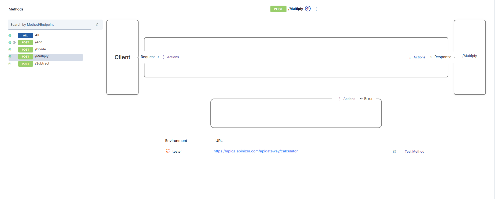
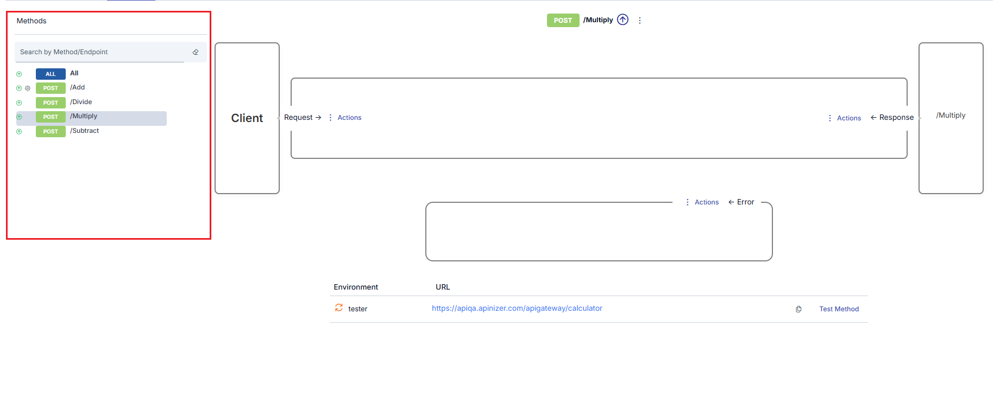
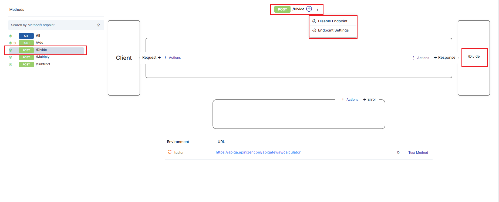
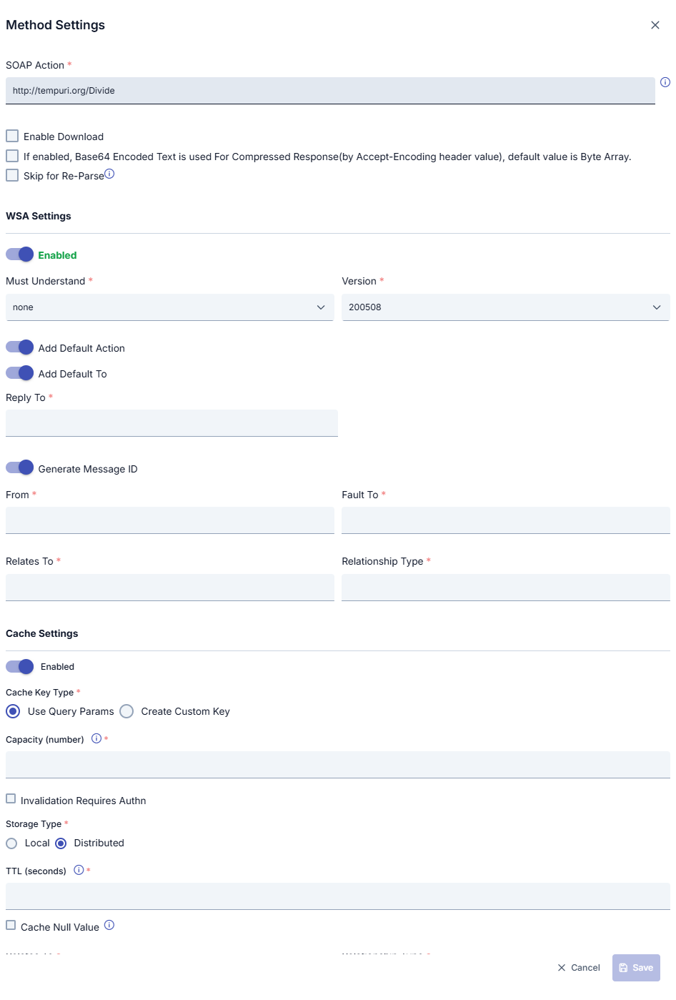
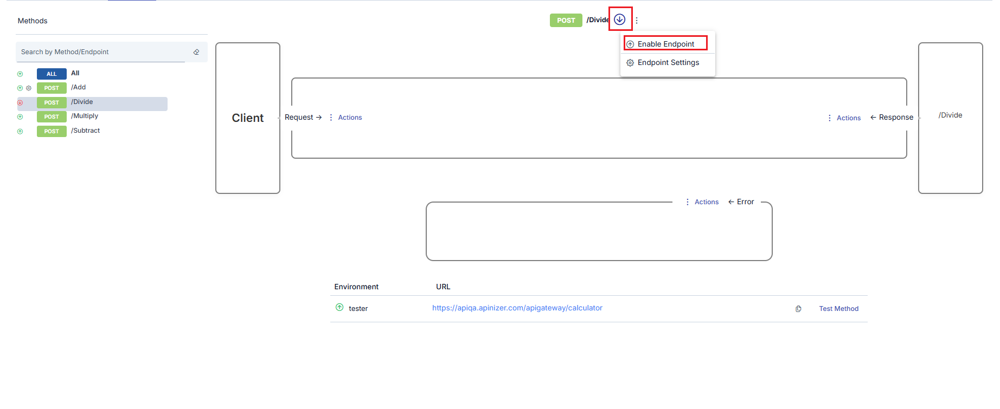
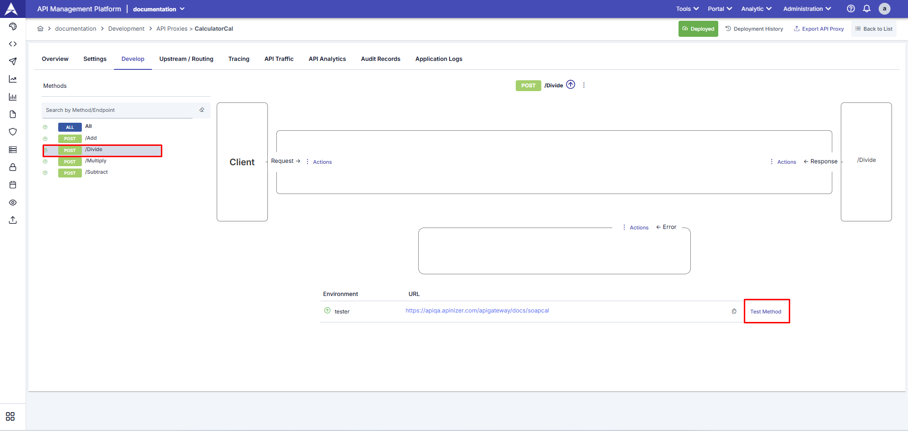
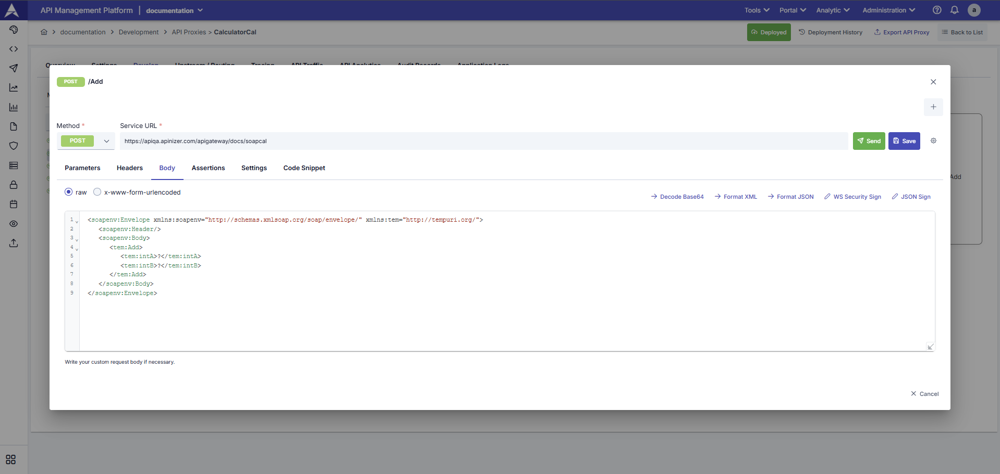

import {Card, CardGroup} from '@site/src/components/Card';

## SOAP Metod Konfigürasyonu

Bu sekmede, seçilen [API Proxy](/tr/concepts/temel-kavramlar/api-proxy-nedir) için  
[politikalar](/tr/concepts/temel-kavramlar/politika-nedir), protokol dönüşümü ayarları ve SOAP metod yönetimi işlemleri yapılabilir.

## SOAP Metod İşlemleri

Her [API Proxy](/tr/concepts/temel-kavramlar/api-proxy-nedir), önüne koyulduğu Backend API'nin metodları için vekil olarak çalışan kendi metodlarına sahiptir.

Eğer API Proxy, bir WSDL dosyası adresi verilerek ya da bu dosya yüklenerek oluşturulmuşsa, WSDL içerisinde tanımlı olan her metod için API Proxy üzerinde aynı isimde bir metod otomatik olarak oluşturulur.

Kullanıcılar aşağıdaki nedenlerle metodlara müdahale etmek isteyebilir:

- Backend API'ye yeni metod(lar) eklenmesi
- Backend API'den mevcut metod(lar)ın silinmesi
- Backend API metod adlarının istemcilerden gizlenmek istenmesi
- Backend API metodlarının tamamen ya da geçici olarak erişime kapatılmak istenmesi

## SOAP Metod Seçme

Metod listesinde herhangi bir metodun adına tıklandığında ilgili metod seçilir ve arayüz buna göre güncellenir:

1. Seçilen metod listede renk değişimi ile vurgulanır.
2. Üst orta bölümde seçili metod bilgisi gösterilir.
3. Alt orta bölümde metod için yapılabilecek işlemler listelenir.
4. Sağ bölümde seçilen metodun Backend API’de karşılık geldiği metod görüntülenir.

## SOAP Metod Ayarları Güncelleme

SOAP tipindeki API Proxy’lerde yalnızca **metod güncelleme** işlemi yapılabilir.

SOAP metodlarına ait ayarlar, REST metod ayarlarından farklıdır. Aşağıda SOAP metodlarına özel ayar alanları gösterilmektedir:

### SOAP Metod Ayarları Alanları

| Alan | Açıklama |
|---|---|
| **SOAP Action** | WSDL ayrıştırılırken elde edilen SOAPAction değeri. İstenirse manuel olarak değiştirilebilir. |
| **İndirmeyi Etkinleştir** | Yanıt Byte Array tipinde ise dosya olarak indirilmesini sağlar. |
| **Compressed Response için Base64 Kullan** | Sıkıştırılmış yanıtlar için Base64 encode edilmiş text kullanımını sağlar. |
| **Re-Parse'da Yoksay** | Re-parse işlemlerinde bu metodun güncellenmemesini sağlar. |
| **WSA Ayarı** | WS-Addressing ayarlarının metod bazlı aktif edilmesini sağlar. |
| **Must Understand** | SOAP `mustUnderstand` alanının ayarlanmasını sağlar. |
| **Versiyon** | Kullanılacak WS-Addressing versiyonunu belirtir. |
| **Add Default Action** | WSDL’den gelen varsayılan action değerini kullanır. |
| **Action** | SOAP mesajına özel action eklenmesini sağlar. |
| **Add Default To** | Varsayılan `To` bilgisinin eklenmesini sağlar. |
| **To** | SOAP mesajına özel `To` alanı eklenir. |
| **Reply To** | SOAP mesajına özel yanıt adresi eklenir. |
| **Generate Message ID** | Her mesaj için otomatik Message ID üretir. |
| **Message ID** | Sabit bir Message ID kullanır. |
| **From** | SOAP mesajına özel `From` bilgisi ekler. |
| **Fault To** | SOAP hata mesajları için özel adres tanımlar. |
| **Relates To** | Hata mesajları için ilişki bilgisi ekler. |
| **Cache Settings** | Metod bazlı önbellek ayarlarını aktif eder. |
| **Cache Key Type** | Önbellek anahtarının nasıl oluşturulacağını belirler. |
| **Variable List** | Özel önbellek anahtarı oluşturmak için kullanılır. |
| **Capacity** | Önbellekte tutulabilecek maksimum yanıt sayısı. |
| **TTL** | Önbellek geçerlilik süresi (saniye). |
| **Cache Null Value** | Boş yanıtların önbelleğe alınmasını sağlar. |

### MTOM / Ekler Ayarları {#mtom-ekler}

Metot ayarları penceresi dört bölümden oluşur: **Genel**, **WS-Addressing**, **MTOM / Ekler** ve **Önbellek**. **MTOM / Ekler** bölümü, MTOM biçimindeki (`multipart/related`; dosya gibi ikili parçaları olan SOAP mesajı) istek ve yanıtları denetler. Bölüm yalnız SOAP tipindeki API Proxy'lerde görünür. Ayarları değiştirmediğiniz sürece davranış öncekiyle aynı kalır.

| Alan | Açıklama |
|---|---|
| **İlk ayraçtan önceki metni (MIME preamble) sil** | Varsayılan olarak kapalıdır. Bazı istemciler MTOM gövdesinde ilk ayraçtan önce bir MIME başlık bloğu yazar ve bazı backend'ler bu bloğu okuyamaz. Ayar açıkken ilk ayraçtan önceki metin istekten silinir, kalan byte'lar değişmez. Ayraç gövdenin ilk 32 KB'ında aranır. Ayraç bulunamazsa gövde olduğu gibi gider. Gövdeyi imzalayan istemcilerde bu ayarı açmayın. |
| **MTOM Zorunluluğu** | Metodun hangi istekleri kabul ettiğini belirler. **Hepsi** (varsayılan): düz SOAP ve MTOM istekler. **MTOM zorunlu**: `multipart/related` olmayan istek ERR-320 hatasını (HTTP 400) alır. **MTOM reddet**: `multipart/related` istek ERR-321 hatasını (HTTP 400) alır. Kontrol, istemcinin isteği üzerinde ve istek politikalarından önce çalışır. |
| **MTOM İstek İşleme** | Gateway'in istek gövdesine ne yapacağını belirler: **Koru** (varsayılan), **Çöz (MTOM → düz SOAP)** veya **Kodla (düz SOAP → MTOM)**. |
| **MTOM Yanıt İşleme** | Gateway'in backend yanıt gövdesine ne yapacağını belirler: **Koru** (varsayılan), **Çöz (MTOM → düz SOAP)** veya **Kodla (düz SOAP → MTOM)**. |
| **Ek Olarak Gönderilecek Elemanlar (XPath, her satıra bir tane)** | **Kodla** için kullanılır. Her satır, Base64 metni ek olacak bir elemanın XPath'idir. En az bir XPath girin. |
| **En Küçük Ek Boyutu (byte)** | **Kodla** için kullanılır. Çözülmüş boyutu bu değerden küçük olan eleman, mesajın içinde Base64 metin olarak kalır. Boş veya 0: seçilen her eleman ek olur. |

#### Koru

Mesaj olduğu gibi gider. Hiçbir politikanın değiştirmediği gövde orijinal byte'larıyla gönderilir; böylece ikili parçalar bozulmaz. Bu kural sıkıştırılmış (gzip, deflate, br, zstd) gövdeler için de geçerlidir.

Metotta aktif bir istek politikası (yanıt için aktif bir yanıt politikası) varsa gateway mesajı politikalara düz SOAP olarak gösterir, sonra yeniden MTOM paketi olarak gönderir:

- Politikalardan önce her `xop:Include` elemanının yerine ekin Base64 metni konur ve Content-Type SOAP tipi olur. XML Schema Validation, XSLT, WS-Security ve script normal XML okur.
- Hiçbir politika mesajı değiştirmediyse orijinal paket byte byte gönderilir.
- Bir politika mesajı değiştirdiyse paketin yalnız kök parçası değişir. Aynen kalan Base64 metin yeniden `xop:Include` olur ve eki orijinal byte'larıyla gider. Politikanın değiştirdiği, biçimlendirdiği, şifrelediği veya sildiği Base64 metin mesajda metin olarak kalır; bu metnin orijinal eki paketten çıkarılır, böylece orijinal byte'ları gönderilmez.
- İstemci veya backend orijinal MTOM Content-Type değerini alır.
- Değişen mesaj XML değilse veya bir politika paketteki hiçbir parçayı göstermeyen bir `xop:Include` yazarsa istek ERR-322 hatasını (HTTP 400) alır; yanıtta istemci ERR-323 hatasının metnini alır.
- Script akışı SUCCESS sonucuyla keserse (`stopFlowAsSuccess`) istemci politikaların yazdığı mesajı MTOM paketi olarak alır.
- [Maksimum Mesaj Boyutu](/tr/develop/politikalar/max-mesaj) politikası orijinal paketi ölçer.

Paket okunamıyorsa, kök parça Base64 kodlu ise veya Content-Length başlığı taşıyorsa, gövde gateway'in en büyük açılmış gövde boyutunu aşıyorsa ya da metot byte array modunda çalışıyorsa gateway mesajı politikalara düz SOAP olarak göstermez. Bu durumda politikalar paketi geldiği gibi alır.

#### Çöz (MTOM → düz SOAP)

Gateway, MTOM mesajını tek parça düz SOAP mesajına çevirir. Her `xop:Include` elemanını ekin Base64 metniyle değiştirir. Bundan sonra XML Schema Validation, XSLT, WS-Security ve script gibi XML politikaları normal XML okur.

- İstekte Çöz, istek politikalarından önce çalışır. Yanıtta, yanıt politikalarından önce çalışır.
- Yeni Content-Type, UTF-8 karakter setiyle `text/xml` veya `application/soap+xml` olur.
- MTOM olmayan mesaj değişmeden devam eder.
- Gateway paketi doğrular. Her Content-ID benzersiz olmalı, her `cid:` referansı paketteki bir parçayı göstermeli ve kök parça geçerli XML olmalıdır. Sonucun boyutu gateway'in en büyük açılmış gövde boyutu ayarıyla sınırlanır.
- Doğrulama başarısız olursa istek ERR-322 hatasını (HTTP 400) alır. Backend yanıtı ERR-323 hatasını (HTTP 502) alır.
- [Maksimum Mesaj Boyutu](/tr/develop/politikalar/max-mesaj) politikasının limitleri istemcinin orijinal isteğinden okunur; bu yüzden Çöz bu limitleri aşmaz.

#### Kodla (düz SOAP → MTOM)

Gateway, düz SOAP mesajında seçilen Base64 elemanlarını MTOM eklerine çevirir.

- İstekte Kodla, istek politikalarından sonra ve gateway isteği backend'e göndermeden önce çalışır. Yanıtta, yanıt politikalarından sonra çalışır.
- Yalnız metni kanonik Base64 olan (boşluk veya satır sonu içermeyen) ve çözülmüş boyutu en küçük boyuta ulaşan eleman taşınır. Diğer elemanlar mesajın içinde kalır.
- Zaten MTOM olan mesaj değişmez.
- Mesaj XML değilse veya bir XPath çalışmazsa gateway loga uyarı yazar ve mesajı değiştirmeden gönderir. Base64 metinli düz SOAP mesajı geçerli bir mesajdır.
- XPath listesi boşsa veya metotta WS-Addressing açıksa **Kodla** seçeneğini kaydedemezsiniz.

:::note XPath ifadeleri

Bu XPath ifadelerinde namespace önekleri tanımlı değildir. `local-name()` veya `Q{namespace}ad` biçimini kullanın. Örnek: `//*[local-name()='Content']`.

:::

#### Bilinen sınırlar

- **Koru** seçeneğinde, mesajı XML dışı bir biçime çeviren politika (örneğin XML'den JSON'a) ERR-322 veya ERR-323 hatasını alır, çünkü gateway MTOM paketi göndermek zorundadır. Bu metotlarda **Çöz** seçeneğini seçin.
- **Koru** seçeneğinde, Maksimum Mesaj Boyutu politikasından önce çalışan bir politika gövdeyi büyütürse bu politika yine orijinal paketi ölçer.
- **Çöz**, hiçbir `xop:Include` elemanının göstermediği parçayı (SOAP with Attachments parçası) atar.
- **Koru** seçeneğinde ikili ek byte'ları içeren yanıt, yanıt önbelleğine yazılmaz; sonraki çağrı aynı byte'ları backend'den alır. Bu yanıtları önbelleğe alma 2027.01.0 sürümü için planlanmıştır.
- WS-Addressing ve MTOM birlikte çalışmaz. WS-Addressing ayarları başlıklarını MTOM paketine ekleyemez ve WS-Addressing açıkken **Kodla** seçeneği kaydedilemez.
- **Çöz** ve **Kodla**, stream veya indirme olarak gönderilen yanıtta uygulanmaz.
- Backend'in MTOM yanıtı geçerli değilse istemci ERR-323 metnini alır. HTTP durum kodu backend'in kodu olarak kalır.

Hata kodları için [Hata Mesajları](/tr/admin/system-settings/hata-mesajlari) sayfasına bakın. Trafik logundaki MTOM kayıtları için [API Trafiği](/tr/analytic/api-trafigi) sayfasına bakın.

## SOAP Metod Silme

SOAP API Proxy'lerinde metodlar silinemez. Bir metodu erişime kapatmak için aşağıdaki devre dışı bırakma işlemi kullanılır.

## SOAP Metod Geçici Olarak Kullanımdan Kaldırma

Bir metod silinmeden erişime kapatılabilir. Bunun için **Endpoint'i Devre Dışı Bırak** seçeneği kullanılır.

Bu işlem sonrası:

1. Metod simgesi devre dışı durumunu gösterecek şekilde değişir.
2. **Endpoint'i aktifleştir** seçeneği görünür hale gelir.

## SOAP Metod Test Etme

1. **Endpointler Görüntülenir**  
_(Test Method)_ kullanılarak ilgili SOAP endpoint’leri görüntülenebilir ve test edilebilir.

2. **Test Method**  
Test Method kullanılarak ilgili SOAP servisleri XML (SOAP Envelope) formatında manuel olarak test edilebilir.

Bir API Proxy [en az bir ortama yüklenmişse](/tr/develop/yukleme-ve-surum-yonetimi), metodlar bu sekme üzerinden kolayca test edilebilir.  
**Metodu Test Et (Test Method)** bağlantısına tıklandığında ilgili metod için [Test Konsolu](/tr/develop/test-debug-araclari/test-console) açılır.

## Sonraki Adımlar

<CardGroup cols={2}>
  <Card title="Endpoint Konfigürasyonu" icon="link" href="/tr/develop/api-proxy-konfigurasyonu/endpoint-konfigurasyonu">
    REST endpoint konfigürasyonu
  </Card>
  <Card title="Genel Bilgi Sekmesi" icon="info-circle" href="/tr/develop/api-proxy-konfigurasyonu/overview">
    API Proxy genel bilgileri
  </Card>
  <Card title="Settings" icon="gear" href="/tr/develop/api-proxy-konfigurasyonu/settings">
    API Proxy ayarları
  </Card>
  <Card title="Test Konsolu" icon="flask" href="/tr/develop/test-debug-araclari/test-console">
    API Proxy test işlemleri
  </Card>
</CardGroup>
