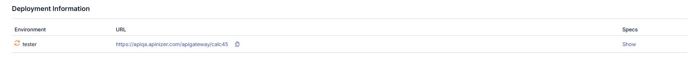
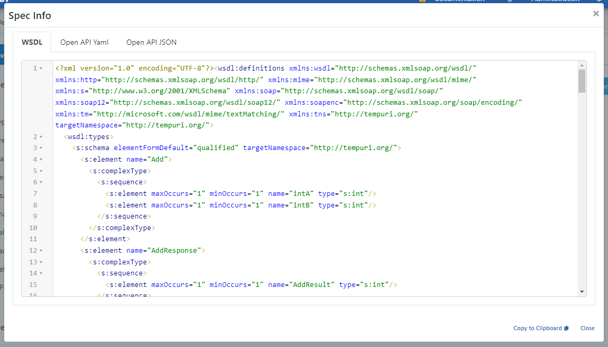

import {Card, CardGroup} from '@site/src/components/Card';

## Yükleme Bilgileri

Yükleme bilgileri bölümü, [API Proxy](/tr/concepts/temel-kavramlar/api-proxy-nedir)'in hangi [ortamlara](/tr/concepts/temel-kavramlar/ortam-nedir) yüklendiğinin ve bu ortamdaki erişim adresinin görüntülendiği bölümdür. Bir API Proxy, aynı anda birden fazla ortama yüklenebilir.

Eğer API Proxy'den bir API Proxy Group oluşturulmuşsa o gruba ait bilgiler de bu alanda görüntülenir.

### Yükleme Bilgileri Alanları

| Alan | Açıklama |
|---|---|
| **Ortam** _(Environment)_ | API Proxy'nin yüklenmiş olduğu Ortam bilgisidir. |
| **Erişim Tipi** _(Access Type)_ | API Proxy'nin erişim tipinin bilgisidir. |
| **URL** | API Proxy'nin erişim adresidir. Geçit Adresi ve yüklenen Ortamın erişim adresi kullanılarak otomatik olarak üretilir. |
| **Tanım Dosyaları** _(Specs)_ | API Proxy'nin Tanım dosyalarıdır. Her API Proxy için Swagger ve OpenAPI formatlarında tanım dosyaları üretilir. Eğer API Proxy'nin tipi SOAP ise WSDL ve XSD tanım dosyaları da üretilecektir. Herhangi bir ortam için **Göster** _(Show)_ bağlantısına tıklandığında, API Proxy'nin o ortam için geçerli olan API Tanım Dosyaları görüntülenir. |

## Tanım Dosyalarını Görüntüleme

**Göster** _(Show)_ butonuna tıklandığında farklı tip ve formattaki API Proxy tanımlarını gösteren dialog açılır:

:::warning

Eğer ilgili API Proxy bir Gruba dahilse ve API Proxy Grup ekranından **API Proxy'lere Direkt Erişimi Engelle** seçeneği seçilmiş ise, bu bölümde bir uyarı kutucuğu görüntülenir.

:::

## Tanım Dosyalarına API Proxy Üzerinden Erişim

Tanım dosyalarının içeriği, **Göster** _(Show)_ bağlantısına tıklandığında yukarıdaki şekilde görüldüğü gibi açılır ve buradan kopyalanabilir. Ancak bu yöntem Apinizer platformu üzerinde çalışmakta olan API Geliştirici, API Testçi gibi rollerden kullanıcılar içindir. İstemciler bu arayüzlere erişemez.

İstemciler, tanım dosyalarına erişmek için API Proxy'nin yüklenmiş olduğu Ortamdaki erişim adresini aşağıdaki şekilde kullanabilirler:

Örneğin API Proxy'nin Production Ortamındaki erişim adresi `https://demo.apinizer.com/apigateway/petstoreProxy` olsun.

Tanım dosyalarına erişim için aşağıdaki adreslere istek gönderilebilir:

### Swagger 2.x (JSON)

- `https://demo.apinizer.com/apigateway/petstoreProxy?swagger`
- `https://demo.apinizer.com/apigateway/petstoreProxy?swagger&format=json`
- `https://demo.apinizer.com/apigateway/petstoreProxy?swagger.json`

### Swagger 2.x (YAML)

- `https://demo.apinizer.com/apigateway/petstoreProxy?swagger&format=yaml`
- `https://demo.apinizer.com/apigateway/petstoreProxy?swagger.yaml`

### OpenAPI 3.x (JSON)

- `https://demo.apinizer.com/apigateway/petstoreProxy?openapi`
- `https://demo.apinizer.com/apigateway/petstoreProxy?openapi&format=json`
- `https://demo.apinizer.com/apigateway/petstoreProxy?openapi.json`

### OpenAPI 3.x (YAML)

- `https://demo.apinizer.com/apigateway/petstoreProxy?openapi&format=yaml`
- `https://demo.apinizer.com/apigateway/petstoreProxy?openapi.yaml`

### WSDL (API Proxy SOAP ise)

- `https://demo.apinizer.com/apigateway/calc?wsdl`

## JWK Set (imza ve şifreleme anahtarları) {#jwk-set-imza-ve-sifreleme-anahtarlari}

Gateway üzerindeki aynı API Proxy erişim adresinden, OpenAPI/Swagger sorgu parametrelerinden **bağımsız** olarak JSON Web Key Set (JWKS) yayınlanabilir. Bu URL'ler API tanım dosyası değildir; `?swagger` veya `?openapi` isteği JWK içeriği **dönmez**. JOSE/JWT doğrulama veya şifreleme için istemcilerin kullanacağı **yalnızca public** anahtarları içerir ([JOSE Doğrulama](/tr/develop/politikalar/jose-dogrulama), [JOSE Uygulama](/tr/develop/politikalar/jose-uygulama-politikasi) politikalarıyla ilişkilidir).

Örnek taban adres: `https://demo.apinizer.com/apigateway/petstoreProxy`

### İmza anahtarları

İmza doğrulama (JWS) için public JWK Set:

- `https://demo.apinizer.com/apigateway/petstoreProxy?jwk-sign.json`

### Şifreleme anahtarları

Şifreleme / şifre çözme (JWE) için public JWK Set:

- `https://demo.apinizer.com/apigateway/petstoreProxy?jwk-enc.json`

:::info

Yanıt yalnızca **public** JWK materyalini içerir (RFC 7517 `keys` dizisi). Private key, shared secret veya Secret Manager'daki ham anahtar materyali bu endpoint'lerden **dışa aktarılmaz**.

:::

:::note

Set içindeki her anahtar `kid`, `alg`, `use` gibi alanlarla tanımlanır; hangi anahtarın imza (`sig`) veya şifreleme (`enc`) için kullanıldığı bu metadata ile eşleştirilir. Proxy'ye bağlı public anahtar yoksa `keys` boş bir dizi olabilir. Anahtar rotasyonunda yeni `kid` değerleri set'e eklenir; istemcilerin JWKS'i periyodik yenilemesi önerilir. Erişim ve içerik, ortamda yayımlanan konfigürasyona bağlıdır — belirli HTTP durum kodları için ürün sürümünüzdeki davranışı test edin.

:::

:::warning

[API Tanım Dosyası Erişim Kontrolü](/tr/develop/api-proxy-konfigurasyonu/settings) (Settings sekmesi — **API Tanım Dosyası Erişim Kontrolü** bölümü) (`?swagger`, `?openapi`, `?wsdl` vb.) ile **JWK Set** URL'lerinin (`?jwk-sign.json`, `?jwk-enc.json`) erişim kuralları **birebir aynı olmayabilir**. Tanım dosyası herkese açık olsa bile JWK setleri kapalı olabilir veya tersi geçerli olabilir; her iki endpoint ailesini de hedef ortamda ayrı ayrı doğrulayın.

:::

## Sonraki Adımlar

<CardGroup cols={2}>
  <Card title="Genel Bilgi Sekmesi" icon="info-circle" href="/tr/develop/api-proxy-konfigurasyonu/overview">
    API Proxy genel bilgileri
  </Card>
  <Card title="Settings" icon="gear" href="/tr/develop/api-proxy-konfigurasyonu/settings">
    API Proxy ayarları
  </Card>
  <Card title="Design" icon="pencil" href="/tr/develop/api-proxy-konfigurasyonu/design">
    API Proxy tasarım sekmesi
  </Card>
</CardGroup>
