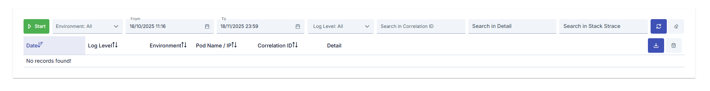

Bu sekmede, ilgili API Proxy'e gelen ve dönen mesajlar için akışın işletilmesi sırasında oluşan yazılımsal loglara ait kayıtlar görüntülenir.

:::info

Bu sayfanın daha çok yazılımsal bir hata olduğundan şüphe edildiğinde veya uygulamanın arka planda nasıl davrandığı araştırılmak istenildiğinde kullanılması uygundur.

:::

**Uygulama Logları sekmesini içeren görsele aşağıda yer verilmiştir:**

Uygulama Logları üzerinde yapılan işlemler ve filtreleme için kullanılan alanlar aşağıda görülmektedir.

| Alan | Açıklama |
|------|----------|
| **Başlat** *(Start)* | Uygulama loglarının API Proxy bazında kaydının tutulmasını sağlar |
| **Ortam Filtresi** *(Environment)* | Uygulama loglarının belirtilen ortam için filtrelenmesini sağlar |
| **Zaman Filtresi** *(From, To)* | Uygulama loglarının belirtilen tarih aralığı için filtrelenmesini sağlar |
| **Log Seviyesi** *(Search by Log Levels)* | Uygulama loglarında "Log Seviyesi" ile belirtilen seviyede olan logların filtrelenmesini sağlar |
| **Correlation ID'ye göre ara** *(Search in Correlation ID)* | API Proxy'ye bir istek geldiği anda, isteğin takip edilebilmesi için Apinizer tarafından bu isteğe bir korelasyon id'si tanımlanır. API Proxy Trafik loglarından bulunacak olan korelasyon id ile uygulama loglarında detaylı arama yapılarak sadece bir isteğin uygulam loglarına erişilebilir |
| **Detaya göre ara** *(Search in Detail)* | Uygulama loglarının metin alanlarında arama yapılmasını sağlar |
| **Stack Trace'e göre ara** *(Search in Stack Trace)* | Uygulama loglarında exception oluşmuş ise exception metni üzerinde arama yapılmasını sağlar |
| **İndir Tuşu** *(Download)* | Uygulama loglarının zip dosyası olarak indirilmesini **Dışa aktar** menüsünden (**Logları indir (zip)**) sağlar. Eğer "Zaman aralığındaki tüm loglar" seçeneği seçili ise bu API Proxy ile ilgili, aranan zaman aralığındaki tüm loglar indirilir. Eğer "Arama Sonuçları" seçeneği seçili ise filtrelenen tüm loglar indirilir |
| **Sil Tuşu** *(Delete)* | Bu API Proxy'e ait uygulama log kayıtlarının silinmesini sağlar |

Sekme son bir saatle açılır.

## Logları İndirme

İndirme için en fazla 7 günlük bir zaman aralığı gerekir. Aralık daha uzunsa **Logları indir (zip)** öğesi devre dışı kalır.

Dosya en fazla 100.000 kayıt içerir. Kayıtlar yeniden eskiye doğru sıralanır. Daha fazla kayıt eşleşirse dosya kesilir ve son satırı kesildiğini belirtir. Ekran, dosyanın kaç kayıt içerdiğini ve kaç kaydın eşleştiğini de söyler. Kalanı almak için zaman aralığını veya filtreleri daraltın.

## Log Satırında Politika Adı ve Tipi

Bir politika çalışırken yazılan log satırı, o politikanın adını ve tipini taşır. Log detay penceresi bunları **Politika** satırında gösterir. Politika dışında yazılan satırda bu satır görünmez. Politika koşulunun değerlendirildiği satırlar, hata şablonundaki REST to SOAP dönüşümü ve asenkron görev satırları politika adını taşımaz.

Ad ve tip; MongoDB ve Graylog log hedeflerinde, indirilen dosyada ve SIEM uygulama log verisinde de bulunur. İlişkisel veritabanı log hedefi kolonlarını korur ve bunları saklamaz.

## Trace Loglarında Kimlik Bilgileri

Bir API proxy için trace açıkken uygulama logu, HTTP istemcisinin başlık, wire ve cookie loglarındaki Authorization, Cookie ve Set-Cookie değerlerini, backend'e giden kimlik bilgisi form alanlarının değerlerini ve WebSocket istemci kütüphanesinin yazdığı mesaj metinlerini saklamaz. Apinizer'in istek ve yanıt başlık, query ve form dökümleri kimlik bilgisi adını gösterir, değerini gizler. Bu; Authorization, Cookie, API key adları ve içinde token, secret ya da password geçen her ad için geçerlidir. Kafka bağlantısının debug satırı `sasl.jaas.config` değerini gizler.

Operatörün DEBUG ya da TRACE yaptığı logger önceki gibi yazar.

## Erişim Denetimi

Uygulama loglarında arama yapmak, bir log kaydını açmak ve logları indirmek birer denetim kaydı yazar. Kayıt kullanıcı adınızı ve filtrelerin özetini içerir. Bkz. [Log Erişim Olayları](/tr/admin/audit-compliance/denetim-kayitlari#log-erisim-olaylari).
