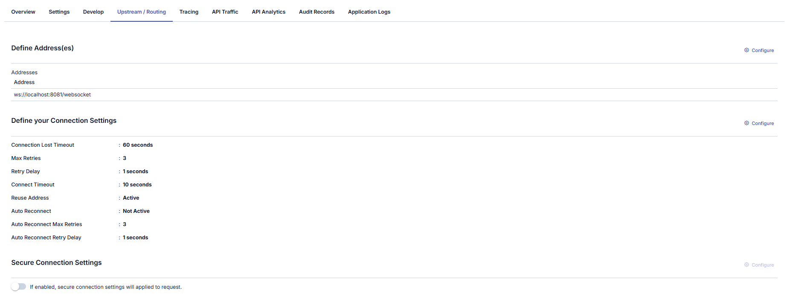
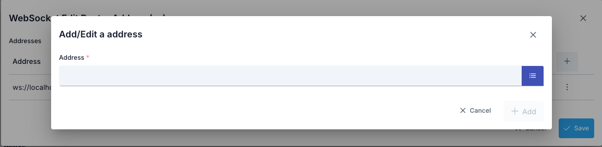
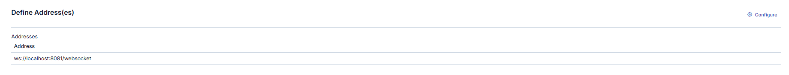
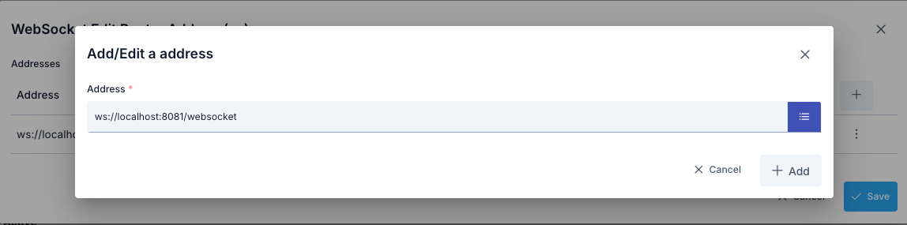
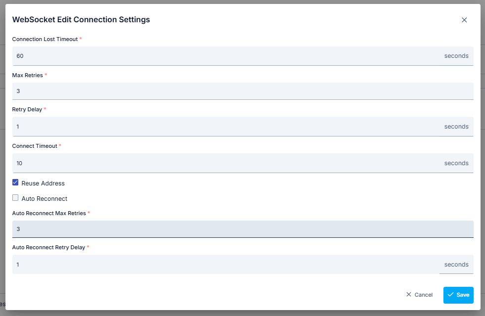
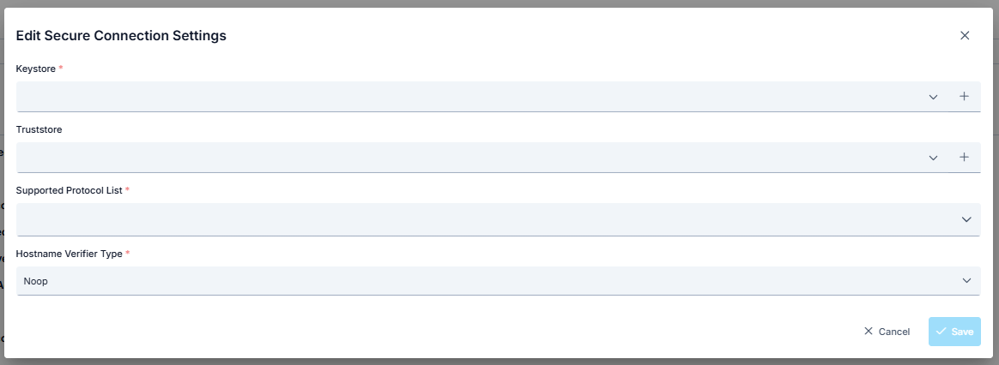

:::note

API tipi WebSocket ise, bu sekme görünür.

:::

:::warning

**SignalR** istemcisi önce HTTP istekleri (negotiate) gönderir ve Server-Sent Events ya da long polling'e geçebilir. Bu istekleri taşımak için proxy'nin bağlantı ayarlarında **SignalR Uyumluluğu** seçeneğini seçin. Bkz. [SignalR Uyumluluğu](#signalr-uyumlulugu). Apinizer önündeki katmanın (Load Balancer, Ingress, Nginx vb.) WebSocket yükseltme başlıklarını (`Upgrade`, `Connection`) bozmadan arkaya iletmesi de gereklidir.

:::

Bu bölümde, WebSocket API Proxy Tipi için yönlendirme ayarları yer almaktadır.

API Proxy, istemciden gelen mesajları karşılayıp varsa politikaları işlettikten sonra, mesajı Backend API'ye yönlendirir. Yönlendirme sekmesi, işte bu yönlendirme işleminin nasıl yapılacağının ayarlandığı sekmedir.

WebSocket Yönlendirme Sekmesi ayarlarını içeren görsele aşağıda yer verilmiştir:


### Yeni Adres Ekleme

Yapılandır butonuyla açılan pencerenin en sağındaki kolon başlığı bölgesindeki ➕ tuşuna tıklandığında açılan pencereden yeni bir adres eklenebilir.




**Yeni adres ekleme penceresinde:**

* Adres alanına backend API adresi girilir veya ortam değişkeni kullanılır
* Adres alanının sağındaki liste ikonu butonuna tıklanarak Ortam Değişkenleri Seçim Dialog'u açılabilir
* Seçilen ortam değişkeni panoya kopyalanır ve adres alanına yapıştırılır
* Koşul  bölümü ile koşullu yönlendirme tanımlanabilir

### Adresi Güncelleme

Adresleri gösteren tablonun **Adres (Address)** kolonundaki **Yapılandır (Configure)** tuşuna tıklandığında açılan pencerede isteğin gönderileceği backend adresi bilgisi güncellenebilir.



Bu değerin nasıl girilmesi gerektiği ile ilgili [WebSocket Proxy Yönlendirme Kılavuzu](/tr/develop/api-proxy-olusturma/websocket-api-proxy-olusturma) sayfasını ziyaret edebilirsiniz.

Eğer bu değer otomatik olarak bulunduğu ortama göre değişmesi isteniyorsa Ortam Değişkenleri (Environment Variable) içinden seçim yapılabilir.

Adresleri gösteren tablonun **Adres (Address)** kolonundaki **Yapılandır (Configure)** tuşuna tıklandığında açılan pencerede adres güncellenebilir.

**Ortam Değişkenleri (Environment Variable) Seçimi** için açılan dialog detayı aşağıdaki görselde belirtilmiştir.

Adres giriş alanının sağında bulunan liste ikonu butonuna tıklandığında Ortam Değişkenleri Seçim Dialog'u açılır. Bu dialog üzerinden projede tanımlı tüm ortam değişkenleri (Environment Variables) görüntülenebilir ve seçilebilir.


**Ortam Değişkenleri Seçim Dialog'unda:**

* Tüm ortam değişkenleri listelenir (Global ve Environment-Specific)
* Arama kutusu ile değişken adı veya açıklamasına göre filtreleme yapılabilir
* Her değişken için Key Name, Açıklama , Tip  bilgileri görüntülenir
* Kopyala (Copy) butonu ile seçilen değişkenin formatı (`${variableName}`) otomatik olarak panoya kopyalanır
* Kopyalanan değer adres alanına yapıştırılarak kullanılabilir

**Örnek Kullanım:**

* Ortam değişkeni: `BACKEND_URL = ws://dev-api.example.com` (Development ortamı için)
* Ortam değişkeni: `BACKEND_URL = wss://api.example.com` (Production ortamı için)
* Adres alanına girilen değer: `${BACKEND_URL}`
* Runtime'da Development ortamında: `ws://dev-api.example.com`
* Runtime'da Production ortamında: `wss://api.example.com`

### Adres Silme

Silinmek istenen adresin satır sonundaki açılır menüsünden **Kaldır ** seçeneği seçilerek adres silinir.

:::warning

API Proxy'nin yönlendirme yapabilmesi için en az bir adres olması gerekir. Bu nedenle en son adres için silindikten sonra kaydet butonu pasif olur ve kaydetmeye izin vermez.

:::

## İstemci Adresi

WebSocket bağlantısının istemci adresi, HTTP'deki gibi bağlantının kendi IP'sidir; port içermez. Trafik kaydı, IP izin ve engel listeleri, istemci adresine bağlı Limit Planı Hedef Kitlesi ve script'ler bu değeri kullanır.

## Bağlantı Ayarları Konfigürasyonu

WebSocket Bağlantı Ayarları Tanımlama Sekmesi, WebSocket protokolü üzerinden yapılan bağlantıların yapılandırılmasını sağlar. Bu sekme, bağlantıların performansını ve güvenliğini optimize etmek için gerekli olan çeşitli parametreleri içerir. Aşağıda, bu sekmede yer alan ayarların detayları verilmiştir.

WebSocket Bağlantı ayarları konfigürasyonu için kullanılan parametreler aşağıda görülmektedir.


| Alan | Açıklama |
|------|----------|
| **Bağlantı Kaybı Zaman Aşımı** *(Connection Lost Timeout)* | Bu ayar, WebSocket bağlantısının kaybolması durumunda, bağlantı kaybolduktan sonra ne kadar süre bekleyeceğini belirler. Bu süre aşılırsa, yeni bir bağlantı kurulmaya çalışılır. |
| **Bağlantı Zaman Aşımı** *(Connect Timeout)* | WebSocket sunucusuna bağlantı kurma sırasında geçerli olan zaman aşımı süresini ifade eder. |
| **Yeniden Deneme Gecikmesi** *(Retry Delay)* | Bağlantı kaybolduğunda, yeniden bağlantı kurulmadan önce beklenmesi gereken süreyi belirtir. |
| **Maksimum Yeniden Deneme Sayısı** *(Max Retries)* | Bağlantı kaybolduğunda, bağlantıyı yeniden kurmak için yapılacak maksimum deneme sayısını belirtir. |
| **Adres Yeniden Kullanımı** *(Reuse Address)* | Ağ bağlantısı için kullanılan IP adresinin, bağlantı kapanmış olsa bile yeniden kullanılmasını sağlayan bir ayardır. |
| **Otomatik Yeniden Bağlanma** *(Auto Reconnect)* | Bağlantı beklenmedik şekilde kapandığında istemcinin sunucuya otomatik olarak yeniden bağlanmaya çalışmasını sağlar. |
| **Maksimum Yeniden Bağlanma Denemesi** *(Auto Reconnect Max Retries)* | İstemcinin bağlantı kesildikten sonra kaç kez yeniden bağlanmayı deneyeceğini belirler. |
| **Yeniden Bağlanma Gecikmesi** *(Auto Reconnect Retry Delay)* | Her yeniden bağlanma denemesi arasında ne kadar süre bekleneceğini belirler. |
| **Socket.IO Uyumluluğu** | Proxy'nin Socket.IO istemcilerinin HTTP long-polling isteklerini taşımasını sağlar. Varsayılan olarak kapalıdır. Seçtiğinizde aynı pencerede **Okuma Zaman Aşımı** alanı görünür. Bkz. [Socket.IO Uyumluluğu](#socketio-uyumlulugu). |
| **SignalR Uyumluluğu** | Proxy'nin ASP.NET Core SignalR istemcilerinin HTTP isteklerini taşımasını sağlar. Varsayılan olarak kapalıdır. Seçtiğinizde aynı pencerede **Okuma Zaman Aşımı** alanı görünür. Bkz. [SignalR Uyumluluğu](#signalr-uyumlulugu). |
| **İzin Verilen Alt Protokoller** | Proxy'nin kabul ettiği WebSocket alt protokolleri, örneğin `graphql-transport-ws` ya da `mqtt`. Varsayılan olarak boştur. Bkz. [İzin Verilen Alt Protokoller](#izin-verilen-alt-protokoller). |

Bu ayarlar, WebSocket bağlantınızın yönetimi ve hatalara karşı nasıl tepki vereceği konusunda önemli bilgiler sağlar.

## Birden Fazla Routing Adresine Dağıtım {#routing-adresi-dagitimi}

WebSocket proxy'nin iki ya da daha çok PRIMARY routing adresi varsa proxy, istemcileri istemci IP adresine göre adreslere dağıtır. Bu, Socket.IO Uyumluluğu ve SignalR Uyumluluğu açık ya da kapalı olsa da geçerlidir.

* Bir istemci IP adresi her zaman aynı adrese gider. Bu seçimde yönlendirme algoritması ve adres ağırlıkları kullanılmaz.
* Sağlık kontrolünün sağlıksız gördüğü adres atlanır. Sağlık kontrolü yalnızca Health Monitoring açık ve Health Check Path tanımlı adrese uygulanır.
* Hiçbir PRIMARY adres sağlıklı değilse bağlantı 1008 koduyla ve `No Healthy Address Found` metniyle kapatılır.
* İletilen istemci IP başlığı yoksa tek bir kaynak adresin arkasındaki tüm istemciler tek adrese gider. Gateway'in önünde bir load balancer varsa Forwarded IP başlığını açın.
* Otomatik yeniden bağlanma, bağlantının kullandığı adrese gider.
* Tek adresli ya da tek PRIMARY adresli proxy o adresi eskisi gibi kullanır. Sağlığına bakılmaz.

Bu davranıştan önce düz WebSocket proxy her bağlantıyı ilk adrese gönderirdi.

## İzin Verilen Alt Protokoller {#izin-verilen-alt-protokoller}

İstemci el sıkışmasında bir ya da daha çok alt protokol önerebilir. Bazı istemciler bir alt protokol ister, örneğin `graphql-transport-ws` ya da `mqtt`. Proxy'nin kabul ettiği alt protokolleri **İzin Verilen Alt Protokoller** alanına girin. Değerleri boşluk ya da virgülle ayırın. Boş ve tekrarlanan değerler atılır.

* Gateway, istemcinin önerisinde listede bulunan ilk değerle istemciye yanıt verir. Backend'e yalnızca bu değeri önerir. Karşılaştırma büyük/küçük harfe duyarlıdır.
* Liste boşsa, istemci öneri yapmamışsa ya da önerilen hiçbir değer listede yoksa alt protokol seçilmez.
* Backend, gateway'in istemciye bildirdiği alt protokolden farklı birini seçerse ya da hiçbirini seçmezse istemci bağlantısı 1002 (protokol hatası) koduyla kapatılır. İstemcinin hiçbir mesajı backend'e ulaşmaz. Bağlantının trafik kaydı 1002 durumlu bir hatadır.

APIops WebSocket ayarları çağrısında `allowedSubprotocols` alanı bulunur.

## Boşta Kalma Süresi

Boşta kalma süresi (`tuneWebsocketIdleTimeout`), yükseltilmiş WebSocket bağlantısına uygulanır. İki yönden birinde giden her mesaj (heartbeat dahil) süreyi yeniden başlatır. Yalnızca veri alan istemci, backend gönderdiği sürece bağlı kalır. İki tarafın da göndermediği bağlantı, süre dolunca kapanır. Gateway ping göndermez.

Süreyi uygulama protokolünün heartbeat aralığından uzun tutun. 60 saniyelik varsayılan değer, Socket.IO 3 ve 4 varsayılanlarından (ping aralığı 25 saniye, ping zaman aşımı 20 saniye) uzundur. Bkz. [Gateway Ayarları](/tr/setup/gateway-ayarlari).

## İstemciye Giden Kapatma Kodları

Backend bağlantısı, kapatma çerçevesinde gönderilemeyen bir kodla biterse istemci, alabileceği bir kod alır. 1006 kodu (backend bağlantısı kapatma çerçevesi olmadan koptu) istemciye 1011 olarak gider. 1005 kodu 1000 olarak gider. 1015 kodu ile 1000-1003, 1007-1014 ve 3000-4999 aralıkları dışındaki her kod 1011 olarak gider. Backend tarafındaki trafik kaydı backend'in kodunu korur. Diğer kodlar önceki gibi gider.

## SignalR Uyumluluğu {#signalr-uyumlulugu}

ASP.NET Core SignalR istemcisi önce HTTP negotiate isteği gönderir ve Server-Sent Events (SSE) ya da long polling'e geçebilir. Proxy'nin istemcileri SignalR istemcisiyse bağlantı ayarları penceresinde **SignalR Uyumluluğu** seçeneğini seçin. Ayar varsayılan olarak kapalıdır. Proxy'nin export, import, deploy ve denetim verisinin parçasıdır.

Ayar açıkken proxy şu istekleri de backend'e taşır:

* Negotiate isteği: `/negotiate` ile biten yolda `POST`; CORS ön isteği için `OPTIONS`.
* Bir bağlantının SSE, long polling, gönderme (`POST`) ve kapatma (`DELETE`) istekleri. Bu istekler `id=<token>` sorgusunu taşır.

Bu istekler, Socket.IO polling isteklerinin yolundan geçer: proxy'nin istek ve yanıt politikaları ile Rate Limit Control List kuralları her biri için çalışır ve her biri bir trafik kaydı yazar. `PUT`, `id` içermeyen `GET` ve ayar kapalıyken her istek HTTP 404 ve `ERR-006` alır. Bu ayardan önce her SignalR HTTP isteği bu yanıtı alırdı.

* SSE isteği (`Accept: text/event-stream` ile `GET`), backend'in gönderdiği gibi akıtılır. Akışın okuma zaman aşımı yoktur. Trafik kaydı akış bitince yazılır. Yanıt politikası akışı ancak gönderildikten sonra görür.
* Diğer istekler tamponlanır ve backend'i **Okuma Zaman Aşımı** süresine kadar bekler. **Okuma Zaman Aşımı** alanı pencerede görünür. SignalR, long poll'u varsayılan olarak 90 saniyeye kadar tutar. **Okuma Zaman Aşımı** değerini bunun üzerinde tutun, örneğin 120 saniye; aksi hâlde bekleyen poll zaman aşımı hatasıyla biter.
* Birden fazla PRIMARY adres varsa istemci IP adresi; negotiate isteğinin, WebSocket bağlantısının ve HTTP isteklerinin backend'ini seçer. Bağlantı token'ı, onu veren backend'e ulaşır. Bkz. [Birden Fazla Routing Adresine Dağıtım](#routing-adresi-dagitimi).

APIops WebSocket ayarları çağrısında `signalREnabled` alanı bulunur. Bu alanı içermeyen çağrı kayıtlı değeri korur.

### WebSocket Aktarımını Tercih Edin

Apinizer üzerinden SignalR'ın WebSocket aktarımını tercih edin. Açık her SSE akışı ve bekleyen her long polling isteği, açık kaldığı sürece bir gateway worker thread'i tutar. Açık WebSocket bağlantısı thread tutmaz. İstemciler SSE ya da long polling kullanıyorsa worker thread sayısını (`tuneWorkerThreads`), olağan trafiğe ek olarak aynı anda bu şekilde bağlı istemci sayısına göre ayarlayın. Bkz. [Gateway Ayarları](/tr/setup/gateway-ayarlari).

## Socket.IO Uyumluluğu {#socketio-uyumlulugu}

Socket.IO istemcisi HTTP long-polling istekleriyle bağlanabilir, sonra WebSocket'e yükselir. Proxy'nin istemcileri Socket.IO istemcisiyse bağlantı ayarları penceresinde **Socket.IO Uyumluluğu** seçeneğini seçin.

Ayar varsayılan olarak kapalıdır. Proxy'nin dışa aktarma, içe aktarma, deploy ve denetim verisinde yer alır.

Ayar açıkken:

* Proxy, Engine.IO long-polling isteklerini aynı proxy adresi üzerinden backend'e taşır. İstekte `Upgrade` başlığı yoksa ve sorguda `transport=polling` ile `EIO=<sürüm>` varsa istek polling sayılır. `GET`, `POST` ve `OPTIONS` metotları taşınır. Engine.IO 3 ve 4 sürümleri desteklenir.
* Polling isteğinin backend adresi, proxy'nin yönlendirme adresidir. `ws` şeması `http`, `wss` şeması `https` olarak çevrilir.
* Pencerede **Okuma Zaman Aşımı** alanı görünür ve zorunludur. Proxy'nin polling isteği için backend yanıtını saniye cinsinden ne kadar bekleyeceğini belirler. Polling isteği backend'i uzun süre bekleyebilir. Socket.IO ping aralığından uzun bir değer girin. Socket.IO varsayılan ping aralığı 25 saniyedir.

### Polling İsteklerinde Politikalar ve Limitler

Polling isteğinde şunlar çalışır:

* Proxy'nin istek politikaları.
* Rate Limit Control List kuralları.
* Çağıranın Limit Planı. Polling isteği Hedef Kitle için bir kez sayılır.
* Proxy'nin yanıt politikaları.

Proxy group politikaları ve metot politikaları polling isteğinde çalışmaz. WebSocket proxy'de metot yoktur.

Yanıt politikası yanıt gövdesini Engine.IO yükü olarak görür. Engine.IO 4 sürümünde paketler `0x1e` baytıyla ayrılır. 3 sürümünde her paket uzunlukla başlar. Gövdeyi değiştiren politika bu çerçeveyi korumalıdır. Aksi halde istemci yanıtı okuyamaz.

Yanıt politikası her long-polling yanıtında çalışır ve gövdeyi Engine.IO yükü olarak görür. JSON veya XML bekleyen bir politika bu yükte hata verirse istemci hata yanıtı alır.

### Birden Çok Routing Adresi

Socket.IO Uyumluluğu açıkken ve proxy'nin birden fazla PRIMARY routing adresi varsa istemcinin tüm oturumu (polling istekleri ve WebSocket yükseltmesi) tek adrese gider. Proxy bu adresi, sağlıklı adresler arasından istemci adresine göre seçer. Canary, mirror ve failover adresleri kullanılmaz.

* Sağlık süzgeci yalnız Sağlık İzleme açık ve Sağlık Kontrol Yolu dolu olan adreste çalışır. Proxy yolu, adresin `http` veya `https` karşılığına ekleyerek sorar.
* Hiçbir PRIMARY adres sağlıklı değilse istek REST API proxy'deki gibi reddedilir: HTTP 503 ve `ERR-003`. WebSocket el sıkışması 1008 koduyla kapanır.
* Tek PRIMARY adres varsa proxy o adresi eskisi gibi kullanır. Socket.IO Uyumluluğu kapalıyken proxy istemcileri aynı şekilde dağıtır; bkz. [Birden Fazla Routing Adresine Dağıtım](#routing-adresi-dagitimi).

İstemci IP'si oturum içinde değişirse (örneğin NAT veya mobil ağ) ya da bir adresin sağlık durumu değişirse oturum başka adrese geçer ve istemci yeniden bağlanır. Gateway'in önünde yük dengeleyici varsa Forwarded IP başlığını açın. Açmazsanız tüm istemciler tek adrese gider.

### Güvenlik Notu

Ayar açıkken backend'in proxy yolu altındaki HTTP uçlarına, `EIO` ve `transport=polling` içeren sorguyla proxy üzerinden erişilebilir. Proxy'nin istek politikaları bu isteklerde çalışır. Bu uçları korumak için proxy'nin istek akışına kimlik doğrulama ve IP politikaları ekleyin.

### Kapasite Notu

`GET` yanıtını bekleyen bir polling istemcisi, yavaş bir REST isteği gibi bir gateway worker thread'i ve bir eşzamanlı istek yeri tutar. WebSocket bağlantısı, yükseltmeden sonra worker thread tutmaz.

Gateway'i polling istemci sayısı ile diğer tepe trafiğin toplamına göre boyutlandırın:

* `tuneWorkerMaxThreads` ve `tuneMaxConcurrentRequest` en az bu sayı kadar olmalıdır.
* `tuneRoutingConnectionPoolMaxConnectionPerHost` bu sayıdan yüksek olmalıdır.

Varsayılanlar: `tuneWorkerThreads` = CPU çekirdek sayısı × 8, `tuneWorkerMaxThreads` = CPU çekirdek sayısı × 16. 4 vCPU'lu sunucuda bu değer 64'tür. Bkz. [Gateway Performans Ayarlama](/tr/operations/yonetici-kilavuzlari/gateway-performans-ayarlama) ve [Gateway Ayarları](/tr/setup/gateway-ayarlari).

### Heartbeat Kayıtları

Socket.IO bağlantısında `2` ve `3` WebSocket çerçeveleri, Engine.IO ping ve pong heartbeat çerçeveleridir. Ayar açıkken ve backend bir Engine.IO oturumunu doğruladıysa proxy her biri için ayrı trafik kaydı yazmaz. Backend oturumu iki durumda doğrular: ilk çerçevesi open paketi (`0{...}`) olduğunda ya da `2probe` isteğine `3probe` yanıtı verdiğinde. Engine.IO sunucusu olmayan bir backend'de her çerçeve kendi trafik kaydını korur.

Politikalar her heartbeat'te çalışır. Bir politikanın reddettiği heartbeat kaydedilir.

Bağlantıyı kapatan kayıt, gövdesinde bir özet taşır:

```text
Socket.IO heartbeats: client to backend N, backend to client M, last <time|none>. Connection closed by the <client|backend|gateway (...)> with code C.
```

Özet yalnız payload loglaması açıkken yazılır. Payload loglaması kapalıysa özet görünmez. Ayar kapalıyken her çerçeve eskisi gibi kendi kaydını yazar.

## Güvenli Bağlantı Ayarı

Bu ayar etkinleştirildiğinde seçili bağlantı ayarları isteğe uygulanır.

Böylece Apinizer'dan hedef hizmete gönderim yapacak olan Apinizer istemcisi, hedef hizmetin sertifikasını doğrular ve kendisinin de bir sertifikası olduğunu ve hedef hizmet tarafından doğrulanması gerektiğini belirtir.

Hedef hizmet de istemcinin sertifikasını doğrular ve bu sayede istemci ile güvenli bir iletişim kurulmuş olur.

Bağlantı ayarları konfigürasyonu için kullanılan parametreler aşağıda görülmektedir.


| Alan | Açıklama |
|------|----------|
| **Keystore** | Keystore, istemci tarafının kimliğini doğrulamak için kullanılır. Keystore içeriğinde şunlar olmalıdır: Eğer server adresinde mTLS doğrulaması yoksa boş olmalıdır. (Alan zorunlu olduğu için boş bir keystore eklenmesi gereklidir.) Eğer server adresinde mTLS doğrulaması varsa: client privatekey, İstemci sertifikası (public key ile birlikte), Sertifika zinciri (varsa intermediate ve root CA sertifikaları) bulunmalıdır. Key Store kaydında **Alias** değeri varsa istemci sertifikası olarak yalnızca bu alias'a ait anahtar kaydı kullanılır. Dosyadaki diğer kayıtlar açılmaz. Alias Key Store içinde yoksa veya özel anahtar kaydı değilse Apinizer Key Store'un tamamını kullanır ve sertifikayı TLS katmanı seçer. Apinizer bu durumda ayar kurulurken worker log'una bir kez WARN satırı yazar. Satır Key Store ID'sini, dosya adını ve aktif ortamı içerir; parolayı içermez. Key Store'da hiç özel anahtar kaydı yoksa istek reddedilir. Alias boşsa Key Store eskisi gibi kullanılır. |
| **Truststore** | Truststore sunucu sertifikasını doğrulamak için kullanılır. Sunucu sertifikası Self Signed ise ya da Apinizer'ın güvenmediği bir sertifika ise Truststore içeriğinde şunlar olmalıdır: Hedef sunucunun root CA sertifikası, Intermediate CA sertifikaları (varsa) bulunmalıdır. Aksi halde Apinizer'ın sahip olduğu CA sertifikalar güvenli bağlantı için yeterli olacaktır. Truststore ayrı bir kayıt türü değildir: JKS/PKCS12 dosyanız **Yönetim** → **Gizli Bilgiler** → **Key Stores** altına bir Key Store kaydı olarak yüklenir ve burada o kayıt seçilir. |
| **Desteklenen Protokol Listesi** *(Supported Protocol List)* | Protokoller seçilir. Seçenekler: TLSv1.3, TLSv1.2, TLSv1.1, TLSv1, SSLv3. Hedefe giden bağlantıda listeden yalnızca TLSv1.2 ve TLSv1.3 uygulanır; diğer seçenekler dikkate alınmaz. Listede ikisi de yoksa varsayılan protokoller kullanılır. |
| **Hostname Doğrulama Tipi** *(Hostname Verifier Type)* | **Noop Hostname Doğrulama**, SSL/TLS bağlantılarında güvenlik riski oluşturabilecek hostname doğrulamasını devre dışı bırakır. Bir saldırganın SSL/TLS iletişimini kesebileceği ve sunucunun kimliğine bürünebileceği man-in-the-middle (MITM) saldırılarını önlemek için sunucunun hostname'ini doğrulamak önemlidir. Noop Hostname Doğrulama kullanmak yerine, Apache HttpComponents istemci çerçevesi tarafından sağlanan aşağıdaki hostname doğrulama uygulamalarından birini kullanabilirsiniz: **Default Hostname Doğrulama**: Bu uygulama, standart hostname doğrulamasını RFC 2818 ve RFC 6125'te tanımlanan kurallara göre gerçekleştirir. Hostname'in eşleştiğinden emin olmak için sunucu sertifikasının ortak adını (CN) ve konu alternatif adlarını (SAN'lar) kontrol eder. **Strict Hostname Doğrulama**: Bu uygulama, Default Hostname Doğrulama'dan daha sıkı bir hostname doğrulaması gerçekleştirir. Hostname ile sunucu sertifikasının CN veya SAN'ları arasında tam bir eşleşme gerektirir. Ayrıca, hostname'in tam nitelikli bir etki alanı adı (FQDN) olup olmadığını ve bir IP adresi veya joker etki alanı adı olmadığını da kontrol eder. **Browser Compat Hostname Doğrulama**: Bu uygulama, popüler web tarayıcıları tarafından kullanılan kurallara dayalı olarak rahat bir hostname doğrulaması gerçekleştirir. Bir joker alan adının, alan adının herhangi bir alt alan adıyla eşleşmesine izin verir ve hostname'in büyük/küçük harf duyarlılığını yok sayar. |

:::warning mTLS yapılandırması başarısız olursa bağlantı reddedilir

Güvenli bağlantı ayarları oluşturulamazsa, örneğin Keystore dosyası açılamazsa, Apinizer varsayılan bağlantıya geçmez. WebSocket bağlantısını 1008 kapatma koduyla reddeder ve yeniden denemez.

Hedefe giden bağlantıda yalnızca TLSv1.2 ve TLSv1.3 sunulur. Yalnızca TLS 1.0 veya 1.1 destekleyen bir hedef bağlanamaz.
:::
