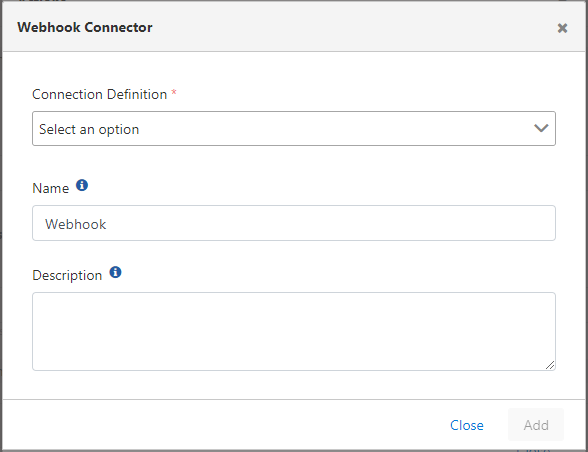

import {Card, CardGroup} from '@site/src/components/Card';

## Konfigürasyon

Konfigürasyon alanları:

<CardGroup cols={1}>
  <Card title="Bağlantı Tanımı" icon="plug">
    **Alan:** Bağlantı Tanımı (Connection Definition)
    
    Webhook bağlantısına ait tanım havuzdan seçilir. Bağlantı oluşturmak hakkında detaylı bilgi için [tıklayınız](/tr/integrations/baglanti-yonetimi/webhook).
  </Card>
</CardGroup>

:::note

Bu konnektör log hedefi olarak kullanıldığında log gönderimi için kendi bağlantısını açar ve diğer log hedeflerinden bağımsız çalışır. Bkz. [Log Gönderimi](/tr/integrations/konnektorler/genel-bakis#log-gonderimi).

:::
