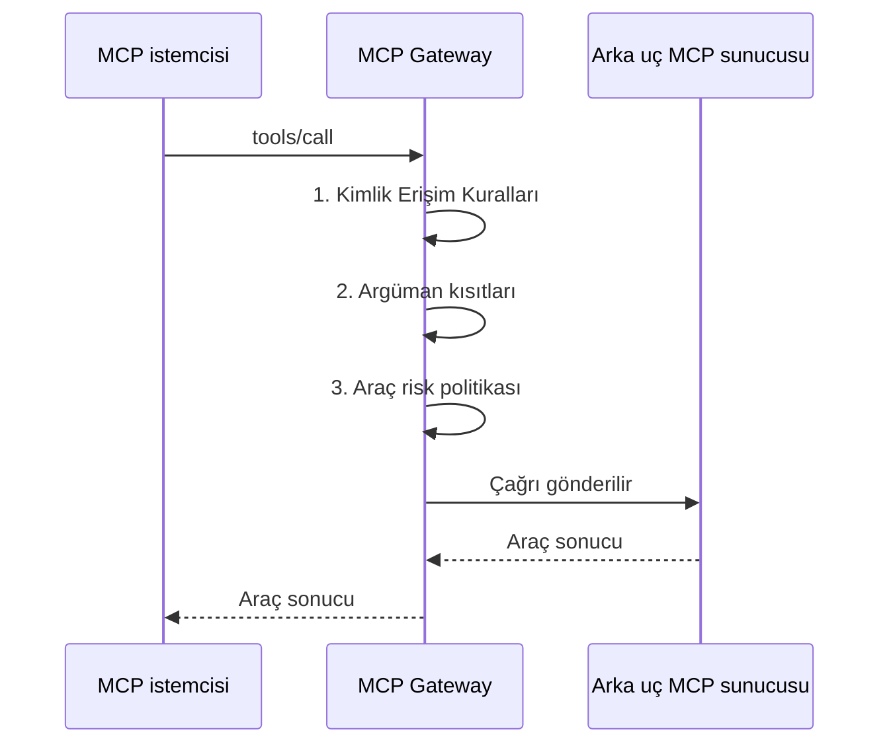

import {Steps, Step} from '@site/src/components/Steps';

## Ne Kuracaksınız

Bu senaryoda Passthrough proxy'si **Order Desk MCP**'ye üç denetim eklersiniz. Denetimler her `tools/call` isteğinde çalışır.

| Kart | Yanıt verdiği soru |
|---|---|
| **Kimlik Erişim Kuralları** | Hangi çağıran hangi aracı görebilir ve çağırabilir? |
| **Argüman kısıtları** | Çağrının argümanları geçerli mi? |
| **Araç risk politikası** | Çağrı için önce bir insanın onayı gerekir mi? |

Çağrı denetimlerden bu sırayla geçer. Bir adımdaki ret çağrıyı durdurur. Sonraki adımlar çalışmaz.



Araçları Aç proxy'sinde aracın **Required Scopes** denetimi 1. adımdan sonra, 2. adımdan önce çalışır. Bkz. [Araçları Aç Proxy'leri](/tr/tutorials/ai-proxy-senaryolari/mcp-gateway-tarayici-girisi#araçları-aç-proxyleri).

Her kartın referansı [MCP Gateway](/tr/ai-gateway/mcp-gateway#güvenlik-ve-governance) sayfasındadır. Bu sayfa kartları tek bir senaryoda nasıl kullanacağınızı gösterir.

## Ön Koşullar

Önce [MCP Gateway'e Keycloak Olmadan Tarayıcı ile Giriş](/tr/tutorials/ai-proxy-senaryolari/mcp-gateway-tarayici-girisi) senaryosunun kurulumunu tamamlayın. Denetimler bir çağıran kimliği ister. Örnekler şu kurulumu kullanır:

| Öğe | Örnek |
|---|---|
| Proxy | **Order Desk MCP**, Passthrough, yol `/order-desk`, Standart MCP OAuth profili. |
| Token politikası | **ACL'den Yönet** modunda bir JWT politikası. |
| Uygulama | **Claude Code**, açık API istemcisi `claude-code-desktop`. |
| Tüketiciler | `jane.doe` (rol **Order Viewer**) ve `sam.lee` (roller **Order Viewer** ve **Order Manager**). |
| Roller | **Order Viewer** (OAuth Scope Adı `orders.read`) ve **Order Manager** (OAuth Scope Adı `orders.write`). |
| Arka uç MCP sunucusu | `order-desk`, üç araçlı. |

Arka uç sunucusunun araçları:

| Araç | İşaret | Argümanlar |
|---|---|---|
| `get_order_status` | `readOnlyHint` | `orderId` |
| `list_open_orders` | `readOnlyHint` | Yok |
| `cancel_order` | `destructiveHint` | `orderId`, `reason` |

## Kartlar Nerede

Proxy'nin **MCP Routing** sekmesini açın. Kartlar arka uç MCP sunucuları listesinin altındadır. Her kartta bir **Yapılandır** düğmesi vardır. API proxy üzerinde yönetme yetkiniz yoksa düğme pasiftir.


Aynı kartlar Araçları Aç proxy'sinde de vardır. Bu proxy'de aracın varsayılan risk düzeyi operasyonun HTTP metodundan gelir: GET Düşük, POST Orta, DELETE Yüksek.

## Kimlik Erişim Kuralları

Bu kart hangi çağıranın hangi aracı görebileceğini ve çağırabileceğini belirler. Bir kuralın izin vermediği çağıran aracı `tools/list` yanıtında görmez ve çağıramaz.

<Steps>
  <Step title="Kartı açın">
    **MCP Routing** sekmesinde **Kimlik Erişim Kuralları** kartındaki **Yapılandır** düğmesini seçin.
  </Step>

  <Step title="Görüntüleyiciler için kuralı ekleyin">
    **Kural Ekle** düğmesini seçin. **Uygulandığı Kimlik** alanını **Rol**, **Ad** alanını `Order Viewer` yapın. **İzin Ver** listesine `get_order_status` ve `list_open_orders` ekleyin.
  </Step>

  <Step title="Yöneticiler için kuralı ekleyin">
    **Kural Ekle** düğmesini yeniden seçin. **Uygulandığı Kimlik** alanını **Rol**, **Ad** alanını `Order Manager` yapın. **İzin Ver** listesine `cancel_order` ekleyin.
  </Step>

  <Step title="Kaydedin ve deploy edin">
    **Kaydet** düğmesini seçin. Proxy'yi deploy edin.
  </Step>
</Steps>


Kuralların işleyişi:

- Kural bir **Tüketici / API istemcisi**, bir **Rol** ya da bir **Kurum** için geçerlidir.
- Boş **İzin Ver** listesi bütün adlar demektir.
- **Reddet** listesindeki ad her zaman önceliklidir.
- Listede kural yoksa kimlik doğrulamasını geçen her çağıran her aracı görür ve çağırır. Listede kural varsa hiçbir kurala uymayan çağıran hiçbir şey alamaz.
- Eşleşen tüm kimliklerin kuralları birleşir. `sam.lee` iki role de sahiptir, bu yüzden iki kuralın araçlarını alır.

Bkz. [Güvenlik ve Governance](/tr/ai-gateway/mcp-gateway#güvenlik-ve-governance).

### Deneyin

Her kullanıcının access token'ı ile `tools/list` gönderin. Token'ı [giriş senaryosunun](/tr/tutorials/ai-proxy-senaryolari/mcp-gateway-tarayici-girisi#curl-ile-doğrulama) adımlarıyla alın.

```bash
curl -s -X POST https://gateway.example.com/apigateway/order-desk \
  -H "Authorization: Bearer <jane.doe access token>" \
  -H "Content-Type: application/json" \
  -H "Accept: application/json, text/event-stream" \
  -d '{"jsonrpc":"2.0","id":1,"method":"tools/list"}'
```

| Çağıran | Yanıttaki araçlar |
|---|---|
| `jane.doe` | `get_order_status`, `list_open_orders` |
| `sam.lee` | `get_order_status`, `list_open_orders`, `cancel_order` |

Şimdi `jane.doe` token'ı ile `cancel_order` çağırın:

```bash
curl -s -X POST https://gateway.example.com/apigateway/order-desk \
  -H "Authorization: Bearer <jane.doe access token>" \
  -H "Content-Type: application/json" \
  -H "Accept: application/json, text/event-stream" \
  -d '{"jsonrpc":"2.0","id":2,"method":"tools/call","params":{"name":"cancel_order","arguments":{"orderId":"SO-10421","reason":"Customer withdrew the order"}}}'
```

Yanıt, JSON-RPC hatası taşıyan bir HTTP 200 yanıtıdır. İstemciye göre gövde JSON ya da SSE `data:` çerçevesidir:

```json
{"jsonrpc":"2.0","id":2,"error":{"code":-32603,"message":"Tool call rejected: the target API requires policies (e.g. authentication or rate-limit) that the MCP gateway cannot apply on this path."}}
```

:::note
Gateway bu durum için tek bir genel ret mesajı kullanır. Çağrının neden reddedildiğini çağırana söylemez. Mesaj metnini [Hata Mesajları](/tr/admin/system-settings/hata-mesajlari) ekranından değiştirebilirsiniz.
:::

## Argüman Kısıtları

Bu kart, gateway çağrıyı göndermeden önce araç çağrısının argümanlarını doğrular.

<Steps>
  <Step title="Kartı açın">
    **Argüman kısıtları** kartındaki **Yapılandır** düğmesini seçin.
  </Step>

  <Step title="get_order_status kurallarını ekleyin">
    `get_order_status` aracını ekleyin. Bir kural ekleyin: **Argüman yolu** `orderId`, **Kural** **Düzenli ifade (tam eşleşme)**, **Değer** `^SO-[0-9]{5}$`.
  </Step>

  <Step title="cancel_order kurallarını ekleyin">
    `cancel_order` aracını ekleyin. Üç kural ekleyin:

    | Argüman yolu | Kural | Değer |
    |---|---|---|
    | `orderId` | **Düzenli ifade (tam eşleşme)** | `^SO-[0-9]{5}$` |
    | `reason` | **Zorunlu** | Kullanılmaz |
    | `reason` | **En fazla uzunluk** | `200` |
  </Step>

  <Step title="Kaydedin ve deploy edin">
    **Kaydet** düğmesini seçin. Proxy'yi deploy edin.
  </Step>
</Steps>


Bilmeniz gereken kurallar:

| Kural | Değer | Çağrı şu durumda reddedilir |
|---|---|---|
| **Düzenli ifade (tam eşleşme)** | Düzenli ifade | Argüman ifadenin tamamıyla eşleşmezse. |
| **En fazla uzunluk** | Tam sayı | Argüman metni daha uzunsa. |
| **İzin verilen değerler** | Virgülle ayrılmış değerler | Argüman değerlerden biri değilse. |
| **Zorunlu** | Yok | Argüman yoksa. |

- **Düzenli ifade (tam eşleşme)**, **En fazla uzunluk** ve **İzin verilen değerler** kuralları bir argümanı yalnız argüman varsa denetler. Argümanı zorunlu yapmak için **Zorunlu** kuralı ekleyin.
- Argüman yolu, noktayla ayrılmış özellik adlarıdır (örneğin `user.email`). Dizi indeksi ve joker karakter desteklenmez.
- Ortam değişkenleri (`${var}`) çalışma zamanında çözülür.
- Araç adı `tools/list` yanıtındaki adla aynı olmalıdır. Eşleşme büyük-küçük harf duyarlıdır. İki sunucu aynı araç adını kullanıyorsa ad `sunucu__araç` biçiminde görünür.

Bkz. [Güvenlik ve Governance](/tr/ai-gateway/mcp-gateway#güvenlik-ve-governance).

### Deneyin

`get_order_status` aracını ifadeye uymayan bir `orderId` ile çağırın:

```bash
curl -s -X POST https://gateway.example.com/apigateway/order-desk \
  -H "Authorization: Bearer <jane.doe access token>" \
  -H "Content-Type: application/json" \
  -H "Accept: application/json, text/event-stream" \
  -d '{"jsonrpc":"2.0","id":3,"method":"tools/call","params":{"name":"get_order_status","arguments":{"orderId":"10421"}}}'
```

```json
{"jsonrpc":"2.0","id":3,"error":{"code":-32602,"message":"Bad request. argument constraint violated: path='orderId' rule=REGEX constraint='^SO-[0-9]{5}$'"}}
```

`sam.lee` olarak `cancel_order` aracını `reason` olmadan çağırın:

```bash
curl -s -X POST https://gateway.example.com/apigateway/order-desk \
  -H "Authorization: Bearer <sam.lee access token>" \
  -H "Content-Type: application/json" \
  -H "Accept: application/json, text/event-stream" \
  -d '{"jsonrpc":"2.0","id":4,"method":"tools/call","params":{"name":"cancel_order","arguments":{"orderId":"SO-10421"}}}'
```

```json
{"jsonrpc":"2.0","id":4,"error":{"code":-32602,"message":"Bad request. argument constraint violated: path='reason' rule=REQUIRED"}}
```

Mesaj, yapılandırmanızdaki kuralı adlandırır. İstemcinin gönderdiği değeri hiçbir zaman tekrarlamaz.

## Çağrı Hacmini Sınırlama

MCP Routing sekmesinde çağrı kotası kartı yoktur. Bir aracın ne sıklıkla çağrılacağını başka iki yerde sınırlarsınız ve her yerin tek bir işi vardır:

- [Limit Planı](/tr/ai-gateway/limit-planlari) bir kimliği sınırlar: tüketici, API istemcisi, uygulama veya organizasyon.
- [Kota](/tr/develop/politikalar/api-bazli-kota) veya [Throttling](/tr/develop/politikalar/api-bazli-daraltma) politikası proxy'yi tüm çağıranların toplamına karşı korur.

İkisi de her aracın çağrılarını ayrı sayabilir. Sayım değişkeni olarak **MCP Araç Adı (tools/call)** bağlam değerini seçin. Ayrıntı için [MCP Gateway](/tr/ai-gateway/mcp-gateway#güvenlik-ve-governance) sayfasındaki **Çağrı hacmini sınırlama** maddesine bakın.

## Araç Risk Politikası ve Bekleyen Araç Onayları

Bu kart riskli araçları, bir insan çağrıyı onaylayana kadar bekletir.

<Steps>
  <Step title="Kartı açın">
    **Araç risk politikası** kartındaki **Yapılandır** düğmesini seçin.
  </Step>

  <Step title="Politikayı açın">
    **Araç risk politikasını uygula** anahtarını açın. Politika kapalıyken her çağrıya izin verilir. Muafiyetler ve araç risk düzeyleri kayıtlı kalır.
  </Step>

  <Step title="Her düzeyin işlemini belirleyin">
    **Risk düzeyine göre işlem** altında **Düşük** için **İzin ver**, **Orta** için **İzin ver**, **Yüksek** için **Onay iste** seçin.
  </Step>

  <Step title="Kaydedin ve deploy edin">
    **Kaydet** düğmesini seçin. Proxy'yi deploy edin.
  </Step>
</Steps>


Bir düzeyin işlemleri **İzin ver**, **Onay iste** ve **Reddet**'tir.

**Passthrough aracının düzeyi.** Gateway eşleşen ilk kuralı uygular:

1. **Araç risk düzeyleri** listesinde araç adı için bir satır.
2. Arka uç sunucunun araç işaretleri: `readOnlyHint` Düşük, `destructiveHint` Yüksek verir.
3. Orta.

Örnekte `get_order_status` ve `list_open_orders` Düşük'tür. `cancel_order` Yüksek'tir, bu yüzden onay ister.

**Muafiyetler.** Eşleşen kimlik (tüketici, rol veya kurum) için **Onay iste**, **İzin ver** olur. **Reddet** değişmez. Muafiyet yalnız kimliği denetler. Bu yüzden bütün araçlar için geçerlidir.

Düzeyler ve işaret seçenekleri için [Araç Risk Politikası ve Onay](/tr/ai-gateway/mcp-gateway#arac-risk-politikasi-ve-onay) bölümüne bakın.

### Deneyin

`sam.lee` olarak `cancel_order` aracını geçerli argümanlarla çağırın:

```bash
curl -s -X POST https://gateway.example.com/apigateway/order-desk \
  -H "Authorization: Bearer <sam.lee access token>" \
  -H "Content-Type: application/json" \
  -H "Accept: application/json, text/event-stream" \
  -d '{"jsonrpc":"2.0","id":6,"method":"tools/call","params":{"name":"cancel_order","arguments":{"orderId":"SO-10421","reason":"Customer withdrew the order"}}}'
```

Gateway çağrıyı bekletir ve şunu döndürür:

```json
{"jsonrpc":"2.0","id":6,"error":{"code":-32021,"message":"Tool call requires approval. Retry the same call after an administrator approves it.","data":{"approvalId":"…"}}}
```

Karardan önce aynı çağrıyı yeniden gönderirseniz yanıt aynı `approvalId` değerini taşır. Gateway ikinci bir istek oluşturmaz.

### Çağrıyı onaylayın

<Steps>
  <Step title="Listeyi açın">
    **MCP Routing** sekmesinde **Bekleyen araç onayları** bölümünü açın. İstek görünmüyorsa **Yenile** düğmesini seçin.

    

    Liste ortamı, aracı, risk düzeyini, çağıranı, istemci kimliğini, işlemi, istek zamanını ve son geçerlilik zamanını gösterir.
  </Step>

  <Step title="İsteği onaylayın">
    **Onayla** düğmesini seçin. Soruyu okuyun ve onaylayın.

    
  </Step>

  <Step title="Çağrıyı yeniden gönderin">
    İstemci aynı çağrıyı yeniden gönderir. Gateway çağrıyı bir kez çalıştırır ve araç sonucunu döndürür:

    ```text
    Order SO-10421 was cancelled: Customer withdrew the order
    ```
  </Step>
</Steps>

Onay tek kullanımlıktır. Aynı çağrının bir sonraki denemesi yeni bir onay isteği oluşturur. MCP Tasks destekleyen bir istemci `-32021` hatası yerine bir task alır ve sonucu `tasks/get` ile okuyabilir.

Gereken yetki ve denetim logu için [Bekleyen araç onayları](/tr/ai-gateway/mcp-gateway#bekleyen-araç-onayları) bölümüne bakın.

## Araç Çıktı Filtresi

**Araç Çıktı Filtresi** kartı bu senaryonun parçası değildir. Çağrıyı değil, aracın yanıtını denetler. Kişisel verileri (PII) maskeleyebilir ve engelleme desenine (düzenli ifade) uyan yanıtı engelleyebilir. Bkz. [Araç Çıktı Filtresi](/tr/ai-gateway/mcp-gateway#araç-çıktı-filtresi).

## Sonuçlar

| Çağıran | Çağrı | Kararı veren kart | Yanıt |
|---|---|---|---|
| `jane.doe` | `tools/list` | Kimlik Erişim Kuralları | `get_order_status`, `list_open_orders` |
| `sam.lee` | `tools/list` | Kimlik Erişim Kuralları | `get_order_status`, `list_open_orders`, `cancel_order` |
| `jane.doe` | `cancel_order` | Kimlik Erişim Kuralları | `-32603`, genel ret mesajı |
| `jane.doe` | `orderId` değeri `10421` olan `get_order_status` | Argüman kısıtları | `-32602`, `rule=REGEX` |
| `sam.lee` | `reason` olmadan `cancel_order` | Argüman kısıtları | `-32602`, `rule=REQUIRED` |
| `sam.lee` | Geçerli argümanlarla `cancel_order` | Araç risk politikası | `approvalId` ile `-32021` |
| `sam.lee` | **Onayla** sonrası aynı çağrı | Araç risk politikası | Araç sonucu |

## Sınırlar ve Davranışlar

**Denetim sırası.** Gateway önce Kimlik Erişim Kurallarını, sonra argüman kısıtlarını, sonra araç risk politikasını denetler. Araçları Aç proxy'sinde **Required Scopes** denetimi kimlik kurallarından sonra çalışır. Bir adımdaki ret çağrıyı durdurur. Sonraki adımlar çalışmaz.

**Hata yanıtları.** Gateway her reddi JSON-RPC hatası taşıyan bir HTTP 200 yanıtı olarak döndürür. Gövde JSON ya da SSE `data:` çerçevesidir. HTTP durumuna değil, `error.code` alanına bakın.

**Genel ret.** Kimlik kurallarının izin vermediği çağıran için gateway bilerek tek bir genel mesaj kullanır. Mesaj, çağrının neden reddedildiğini açıklamaz. Mesaj metnini [Hata Mesajları](/tr/admin/system-settings/hata-mesajlari) ekranından değiştirebilirsiniz.

**Onay.**
- Onay tek kullanımlıktır. Aynı çağrının bir sonraki denemesi yeni onay ister.
- İstek, oluşturulmasından 15 dakika sonra sona erer.
- Bir çağıran bir proxy'de en çok 20 açık onay isteğine sahip olabilir.
- Onay ortama, çağırana, araca ve argümanlara bağlıdır.
- Manager'da verdiğiniz kararlar denetim loguna yazılır.

## Sorun Giderme

| Sorun | Neden | Çözüm |
|---|---|---|
| Çağıran `tools/list` yanıtında hiç araç görmüyor | **Kimlik Erişim Kuralları** listesinde kural var ve hiçbir kural çağırana uymuyor. | Çağıranın tüketicisi, rolü ya da kurumu için kural ekleyin. |
| Doğru role sahip çağıran için bir araç yok | Eşleşen bir kuralın **Reddet** listesinde araç var. Reddet listesi her zaman önceliklidir. | Adı **Reddet** listesinden kaldırın. |
| "Tool call rejected: the target API requires policies…" mesajıyla `-32603` | Kimlik kuralları çağırana aracı çağırma izni vermiyor. | Çağıranın rolünün kuralını kontrol edin. |
| Argüman kuralı etki etmiyor | Kuraldaki araç adı `tools/list` yanıtındaki adla aynı değil ya da argüman yolu yanlış. | Adı `tools/list` yanıtından kopyalayın. Noktayla ayrılmış özellik adları kullanın. |
| Eksik argüman denetimi geçiyor | **Düzenli ifade (tam eşleşme)**, **En fazla uzunluk** ve **İzin verilen değerler** kuralları argümanı yalnız argüman varsa denetler. | **Zorunlu** kuralı ekleyin. |
| Yıkıcı araç onay istemiyor | Araç risk politikası kapalı, bir muafiyet çağırana uyuyor ya da bir **Araç risk düzeyleri** satırı daha düşük düzey veriyor. | Anahtarı, **Muafiyetler** listesini ve **Araç risk düzeyleri** listesini kontrol edin. |
| İstek **Bekleyen araç onayları** listesinde görünmüyor | İstek 15 dakika sonunda sona erdi ya da başka bir ortamda. | **Yenile** düğmesini seçin. Yeni istek oluşturmak için çağrıyı yeniden gönderin. |
| **Onayla** sonrası çağrı yine `-32021` döndürüyor | Onay tek kullanımlıktır ya da çağrının argümanları aynı değil. | Çağrıyı aynı argümanlarla, onaydan hemen sonra gönderin. |
| Çağrı açık onay isteklerine ilişkin hata döndürüyor | Çağıranın 20 açık onay isteği var. | Açık istekleri onaylayın ya da reddedin, veya sürelerinin dolmasını bekleyin. |

## Kurulumu Kontrol Etme

- `jane.doe` `tools/list` gönderince yanıt yalnız `get_order_status` ve `list_open_orders` araçlarını gösteriyor mu?
- `sam.lee` `tools/list` gönderince yanıt üç aracı da gösteriyor mu?
- `jane.doe` `cancel_order` çağırınca çağrı `-32603` kodlu genel ret mesajını döndürüyor mu?
- `get_order_status` aracına `SO-` ile başlamayan bir `orderId` verilince çağrı `rule=REGEX` ile `-32602` döndürüyor mu?
- `cancel_order` çağrısında `reason` yoksa çağrı `rule=REQUIRED` ile `-32602` döndürüyor mu?
- `sam.lee` `cancel_order` aracını geçerli argümanlarla çağırınca çağrı `approvalId` ile `-32021` döndürüyor mu?
- Karardan önce aynı çağrıyı yeniden gönderince yanıt aynı `approvalId` değerini taşıyor mu?
- İstek **Bekleyen araç onayları** listesinde Yüksek risk düzeyiyle görünüyor mu?
- **Onayla** sonrası aynı çağrı araç sonucunu döndürüyor mu?
- Onaydan sonra aynı çağrıyı ikinci kez gönderince gateway yeni bir onay isteği oluşturuyor mu?
- **Araç risk politikasını uygula** anahtarını kapatınca `cancel_order` onaysız çalışıyor mu?
