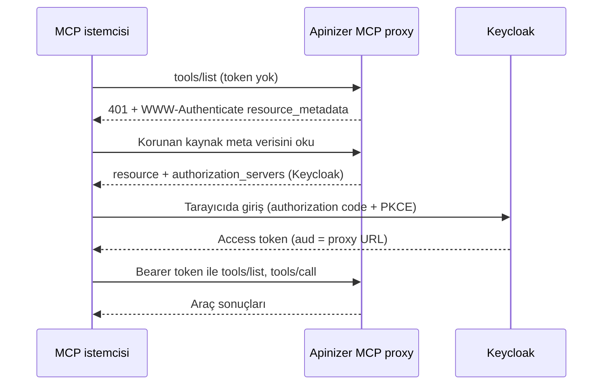

import {Steps, Step} from '@site/src/components/Steps';

## Ne Kuracaksınız

Bu senaryoda bir kimlik sağlayıcı (Keycloak) ve ona güvenen iki MCP Gateway kurarsınız:

- Mevcut bir MCP sunucusunun önünde çalışan bir **Passthrough** proxy. Örnekte salt okunur bir Jira MCP sunucusu kullanılır.
- Bir REST API'yi MCP aracı olarak yayınlayan bir **Araçları Aç** proxy'si. Örnekte küçük bir Jira REST alt kümesi kullanılır.
- Tarayıcı üzerinden oturum açan ve iki proxy'nin araçlarını çağıran bir MCP istemcisi (Claude Code).

İki proxy de **Standart MCP OAuth** istemci kimlik doğrulama profilini ve Keycloak'a güvenen bir **OIDC Authentication** politikasını kullanır. Profilin kendisi [Standart MCP İstemci Profili](/tr/ai-gateway/mcp-gateway#standart-mcp-istemci-profili) bölümünde anlatılır.



:::note
Apinizer'in kendi OAuth2 ve JWT politikasında (Credential yetkilendirme sunucusu) bu sürümde tarayıcı üzerinden oturum açma yoktur. Bu yüzden senaryo harici bir kimlik sağlayıcı kullanır. Makine istemcileri için sayfanın sonundaki nota bakın.
:::

## Ön Koşullar

- **Keycloak**, kullanıcının tarayıcısından ve ortamın worker'larından **aynı issuer URL'si** ile erişilebilir olmalıdır. Token bu URL'yi `iss` içinde taşır ve worker'lar imza anahtarlarını bu URL'den yükler.
- Ortamın **erişim URL'si** tanımlı olmalıdır. Proxy'nin kanonik kaynağı bu URL'den üretilir.
- Worker'ların erişebildiği bir **MCP sunucusu** olmalıdır. Senaryo, streamable HTTP üzerinden çalışan bir MCP sunucusu varsayar. Örneğin `https://mcp-backend.example.com/mcp`.
- Araçları Aç proxy'si için araç olarak yayınlamak istediğiniz bir **REST API proxy'si** olmalıdır.
- Ortamdaki tüm worker'lar Standart profili destekleyen bir sürümde olmalıdır (referans sayfadaki uyarıya bakın).

Aşağıdaki örneklerde gateway `https://gateway.example.com`, Keycloak realm'i `https://keycloak.example.com/realms/mcp`, proxy yolları ise `/jira-pt` (Passthrough) ve `/jira-ex` (Araçları Aç) olarak geçer. Bir proxy'nin kanonik kaynağı erişim URL'si, root context ve proxy yolundan oluşur:

```text
https://gateway.example.com/apigateway/jira-pt
https://gateway.example.com/apigateway/jira-ex
```

## Keycloak Yapılandırması

<Steps>
  <Step title="Realm oluşturun veya seçin">
    Mevcut bir realm kullanın ya da yeni bir realm oluşturun (örnekte `mcp`). Realm'in issuer değeri `https://keycloak.example.com/realms/mcp` olur.
  </Step>

  <Step title="MCP istemcisi için public client oluşturun">
    Şu ayarlarla bir client oluşturun:

    | Ayar | Değer |
    |---|---|
    | Client ID | Seçeceğiniz bir ad, örneğin `mcp-cli` |
    | Client authentication | Kapalı (public client) |
    | Standard flow | Açık |
    | Direct access grants | Kapalı |
    | Proof Key for Code Exchange Code Challenge Method (Advanced settings) | `S256` |
    | Valid redirect URIs | `http://localhost:*` ve `http://127.0.0.1:*` |

    MCP istemcisi oturum sonucunu almak için yerel bir port açar. Bu yüzden yönlendirme adresleri yerel makineyi gösterir.
  </Step>

  <Step title="Her proxy için bir Audience mapper ekleyin">
    Keycloak istemcinin `resource` parametresini yok sayar. Bu yüzden kanonik kaynağı `aud` claim'ine kendiniz eklersiniz. Bir client scope oluşturun (örneğin `mcp-audience`) ve her proxy için **Audience** türünde bir mapper ekleyin:

    | Alan | Değer |
    |---|---|
    | Name | Seçeceğiniz bir ad, örneğin `aud-jira-pt` |
    | Included Custom Audience | `https://gateway.example.com/apigateway/jira-pt` |
    | Add to access token | Açık |

    İkinci proxy için aynı adımı `https://gateway.example.com/apigateway/jira-ex` değeriyle tekrarlayın. Sonra public client'ı açın, **Client scopes** sekmesinden scope'u **Default** olarak ekleyin. Client'ın varsayılan scope'u olmayan bir scope token'a girmez.
  </Step>

  <Step title="Test kullanıcısı oluşturun">
    Realm'de bir kullanıcı oluşturun ve parola belirleyin. Kullanıcı tarayıcıda bu hesapla oturum açar.
  </Step>

  <Step title="İsteğe bağlı: makine testleri için confidential client oluşturun">
    Proxy'leri curl ile denemek isterseniz **Client authentication** ve **Service accounts roles** seçenekleri açık ikinci bir client oluşturun. Aynı scope'u varsayılan scope olarak ekleyin. Bu client'ı [curl ile Doğrulama](#curl-ile-doğrulama) bölümünde kullanırsınız.
  </Step>
</Steps>

## OIDC Politikasını Oluşturma

Beklenen audience her proxy'de farklı olduğu için her proxy'nin kendi **OIDC Authentication** politikası olmalıdır. Politikayı proxy'nin **Develop** sekmesinde, istek hattında **Actions** → **Politika Ekle** yolundan ekleyin ve **OIDC Authentication** seçin. Politikanın tüm ayrıntıları için [OIDC Authentication](/tr/develop/politikalar/oidc) sayfasına bakın.

Aşağıdaki tablodaki alanları ayarlayın. Diğer alanları varsayılan değerlerinde bırakın.

| Sekme ve panel | Alan | Değer |
|---|---|---|
| Formun üstü | Yapılandırma Profili | **OIDC (Keycloak, Okta, Azure AD, ...)** |
| **Bağlantı** | OIDC Sağlayıcı URL | `https://keycloak.example.com/realms/mcp` |
| **Bağlantı** | JWKS Endpoint | `https://keycloak.example.com/realms/mcp/protocol/openid-connect/certs` |
| **Bağlantı** | Yetkilendirme Endpoint, Token Endpoint, İstemci ID, Yönlendirme URI | Form bu alanları zorunlu tutar. Endpoint'leri doldurmak için issuer'ın yanındaki **Otomatik Keşif** düğmesini seçin, public client'ın ID değerini girin ve geçerli herhangi bir yönlendirme adresi yazın. Bearer token doğrulaması tarayıcıda giriş başlatmaz. |
| **Bağlantı** → Akış Yapılandırması | Kimlik Doğrulama Modu | **External OIDC Provider Only** |
| **Bağlantı** → Akış Yapılandırması | Kapsamlar | `openid` içersin |
| **Token & Doğrulama** → Token Doğrulama | Bearer JWT Kimlik Doğrulama | Açık |
| **Token & Doğrulama** → JWT Doğrulama Detayları | JWT'yi Lokal Doğrula | Açık |
| **Token & Doğrulama** → JWT Doğrulama Detayları | JWT İmzasını Doğrula | Açık |
| **Token & Doğrulama** → JWT Doğrulama Detayları | Audience Doğrula | Açık |
| **Token & Doğrulama** → JWT Doğrulama Detayları | Beklenen Audience | **Bu** proxy'nin kanonik kaynağı |

:::warning
İki proxy için tek politika kullanmayın. İlk proxy için alınan token yalnız ilk proxy'nin `aud` değerini taşır ve ikinci proxy onu reddetmelidir.
:::

## Passthrough Proxy

<Steps>
  <Step title="Proxy'yi oluşturun">
    **AI Gateway** altındaki **MCP Gateway** seçeneğini açın ve istemci yolu `/jira-pt` olan yeni bir MCP Gateway oluşturun.
  </Step>

  <Step title="Arka uç MCP sunucusunu ekleyin">
    **MCP Routing** sekmesini açın. **Routing Modu** bölümünde **Yapılandır** düğmesini seçin, **Passthrough** modunu seçin ve **Arka Uç MCP Sunucusu Ekle** düğmesini seçin. Sunucu çekmecesinde **Ad**, MCP sunucusunun **Uç Nokta** adresi ve **Kimlik Doğrulama Şeması** alanlarını doldurun: **Yok** ya da sunucunun istediği şema. Kaydetmeden önce sunucuyu denemek için **Araçları getir** düğmesini seçin, sonra **Kaydet** düğmesini seçin.

    **İstemci token'ını arka uç sunucuya ilet** seçeneğini kapalı tutun. Standart profil istemcinin token'ını arka uca iletmez.
  </Step>

  <Step title="İsteğe bağlı: araçları kısıtlayın">
    **İzin Verilen Araç Adları** bölümünde **Araç Ekle** düğmesini seçin ve istemcilerin kullanabileceği araç adlarını girin. Liste boşsa keşfedilen tüm araçlar geçer. Örnekte yalnız okuma araçlarına izin verilir.
  </Step>

  <Step title="Profili seçin">
    **Routing Modu** bölümünde yeniden **Yapılandır** düğmesini seçin. **İstemci Kimlik Doğrulama Profili** altında **Standart MCP OAuth** seçeneğini seçin ve **Kaydet** düğmesini seçin. Ekran ön koşulları listeler ve uygun olmayan bir kimlik doğrulama zincirinin kaydedilmesine izin vermez. Ekran etkin bir kimlik doğrulama politikası olmadığını bildirirse önce OIDC politikasını ekleyin.
  </Step>

  <Step title="OIDC politikasını ekleyin ve deploy edin">
    Önceki bölümdeki OIDC politikasını `https://gateway.example.com/apigateway/jira-pt` audience değeriyle ekleyin, sonra proxy'yi ortama deploy edin.
  </Step>
</Steps>

## Araçları Aç Proxy'si

<Steps>
  <Step title="Hedef REST API'yi koruyun">
    Yayınlamak istediğiniz REST API proxy'sini açın ve **ACL'den Yönet** seçili bir **OAuth2** politikası ekleyin. Bkz. [OAuth2](/tr/develop/politikalar/oauth2). Proxy'yi deploy edin.
  </Step>

  <Step title="Servis istemcisini oluşturun">
    Bir **Tüketici** (API istemcisi) oluşturun ve **API Proxy Erişimi** bölümünden hedef proxy'ye erişim verin. Bu istemci **servis istemcisidir**: gateway araçlar adına hedefi bu istemciyle çağırır.
  </Step>

  <Step title="MCP proxy'sini oluşturun">
    İstemci yolu `/jira-ex` olan yeni bir MCP Gateway oluşturun. **MCP Routing** sekmesinde **Routing Modu** bölümündeki **Yapılandır** düğmesini seçin ve **Araçları Aç** modunu seçin.
  </Step>

  <Step title="Araçları ekleyin">
    **Araç Ekle** düğmesini seçin ve çekmeceyi doldurun:

    | Alan | Değer |
    |---|---|
    | API Proxy | Hedef REST API proxy'si |
    | Metot | Yayınlanacak operasyon |
    | Araç Adı | Okunur bir ad, örneğin `jira_issue` |
    | Açıklama | Aracın ne yaptığı |
    | Hedef kimliği | **Servis** |

    Her operasyon için bir araç ekleyin. Aracın girdi parametreleri hedef API'nin tanımından gelir.
  </Step>

  <Step title="Profili ve servis istemcisini seçin">
    **Routing Modu** bölümünde **Yapılandır** düğmesini seçin. **İstemci Kimlik Doğrulama Profili** altında **Standart MCP OAuth** seçeneğini seçin, **Servis istemcisi** alanına 2. adımdaki tüketicinin API istemci kimliğini girin ve **Kaydet** düğmesini seçin.
  </Step>

  <Step title="OIDC politikasını ekleyin ve deploy edin">
    OIDC politikasını `https://gateway.example.com/apigateway/jira-ex` audience değeriyle ekleyin, sonra proxy'yi deploy edin.
  </Step>
</Steps>

:::info
Hedef kimliği **Servis** olduğunda hedef API oturum açan kullanıcıyı değil servis istemcisini görür. Kullanıcı MCP proxy'sinin trafik logunda kayıtlıdır. **Delege kullanıcı** seçeneği hedefi oturum açan kullanıcı olarak çağırır. Bkz. [Araç hedefine yapılan çağrılar](/tr/ai-gateway/mcp-gateway#araç-hedefine-yapılan-çağrılar).
:::

## curl ile Doğrulama

Denetimleri her proxy için çalıştırın. Örnekler Passthrough proxy'yi kullanır.

**1. Token olmadan çağrı.** Gateway `401` yanıtı verir ve meta veri belgesini adıyla belirtir:

```bash
curl -i -X POST https://gateway.example.com/apigateway/jira-pt \
  -H "Content-Type: application/json" \
  -H "Accept: application/json, text/event-stream" \
  -d '{"jsonrpc":"2.0","id":1,"method":"tools/list"}'
```

Yanıtta şuna benzer bir başlık bulunur:

```text
WWW-Authenticate: Bearer resource_metadata="https://gateway.example.com/apigateway/jira-pt/.well-known/oauth-protected-resource"
```

**2. Korunan kaynak meta verisini okuyun.** `resource` değeri kanonik kaynaktır, `authorization_servers` Keycloak issuer'ını içerir:

```bash
curl -s https://gateway.example.com/apigateway/jira-pt/.well-known/oauth-protected-resource
```

**3. İsteğe bağlı: makine token'ı ile çağrı.** Confidential client'tan token alın ve proxy'yi çağırın:

```bash
TOKEN=$(curl -s -X POST \
  https://keycloak.example.com/realms/mcp/protocol/openid-connect/token \
  -d grant_type=client_credentials \
  -d client_id=<makine client id> \
  -d client_secret=<makine client secret> | jq -r .access_token)

curl -i -X POST https://gateway.example.com/apigateway/jira-pt \
  -H "Authorization: Bearer $TOKEN" \
  -H "Content-Type: application/json" \
  -H "Accept: application/json, text/event-stream" \
  -d '{"jsonrpc":"2.0","id":1,"method":"tools/list"}'
```

Araç listesiyle gelen `200` yanıtı imza, issuer ve audience denetimlerinin geçtiğini gösterir. Aynı token'ı diğer proxy'de kullanırsanız audience farklı olduğu için gateway `401` vermelidir.

## Claude Code ile Oturum Açma

Her proxy'yi Claude Code'a ekleyin. Public client'ın ID değerini ve yönlendirme adresleriyle uyumlu sabit bir callback portu kullanın:

```bash
claude mcp add --transport http --client-id <public client id> --callback-port 33418 jira-pt https://gateway.example.com/apigateway/jira-pt
```

```bash
claude mcp add --transport http --client-id <public client id> --callback-port 33418 jira-ex https://gateway.example.com/apigateway/jira-ex
```

Sonra oturum açın:

<Steps>
  <Step title="Sunucu listesini açın">
    Claude Code içinde `/mcp` yazın ve sunucuyu seçin.
  </Step>

  <Step title="Kimlik doğrulayın">
    **Authenticate** seçeneğini seçin. Tarayıcı Keycloak giriş sayfasını açar. Test kullanıcısıyla oturum açın.
  </Step>

  <Step title="Araçları kullanın">
    Claude Code'a döndüğünüzde sunucu bağlı görünür. Claude Code'dan bir aracı çağırmasını isteyin, örneğin bir kaydı okumasını.
  </Step>
</Steps>

MCP Inspector aynı şekilde çalışır. Tarayıcıda çalıştığı için proxy'nin CORS ayarlarının açık olması gerekir. Referans sayfada da böyle belirtilir.

## Trafik Logunu Kontrol Etme

Proxy'nin **Traffic** sekmesini açın ve bir çağrıda **Detaylı Göster** seçeneğini seçin. Kayıt token'ın kullanıcısını ve istemcisini gösterir. **MCP Detayları** sekmesi her çağrının araç adını gösterir. Log alanları için [Loglarda ve limitlerde kullanıcı bağlamı](/tr/ai-gateway/mcp-gateway#loglarda-ve-limitlerde-kullanıcı-bağlamı) bölümüne bakın.

## Sorun Giderme

| Sorun | Neden | Çözüm |
|---|---|---|
| Girişten hemen sonra `invalid_token` ile `401` | `aud` claim'i yok ya da farklı. Audience mapper değeri kanonik kaynağa eşit değil. | **Included Custom Audience** değerini düzeltin (sonunda `/` olmasın), scope'un client'ın varsayılan scope'u olduğunu kontrol edin ve yeniden oturum açın. |
| Meta veri adresinde `404` | Proxy Standart profili kullanmıyor ya da kimlik doğrulama zinciri profile uymuyor. | **Standart MCP OAuth** seçin ve [referans sayfadaki](/tr/ai-gateway/mcp-gateway#ön-koşullar) ön koşullar tablosunu kontrol edin. |
| Tarayıcıda "Invalid redirect uri" görünür | Public client'ın yönlendirme adresleri callback portuyla uyuşmuyor. | `http://localhost:*` ve `http://127.0.0.1:*` adreslerini ekleyin ya da `--callback-port` ile verdiğiniz portu yazın. |
| Geçerli token reddediliyor | Worker Keycloak'a token'daki issuer'dan farklı bir URL ile ulaşıyor. | Issuer'a worker'lardan da aynı URL ile erişilmesini sağlayın ve **OIDC Sağlayıcı URL** alanına bu değeri yazın. |
| `insufficient_scope` ile `403` (Araçları Aç) | Token, aracın istediği rolün OAuth scope'unu içermiyor. | Rolün **OAuth Scope Name** alanını ve aracın **Zorunlu Scope'lar** alanını kontrol edin. |
| Arka uç (örneğin Jira) her çağrıyı tek hesap olarak kaydediyor | Arka uç hâlâ kendi paylaşılan kimlik bilgisini kullanıyor. Gateway kullanıcıyı arka uca iletmez. | Beklenen davranıştır. Gateway kullanıcıyı kendi trafik logunda kaydeder. |

:::note
Apinizer'in kendi OAuth2 ve JWT politikasında bu sürümde tarayıcı üzerinden oturum açma yoktur. Makine istemcisi yine de `client_credentials` ile token alıp MCP istemcisine başlık olarak verebilir. Token süresi dolunca yenileyin.

```bash
claude mcp add --transport http jira-pt https://gateway.example.com/apigateway/jira-pt --header "Authorization: Bearer <token>"
```
:::
