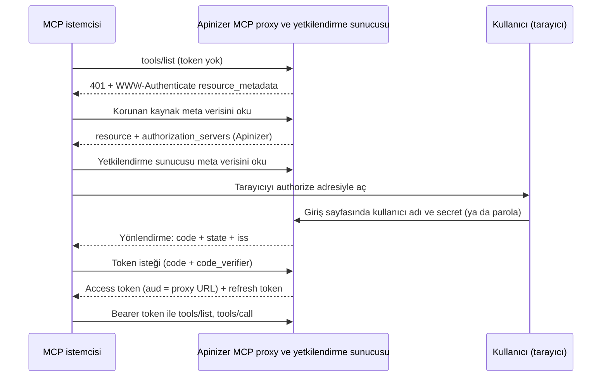

import {Steps, Step} from '@site/src/components/Steps';

## Ne Kuracaksınız

Bu senaryoda Apinizer'ın OAuth2 veya JWT politikasını yetkilendirme sunucusu olarak kullanırsınız. Harici bir kimlik sağlayıcı gerekmez.

- Standart MCP OAuth profilini kullanan bir MCP Gateway (Passthrough veya Araçları Aç).
- Kullanıcının tarayıcıda Apinizer giriş sayfasıyla oturum açtığı bir akış (authorization code + PKCE).
- Kullanıcı adına token alan bir uygulama ve onun açık (public) API istemcisi.

İki yönetim modu vardır. Modu proxy'nin OAuth2 veya JWT politikası belirler.

| | ACL'den Yönet | Bu Poliçe'den Yönet |
|---|---|---|
| Uç nokta ailesi | `/credential` | `/auth` |
| Issuer | `https://gateway.example.com/credential` | `https://gateway.example.com/auth` |
| Giriş yapan kullanıcı | Apinizer tüketicisi. Kullanıcı tüketici adını ve tüketicinin bir API istemcisinin secret'ını girer. Yerel parolası olan ya da LDAP ile eşitlenmiş tüketici de çalışır. | Politikanın kimlik kaynağındaki kullanıcı: Secret Manager, LDAP, veritabanı ya da API. |
| Erişim | Kullanıcının ACL satırı ∩ uygulamanın ACL satırı | Politikanın yetkilendirmesi ∩ uygulamanın ACL satırı |
| Geçerli CORS ayarı | Ortamın (worker) CORS ayarı | Hedef proxy'nin CORS ayarı (**Settings** sekmesi) |
| Politikada ek ayar | Yok. Tarayıcı girişi API istemcisinde açılır. | **Tarayıcı ile giriş (authorization_code)** anahtarı |



Profilin kendisi [Standart MCP İstemci Profili](/tr/ai-gateway/mcp-gateway#standart-mcp-istemci-profili) bölümünde anlatılır. Harici kimlik sağlayıcı kullanmak isterseniz [MCP Gateway'e Keycloak ile OAuth Girişi](/tr/tutorials/ai-proxy-senaryolari/mcp-gateway-keycloak-oauth-girisi) senaryosuna bakın.

## Ön Koşullar

- Ortamın **erişim URL'si** tanımlı olmalıdır. Issuer yalnız bu yapılandırmadan üretilir. Erişim URL'si yoksa tarayıcı ile giriş kapalıdır: yetkilendirme ucu ilan edilmez ve authorize isteği hata verir.
- Ortamdaki **tüm worker'lar** tarayıcı ile girişi destekleyen sürümde olmalıdır. Önce tüm worker'ları yükseltin, sonra tarayıcı ile girişi açın.
- Erişim URL'si HTTPS kullanır. Giriş sayfası girişi güvenli bir tarayıcı çerezinde tutar ve tarayıcılar bu çerezi yalnız HTTPS üzerinden kabul eder. Yerel geliştirmede `http://localhost` ve `http://127.0.0.1` de çalışır.
- Ingress, yolun başına bir önek ekliyorsa host kökündeki `/.well-known/oauth-authorization-server/...` yolunu gateway'e yönlendirmelidir. Ayrıntı için [Sınırlar ve Davranışlar](#sınırlar-ve-davranışlar) bölümüne bakın.
- Kullanıcıların kimliği bir **OIDC** kaynağı değildir. Tarayıcı girişi OIDC kimlik kaynağını desteklemez.

Örnekler **Order Management** projesindeki tek bir senaryoyu ve `https://gateway.example.com` gateway'ini kullanır:

| Öğe | Örnek |
|---|---|
| Passthrough proxy | **Order Desk MCP**, yol `/order-desk`. Arka uç MCP sunucusunun araçları: `get_order_status`, `list_open_orders` ve `cancel_order`. |
| Araçları Aç proxy'si | **Order Service Tools**, yol `/order-tools`. REST proxy'si **Order Service API**'nin metotlarını yayımlar. |
| Uygulama | **Claude Code**, açık API istemcisi `claude-code-desktop`. |
| Tüketiciler | `jane.doe` (rol **Order Viewer**) ve `sam.lee` (roller **Order Viewer** ve **Order Manager**). |
| Roller | **Order Viewer** (OAuth Scope Adı `orders.read`) ve **Order Manager** (OAuth Scope Adı `orders.write`). |
| Servis uygulaması | **Order Tools Gateway**, API istemcisi `order-tools-gateway`. |

**Order Desk MCP** proxy'sinin kanonik kaynağı şudur:

```text
https://gateway.example.com/apigateway/order-desk
```

## Ortak Adımlar

### Uygulama ve açık API istemcisi

Tarayıcı girişini sahibi uygulama ya da tüketici olan her API istemcisi kullanabilir. Bu kılavuz bir uygulamanın API istemcisini kullanır.

<Steps>
  <Step title="Uygulamayı oluşturun">
    Kullanıcı adına token alacak istemciyi temsil eden bir uygulama (örneğin **Claude Code**) oluşturun. Bkz. [Portal Uygulamaları](/tr/admin/identity-management/portal-applications).
  </Step>

  <Step title="API istemcisi oluşturun">
    Uygulamanın **API İstemcileri** sekmesinde yeni bir API istemcisi oluşturun. İstemcinin **client kimliği** OAuth `client_id` değeridir. Örnekte bu değer `claude-code-desktop` olur.
  </Step>

  <Step title="Tarayıcı girişini açın">
    İstemci editöründe **Tarayıcı girişi (authorization code + PKCE)** anahtarını açın ve şu alanları doldurun:

    | Alan | Değer |
    |---|---|
    | İstemci türü | **Public (secret yok)**. MCP istemcileri secret saklayamaz. |
    | Redirect URI'ler | MCP istemcisinin kullandığı yönlendirme adresi. Her satıra bir adres yazın. Örnek: `http://localhost:33418/callback` |
    | Access token süresi | Sonlu bir süre. Örnek: 15 dakika. |
    | Refresh token'a izin ver | Açık. Sonlu bir refresh süresi girin. Örnek: 8 saat. |

    Yönlendirme adresi sayısında sınır yoktur. Her adres farklı ve mutlak olmalı, parça (fragment) içermemeli ve en çok 2048 karakter olmalıdır. `http` her ana makinede kullanılabilir. Yönlendirme adresi tam eşleşir. `http://127.0.0.1`, `http://[::1]` ve `http://localhost` adreslerinde yalnız port farklı olabilir.

    
  </Step>

  <Step title="Kaydedin ve istemciyi etkinleştirin">
    İstemciyi kaydedin ve etkinleştirin. Public istemci secret istemez. İstemcinin secret'ları varsa korunur; istemci Public iken kullanılmaz.
  </Step>
</Steps>

:::warning
Tarayıcı girişi hiçbir zaman süresiz token vermez. Access veya refresh süresi boş ya da `0` olan bir istemci kaydedilemez.
:::

### Uygulamanın ACL satırı

Uygulamanın, MCP proxy'sine erişim satırı olmalıdır. Satırı [Erişim Kontrolü](/tr/admin/identity-management/erisim-kontrolu) ekranında uygulamanın kimliği altına ekleyin. Uygulamanın erişimi yoksa Apinizer kullanıcıya giriş sayfasını açmaz ve `unauthorized_client` hatası verir.

Erişim şu kuralla belirlenir: **kullanıcının erişimi ∩ uygulamanın erişimi**. Biri eksikse token çalışmaz. Token verildikten sonra iki satırdan biri kaldırılırsa gateway çağrıyı `403` ile reddeder.

## A. ACL'den Yönet Modu (`/credential`)

<Steps>
  <Step title="Kullanıcıyı hazırlayın">
    Giriş yapacak kişi için bir **Tüketici** oluşturun (örneğin `jane.doe`). Bu sürümde oluşturduğunuz tüketicinin parolası yoktur. Secret'ları tüketicinin API istemcileri tutar:

    1. Tüketicinin **API İstemcileri** sekmesinde yeni bir API istemcisi oluşturun. **Tarayıcı girişi** anahtarını kapalı bırakın. İstemci böylece gizli (confidential) istemci olur.
    2. İstemci için bir client secret oluşturun. Apinizer secret'ı yalnız bir kez gösterir. Kullanıcı secret'ı saklar.
    3. API istemcisini etkinleştirin.
    4. Tüketiciyi deploy edin.

    Kullanıcı **tüketici adı** ve bu **client secret** ile giriş yapar.

    

    Kullanıcı bir API istemcisinin **client kimliğini** ve o istemcinin kendi secret'ını da girebilir. Açık (public) istemcinin client kimliği hiçbir zaman kullanıcı sayılmaz. Süresi dolmuş, kesilmiş, IP'si reddedilmiş ya da devre dışı bırakılmış tüketici reddedilir. Yerel parolası olan (eski) tüketici ve LDAP ile eşitlenmiş tüketici eskisi gibi giriş yapar. Keycloak ya da başka bir OIDC ile eşitlenmiş tüketici desteklenmez. Uygulamanın kimliği ve API istemcileri kullanıcı olamaz.
  </Step>

  <Step title="Kullanıcıya erişim verin">
    MCP proxy'si için tüketicinin erişim satırını ekleyin. Bkz. [API Proxy ACL](/tr/admin/identity-management/api-proxy-acl).
  </Step>

  <Step title="Uygulamaya erişim verin">
    Aynı proxy için uygulamanın erişim satırını ekleyin. Bu satır [yukarıda](#uygulamanın-acl-satırı) anlatılır.
  </Step>

  <Step title="Token politikasını ekleyin">
    MCP proxy'sine **ACL'den Yönet** seçili bir JWT veya OAuth2 politikası ekleyin. Bkz. [JWT](/tr/develop/politikalar/jwt) ve [OAuth2](/tr/develop/politikalar/oauth2). Token biçimi (JWT veya opaque) politikaya uyar. Token süreleri API istemcisinden gelir.
  </Step>

  <Step title="Profili seçin">
    **MCP Routing** sekmesinde **Routing Modu** bölümünde **Yapılandır** düğmesini seçin. **İstemci Kimlik Doğrulama Profili** altında **Standart MCP OAuth** seçeneğini seçin ve kaydedin. Proxy'yi deploy edin.

    
  </Step>
</Steps>

Bu modda istemci `https://gateway.example.com/credential/authorize` ve `https://gateway.example.com/credential/token` adreslerini kullanır. Aynı ailede `/credential/revoke` ve `/credential/introspect` uçları da vardır.

Access süresini ve refresh süresini tarayıcı girişi yapan API istemcisi belirler. İstemcide refresh sayısı alanı yoktur. Refresh, giriş üst sınırıyla sınırlanır. Bkz. [Oturum süresi](#sınırlar-ve-davranışlar).

## B. Bu Poliçe'den Yönet Modu (`/auth`)

<Steps>
  <Step title="Token politikasını yapılandırın">
    MCP proxy'sine **Bu Poliçe'den Yönet** seçili bir JWT veya OAuth2 politikası ekleyin. Kimlik kaynağını seçin: Secret Manager, LDAP, veritabanı veya API. OIDC seçilirse anahtar kapalıdır.
  </Step>

  <Step title="Sonlu token süreleri verin">
    **Token Never Expires** ayarını kapatın ve bir access token süresi girin. Refresh token'a izin verdiyseniz sonlu bir refresh süresi girin. Süreler sonlu değilse politika kaydedilemez. Refresh sayısını **Refresh Token Count** ile de sınırlayabilirsiniz. Aşağıya bakın.
  </Step>

  <Step title="Tarayıcı girişini açın">
    Politikada **Tarayıcı ile giriş (authorization_code)** anahtarını açın. Seçili eski grant (client credentials veya password) çalışmaya devam eder.
  </Step>

  <Step title="Uygulamayı ve ACL satırını hazırlayın">
    [Ortak adımlardaki](#ortak-adımlar) uygulamayı, açık API istemcisini ve uygulamanın ACL satırını hazırlayın. Bu modda da uygulamanın ACL satırı gerekir.
  </Step>

  <Step title="Profili seçin ve deploy edin">
    Proxy'de **Standart MCP OAuth** profilini seçin. Politikayı kaydedin ve proxy'yi yeniden deploy edin. Anahtarı açmak ya da kapatmak yeni bir kaydetme ve deploy gerektirir.
  </Step>
</Steps>

Bu modda istemci `https://gateway.example.com/auth/authorize` ve `https://gateway.example.com/auth/token` adreslerini kullanır. `client_id`, uygulamanın **API istemcisinin client kimliğidir**. **API Anahtarını Göster** penceresindeki proxy Client Id değeri değildir.

Kullanıcılar politikanın kimlik kaynağından gelir:

- **Secret Manager.** Kullanıcı bir tüketici olmalıdır. Kullanıcı ACL'den Yönet modundaki gibi giriş yapar: tüketici adı ve tüketicinin gizli bir API istemcisinin secret'ı, ya da bir API istemcisinin client kimliği ve o istemcinin kendi secret'ı. Gateway her istekte kullanıcıyı yeniden kontrol eder.
- **LDAP, veritabanı, API.** Kaynak kullanıcı için her istekte sorgulanmaz. Roller refresh sırasında yeniden sorulur.

**Refresh Token Count.** Bu modda JWT veya OAuth2 politikasındaki **Refresh Token Count** ayarı, tek bir girişteki (tek token ailesindeki) refresh sayısını sınırlar. Boş bırakılırsa sınır yoktur. İzin verilen son refresh yeni bir access token döner, ama yeni refresh token dönmez. Bundan sonra kullanıcı yeniden giriş yapar.

Roller token'ın scope değerinde taşınır. İstemci bir rolü adıyla ya da rolün **OAuth Scope Adı** ile isteyebilir. İkisinde de rol verilir.

## Araçları Aç Proxy'leri

Aynı giriş akışı **Araçları Aç** modundaki bir MCP Gateway için de çalışır. Bu modda REST API metotları MCP aracı olarak yayımlanır. Uç noktalar, giriş sayfası ve token'lar aynıdır. Yalnız kanonik kaynak değişir: kaynak, Araçları Aç proxy'sinin URL'sidir. Örnek: `https://gateway.example.com/apigateway/order-tools`.

<Steps>
  <Step title="Servis istemcisini oluşturun">
    Standart MCP OAuth profilinde Araçları Aç proxy'sinin bir **servis istemcisi** olmalıdır. Gateway hedef REST proxy'sini bu istemci olarak çağırır. Aynı projede bir uygulama (örneğin **Order Tools Gateway**) ve etkin bir API istemcisi (örneğin `order-tools-gateway`) oluşturun. Servis istemcisi MCP proxy'sini çağırmaz, bu yüzden orada ACL satırı gerekmez. API istemcisini ekledikten sonra uygulamayı deploy edin.
  </Step>

  <Step title="Servis istemcisini proxy'de girin">
    **Order Service Tools** proxy'sinin **MCP Routing** sekmesinde **Routing Modu** bölümünde **Yapılandır** düğmesini seçin. **Standart MCP OAuth** profilini seçin. **Ön koşullar** listesinin altındaki **Servis istemcisi** alanına servis istemcisinin client kimliğini girin. Kaydedin ve proxy'yi deploy edin. Servis istemcisi olmadan kaydederseniz Apinizer kaydı reddeder: "STANDARD_MCP_OAUTH needs a service client for the exposed tools".

    
  </Step>

  <Step title="Her aracın hedef kimliğini belirleyin">
    Her araç için bir **Hedef kimliği** vardır:

    - **Servis.** Gateway hedefi servis istemcisi olarak çağırır. Kullanıcı yalnız denetim için kaydedilir.
    - **Delege kullanıcı.** Gateway hedefi oturum açmış kullanıcı olarak çağırır. Bkz. [Araç hedefine yapılan çağrılar](/tr/ai-gateway/mcp-gateway#araç-hedefine-yapılan-çağrılar).
  </Step>

  <Step title="Araçların gerekli scope'larını belirleyin">
    Bir aracın **Zorunlu Scope'lar** alanına **rol adını** yazın, örneğin **Order Manager**. Alandaki örnek metin bir scope örneği gösterir, ama siz rol adını girmelisiniz. **Zorunlu Scope'lar** alanı boş olan araç araç tablosunda açık görünür.

    
  </Step>
</Steps>

Örnekte `list_orders` ve `get_order` araçlarının gerekli scope'u yoktur. `create_order` ve `cancel_order` araçları **Order Manager** rolünü ister.


**Scope nasıl çalışır.** İstemci, authorize isteğinin `scope` parametresinde rolün **OAuth Scope Adını** ister (örneğin `orders.write`). Korunan kaynak meta verisi bu adları `scopes_supported` alanında listeler. Giriş sayfası istenen scope'ları **İstenen erişim** başlığı altında gösterir. Scope istenmezse sayfa **Temel erişim** gösterir.


Örnekte **Order Viewer** (scope gerekmez) ve **Order Manager** (OAuth Scope Adı `orders.write`) rolleri kullanılır:

| Kullanıcı | Roller | `scope=orders.write` ile sonuç |
|---|---|---|
| `jane.doe` | Order Viewer | Token scope'u boştur. `tools/list` yalnız `list_orders` ve `get_order` araçlarını gösterir. `cancel_order` için `tools/call` HTTP `403` döner. |
| `sam.lee` | Order Viewer, Order Manager | Token scope'u `orders.write` olur. `tools/list` dört aracın hepsini gösterir. `cancel_order` başarılı olur. |

Çağıranın kullanamadığı araç `tools/list` içinde görünmez. Çağıran böyle bir aracı yine de çağırırsa gateway `403` ve şu başlıkla yanıt verir:

```text
WWW-Authenticate: Bearer error="insufficient_scope", scope="orders.write", resource_metadata="https://gateway.example.com/apigateway/order-tools/.well-known/oauth-protected-resource"
```

:::note
Kullanıcının ve **Claude Code** uygulamasının her birinin MCP proxy'si için ACL satırı olmalıdır. Diğer modlarda da böyledir. Erişim kullanıcı ∩ uygulama kuralıyla belirlenir. API istemcisi ekledikten sonra uygulamaları deploy edin.
:::

## MCP İstemcisini Bağlama

Standart bir MCP istemcisi (Claude Code, MCP Inspector) şu sırayı kendisi izler:

1. İstemci token olmadan çağırır ve `401` yanıtındaki `resource_metadata` adresini okur.
2. İstemci `<proxy URL>/.well-known/oauth-protected-resource` belgesini okur. Belge `authorization_servers` alanında Apinizer issuer'ını verir: `/credential` ya da `/auth`.
3. İstemci yetkilendirme sunucusunun meta verisini okur.
4. İstemci tarayıcıyı Apinizer giriş sayfasıyla açar.

Giriş sayfası uygulamanın adını, yönlendirme adresini, hedef kaynağı ve istenen erişimi gösterir. Sayfada kullanıcı adı ve parola alanları ile **Giriş yap ve izin ver** düğmesi bulunur. Kullanıcı tüketici adını ve client secret'ı girer (bkz. [ACL'den Yönet Modu](#a-aclden-yönet-modu-credential)). Secret yanlışsa aynı sayfa şu mesajla yeniden açılır: "Giriş başarısız. Kullanıcı adınızı ve parolanızı kontrol edip yeniden deneyin." Mesaj hangi bilginin yanlış olduğunu söylemez. Giriş başarılıysa Apinizer tarayıcıyı `code`, `state` ve `iss` parametreleriyle yönlendirme adresine yönlendirir. İstemci code'u token ile değiştirir ve araçları çağırır.


**Dil.** Sayfada formun altında **English** ve **Türkçe** düğmeleri vardır. İstemci authorize isteğinde `ui_locales` parametresini de gönderebilir (örneğin `ui_locales=tr`). Düğme seçimi ya da `ui_locales` yoksa tarayıcının `Accept-Language` başlığı belirler. Dil değiştirmek aynı sayfayı yeniden gösterir. Bu bir giriş denemesi sayılmaz. Sayfa JavaScript kullanmaz. Enter tuşu girişi yapar.


Claude Code için API istemcisinin client kimliğini ve sabit bir callback portunu verin. Kayıtlı yönlendirme adresiyle istemcinin kullandığı adres aynı olmalıdır.

```bash
claude mcp add --transport http --client-id claude-code-desktop --callback-port 33418 order-desk https://gateway.example.com/apigateway/order-desk
```

Sonra `/mcp` ekranında sunucuyu seçin ve **Authenticate** seçeneğini kullanın.

MCP Inspector tarayıcıda çalışır. Token ucuna tarayıcıdan istek gönderebilmesi için Inspector'ın kökenine CORS izni verin. Hangi CORS ayarının geçerli olduğu moda bağlıdır:

- **ACL'den Yönet (`/credential`).** Ortamın (worker) CORS ayarı geçerlidir.
- **Bu Poliçe'den Yönet (`/auth`).** Hedef proxy'nin CORS ayarı geçerlidir (proxy'nin **Settings** sekmesi). Eski `/auth` uç noktalarında da böyledir.

Bkz. [Token Servisi](/tr/develop/politikalar/token-service/genel-bakis).

## curl ile Doğrulama

Aşağıdaki örnekler ACL'den Yönet modunu kullanır. Bu modda `/credential` yerine `/auth` yazarak modu değiştirin. Örneklerde `<client secret>`, API istemcisinin secret'ıdır. Gerçek bir secret'ı hiçbir betiğe ya da belgeye yazmayın.

**1. Meta verileri okuyun.** Korunan kaynak meta verisi Apinizer issuer'ını verir. Yetkilendirme sunucusu meta verisi kanonik adrestedir:

```bash
curl -s https://gateway.example.com/apigateway/order-desk/.well-known/oauth-protected-resource

curl -s https://gateway.example.com/.well-known/oauth-authorization-server/credential
```

**2. PKCE çifti üretin:**

```bash
VERIFIER=$(openssl rand -base64 48 | tr -d '=+/\n' | cut -c1-64)
CHALLENGE=$(printf '%s' "$VERIFIER" | openssl dgst -sha256 -binary | openssl base64 -A | tr '+/' '-_' | tr -d '=')
echo "$CHALLENGE"
```

**3. Authorize adresini tarayıcıda açın.** `redirect_uri` değeri API istemcisinde kayıtlı olmalıdır. `resource` zorunludur:

```text
https://gateway.example.com/credential/authorize?response_type=code&client_id=claude-code-desktop&redirect_uri=http%3A%2F%2Flocalhost%3A33418%2Fcallback&code_challenge=<CHALLENGE değeri>&code_challenge_method=S256&resource=https%3A%2F%2Fgateway.example.com%2Fapigateway%2Forder-desk&state=abc123
```

Giriş sayfasında tüketici adını (örneğin `jane.doe`) ve `<client secret>` değerini girin. Tarayıcı `http://localhost:33418/callback?code=...&state=abc123&iss=https%3A%2F%2Fgateway.example.com%2Fcredential` adresine gider. Bu portta dinleyen bir şey yoksa tarayıcı bağlantı hatası gösterir. Adres çubuğundan `code` değerini kopyalayın. `iss` değeri issuer'a eşittir.

Araçları Aç proxy'si için o proxy'nin kanonik kaynağını kullanın ve `scope` içinde rolün OAuth Scope Adını isteyin:

```text
https://gateway.example.com/credential/authorize?response_type=code&client_id=claude-code-desktop&redirect_uri=http%3A%2F%2Flocalhost%3A33418%2Fcallback&code_challenge=<CHALLENGE değeri>&code_challenge_method=S256&resource=https%3A%2F%2Fgateway.example.com%2Fapigateway%2Forder-tools&scope=orders.write&state=abc123
```

**4. Code'u token ile değiştirin.** `code` gövdede gönderilir. URL sorgusundaki `code` reddedilir:

```bash
curl -s -X POST https://gateway.example.com/credential/token \
  -d grant_type=authorization_code \
  -d code=<code değeri> \
  -d code_verifier="$VERIFIER" \
  -d redirect_uri=http://localhost:33418/callback \
  -d client_id=claude-code-desktop \
  -d resource=https://gateway.example.com/apigateway/order-desk
```

Yanıt `access_token`, `refresh_token`, `expires_in` ve `token_type` alanlarını içerir:

```json
{"access_token":"…","refresh_token":"…","token_type":"Bearer","expires_in":900}
```

JWT biçimindeki access token'ın başlığında `typ: at+jwt` bulunur. Çözülmüş bir token şöyle görünür:

```json
{
  "header": {"typ": "at+jwt", "alg": "RS256", "kid": "…"},
  "claims": {
    "sub": "jane.doe",
    "tokenSubjectType": "CONSUMER",
    "clientOwnerType": "APPLICATION",
    "iss": "https://gateway.example.com/credential",
    "client_id": "claude-code-desktop",
    "aud": "https://gateway.example.com/apigateway/order-desk",
    "X-TokenProfile": "mcp-standard",
    "grantType": "authorization_code",
    "exp": 0,
    "iat": 0,
    "jti": "…"
  }
}
```

**5. Proxy'yi çağırın:**

```bash
curl -i -X POST https://gateway.example.com/apigateway/order-desk \
  -H "Authorization: Bearer <access_token>" \
  -H "Content-Type: application/json" \
  -H "Accept: application/json, text/event-stream" \
  -d '{"jsonrpc":"2.0","id":1,"method":"tools/list"}'
```

Araçları Aç proxy'sinde, kullanıcının sahip olmadığı bir rolü isteyen araca yapılan çağrı `insufficient_scope` ile `403` döner:

```bash
curl -i -X POST https://gateway.example.com/apigateway/order-tools \
  -H "Authorization: Bearer <access_token>" \
  -H "Content-Type: application/json" \
  -H "Accept: application/json, text/event-stream" \
  -d '{"jsonrpc":"2.0","id":2,"method":"tools/call","params":{"name":"cancel_order","arguments":{"orderId":"1001"}}}'
```

**6. Token'ı yenileyin.** Refresh token her kullanımda yenilenir. Eski refresh token'ı tekrar gönderirseniz Apinizer `400 invalid_grant` ("Refresh Token is not valid!") döner ve tüm token ailesini iptal eder:

```bash
curl -s -X POST https://gateway.example.com/credential/token \
  -d grant_type=refresh_token \
  -d refresh_token=<refresh_token> \
  -d client_id=claude-code-desktop
```

İstemci ya da politika için refresh artık izinli değilse refresh de `invalid_grant` ile reddedilir.

**7. Çıkış yapın.** Açık istemci yalnız `client_id` ile kendi token'ını iptal eder. Refresh token'ın iptali tüm aileyi düşürür:

```bash
curl -s -X POST https://gateway.example.com/credential/revoke \
  -d token=<refresh_token> \
  -d client_id=claude-code-desktop
```

## Sınırlar ve Davranışlar

**Erişim adresi ve issuer.** Issuer yalnız ortamın erişim URL'sinden üretilir. İstek başlıkları issuer'ı belirlemez. Erişim URL'si yoksa tarayıcı girişi kapalıdır.

**Meta veri adresleri.** Kanonik adres RFC 8414 biçimindedir: `https://gateway.example.com/.well-known/oauth-authorization-server/credential` ya da `.../auth`. Eski adresler çalışmaya devam eder: `/auth/.well-known/oauth-authorization-server`, `/credential/.well-known/oauth-authorization-server` ve `/credential/.well-known/openid-configuration`. Issuer yapılandırılmış değere eşitse eski belgeler yeni alanları da içerir.

**Ingress öneki.** Ingress yola bir önek ekliyorsa issuer de bu öneki taşır. Kanonik adres `https://host/.well-known/oauth-authorization-server/<önek>/auth` olur. Ingress'te host kökündeki `/.well-known/oauth-authorization-server` yolunu gateway'e yönlendirin. Bu bir kurulum adımıdır.

**Desteklenmeyenler.**
- Proxy grubu politikaları. Proxy grubuna tarayıcı girişi açık bir politika eklenirse kayıt reddedilir.
- Metot düzeyindeki politikalar.
- OIDC kimlik kaynağı. Bu durumda OIDC sağlayıcısının kendi girişini kullanın.
- Dinamik istemci kaydı (DCR) ve istemci kimliği meta veri belgeleri (CIMD).

**Protokol kuralları.**
- Yalnız PKCE `S256` kabul edilir.
- Yönlendirme adresi tam eşleşir. Loopback adreslerinde yalnız port serbesttir.
- `resource` zorunludur. Yoksa ya da bu yetkilendirme sunucusu tarafından sunulmuyorsa `invalid_target` döner.
- Yönlendirmede RFC 9207 `iss` parametresi bulunur.
- Access token JWT ise başlığında `typ: at+jwt` bulunur.
- Refresh token her kullanımda döner. Kullanılmış bir refresh token yeniden gelirse token ailesi iptal edilir.
- JWT access token, aile iptalinden sonra süresi dolana kadar geçerli kalır. Hemen düşmesini istiyorsanız [Token İptali Katılık Ayarı](/tr/admin/identity-management/token-yonetim-ayarlari#token-iptali-katilik-ayari) ayarını **STRICT** yapın.

**Oturum süresi.** Giriş anında bir üst sınır belirlenir: en uzun access veya refresh süresi. Refresh bu sınırı uzatmaz. Sınır dolunca kullanıcı yeniden giriş yapar. Bu Poliçe'den Yönet modunda **Refresh Token Count** da tek girişteki refresh sayısını sınırlar.

**Anahtarı kapatma.** Bu Poliçe'den Yönet modunda anahtarı kapatıp kaydederseniz ve deploy ederseniz, tarayıcı girişiyle verilmiş token'lar hemen geçersiz olur. Bu token'ların refresh'i de reddedilir. Eski grant'larla alınmış token'lar etkilenmez.

**Hesap kapatma.**
- Secret Manager kullanıcıları her istekte yeniden kontrol edilir.
- LDAP, veritabanı ve API kaynaklarında kaynakta kapatılan hesap, token ailesinin süresi dolana kadar çalışabilir. Silinen kullanıcı ya da geri alınan rol refresh sırasında düşer. Rol taşımayan bir token ailesinde silinen kullanıcı da aile süresi dolana kadar çalışabilir.
- Tüketici askıya alınırsa ya da API istemcisi iptal edilirse token'lar sonraki istekte düşer.

**Rol yetkisi.** Girişte metot düzeyindeki rol yetkisi sorulmaz, çünkü henüz bir metot yoktur. Rolü yetmeyen kullanıcı token alır. Gateway çağrıyı reddeder. Araçları Aç proxy'sinde gateway, çağıranın kullanamadığı araçları da gizler.

**Eski akışlar.** `client_credentials`, `password` ve eski `refresh_token` token'ları çalışmaya devam eder. Standart profilli bir MCP proxy'si eski türde token'ı yine reddeder.

## Sorun Giderme

| Sorun | Neden | Çözüm |
|---|---|---|
| Authorize isteği hata sayfası verir, yönlendirme olmaz | `client_id` bilinmiyor ya da `redirect_uri` kayıtlı adresle eşleşmiyor. | Adresi API istemcisindeki kayıtla birebir karşılaştırın. |
| `unauthorized_client` | Uygulamanın proxy için ACL satırı yok ya da `authorization_code` bu istemcide açık değil. | Uygulamanın ACL satırını ve tarayıcı girişi anahtarını kontrol edin. |
| `access_denied` | Kullanıcının ACL satırı yok. | Kullanıcıya proxy için erişim verin. |
| `invalid_target` | `resource` yok ya da kanonik kaynakla eşleşmiyor. İstemci başka moddaki bir proxy'yi hedefliyor. | Kanonik kaynağı kontrol edin. Politikanın modunu ve uç nokta ailesini kontrol edin. |
| Kayıt sırasında süre hatası | Access veya refresh süresi sonlu değil. | Sonlu bir süre girin. Authorize isteği de süresiz ayarda `invalid_request` verir. |
| Korunan kaynak meta verisi adresi `404` veriyor | Standart profil seçili değil ya da zincirde hâlâ engel var. | **MCP Routing** sekmesindeki ön koşullar panelini ve [Standart MCP İstemci Profili](/tr/ai-gateway/mcp-gateway#standart-mcp-istemci-profili) ön koşullarını kontrol edin. |
| Kanonik yetkilendirme sunucusu adresi `404` veriyor | Ortamın erişim URL'si tanımlı değil ya da yol `/auth` veya `/credential` değil. | Erişim URL'sini tanımlayın. Yolu kontrol edin. |
| Paroladan sonra sayfa girişin süresinin dolduğunu söylüyor ya da ilerlemiyor | Erişim URL'si loopback olmayan bir adreste düz `http`. Bu yüzden tarayıcı güvenli giriş çerezini atıyor. Ya da kullanıcı giriş sayfasını erişim URL'sinden farklı bir adresten açtı. | HTTPS erişim URL'si kullanın ve authorize adresini bu URL'nin altında açın. |
| Giriş başarılı ama çağrı `403` | Token sonrası kullanıcının ya da uygulamanın ACL satırı kaldırıldı ya da rol yetmiyor. | ACL satırlarını ve rolün OAuth scope adını kontrol edin. |
| Tüketici adıyla giriş başarısız | API istemcisi açık (public), etkin değil ya da deploy edilmemiş. Secret'ın süresi dolmuş. Tüketici deploy edilmemiş. | Gizli bir API istemcisi kullanın (tarayıcı girişi kapalı). İstemciyi etkinleştirin, secret'ı kontrol edin ve tüketiciyi deploy edin. |
| Araçları Aç proxy'si kaydedilmiyor: servis istemcisi gerekiyor | Standart MCP OAuth profili, yayımlanan araçlar için bir servis istemcisi ister. | **Servis istemcisi** alanına aynı projedeki etkin bir API istemcisinin client kimliğini girin. |
| `tools/call` `insufficient_scope` ile `403` döner | Kullanıcı aracın rolüne sahip değil ya da istemci rolün OAuth Scope Adını istemedi. | Kullanıcıya rolü verin. Authorize isteğinin `scope` parametresinde OAuth Scope Adını isteyin. |
| MCP Inspector CORS hatası veriyor | Inspector'ın kökeni, modun geçerli CORS ayarında izinli değil. | ACL'den Yönet modunda ortamın CORS ayarını değiştirin. Bu Poliçe'den Yönet modunda proxy'nin **Settings** sekmesindeki CORS ayarını değiştirin. |

## Kurulumu Kontrol Etme

- Claude Code'a proxy eklenince Apinizer giriş sayfası açılıyor mu?
- Giriş sayfası uygulamanın adını ve hedef kaynağı gösteriyor mu?
- Kullanıcı tüketici adı ve gizli bir API istemcisinin secret'ı ile giriş yapabiliyor mu?
- Yanlış secret girilince aynı sayfa hata mesajıyla yeniden açılıyor mu?
- **Türkçe** ve **English** düğmeleri, giriş denemesi yapmadan sayfanın dilini değiştiriyor mu?
- Girişten sonra araç listesi geliyor mu?
- Araçları Aç proxy'sinde rolü olmayan kullanıcı kapsamlı araçları görmüyor mu ve böyle bir araca yapılan çağrı `403` dönüyor mu?
- Access token süresi dolunca istemci yeniden giriş istemeden çalışıyor mu?
- Aynı refresh token ikinci kez gönderilince istek reddediliyor mu?
- Bu Poliçe'den Yönet modunda **Refresh Token Count** kadar refresh'ten sonra kullanıcı yeniden giriş yapmak zorunda kalıyor mu?
- Uygulamanın ACL satırı kaldırılınca bir sonraki çağrı reddediliyor mu?
- Kullanıcının ACL satırı kaldırılınca bir sonraki çağrı reddediliyor mu?
- Tüketici devre dışı bırakılınca bir sonraki çağrı reddediliyor mu?
- Bu Poliçe'den Yönet modunda anahtar kapatılıp deploy edilince verilmiş tarayıcı girişi token'ı reddediliyor mu?
- Bu Poliçe'den Yönet ve ACL'den Yönet modunun ikisinde de giriş çalışıyor mu?
- Eski `client_credentials` token'ı hâlâ çalışıyor mu?
