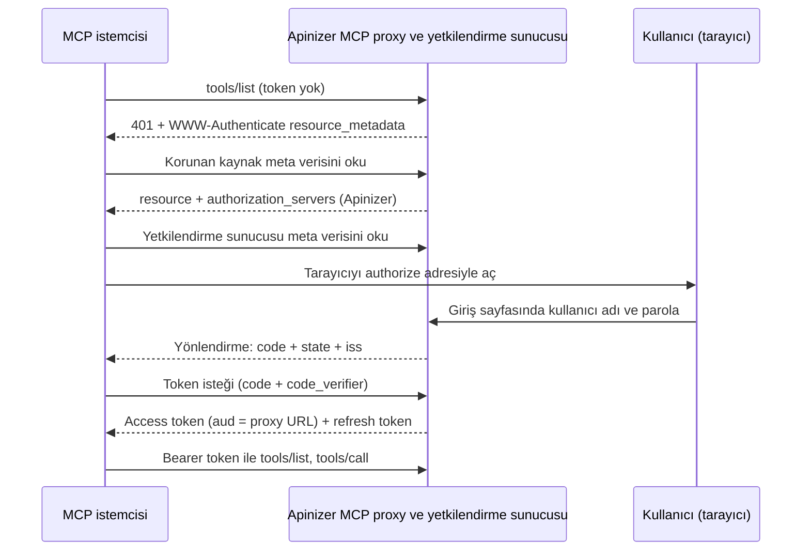

import {Steps, Step} from '@site/src/components/Steps';

## Ne Kuracaksınız

Bu senaryoda Apinizer'ın OAuth2 veya JWT politikasını yetkilendirme sunucusu olarak kullanırsınız. Harici bir kimlik sağlayıcı gerekmez.

- Standart MCP OAuth profilini kullanan bir MCP Gateway.
- Kullanıcının tarayıcıda Apinizer giriş sayfasıyla oturum açtığı bir akış (authorization code + PKCE).
- Kullanıcı adına token alan bir uygulama ve onun açık (public) API istemcisi.

İki yönetim modu vardır. Modu proxy'nin OAuth2 veya JWT politikası belirler.

| | ACL'den Yönet | Bu Poliçe'den Yönet |
|---|---|---|
| Uç nokta ailesi | `/credential` | `/auth` |
| Issuer | `https://gateway.example.com/credential` | `https://gateway.example.com/auth` |
| Giriş yapan kullanıcı | Apinizer tüketicisi. Yerel parola ya da LDAP ile eşitlenmiş tüketici. | Politikanın kimlik kaynağındaki kullanıcı: Secret Manager, LDAP, veritabanı ya da API. |
| Erişim | Kullanıcının ACL satırı ∩ uygulamanın ACL satırı | Politikanın yetkilendirmesi ∩ uygulamanın ACL satırı |
| Politikada ek ayar | Yok. Tarayıcı girişi API istemcisinde açılır. | **Tarayıcı ile giriş (authorization_code)** anahtarı |



Profilin kendisi [Standart MCP İstemci Profili](/tr/ai-gateway/mcp-gateway#standart-mcp-istemci-profili) bölümünde anlatılır. Harici kimlik sağlayıcı kullanmak isterseniz [MCP Gateway'e Keycloak ile OAuth Girişi](/tr/tutorials/ai-proxy-senaryolari/mcp-gateway-keycloak-oauth-girisi) senaryosuna bakın.

## Ön Koşullar

- Ortamın **erişim URL'si** tanımlı olmalıdır. Issuer yalnız bu yapılandırmadan üretilir. Erişim URL'si yoksa tarayıcı ile giriş kapalıdır: yetkilendirme ucu ilan edilmez ve authorize isteği hata verir.
- Ortamdaki **tüm worker'lar** tarayıcı ile girişi destekleyen sürümde olmalıdır. Önce tüm worker'ları yükseltin, sonra tarayıcı ile girişi açın.
- Production ortamında HTTPS erişim URL'si kullanın.
- Ingress, yolun başına bir önek ekliyorsa host kökündeki `/.well-known/oauth-authorization-server/...` yolunu gateway'e yönlendirmelidir. Ayrıntı için [Sınırlar ve Davranışlar](#sınırlar-ve-davranışlar) bölümüne bakın.
- Kullanıcıların kimliği bir **OIDC** kaynağı değildir. Tarayıcı girişi OIDC kimlik kaynağını desteklemez.

Örneklerde gateway `https://gateway.example.com`, proxy yolu `/jira-pt` olarak geçer. Proxy'nin kanonik kaynağı şudur:

```text
https://gateway.example.com/apigateway/jira-pt
```

## Ortak Adımlar

### Uygulama ve açık API istemcisi

Tarayıcı girişini yalnız **uygulamaya ait** bir API istemcisi kullanabilir. Bir tüketiciye ait API istemcisi kullanamaz.

<Steps>
  <Step title="Uygulamayı oluşturun">
    Kullanıcı adına token alacak istemciyi temsil eden bir uygulama oluşturun. Bkz. [Portal Uygulamaları](/tr/admin/identity-management/portal-applications).
  </Step>

  <Step title="API istemcisi oluşturun">
    Uygulamanın **API İstemcileri** sekmesinde yeni bir API istemcisi oluşturun. İstemcinin **client kimliği** OAuth `client_id` değeridir.
  </Step>

  <Step title="Tarayıcı girişini açın">
    İstemci editöründe **Tarayıcı girişi (authorization code + PKCE)** anahtarını açın ve şu alanları doldurun:

    | Alan | Değer |
    |---|---|
    | İstemci türü | **Public (secret yok)**. MCP istemcileri secret saklayamaz. |
    | Redirect URI'ler | MCP istemcisinin kullandığı yönlendirme adresi. Her satıra bir adres yazın. |
    | Access token süresi | Sonlu bir süre. |
    | Refresh token'a izin ver | Açık. Sonlu bir refresh süresi girin. |

    Yönlendirme adresi tam eşleşir. `http://127.0.0.1`, `http://[::1]` ve `http://localhost` adreslerinde yalnız port farklı olabilir. `http` yalnız bu adreslerde kullanılabilir.
  </Step>

  <Step title="Kaydedin ve istemciyi etkinleştirin">
    İstemciyi kaydedin ve etkinleştirin. Public istemci secret istemez.
  </Step>
</Steps>

:::warning
Tarayıcı girişi hiçbir zaman süresiz token vermez. Access veya refresh süresi boş ya da `0` olan bir istemci kaydedilemez.
:::

### Uygulamanın ACL satırı

Uygulamanın, MCP proxy'sine erişim satırı olmalıdır. Satırı [Erişim Kontrolü](/tr/admin/identity-management/erisim-kontrolu) ekranında uygulamanın kimliği altına ekleyin. Uygulamanın erişimi yoksa Apinizer kullanıcıya giriş sayfasını açmaz ve `unauthorized_client` hatası verir.

Erişim şu kuralla belirlenir: **kullanıcının erişimi ∩ uygulamanın erişimi**. Biri eksikse token çalışmaz. Token verildikten sonra iki satırdan biri kaldırılırsa gateway çağrıyı `403` ile reddeder.

## A. ACL'den Yönet Modu (`/credential`)

<Steps>
  <Step title="Kullanıcıyı hazırlayın">
    Giriş yapacak kişi için bir **Tüketici** oluşturun. Tüketici yerel bir parolayla ya da LDAP ile eşitlenmiş olabilir. Keycloak ya da başka bir OIDC ile eşitlenmiş tüketici desteklenmez. Uygulamanın kimliği ve API istemcileri kullanıcı olamaz.
  </Step>

  <Step title="Kullanıcıya erişim verin">
    MCP proxy'si için tüketicinin erişim satırını ekleyin. Bkz. [API Proxy ACL](/tr/admin/identity-management/api-proxy-acl).
  </Step>

  <Step title="Uygulamaya erişim verin">
    Aynı proxy için uygulamanın erişim satırını ekleyin. Bu satır [yukarıda](#uygulamanın-acl-satırı) anlatılır.
  </Step>

  <Step title="Token politikasını ekleyin">
    MCP proxy'sine **ACL'den Yönet** seçili bir JWT veya OAuth2 politikası ekleyin. Bkz. [JWT](/tr/develop/politikalar/jwt) ve [OAuth2](/tr/develop/politikalar/oauth2). Token biçimi (JWT veya opaque) politikaya uyar. Token süreleri API istemcisinden gelir.
  </Step>

  <Step title="Profili seçin">
    **MCP Routing** sekmesinde **Routing Modu** bölümünde **Yapılandır** düğmesini seçin. **İstemci Kimlik Doğrulama Profili** altında **Standart MCP OAuth** seçeneğini seçin ve kaydedin. Proxy'yi deploy edin.
  </Step>
</Steps>

Bu modda istemci `https://gateway.example.com/credential/authorize` ve `https://gateway.example.com/credential/token` adreslerini kullanır. Aynı ailede `/credential/revoke` ve `/credential/introspect` uçları da vardır.

## B. Bu Poliçe'den Yönet Modu (`/auth`)

<Steps>
  <Step title="Token politikasını yapılandırın">
    MCP proxy'sine **Bu Poliçe'den Yönet** seçili bir JWT veya OAuth2 politikası ekleyin. Kimlik kaynağını seçin: Secret Manager, LDAP, veritabanı veya API. OIDC seçilirse anahtar kapalıdır.
  </Step>

  <Step title="Sonlu token süreleri verin">
    **Token Never Expires** ayarını kapatın ve bir access token süresi girin. Refresh token'a izin verdiyseniz sonlu bir refresh süresi girin. Süreler sonlu değilse politika kaydedilemez.
  </Step>

  <Step title="Tarayıcı girişini açın">
    Politikada **Tarayıcı ile giriş (authorization_code)** anahtarını açın. Seçili eski grant (client credentials veya password) çalışmaya devam eder.
  </Step>

  <Step title="Uygulamayı ve ACL satırını hazırlayın">
    [Ortak adımlardaki](#ortak-adımlar) uygulamayı, açık API istemcisini ve uygulamanın ACL satırını hazırlayın. Bu modda da uygulamanın ACL satırı gerekir.
  </Step>

  <Step title="Profili seçin ve deploy edin">
    Proxy'de **Standart MCP OAuth** profilini seçin. Politikayı kaydedin ve proxy'yi yeniden deploy edin. Anahtarı açmak ya da kapatmak yeni bir kaydetme ve deploy gerektirir.
  </Step>
</Steps>

Bu modda istemci `https://gateway.example.com/auth/authorize` ve `https://gateway.example.com/auth/token` adreslerini kullanır. `client_id`, uygulamanın **API istemcisinin client kimliğidir**. **API Anahtarını Göster** penceresindeki proxy Client Id değeri değildir.

Kullanıcılar politikanın kimlik kaynağından gelir:

- **Secret Manager.** Kullanıcı bir tüketici olmalıdır. Gateway her istekte kullanıcıyı yeniden kontrol eder.
- **LDAP, veritabanı, API.** Kaynak kullanıcı için her istekte sorgulanmaz. Roller refresh sırasında yeniden sorulur.

Roller token'ın scope değerinde taşınır. İstemci bir rolü adıyla ya da rolün **OAuth Scope Adı** ile isteyebilir. İkisinde de rol verilir.

## MCP İstemcisini Bağlama

Standart bir MCP istemcisi (Claude Code, MCP Inspector) şu sırayı kendisi izler:

1. İstemci token olmadan çağırır ve `401` yanıtındaki `resource_metadata` adresini okur.
2. İstemci `<proxy URL>/.well-known/oauth-protected-resource` belgesini okur. Belge `authorization_servers` alanında Apinizer issuer'ını verir: `/credential` ya da `/auth`.
3. İstemci yetkilendirme sunucusunun meta verisini okur.
4. İstemci tarayıcıyı Apinizer giriş sayfasıyla açar.

Giriş sayfası uygulamanın adını, yönlendirme adresini ve hedef kaynağı gösterir. Sayfada kullanıcı adı ve parola alanları ile **Giriş yap ve izin ver** düğmesi bulunur. Parola yanlışsa aynı sayfa hata mesajıyla yeniden açılır. Giriş başarılıysa Apinizer tarayıcıyı `code`, `state` ve `iss` parametreleriyle yönlendirme adresine yönlendirir. İstemci code'u token ile değiştirir ve araçları çağırır.

Claude Code için API istemcisinin client kimliğini ve sabit bir callback portunu verin. Kayıtlı yönlendirme adresiyle istemcinin kullandığı adres aynı olmalıdır.

```bash
claude mcp add --transport http --client-id <API istemcisinin client kimliği> --callback-port 33418 jira-pt https://gateway.example.com/apigateway/jira-pt
```

Sonra `/mcp` ekranında sunucuyu seçin ve **Authenticate** seçeneğini kullanın.

MCP Inspector tarayıcıda çalışır. Token ucuna tarayıcıdan istek gönderebilmesi için Inspector'ın kökenine CORS izni verin. ACL'den Yönet modunda ortamdaki worker'ın CORS ayarı, Bu Poliçe'den Yönet modunda proxy'nin **Settings** sekmesindeki CORS ayarı geçerlidir. Bkz. [Token Servisi](/tr/develop/politikalar/token-service/genel-bakis).

## curl ile Doğrulama

Aşağıdaki örnekler ACL'den Yönet modunu kullanır. Bu modda `/credential` yerine `/auth` yazarak modu değiştirin.

**1. Meta verileri okuyun.** Korunan kaynak meta verisi Apinizer issuer'ını verir. Yetkilendirme sunucusu meta verisi kanonik adrestedir:

```bash
curl -s https://gateway.example.com/apigateway/jira-pt/.well-known/oauth-protected-resource

curl -s https://gateway.example.com/.well-known/oauth-authorization-server/credential
```

**2. PKCE çifti üretin:**

```bash
VERIFIER=$(openssl rand -base64 48 | tr -d '=+/\n' | cut -c1-64)
CHALLENGE=$(printf '%s' "$VERIFIER" | openssl dgst -sha256 -binary | openssl base64 -A | tr '+/' '-_' | tr -d '=')
echo "$CHALLENGE"
```

**3. Authorize adresini tarayıcıda açın.** `redirect_uri` değeri API istemcisinde kayıtlı olmalıdır. `resource` zorunludur:

```text
https://gateway.example.com/credential/authorize?response_type=code&client_id=<client kimliği>&redirect_uri=http%3A%2F%2F127.0.0.1%3A33418%2Fcb&code_challenge=<CHALLENGE değeri>&code_challenge_method=S256&resource=https%3A%2F%2Fgateway.example.com%2Fapigateway%2Fjira-pt&state=abc123
```

Giriş sayfasında kullanıcı adı ve parolayı girin. Tarayıcı `http://127.0.0.1:33418/cb?code=...&state=abc123&iss=...` adresine gider. Bu portta dinleyen bir şey yoksa tarayıcı bağlantı hatası gösterir. Adres çubuğundan `code` değerini kopyalayın. `iss` değeri issuer'a eşittir.

**4. Code'u token ile değiştirin.** `code` gövdede gönderilir. URL sorgusundaki `code` reddedilir:

```bash
curl -s -X POST https://gateway.example.com/credential/token \
  -d grant_type=authorization_code \
  -d code=<code değeri> \
  -d code_verifier="$VERIFIER" \
  -d redirect_uri=http://127.0.0.1:33418/cb \
  -d client_id=<client kimliği> \
  -d resource=https://gateway.example.com/apigateway/jira-pt
```

Yanıt `access_token`, `refresh_token`, `expires_in` ve `token_type` alanlarını içerir. JWT biçimindeki access token'ın başlığında `typ: at+jwt` bulunur.

**5. Proxy'yi çağırın:**

```bash
curl -i -X POST https://gateway.example.com/apigateway/jira-pt \
  -H "Authorization: Bearer <access_token>" \
  -H "Content-Type: application/json" \
  -H "Accept: application/json, text/event-stream" \
  -d '{"jsonrpc":"2.0","id":1,"method":"tools/list"}'
```

**6. Token'ı yenileyin.** Refresh token her kullanımda yenilenir. Eski refresh token'ı tekrar gönderirseniz Apinizer tüm token ailesini iptal eder:

```bash
curl -s -X POST https://gateway.example.com/credential/token \
  -d grant_type=refresh_token \
  -d refresh_token=<refresh_token> \
  -d client_id=<client kimliği>
```

**7. Çıkış yapın.** Açık istemci yalnız `client_id` ile kendi token'ını iptal eder. Refresh token'ın iptali tüm aileyi düşürür:

```bash
curl -s -X POST https://gateway.example.com/credential/revoke \
  -d token=<refresh_token> \
  -d client_id=<client kimliği>
```

## Sınırlar ve Davranışlar

**Erişim adresi ve issuer.** Issuer yalnız ortamın erişim URL'sinden üretilir. İstek başlıkları issuer'ı belirlemez. Erişim URL'si yoksa tarayıcı girişi kapalıdır.

**Meta veri adresleri.** Kanonik adres RFC 8414 biçimindedir: `https://gateway.example.com/.well-known/oauth-authorization-server/credential` ya da `.../auth`. Eski adresler çalışmaya devam eder: `/auth/.well-known/oauth-authorization-server`, `/credential/.well-known/oauth-authorization-server` ve `/credential/.well-known/openid-configuration`. Issuer yapılandırılmış değere eşitse eski belgeler yeni alanları da içerir.

**Ingress öneki.** Ingress yola bir önek ekliyorsa issuer de bu öneki taşır. Kanonik adres `https://host/.well-known/oauth-authorization-server/<önek>/auth` olur. Ingress'te host kökündeki `/.well-known/oauth-authorization-server` yolunu gateway'e yönlendirin. Bu bir kurulum adımıdır.

**Desteklenmeyenler.**
- Proxy grubu politikaları. Proxy grubuna tarayıcı girişi açık bir politika eklenirse kayıt reddedilir.
- Metot düzeyindeki politikalar.
- OIDC kimlik kaynağı. Bu durumda OIDC sağlayıcısının kendi girişini kullanın.
- Dinamik istemci kaydı (DCR) ve istemci kimliği meta veri belgeleri (CIMD).

**Protokol kuralları.**
- Yalnız PKCE `S256` kabul edilir.
- Yönlendirme adresi tam eşleşir. Loopback adreslerinde yalnız port serbesttir.
- `resource` zorunludur. Yoksa ya da bu yetkilendirme sunucusu tarafından sunulmuyorsa `invalid_target` döner.
- Yönlendirmede RFC 9207 `iss` parametresi bulunur.
- Access token JWT ise başlığında `typ: at+jwt` bulunur.
- Refresh token her kullanımda döner. Kullanılmış bir refresh token yeniden gelirse token ailesi iptal edilir.
- JWT access token, aile iptalinden sonra süresi dolana kadar geçerli kalır. Hemen düşmesini istiyorsanız [Token İptali Katılık Ayarı](/tr/admin/identity-management/token-yonetim-ayarlari#token-iptali-katilik-ayari) ayarını **STRICT** yapın.

**Oturum süresi.** Giriş anında bir üst sınır belirlenir: en uzun access veya refresh süresi. Refresh bu sınırı uzatmaz. Sınır dolunca kullanıcı yeniden giriş yapar.

**Anahtarı kapatma.** Bu Poliçe'den Yönet modunda anahtarı kapatıp kaydederseniz ve deploy ederseniz, tarayıcı girişiyle verilmiş token'lar hemen geçersiz olur. Bu token'ların refresh'i de reddedilir. Eski grant'larla alınmış token'lar etkilenmez.

**Hesap kapatma.**
- Secret Manager kullanıcıları her istekte yeniden kontrol edilir.
- LDAP, veritabanı ve API kaynaklarında kaynakta kapatılan hesap, token ailesinin süresi dolana kadar çalışabilir. Silinen kullanıcı ya da geri alınan rol refresh sırasında düşer. Rol taşımayan bir token ailesinde silinen kullanıcı da aile süresi dolana kadar çalışabilir.
- Tüketici askıya alınırsa ya da API istemcisi iptal edilirse token'lar sonraki istekte düşer.

**Rol yetkisi.** Girişte metot düzeyindeki rol yetkisi sorulmaz, çünkü henüz bir metot yoktur. Rolü yetmeyen kullanıcı token alır. Gateway çağrıyı reddeder.

**Eski akışlar.** `client_credentials`, `password` ve eski `refresh_token` token'ları çalışmaya devam eder. Standart profilli bir MCP proxy'si eski türde token'ı yine reddeder.

## Sorun Giderme

| Sorun | Neden | Çözüm |
|---|---|---|
| Authorize isteği hata sayfası verir, yönlendirme olmaz | `client_id` bilinmiyor ya da `redirect_uri` kayıtlı adresle eşleşmiyor. | Adresi API istemcisindeki kayıtla birebir karşılaştırın. |
| `unauthorized_client` | Uygulamanın proxy için ACL satırı yok, istemci uygulamaya ait değil ya da `authorization_code` bu istemcide açık değil. | Uygulamanın ACL satırını ve tarayıcı girişi anahtarını kontrol edin. |
| `access_denied` | Kullanıcının ACL satırı yok. | Kullanıcıya proxy için erişim verin. |
| `invalid_target` | `resource` yok ya da kanonik kaynakla eşleşmiyor. İstemci başka moddaki bir proxy'yi hedefliyor. | Kanonik kaynağı kontrol edin. Politikanın modunu ve uç nokta ailesini kontrol edin. |
| Kayıt sırasında süre hatası | Access veya refresh süresi sonlu değil. | Sonlu bir süre girin. Authorize isteği de süresiz ayarda `invalid_request` verir. |
| Metadata adresi `404` | Standart profil seçili değil ya da zincir profile uymuyor. | [Standart MCP İstemci Profili](/tr/ai-gateway/mcp-gateway#standart-mcp-istemci-profili) ön koşullarını kontrol edin. |
| Giriş başarılı ama çağrı `403` | Token sonrası kullanıcının ya da uygulamanın ACL satırı kaldırıldı ya da rol yetmiyor. | ACL satırlarını ve rolün OAuth scope adını kontrol edin. |

## Kurulumu Kontrol Etme

- Claude Code'a proxy eklenince Apinizer giriş sayfası açılıyor mu?
- Giriş sayfası uygulamanın adını ve hedef kaynağı gösteriyor mu?
- Yanlış parola girilince aynı sayfa hata mesajıyla yeniden açılıyor mu?
- Girişten sonra araç listesi geliyor mu?
- Access token süresi dolunca istemci yeniden giriş istemeden çalışıyor mu?
- Aynı refresh token ikinci kez gönderilince istek reddediliyor mu?
- Uygulamanın ACL satırı kaldırılınca bir sonraki çağrı reddediliyor mu?
- Kullanıcının ACL satırı kaldırılınca bir sonraki çağrı reddediliyor mu?
- Tüketici devre dışı bırakılınca bir sonraki çağrı reddediliyor mu?
- Bu Poliçe'den Yönet modunda anahtar kapatılıp deploy edilince verilmiş tarayıcı girişi token'ı reddediliyor mu?
- Bu Poliçe'den Yönet ve ACL'den Yönet modunun ikisinde de giriş çalışıyor mu?
- Eski `client_credentials` token'ı hâlâ çalışıyor mu?
