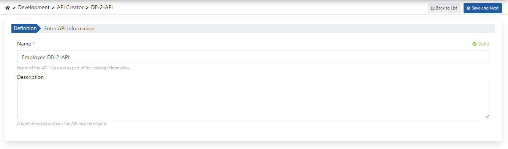
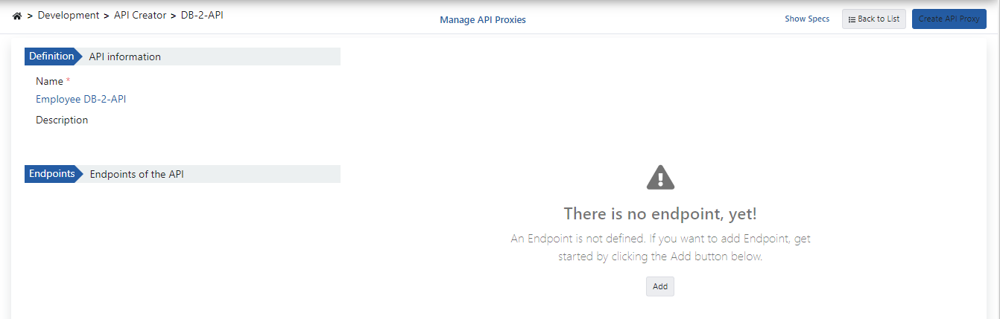
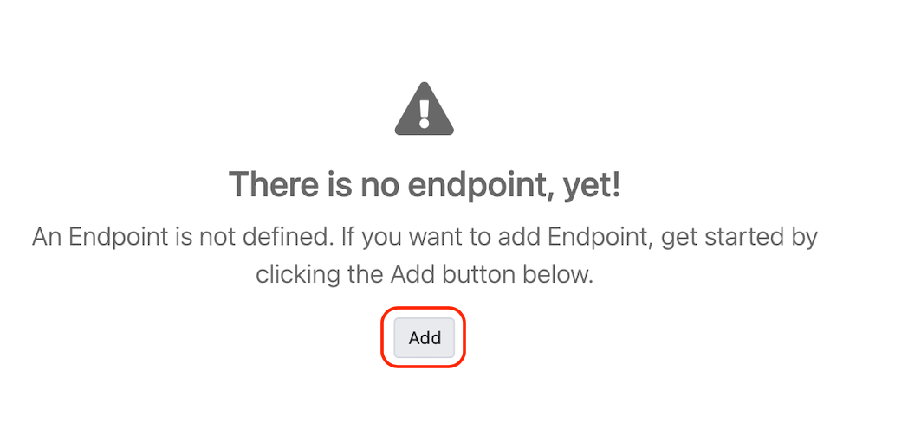
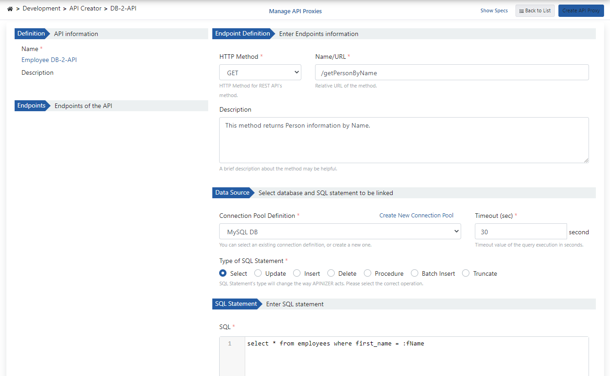
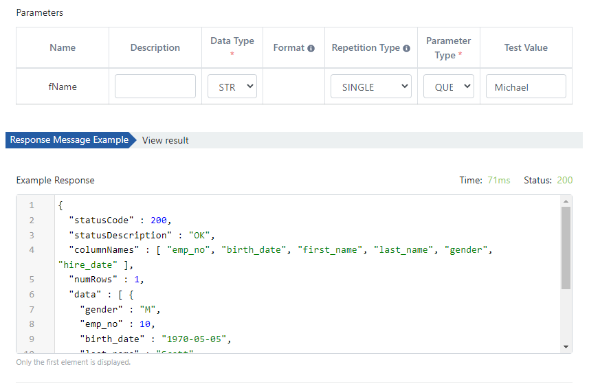
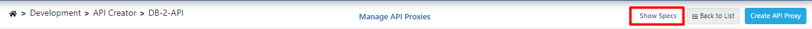
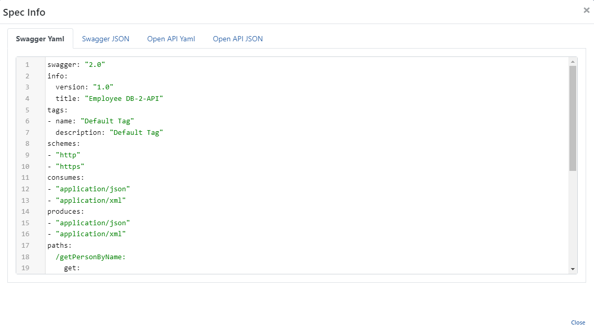
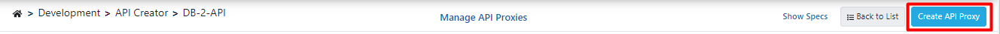
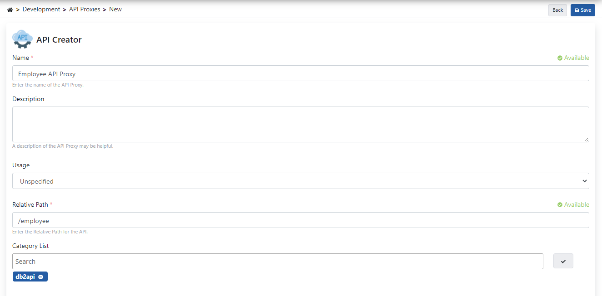
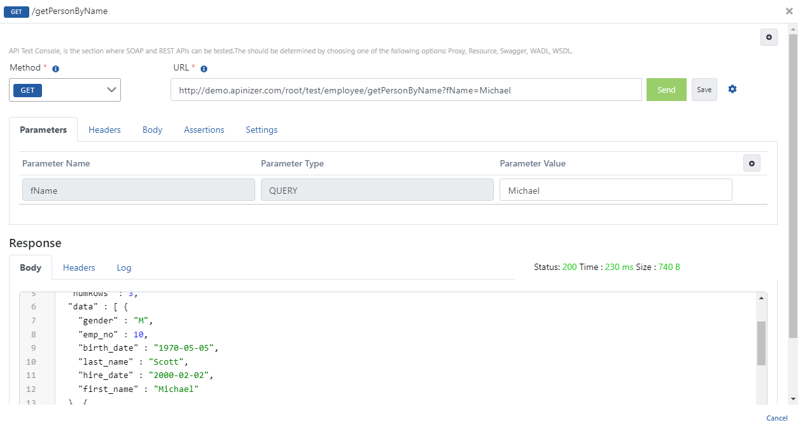

DB-2-API oluşturmak hakkında daha fazla bilgi almak için [tıklayınız](/tr/develop/api-proxy-olusturma/api-creator-db-api-olusturma).

## 1. DB-2-API Oluşturma

Çalışan kayıtlarının yönetildiği bir API Proxy oluşturulmak istenmektedir.

DB-2-API'nin ad ve açıklama alanları doldurulup **Devam Et** butonuna tıklanır. **Gözden geçir** adımında bilgiler kontrol edilip **DB-2-API Oluştur** butonuna tıklanır.

**DB-2-API ayarlarını içeren görsele aşağıda yer verilmiştir:**

  

DB-2-API oluşturulduğunda sol panelde API bilgileri görünür. Henüz endpoint tanımlanmadıysa sağ tarafta boş durum mesajı yer alır.

  

## 2. Endpoint Oluşturma

**+ Add endpoint** butonuna tıklayarak endpoint oluşturma paneli açılır.

  

**Metot oluşturma ayarlarını içeren görsele aşağıda yer verilmiştir:**

  

**Test sonucu dönen mesajı içeren görsele aşağıda yer verilmiştir:**

  

## 3. API Tanım Belgelerini Görüntüleme

Employee Db-2-API'ye ait API tanım dosyalarına erişmek için **Spec'leri Göster (Show Specs)** linkine tıklanır.

  

**Spec Bilgisi diyaloğunu içeren görsele aşağıda yer verilmiştir:**

  

## 4. API Proxy Oluşturma

DB-2-API ekranının sağ üstündeki **⋯** menüsünden **API Proxy → API Proxy Oluştur (Create API Proxy)** seçeneğiyle API Proxy oluşturulabilir.

  

API Proxy'i oluştururken aşağıdaki görseldeki alanlar doldurulur ve **Create and deploy (Oluştur ve yükle)** butonuna tıklanır.

  

## 5. Test Etme

**"getPersonByName" metoduna** ilgili parametre de verilerek istek gönderildiğinde aşağıdaki yanıt dönmektedir.

  
