Bu dokümanda API Portal menüsüne nasıl erişilebileceği ve **API Portal'**de görüntülenecek olan **API Proxy** ve **API Proxy Group'ları** nasıl **API Product** olarak tanımlayabileceğiniz adım adım açıklanacaktır.

:::tip
Alan ve sekme referansı: [API Ürünü](/tr/api-portal/api-urunu). Paketleme envanteri: [API Katalog](/tr/api-portal/api-katalog). Destek / Prod Promote ayarları: [API Portal Ayarları](/tr/api-portal/api-portal-ayarlari).
:::

## Portal Menüsüne ve API Product Tanımlama Ekranına Erişim

**Apinizer API Portal** ile **API/Web Servisler** merkezi bir yerden vitrin haline getirip **API** Kullanıcılarının kullanımına sunabilir, plan tanımlamalarınıza özel **quota** veya **throttling** politikalarıyla kullanıcıların sahip oldukları plana göre API tüketimini yönetebilirsiniz.

Bir **API Proxy**'i API Portal üzerinden yayınlamak için **API Product** tanımlaması yapılması gerekmektedir.

**Administration** (Yönetim) modunda **Portal** menüsüne yalnızca uygun yetkilerle erişilir.

  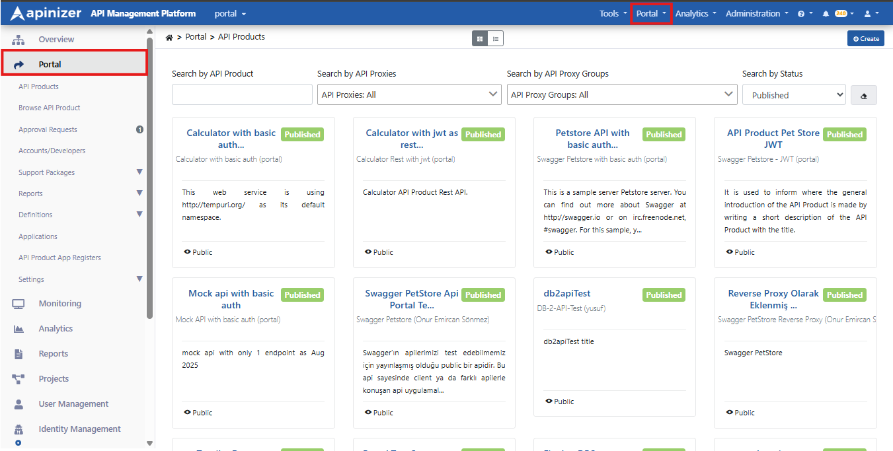

**Administration → Portal → API Products** yolunu izleyin. Sağ üstteki **+ New API Product** düğmesine tıklayarak **New API Product** sihirbazını başlatın.

:::warning

Burada seçeceğiniz **API Proxy** / **API Proxy Group**'un bir güvenlik politikası ile korunuyor olmasını, güvenlik politikası bulunmayan **API Proxy** / **Proxy Group'un** Portal kullanımına güvenlik sebebiyle açılmamasını tavsiye ediyoruz.

:::

:::note

Burada seçilen aktif kullandığınız **API Proxy** / **API Proxy Group**'u direk yayınlamamanızı, farklı bir projede ilgili **API Proxy** / **API Proxy Group**'un bir replikasını API Portal üzerinde yayınlanmanızı tavsiye etmekteyiz.
Bu sayede bu API product'ınıza gelecek trafiği diğerinden yalıtarak, daha kontrollü bir ortam oluşturabilirsiniz.

:::

**API Product** tanımlamaya başlamadan önce **API Product** tanımlı **API Product**'ları yönetmeyi kolaylaştıran **Category** ve **Responsible Unit** tanımlamaları yaparak onların da kullanımını görmek gerekir:

## Responsible Unit / Category Tanımlama

**Administration → Portal → Definitions** altından **Responsible Units** ve **Categories** ile birimleri ve kategorileri oluşturabilir, görüntüleyebilir ve düzenleyebilirsiniz.

### Responsible Unit Tanımlama

**Responsible Unit**, **API Product**'lardan sorumlu birimi temsil eder. **Administration → Portal → Definitions → Responsible Units** sayfasında mevcut birimleri görüntüleyebilir, güncelleyebilir veya yenisini ekleyebilirsiniz.

  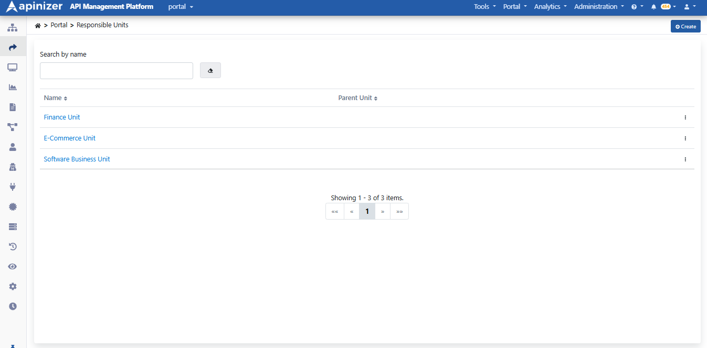

Yeni birim için **+ Create** ile formu açın; alanları doldurup **Save and Deploy** ile kaydedin.

  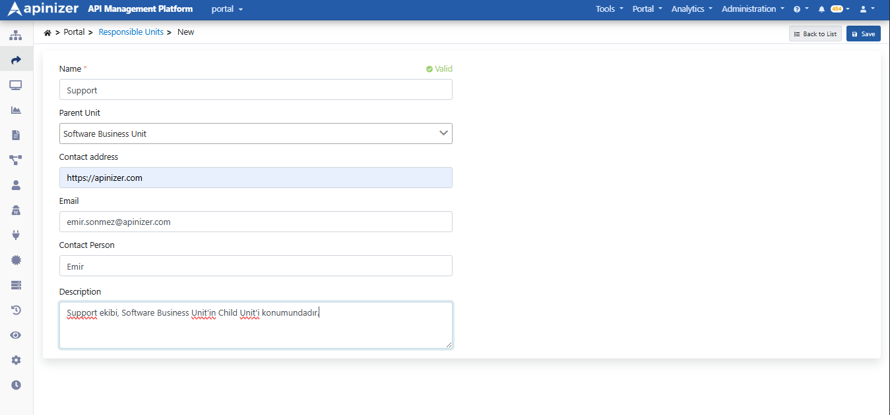

:::note

**Parent Unit**, ilgili **Responsible Unit**'in bağlı olduğu birimi referans gösterir. Alt–üst birim ilişkisi kurmanız; listede hiyerarşiyi görmenizi kolaylaştırır.

:::

### Category Tanımlama

**Category**, **API Product**'ları gruplayarak Developer Portal’da kategoriye göre filtrelemeyi sağlar. **Administration → Portal → Definitions → Categories** sayfasında kategorileri yönetebilirsiniz.

  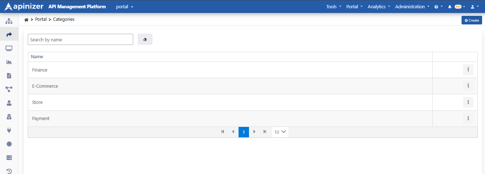

**+ Create** ile **Create or edit a Category** penceresini açın; **Name (tr)** alanını doldurup **Save** ile kaydedin.

  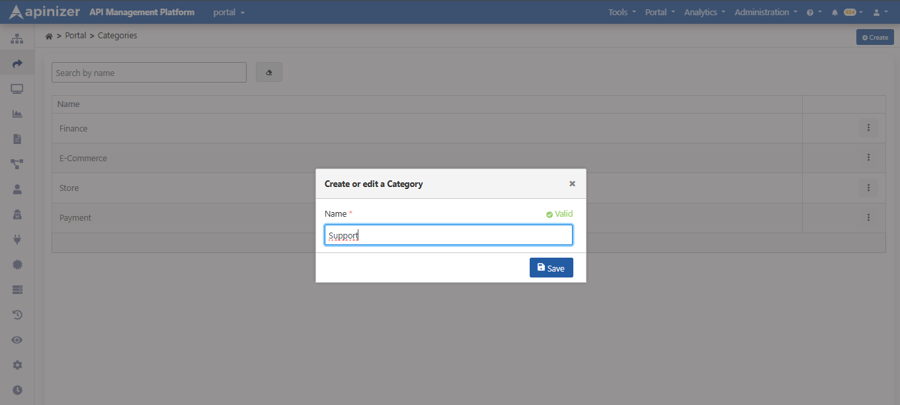

## API Product Tanımlama Ve Tanımlanan API Product'ın API Portal Üzerinde Yayınlanması

**Administration → Portal → API Products** listesinde **+ New API Product** ile sihirbaz açılır. Sihirbaz sırası:

1. **General** — ad, açıklama, kategori, Responsible Unit  
2. **APIs** — Catalog’dan paketlenecek proxy / proxy group seçimi  
3. **API Spec** — ürüne ait OpenAPI (JSON/YAML) yükleme  
4. **Plans** — kota, rate limit, onay ve fiyatlandırma  
5. **Environment** — gateway ortamı  
6. **Summary** — özet ve **Complete**

:::note

Alan ve sekme ayrıntıları: **[API Ürünü](/tr/api-portal/api-urunu)**. Paketleme envanteri: **[API Katalog](/tr/api-portal/api-katalog)**.

:::

### 1) General

**Name (tr)**, açıklama, **Categories** ve **Responsible Unit** alanlarını doldurun. Zorunlu alanlar tamamlanmadan **Save and continue →** aktif olmaz.

  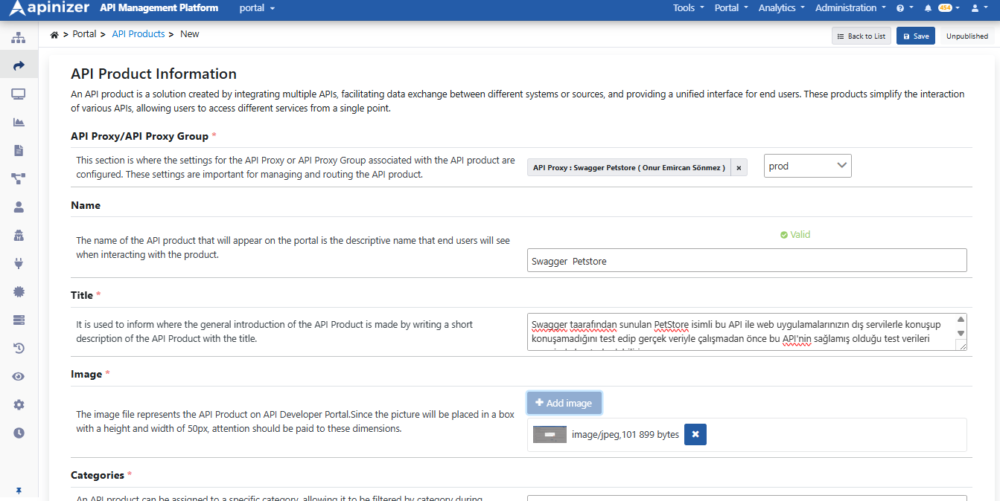

### 2) APIs

Katalog listesinden en az bir proxy veya proxy group seçin (**Project**, **Packaging Status** filtrelerini kullanabilirsiniz). Aynı proxy birden fazla üründe yer alabilir.

  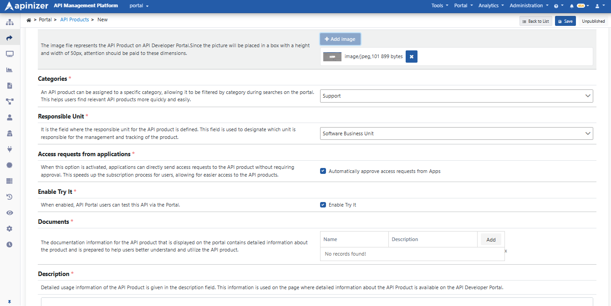

### 3) API Spec

Ürün birden fazla proxy içerebildiği için referans doküman tek proxy swagger’ından türetilmez; **Select file** ile ürüne OpenAPI dosyası (.yaml / .json) yüklenir.

  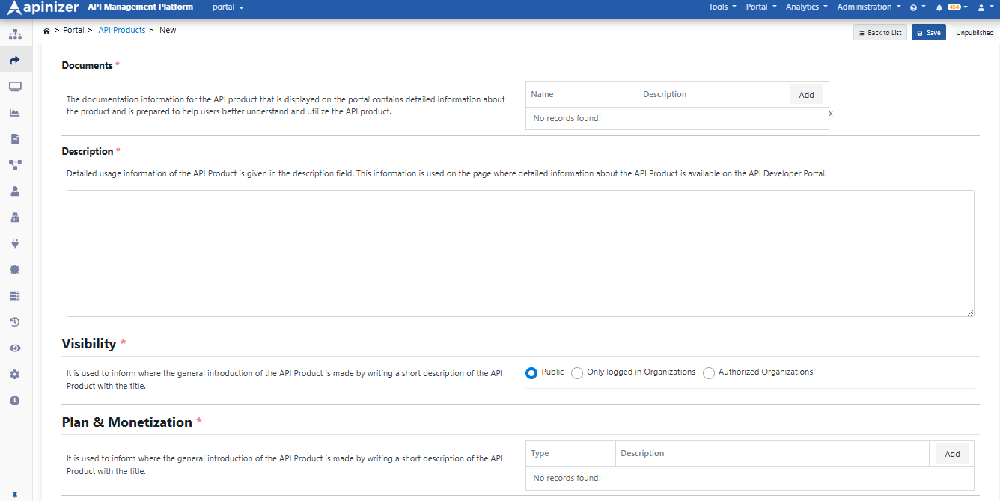

### 4) Plans

Tüketici abonelikte **tek plan** seçer. En az bir plan tanımlamanız gerekir. **+ Add plan** ile plan ekleyin; plan yokken *No plans yet — add at least one to create the product* uyarısı görünür.

  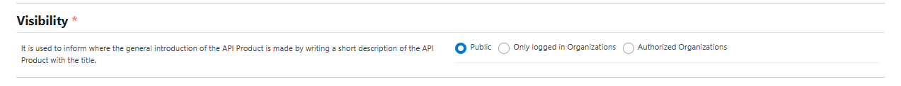

Plan fiyatlandırma tipleri:

* **Free** — ücretsiz  
* **Flat rate** — sabit ücret  
* **Metered** — kullanım bazlı  
* **Tiered** — kademeli  

**Edit Plan** penceresinde **Approval Type**, **Throttling**, **Quota**, fiyatlandırma tipi ve kota aşımında **Block (429)** / **Continue** seçeneklerini ayarlayıp **Save changes** ile kaydedin.

  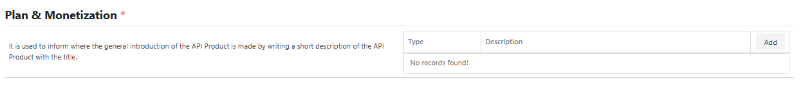

### 5) Environment

Portal erişim URL’si, Try It ve abonelik limitlerinin uygulanacağı gateway ortamını seçin.

  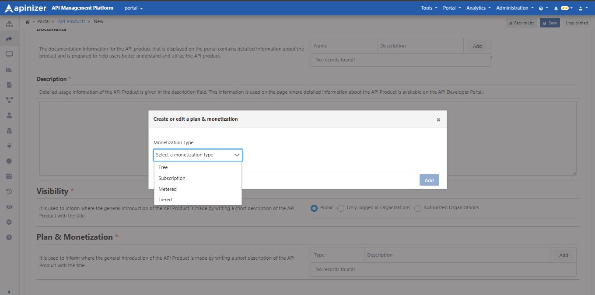

### 6) Summary ve Complete

**Summary** adımında General, APIs, API Spec, Environment ve Plans özetini kontrol edin; gerekirse sol adımlardan geri dönün. **Complete** ile ürünü oluşturun. Ürün **Unpublished** olarak kaydedilir.

  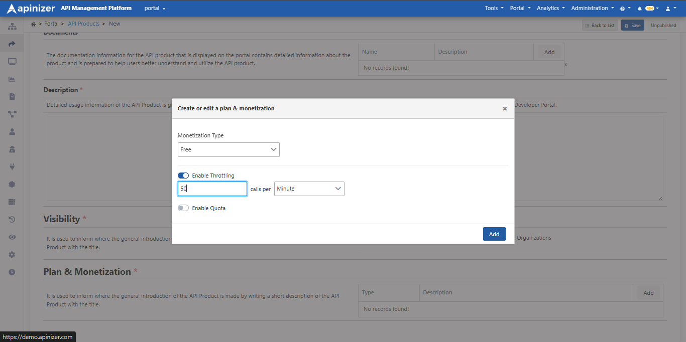

  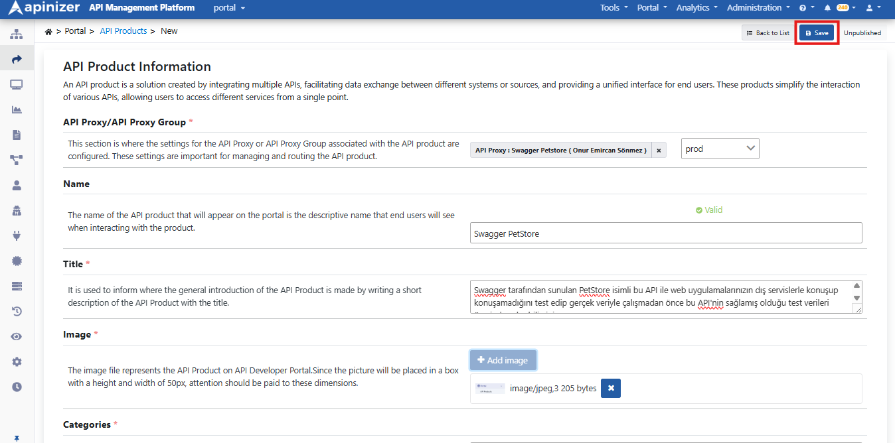

:::note

**Visibility** (Public / Only logged in Organizations / Authorized Organizations) create sonrası ürün detayındaki **Visibility** sekmesinden ayarlanır; keşfedilebilirliği belirler, abonelik onayı planlardadır. Ayrıntı: **[API Ürünü](/tr/api-portal/api-urunu)**.

:::

Ürün detayında **Unpublished** durumunu ve planları (**Plans** sekmesi) kontrol edin. Bağlı proxy tüketiciyi tanımıyorsa sarı uyarı görünebilir; ayrıntı **Security** sekmesindedir.

Yayınlamak için sağ üstteki **Unpublished** düğmesine tıklayın. Güvenlik uyarıları varsa **Publish with security warnings?** penceresinde uyarıları okuyup **Publish** ile onaylayın.

  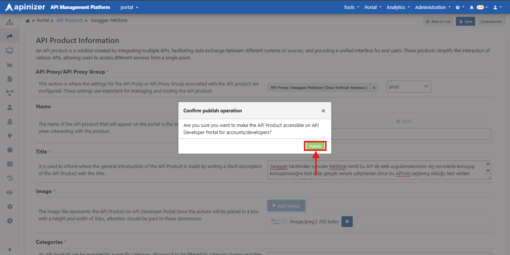

Yayın sonrası **Administration → Portal → API Products** listesinde ürün **Published** rozetiyle görünür.

  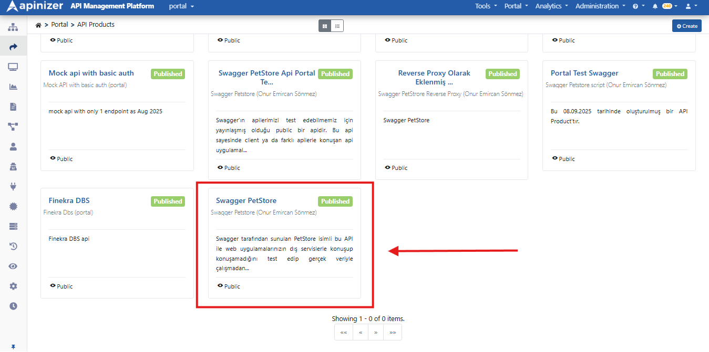

## Sonraki adımlar

* Abonelik onayları: [Onay İstekleri](/tr/api-portal/onay-istekleri) / API Product App Registers
* Canlı kullanım: [Trafik ve Kullanım](/tr/api-portal/trafik-ve-kullanim)
* Destek / Promote özelliklerini açmak: [API Portal Ayarları](/tr/api-portal/api-portal-ayarlari) (**Destek**, **Prod Promote**)

