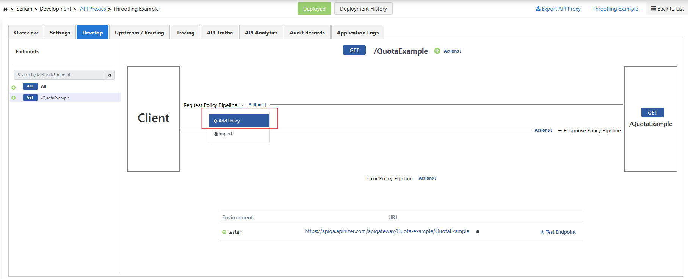
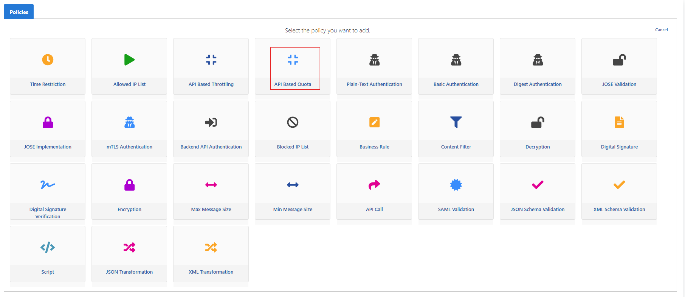
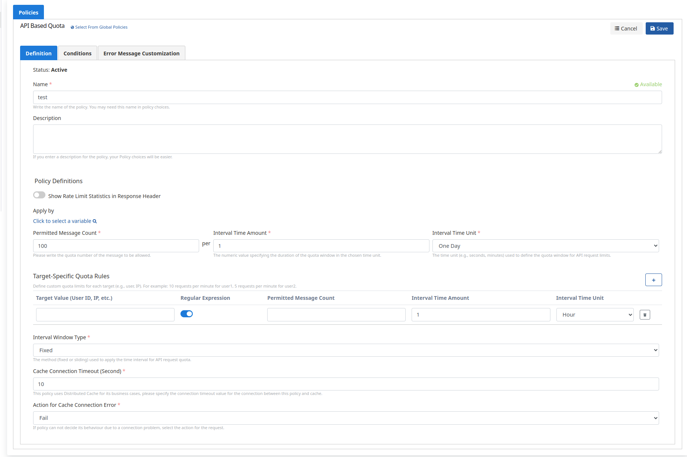
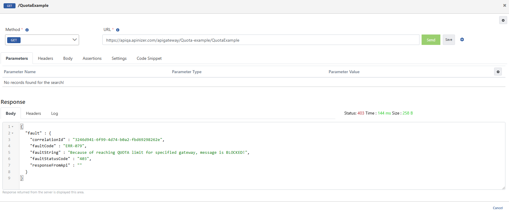
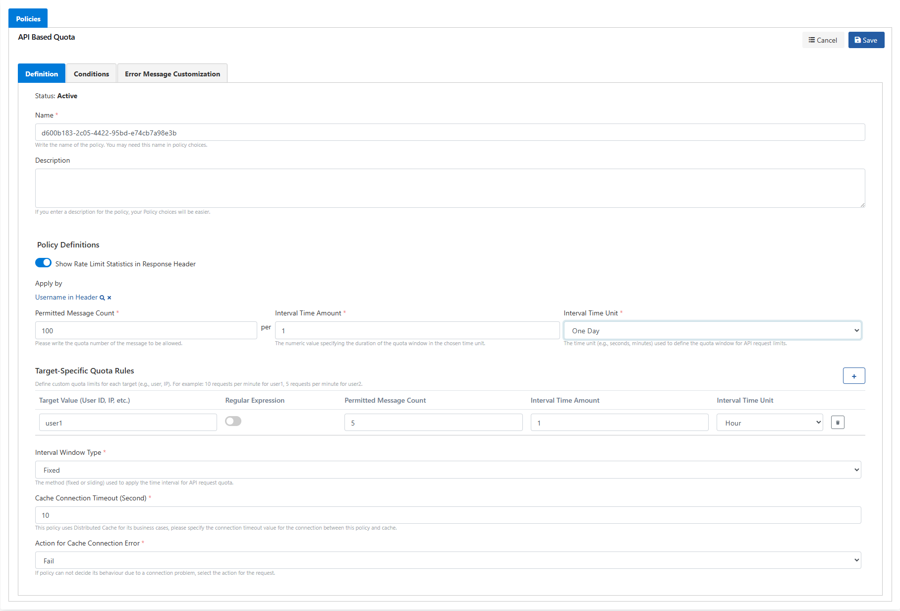
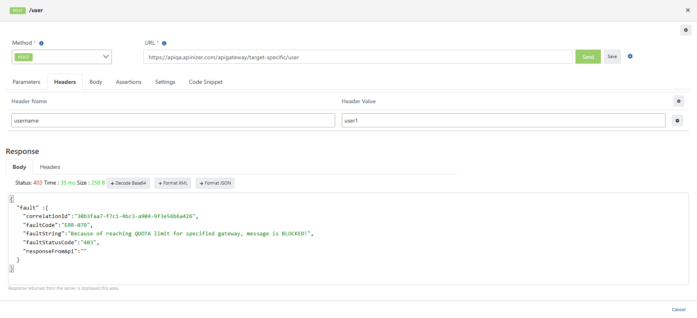

Bu senaryoda **Swagger Petstore** API Proxy'sine **API Based Quota** politikasının uygulanması test edilecektir.

Quota politikası, belirli bir zaman diliminde yapılabilecek toplam istek sayısını sınırlar. Bu politika, genellikle daha uzun dönemli kullanım kontrolü sağlamak için kullanılır (**örneğin**, **bir gün veya bir ay içinde belirli bir kullanıcıya 1000 istek izni vermek**).

Senaryoda, gelen istekleri 1 günlük zaman diliminde 100 istek ile sınırlayacağız.

**Development → API Proxies → Swagger Petstore** yolunu izleyin. **Develop** sekmesinde bir uç nokta seçin (ör. **ALL**). **Request** hattında **Actions → Add Policy** ile politika ekleyin.

**Access Control & Limiting** bölümünden **API Based Quota** politikasını seçin.

Senaryoda, gelen istekleri **Fixed Window** (Sabit Pencere) yöntemiyle **1 gün için 100 istekle** sınırlayalım.

- Eğer periyot 1 olarak ayarlanmışsa ve gün seçilmişse:
- Örneğin, politika saat 12:00:00'de kaydedildiyse, bu politika bulunduğunuz gün içinde saat **00:00:00** ile **23:59:59** arasında geçerli olacaktır.
- Ertesi gün saat **00:00:00'da** yeni bir pencere başlar ve sayaç sıfırlanır.

**Definition** sekmesinde **Permitted Message Count**, **Interval Time Amount**, **Interval Time Unit** ve **Interval Window Type: Fixed** alanlarını doldurup **Save** ile kaydedin.

| Alan | Açıklama |
| --- | --- |
| Show Limits in Response Header | Açıksa kalan kota bilgisi yanıt başlığında gösterilir. |
| Permitted Message Count | İzin verilen istek sayısıdır. Bu senaryoda 100 olarak belirledik. |
| Interval Time Amount | Seçilen zaman birimine göre belirlenen periyottur. Bu senaryoda 1 olarak belirledik. |
| Interval Time Unit | Zaman birimi. Bu senaryoda gün olarak belirledik. |
| Target-Specific Quota Rules | Her hedef için özel kota sınırları tanımlanır (ikinci bölüm). |
| Interval Window Type | Zaman aralığını uygulamak için kullanılan yöntem. Fixed türünde 1 günlük zaman periyotları. |
| Counting Mode | Sayıma dahil edilen istekler (ör. **All requests**). |
| Cache Connection Timeout (Second) | Politika ile cache arasındaki bağlantı için bağlantı zaman aşımı değerini belirtin. |
| Action for Cache Connection Error | Cache ile bağlantı problemi yaşanırsa, hata döndürmesi (Fail seçilir) veya istek kısıtı uygulanmadan devam etmesi (Continue seçilir) durumu belirlenir. |

Proxy'yi **Deploy** edin. **Develop** ekranının altındaki **Test Endpoint** ile istek gönderin. Kota sınırına ulaşıldığında yanıtta kota engeli (ör. `ERR-079`, QUOTA limit) görülür.

## Target-Specific Quota Rules (Hedefe Özel Kota Kuralları)

Bu özellik sayesinde belirli kullanıcılar veya hedefler için özel kota sınırlamaları tanımlayabilirsiniz.

Yine **Request** hattında **Add Policy → API Based Quota** ile politika ekleyin (veya mevcut politikayı düzenleyin).

- **Target-Specific Quota Rules** ile header, body veya başka bir alana göre özel kota tanımlanır. Genel kural: **Fixed Window** ile **1 gün / 100 istek**; **Apply by** alanında örneğin **Username in Header** seçilir.
- **user1** için hedef kural: **1 saat / 1 istek** (görseldeki örnek).
- Fixed Window’da gün seçiliyse genel sayaç günün **00:00:00–23:59:59** aralığında çalışır; hedef kural saatlik pencerede (**00:00:00–00:59:59** vb.) ayrı sayılır.

**Test Endpoint**'te **Headers** sekmesine `username: user1` ekleyerek istek gönderin. Limit aşıldığında istek engellenir; limit içindeyken başarılı yanıt alınır.

