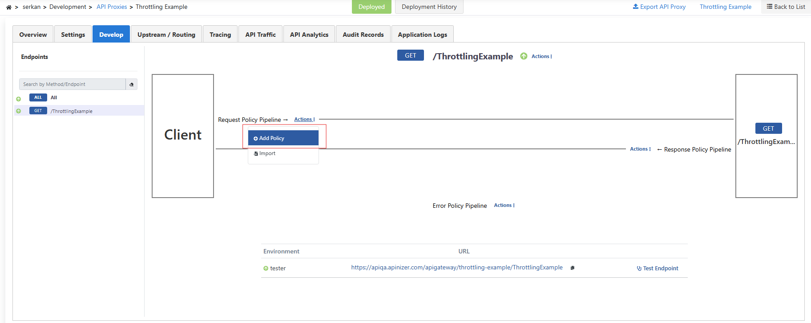
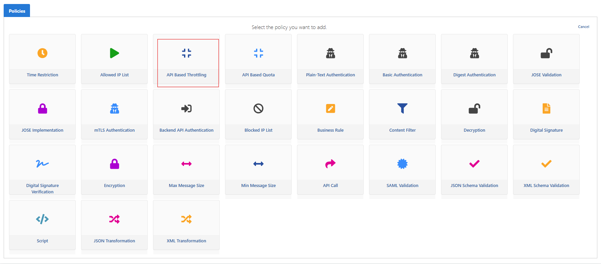
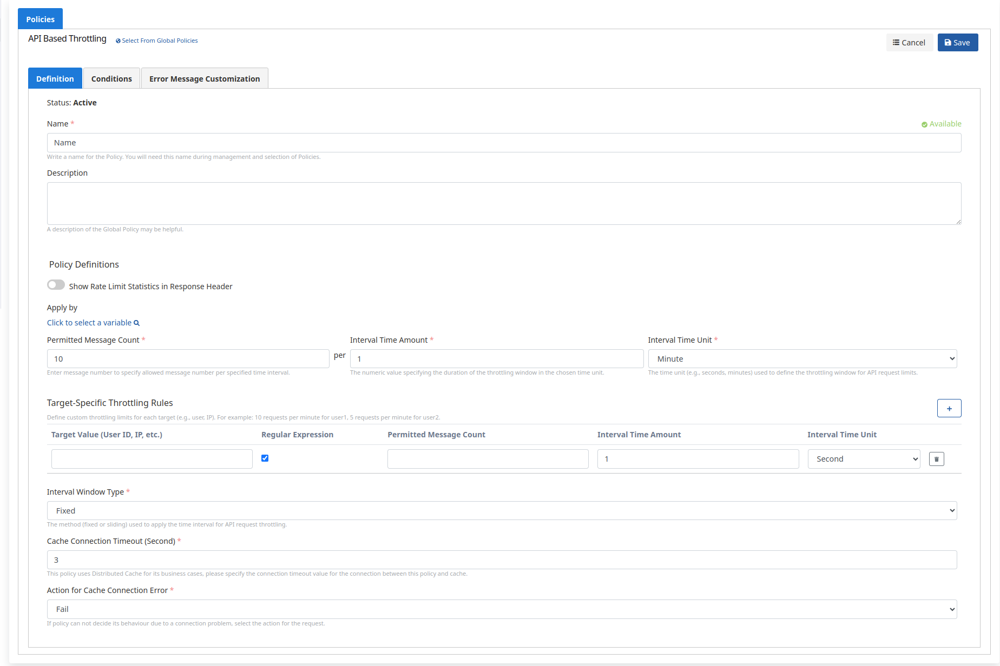
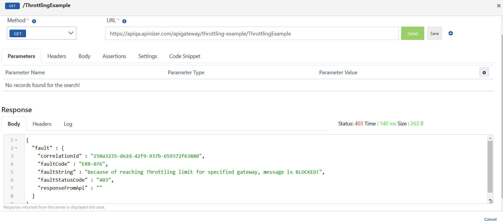
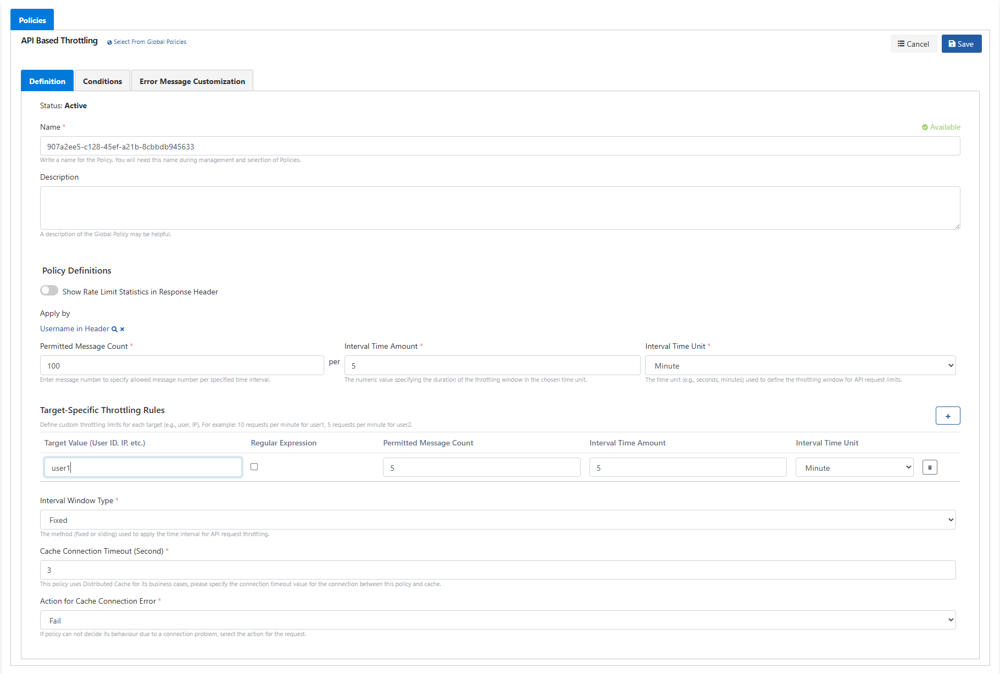
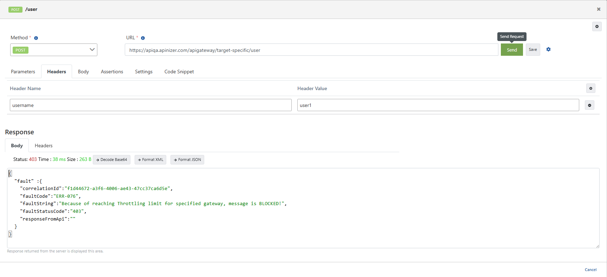

Bu senaryoda **Swagger Petstore** API Proxy'sine **API Based Throttling** politikasının uygulanması test edilecektir.

Servisler için **throttling** kullanmak aşırı yüklenmeyi önleyerek istek miktarını sınırlama yöntemidir.

İlk örnekte gelen istekleri **Fixed Window** ile **1 dakikada 10 istek** ile sınırlayacağız.

**Development → API Proxies → Swagger Petstore** yolunu izleyin. **Develop** sekmesinde bir uç nokta seçin (ör. **ALL**). **Request** hattında **Actions → Add Policy** ile politika ekleyin.

**Access Control & Limiting** bölümünden **API Based Throttling** politikasını seçin.

**Definition** sekmesinde **Permitted Message Count: 10**, **Interval Time Amount: 1**, **Interval Time Unit: Minute** ve **Interval Window Type: Fixed** değerlerini ayarlayıp **Save** ile kaydedin.

- Periyot 1 dakika ve **Fixed** ise, pencere kayıt anından itibaren **1 dakikalık** dilimler halinde ilerler (ör. **12:00:00–12:00:59**).
- Yeni pencerede sayaç sıfırlanır.

| Alan | Açıklama |
| --- | --- |
| Show Limits in Response Header | Açıksa limit bilgisi yanıt başlığında gösterilir. |
| Permitted Message Count | İzin verilen istek sayısıdır. Bu örnekte 10. |
| Interval Time Amount | Periyot uzunluğu. Bu örnekte 1. |
| Interval Time Unit | Zaman birimi. Bu örnekte **Minute**. |
| Target-Specific Throttling Rules | Hedefe özel kurallar (ikinci bölüm). |
| Interval Window Type | **Fixed** — sabit pencere. |
| Counting Mode | Sayıma dahil edilen istekler (ör. **All requests**). |
| Cache Connection Timeout (Second) | Politika ile cache arasındaki bağlantı zaman aşımı. |
| Action for Cache Connection Error | Cache hatasında **Fail** veya **Continue**. |

Proxy'yi **Redeploy** / **Deploy** edin. **Test Endpoint** ile örnek istek gönderin. Limit aşıldığında throttling engeli görülür; limit içindeyken başarılı yanıt alınır.

## Target-Specific Throttling Rules (Hedefe Özel Throttling Kuralları)

Belirli kullanıcılar veya hedefler için özel throttling tanımlayabilirsiniz.

**Request** hattında tekrar **Add Policy → API Based Throttling** seçin (veya politikayı düzenleyin).

- Genel kural: **Fixed Window**, **5 dakikada 100 istek** (**Permitted Message Count: 100**, **Interval Time Amount: 5**, **Minute**).
- **Apply by** alanında örneğin header’daki kullanıcı adı seçilir.
- **Target-Specific Throttling Rules**: **user1** için **5 dakikada 5 istek** (görseldeki örnek).
- **user1** için pencere **12:00:00–12:04:59** gibi 5 dakikalık dilimlerde sayılır; **12:05:00**’da sayaç sıfırlanır.

**Test Endpoint**'te **Headers** sekmesine `username: user1` ekleyin; path parametrelerini (ör. `petId`) doldurup istek gönderin. Limit aşıldığında istek engellenir.

