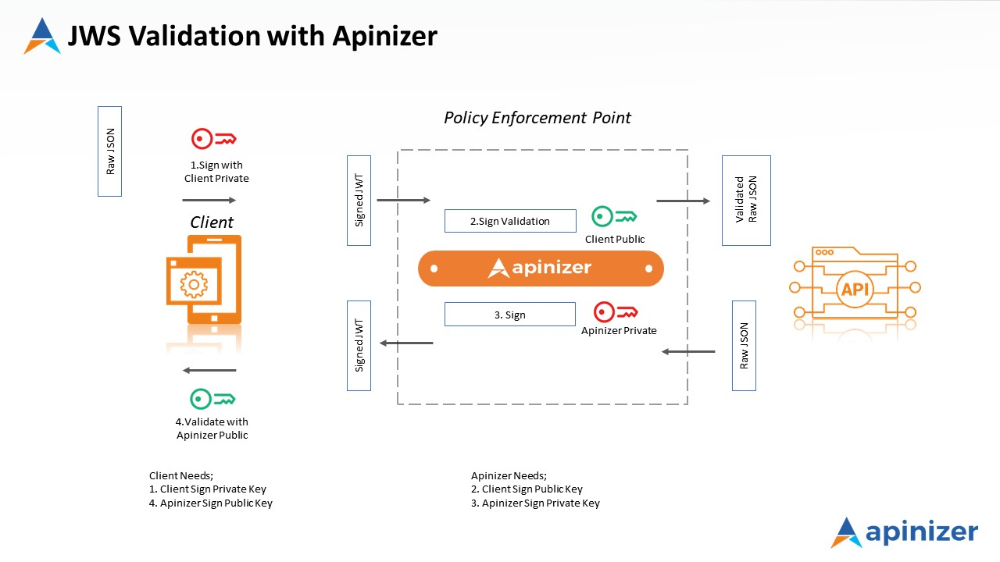
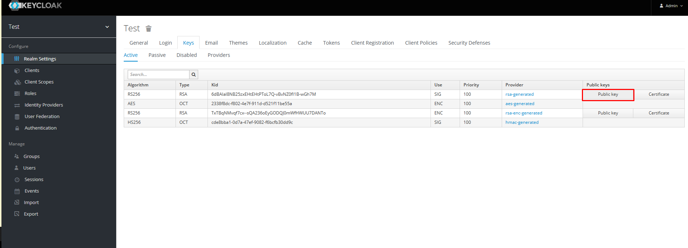
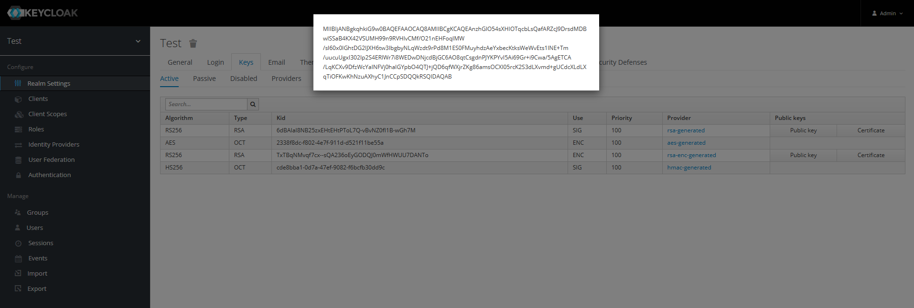
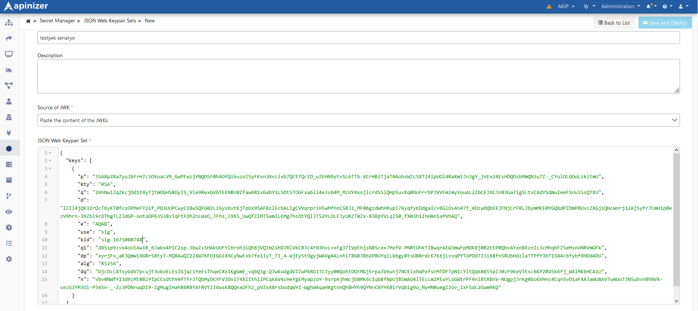
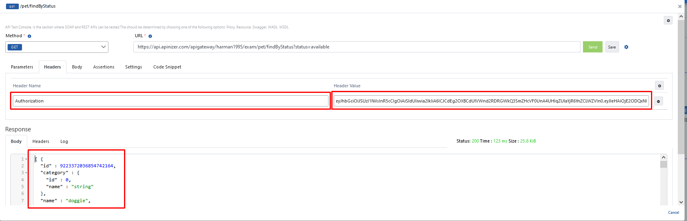

Bu senaryoda **Swagger PetStore** isimli **REST** mimaride oluşturulmuş bir **API'ye** gönderilen JWT'nin **JOSE Validation** poliçesi ile kontrol edilmesi anlatılacaktır.

Aşağıdaki görselde bir isteğe uygulanacak olan JOSE Validation iş akışı yer almaktadır.

## 1) API Proxy'nin Oluşturulması

Bu senaryoda [Swagger Petstore](https://petstore.swagger.io) OpenAPI spesifikasyonu kullanılacaktır.

**Development → API Proxies** sayfasına gidin. Sağ üstten **+ Add API Proxy** ile yeni proxy oluşturmayı başlatın.

**Swagger 2.x/OpenAPI** şablonunu seçin, **Enter URL** ile spec adresi giriş ekranına geçin.

**URL** alanına `https://petstore.swagger.io/v2/swagger.json` yazıp **Parse** ile spec'i yükleyin. **Name**, routing adresleri ve diğer alanları onaylayıp **Save** ile kaydedin. Ayrıntılar için [API Proxy Oluşturma](/tr/develop/api-proxy-olusturma).

Kayıttan sonra proxy'de **Develop** sekmesine geçin. Endpoint listesinde **ALL** satırı ile **JOSE Validation** poliçesini tüm metodlara; tek bir metoda uygulayacaksanız ilgili satırı seçerek ekleyebilirsiniz.

JOSE Validation'da **imza doğrulamasını** yapabilmek için **JSON Web Keypair Sets** tanımlanması gerekir.

## 2) JSON Web Keypair Sets

Sol menüden **Secret** sayfasına gidin.

**JSON Web Keypair Sets** sekmesini açın. Sağ üstten **+ Create** ile yeni kayıt oluşturun.

Bu doküman içerisinde JSON Web Keypair Sets'in Apinizer ile veya Keycloak (3. parti) ile üretilmesi anlatılır.

### 2.1) Apinizer üzerinden JWK üretilmesi

**General** sekmesinde **Name** alanına tanımlayıcı bir ad girin. **Source of JWK** olarak **Generate JWK** seçin; **Key Type**, **Key Use**, **Algorithm** ve **Key Size** değerlerini gereksiniminize göre belirleyip **Generate** ile anahtar çiftini oluşturun.

**Generate** sonrası oluşan **Public Key** / **Public Key Set** doğrulama için kullanılır.

**Save and Deploy** ile kaydedin.

### 2.2) Keycloak üzerinden JWK üretilmesi

Keycloak üzerinden **Realm Settings → Keys** menüsünden **Public key** alanına basılarak public key alınır.

Public key, 3. parti bir araçla JWK'ya dönüştürülmelidir. Örnek: [https://russelldavies.github.io/jwk-creator/](https://russelldavies.github.io/jwk-creator/)

JWK'ya dönüştürülen public key'i Apinizer'a kaydetmek için:

- **Secret → JSON Web Keypair Sets** sekmesine gidin.
- **Paste the content of the JWT** (veya ilgili yapıştırma seçeneği) ile JWK içeriğini girin.
- **Key id** alanına Keycloak'taki **Kid** değerini yazın ve **Save and Deploy** ile kaydedin.

## 3) JOSE Validation poliçesinin eklenmesi

**Swagger Petstore** proxy'sinde **Develop** sekmesine gidin. **ALL** (veya ilgili endpoint) için **Request → Actions → Add Policy** seçin. **Security and Authentication** bölümünden **JOSE Validation** poliçesini seçin.

**Definition** sekmesinde doğrulama hedefi ve istemci tanımını yapılandırın (örnek ekran: **Authorization Header**, **JWT Payload**, claim **`iss`**).

**JWS Validation Settings** bölümünde **Validate Sign** açık olsun; **JWK for Validation** alanından 2. adımda kaydettiğiniz seti listeden seçin. **Validate Expiration Time** ihtiyaca göre açılabilir.

DPoP, replay koruması, ACL ve cache hata davranışı gibi ek alanlar aşağıdaki ekranda yapılandırılır. Yalnızca Bearer JWT doğrulaması yapacaksanız **DPoP Validation** kapalı bırakılabilir.

Alan açıklamaları için [JWKS Yapılandırması](/tr/admin/secrets-management/jwks-yapilandirma) sayfasına bakabilirsiniz.

Değişiklikleri **Save** ile kaydedin; proxy'yi **Deploy** / **Redeploy** edin.

## 4) API Proxy'nin test edilmesi

**Swagger Petstore** proxy'sinde **Develop** sekmesine gidin. Örnek olarak **`GET /pet/findByStatus`** endpoint'ini seçin, **Test Endpoint** ile konsolu açın. Aynı örnek üzerinden **`status`** sorgu parametresine **pending** değerini girin. İlk **Send**'de **Authorization** header olmadan istek atıldığında hata beklenir.

**Headers** sekmesine **Authorization** header'ı ekleyin; Keycloak veya Apinizer üzerinden üretilmiş geçerli JWT değerini kullanın. **Send** ile başarılı yanıt alınmalıdır.

Geçersiz veya süresi dolmuş token kullanıldığında yine hata döner.
